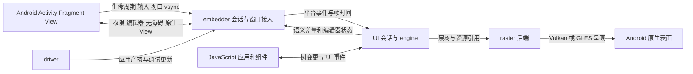

# Impasto Android 框架能力建设方案

Impasto 的 Android 目标是让独立应用完成开发、嵌入、分发和长期运行。应用应能恢复用户任务，使用原生输入法和无障碍服务，接入原生控件和媒体，并在声明支持的设备上稳定呈现。能力对齐以可运行场景、公开接口和发布测试为准。Android 是首个完整交付平台，影响会话、UI 和绘制的通用契约须用 macOS 宿主和无窗口测试一起验证。

当前 Android 路径支持异步准备独立会话、Activity 和 Fragment 接入、单个会话迁移到新窗口，以及 Vulkan 和 GLES 绘制。Gradle 可打包 `arm64-v8a` 和 `x86_64`，CLI 可构建 APK、AAB 和包含应用产物的 AAR。验收应用使用框架提供的任务快照保存导航、滚动位置和小型表单状态，手动保存的草稿仍由应用持久化。Android 支持共享应用状态的并行窗口、矩形裁剪的原生 View 覆盖层，以及由 CPU 上传的媒体纹理。Pixel 9 的历史 120 Hz 回放中，日 K 提交帧 CPU 耗时 P95 为 47.65 ms，实时行情纵向滚动的实际呈现间隔 P95 为 16.68 ms。每个显示周期约 8.33 ms。 [当前宿主实现与历史性能基线](../platform-hosts.md) · [验收应用](../../apps/android-acceptance/README.md)

Android embedder 和 Impeller 的源码对照基线为 `build/impeller-source/flutter` 中的 `77f043bc63196b9979cc09c5b97bb6d9b00be34d`。各阶段同时核对 Android embedder 的系统交互、Flutter 框架的消费行为和对应测试。运行时性能对照使用单独的 Flutter 行情参考，其构建产物记录 Flutter SDK 版本。 [Flutter 与 Impasto 职责对照](../platform-hosts.md#与-flutter-的职责对照) · [Flutter 行情参考](../../tools/android-flutter-reference/README.md)

## 当前进度

| 阶段 | 已验证的交付 | 待验收范围 |
|---|---|---|
| 0 · 回归基线 | Gallery 启动异常的无窗口重现与修复。Android CI 入口。Pixel 9 的 60/120 Hz Gallery 回放各三轮，Flutter 参考各有初次一轮及补采两轮。 | 当前改动的 CI 远端运行、对齐参考的输入配对、启动和恢复绝对定标。 |
| 1 · 会话与宿主 | 可取消的异步启动、首帧提交和 View 生命周期。全屏 Activity、原生 Fragment 与同 Activity 多独立会话。Pixel 9 上 Vulkan 和 GLES 均通过保留会话并迁移到另一个窗口的测试。 | 跨 Activity、外接显示器和长时间反复迁移。 |
| 2 · 渲染与恢复 | Vulkan 和 GLES 的真机旋转与前后台测试。设备丢失后重用层树的无窗口故障测试。Pixel 9 验证 standalone Vulkan 关闭修复。 | 更新 CI 验证的 SDK 归档，覆盖更多 GPU、真机设备丢失和 x86_64 运行验收。 |
| 3 · 视口与性能 | 窗口指标包含逻辑尺寸、像素尺寸、安全区、IME、手势区、屏幕 ID、刷新率和显示特征。16 KB 折叠模拟器观察到平展、半展开和无折叠特征。Pixel 9 验证同一进程从 60 Hz 切到 120 Hz。修复 GLES 的 Canvas 轨迹绘制后需重新采集呈现性能。 | 90 Hz、折叠真机、分屏和外接显示器。输入到实际呈现的 P95 仍超过门槛，详情行情及双后端需继续量测。 |
| 4 · 输入与无障碍 | 虚拟编辑节点支持文本更新和 UTF-16 选区。模拟器 TalkBack 聚焦、输入和保存。密码字段发布密码语义，受遮盖路由退出无障碍树，Android 实体键删除扩展字素簇。字段可声明自动填充提示，系统填充值走文本替换协议。 | 完整输入设备矩阵、OEM 输入法、真实密码管理器端到端、富内容和 TalkBack 全流程。 |
| 5 · 导航与平台服务 | AndroidX 任务快照、返回手势的进度和取消、权限请求和文本分享。Pixel 9 验证 Activity 重建与手势事件。16 KB 模拟器验证进程回收后的路由和未手动保存的备注、拒绝相机权限和 Sharesheet。权限请求通过保留会话和恢复的 Activity Result 注册键续接，仪器测试覆盖恢复后的结果只完成一次。 | 系统权限弹窗期间真机重建、通用插件注册与结果作用域、文件分享和更广的授权回归。 |
| 6 · 原生混排与多实例 | 原生 Fragment 和独立会话接入。原生相机返回照片并在宿主中预览。单个 View 会话可迁移。Android 可为同一应用会话连接多个窗口，各自运行 UI 并显式共享状态。UI 树内的原生槽位支持矩形裁剪。媒体图元可消费由 RGBA 或 YUV 帧上传的纹理。 | 原生 View 与 raster 内容任意交错、GPU 导入和同步 fence、视频与相机连续采集、外屏与分屏，以及复用同一 JS 运行时的多 View。 |
| 7 · 开发与发布 | APK、AAB、AAR、签名、原生符号和 JavaScript 源映射。两种 ABI 的包对齐检查，16 KB 模拟器从验收调试包升级到本地签名 AAB 的 arm64 分包。Android 调试监听对纯源码变更发送应用私有更新，在会话内校验候选首帧并替换脚本环境。恢复快照随验证结果提交。资产和应用配置变更走重新安装。 | 同一脚本环境内的组件替换、断连重连的设备验收、存档升级及额外设备覆盖。 |

### 本轮回归

- Android API 35 的 arm64 16 KB 模拟器通过 23 项宿主回归。覆盖 Vulkan 与 GLES 的原生编辑框和 RGBA 帧替换、双窗口共享与独立尺寸、权限结果恢复、旋转和生命周期。启用测试自动填充服务后，单独验证系统虚拟字段的填充值进入编辑控件。测试结束恢复原服务配置。
- 本地签名的发布 AAB 用独立验收包名安装 arm64 分包，从深链打开详情。APK、AAB 和 AAR 均检查了 arm64-v8a 与 x86_64 的 ELF 对齐，APK 同时通过 ZIP 对齐检查。原生 Fragment 实测文件导入和系统相机拍照后在 UI 树中显示照片。 [验收应用](../../apps/android-acceptance/README.md)
- 从 CLI 新生成的应用实测脚本更新。候选脚本抛出异常后旧画面和草稿继续可用，修正后同一进程显示更新画面和原草稿。串行 `just check`、macOS Impeller 链接测试和 Android Gradle lint 通过。
- Pixel 9 后续通过 25 项真机前台仪器测试，包含 GLES Canvas 曲线的像素回归。主 Gallery 使用预构建 SDK 的默认 GLES 路径复验，列表轨迹恢复。实际呈现性能仍需复测，发布 SDK 以 CI 归档为准。

## 能力交付范围

| 应用需要的能力 | 首轮交付条件 |
|---|---|
| 独立运行与原生嵌入 | 生成的应用能冷启动、暖启动、恢复和发布。原生应用可把 Impasto 加到已有 Activity 或 Fragment，并可在配置变更后重新接入会话。 |
| 页面、控件与布局 | 导航栈、列表、文本、表单、弹层和过渡都能正确响应窗口变化与交互。覆盖窄屏、横屏、分屏、折叠区域、字体缩放、RTL、CJK 和减少动效。 |
| 完整输入与辅助技术 | 触屏、鼠标、触控板、手写笔、实体键盘及 IME 有可组合的事件和默认行为。TalkBack 能浏览、聚焦、激活、滚动和编辑，平台自动填充可完成登录表单。 |
| 平台服务与插件 | 应用可用深链、权限、文件选择、剪贴板、系统分享和应用设置。原生插件可声明依赖，监听宿主接入与分离，可靠完成异步操作。 |
| 光栅渲染与媒体 | Vulkan 和 GLES 都通过同一套场景语义测试。相机或视频可向框架交付外部纹理，原生 View 可参与布局、绘制、命中、焦点和无障碍遍历。 |
| 多窗口和上下文恢复 | 两个独立窗口可并行工作。应用可选择保留会话并替换窗口。系统回收进程后可重建路由、列表位置和显式保存的表单草稿。 |
| 开发、发布和排障 | CLI 能创建、运行、测试、构建 APK/AAB，交付调试更新、符号和源映射。团队可从日志和 trace 定位到会话、窗口、后端和帧阶段。 |

另建一个从 `impasto create` 生成的验收应用。用深链打开详情并恢复导航，用原生文件选择和摄像头贯穿插件、权限、纹理与应用生命周期，再用登录表单验证 IME 和无障碍。Gallery 保留市场行情、列表和 Canvas 的性能回归。插件作者通过至少一个仓库外的示例工程验证依赖、注册和嵌入说明。

## 目标架构与契约

| 所有者 | 实现边界 | 对应现有入口 |
|---|---|---|
| `driver` | 生成平台工程、编译和打包、安装、测试、符号管理及调试更新。APK、AAB 和嵌入库消费同一宿主实现。 | `crates/cli`、Gradle 模板和 `tools/` |
| `embedder` | 管理会话及窗口接入、平台事件与时钟、原生资源的所有权、原生 View 和插件。 | `crates/embedder/common`、`crates/embedder/android` 和 `crates/embedder/macos` |
| `engine` | 管理 UI 树、布局、命中、手势、快捷键、焦点、语义和层树。 | `crates/engine` |
| `raster` | 消费层树，管理绘制后端、交换链、纹理、字体与资源重建。文字测量和绘制共用排版及字体资源。 | `crates/raster` 和 `crates/impeller-sys` |
| JavaScript 与作者层 | 运行时拥有 JS、模块和标准库语义。UI 绑定送交变更并返回事件，Solid 组件和路由提供应用作者接口。 | `crates/javascript`、`engine::js`、`packages/solid-renderer`、`packages/solid-ui` 和 `packages/solid-router` |

沿用现有 crate 入口分步迁移。Android 主线程管理 View、系统回调和 Android 服务。渲染线程同步推进 UI 帧并独占 QuickJS、UI 树和当前光栅后端。后台工作线程处理 I/O 与解码，交付自有数据。具体后端对纹理上传线程的约束由后端实现保证。 [目标架构](../../AGENTS.md) · [现有渲染后端设计](../rendering-design.md)

- **会话与窗口寿命。** 会话从准备进入就绪和关闭，Activity 的可见性、View 的连接状态和表面可用性各自推进。启动允许 `SessionReady`、窗口视口和表面按不同顺序到达。只有同一次窗口接入所需数据齐备后才呈现。配置变更可交还窗口并保留会话，显式退出会结束会话。
- **事件归属。** 用会话、视图、`SurfaceId` 和接入代数定位事件。输入、IME、平台插件和帧回调在对应 owner 或代数失效后结束。尺寸和 inset 可按规则合并，生命周期和输入的开始、终止、取消保留顺序。协议先覆盖一个会话和一个窗口，再验证多实例隔离。
- **表面与资源寿命。** 表面销毁回调返回时，渲染线程已停止访问该表面。通过控制消息取消排队的呈现重试并独立完成销毁。明确区分交换链、设备、已注册的字体与可重建的 CPU 资源。 [Android 表面生命周期](https://developer.android.com/reference/android/view/SurfaceHolder.Callback#surfaceDestroyed(android.view.SurfaceHolder))
- **故障与取消。** 明确区分启动失败、脚本异常、不可用的系统能力、单次表面失效和渲染设备丢失。每种错误都有对应的恢复范围及诊断记录。同步主线程操作限制在 Android 要求的所有权交接和平台 API 上，权限、文件、插件结果与状态持久化通过异步协议交付。

| 关键交互 | 交付时机和结果 |
|---|---|
| 启动与接入 | 会话注册后接收生命周期、配置和最新视口。就绪后为当前 View 打开表面。旧 View 被替换时，回收它的表面和输入订阅。启动被取消时结束本次接入并释放已经取得的资源。 |
| 可见性变化 | 活跃与可见但不活跃的窗口均可呈现，输入按窗口的焦点和系统分发决定。隐藏时取消活跃手势并冻结 UI 帧，恢复时校验表面并登记新 vsync。会话结束时撤销全部插件回调。 |
| 帧与表面 | 帧以当前 `SurfaceId` 和像素尺寸为目标。只变更 inset 时更新布局，改变物理尺寸时重配交换链。最后一次有效提交的层树可在表面重建时重新呈现。设备重建后从 CPU 数据恢复字体和纹理。 |
| 事件与异步结果 | 可取消操作携带会话或 Activity 作用域和请求 ID。Activity 重建时，仍由系统管理的结果使用稳定注册键归还给原请求，失去接收者的请求按作用域结束。进程重建后通过应用状态恢复继续业务流程。 |
| 深链与恢复 | 优先恢复已保存的应用状态，再应用本次明确交付的深链。对系统重复交付的同一次 Intent 做去重。路由和插件各管理各自的恢复数据，共享一致的快照版本与任务标识。 |

## 分阶段实现

### 阶段 0 建立回归基线和设备测试

1. 固定源码、SDK、包、设备、系统版本、后端和刷新率，保存当前 Gallery release profile 的原始记录。为启动、空闲动画、列表拖动、文本输入、连续恢复和横竖屏设计可重复动作。用相同数据与动作建立一个独立 Flutter 参考应用，比较同一设备上关键场景的表现。
2. 给 Rust 无窗口测试增加可控时钟和故障注入。把现有 Android lint、仪器测试、APK 构建和启动验证接入 CI。把三轮旋转的实际缓冲区尺寸和前后台恢复验证做成可重跑的设备任务。把 Gallery 启动时观察到的 `ArrayBuffer object expected` 固化为最小重现，定位并修复后再用 Gallery 作为发布验收。
3. 统一诊断字段，记录会话、窗口、表面、后端、帧号和关联的系统时间。为脚本、布局、录制、提交、队列、GPU、实际呈现及表面销毁分别留计时点。

验收时，基线报告能回答一次卡顿发生在哪个阶段，并能复现旋转、前后台和启动异常。PR 测试、设备长测和性能回放的入口都有明确命令。 [已有检查和构建入口](../../justfile) · [Android 帧性能](../platform-hosts.md#android-帧性能)

### 阶段 1 会话、View 与启动

1. 从 `embedder::start` 的就绪等待拆出可取消的启动过程。保留原入口作为迁移适配，Android `nativeAttach` 快速建立宿主和句柄，把脚本、字体及后端准备放到对应线程，首次进入视图前交付最新尺寸、设置和初始 URL。用测试覆盖启动过程中同一来源的重复回调以及旧窗口退出后的迟到就绪。
2. 把可以复用的接入接口从 `ImpastoActivity` 拆到宿主与 View。Activity 继续作为默认入口，提供 Activity、Fragment 和已有 ViewGroup 的接入示例。区分会话准备完成、当前表面首次提交成功和实际呈现，启动界面和 `reportFullyDrawn` 使用明确的状态条件。
3. 把配置变更、后台停止、低内存、离屏和重新接入接到相同状态机。保留会话的策略由宿主选定，释放后结束输入连接、无障碍订阅、平台回调和会话任务。测试系统在启动、恢复和销毁之间任意交错事件的情况。

验收时，主线程启动 trace 中的同步等待已经移出 JNI 启动路径。全屏应用和原生 Fragment 各通过一次完整生命周期。在启动失败和启动中销毁的测试里，首帧报告与资源释放均符合所属代数。

### 阶段 2 绘制后端、表面与设备恢复

1. 落地现有设计中的后端工厂，先以 Vulkan 和 macOS Metal 串通，公共调度使用后端接口管理表面和呈现。建立相同的文字测量、字体配置、LayerTree 和图像语义契约。诊断分开记录表面过期、超时、交换链失败和设备丢失。若当前 Impeller C ABI 只能报告空句柄或布尔值，先核对锁定 SDK 能提供的结构化状态，再为 resize、错误传播或纹理导入补所需的 SDK 接口及绑定测试。 [渲染后端接口设计](../rendering-design.md)
2. 使用 EGL 接入 Impeller GLES。光栅线程拥有 GLES context、当前表面和帧缓冲，CPU 图像可在后台解码，GLES 纹理在 context 所属线程上传。设备支持和 Vulkan context、首个真实表面能否使用共同决定后端。调试和测试可强制选择路径，故障注入覆盖探测失败、创建设备失败、窗口表面失败和运行中设备丢失。 [锁定 Impeller C API 的线程约束](../../crates/impeller-sys/include/impeller.h)
3. 先在同一设备上重配或重建有效交换链，设备丢失后按有限预算重建设备。后端切换在表面和资源所有权交接点完成，重用仍有效的字体字节、图像来源及层树，重新提交设备资源。字体度量变化时重新布局。用资源代数拒绝旧纹理、旧提交和旧设备的异步上传。
4. 把 `arm64-v8a` 与 `x86_64` 的 SDK、Cargo、JNI 和 Gradle 产物贯通并独立运行验证。根据对照 Flutter 的发行 ABI 和目标设备覆盖数据决定 32 位的发布矩阵，单独核对 Vulkan FFI 结构、依赖和设备测试。[已纳入仓库的 SDK 归档](../../crates/impeller-sys/README.md)

验收时，两条后端路径通过同一画面与交互测试。旋转与快速改尺寸得到目标像素大小。回收、恢复、注入设备失败后，都能验证首帧和资源释放。没有可用后端时，应用通过明确的启动失败路径退出或展示错误。

### 阶段 3 响应式视口、帧调度与性能

1. 扩展 `Metrics`，统一分发逻辑尺寸、物理尺寸、像素比、系统栏、手势区、IME、显示切口和折叠特征。设备配置与窗口视口分别更新，对外提供可观察的窗口环境。组件使用安全区、输入法避让和窗口分区，测试多窗口、外屏、旋转、字体缩放和动态 inset。
2. 保留 `FrameScheduler` 的单次登记和 token 取消语义，接入显示变化及剩余帧时间。使用统一单调时钟把 Choreographer、输入和渲染关联到呈现。重载或动画持续时施加背压，合并被更新内容取代的帧，保持语义、输入结束事件和 PlatformView 更新的顺序。空闲只在工作到达时请求下一帧。
3. 逐段优化现有帧内工作。首先处理行情详情响应式传播、根布局及 Canvas 重录，再看提交与 GPU 等待。每次优化用相同的真实负载验证脏节点数、层提交、GPU 资源与用户可见时序。以计时和延迟对照决定是否把某段移到独立线程，并在该决策中验证字体、层树资源与表面同步。

验收时，60/90/120 Hz 的动态切换和窗口迁移有实测。布局和光栅指标能按同一帧关联，用户可见流畅度由实际呈现验证。性能门槛见后文。 [现有回放与实际呈现统计](../platform-hosts.md#android-帧性能)

### 阶段 4 输入、编辑与无障碍

1. 在 Android 收集带设备、指针、来源、时间以及坐标的事件，在 UI 层合法化按下、移动、抬起、进入、离开和取消。补齐多指边界、鼠标按钮与滚轮、触控板平移和缩放、手写笔压力与倾角。位置历史和高频合并都以事件完整性为前提，使用回放检验是否需要重采样。
2. 给键盘定义物理键、逻辑键、修饰键、重复与组合字符。按快捷键、编辑器和系统默认行为决定事件归属。跨线程处理通过有截止时间的结果协议，未处理按键至多重派发一次。会话失焦或设备移除时清理按键和手势状态。控件层补齐焦点遍历、焦点可见状态和跨控件的键盘操作。
3. 用编辑器 ID、连接代数和文本修订号关联 IME 更新。Android `InputConnection` 保持可同步读取的编辑快照，批次在提交边界同步，旧连接和过期修订走明确的丢弃或重新同步路径。测试 UTF-16 区间、Unicode 字素簇、组合状态、选区、删除、光标矩形和编辑器切换。接入自动填充、密码语义、富内容和系统文本菜单。 [Android InputConnection](https://developer.android.com/reference/android/view/inputmethod/InputConnection)
4. 扩展语义树的角色、状态、动作、遍历、集合与文本编辑能力。语义边界使用当前已呈现视口和裁剪变换，虚拟节点生命周期与页面挂载一致。处理 TalkBack 焦点回收、实时区域、滚动、编辑和虚拟节点重排，验证输入焦点和无障碍焦点的交替。

验收时，使用 Gboard 与至少一种 OEM 输入法，完成含中文、RTL、组合输入、emoji 和密码字段的编辑脚本。用 TalkBack 完成打开页面、遍历、滚动、填写与返回，用实体键盘、鼠标或触控板及手写笔完成各自典型场景。

### 阶段 5 导航、状态恢复与平台服务

1. `solid-router` 和弹层通过可同步读取的返回能力决定是否接管手势。AndroidX 在支持时交付开始、进度、取消和提交。路由只在提交时变更，取消恢复原有页面与焦点。系统控制键盘、任务或返回桌面时交还系统。深链通过同一导航入口处理冷启动、暖启动和任务恢复。 [AndroidX 返回回调](https://developer.android.com/reference/androidx/activity/OnBackPressedCallback) · [Android 预测返回接入](https://developer.android.com/guide/navigation/custom-back/predictive-back-gesture)
2. 通过 `SavedStateRegistry` 交付有版本、大小上限和稳定键的 UI 快照。会话在运行过程中异步生成并缓存最新可用快照。恢复数据在首次路由和视图构造前交付。测试旧版本迁移、丢失或损坏快照、任务隔离，以及系统回收进程。大型草稿由应用持久化，快照持有恢复所需的小型状态和引用。 [Android 保存 UI 状态](https://developer.android.com/topic/libraries/architecture/views/saving-states-views)
3. 扩展现有 `ModuleRegistry`、主线程派发与 `Settle`，描述插件的进程、会话或 Activity 作用域。请求在成功、失败、取消与宿主离开之间保证一次完成。实现权限、Activity Result、文件选择、URI 授权、系统分享与应用设置，通过生成的 TypeScript 声明对外提供稳定类型。此前已暴露的包优先保持签名，新增返回状态由契约测试锁定。 [会话模块入口](../../crates/javascript/src/session/modules.rs) · [现有平台包](../architecture.md)
4. 用作者 API 完成路由和滚动位置恢复、表单草稿、系统对话框、键盘避让及字号和语言切换。补齐现有组件的触点尺寸、语义、键盘交互和可恢复状态，用实际应用验证同一份 TSX 在默认 Activity 与嵌入 View 中工作。

验收时，系统回收后台进程后能恢复详情页和表单草稿。拒绝权限、关闭文件选择、宿主在授权期间重建以及返回手势中途取消均通过测试。

### 阶段 6 原生 View、外部纹理与多实例

1. 先交付外部纹理。定义 producer 注册、尺寸变化、帧可用、消费和释放的契约，缓冲区队列有容量限制。GLES 验证 `SurfaceTexture` 路径，Vulkan 验证 Android Hardware Buffer 导入及同步 fence。到达速度超过消费能力时按纹理契约更新最新帧，表面重建和内存回收可重新连接 producer。用相机或视频验证旋转、前后台、裁剪、色彩和资源回收。
2. 接入原生 View 工厂。UI 层只传 View 标识、几何、变换和裁剪，Android 主线程拥有 View。先上线经过验证的混排能力，用 `EditText` 和一个滚动原生视图验证层顺序、遮挡、焦点、IME、触摸和 TalkBack。对需要纹理合成的 View 提供独立经过测试的路径，按可实现的变换、滤镜和保护内容公布能力矩阵。
3. 先验证多个独立会话和多个窗口互相隔离。再交付同一会话接入多个 View 的契约，视图各自有视口、时钟、语义、输入焦点及表面状态，共享数据由应用会话显式管理。覆盖外部显示、分屏和窗口接入迁移。原生 Activity、Fragment、已有 ViewGroup 和可选的 Compose `AndroidView` 复用同一接入实现。

验收时，两个窗口可以独立改变尺寸、获取焦点和销毁，另一个窗口继续交互。媒体与原生 View 在触摸、滚动、TalkBack、表面丢失和设备恢复场景都通过测试。

### 阶段 7 开发工具和发布交付

1. 由 driver 打通 `create`、`run`、`test`、APK 与 AAB 构建，支持明确选择设备、ABI、构建模式、包名与平台配置。统一开发 APK、发布 APK/AAB 和供原生项目消费的宿主库。发布产物使用应用自己的签名配置，产出匹配的符号、JS 源映射、版本与 SDK 清单。
2. 由 driver 监听变化并发送带版本的 debug 产物。会话校验更新格式，在帧边界应用可安全更新的代码，保留明确支持的状态。涉及根模块、平台注册或协议变动时走受控重启，失败保留上次可运行版本并报告错误。覆盖持续编辑、断连重连、错误代码更新和插件升级。
3. 在发布测试中校验 AAB 生成的各 ABI APK、native 依赖、ELF 段和打包对齐，在 16 KB 页设备实际安装、启动并完成基础流程。根据发布时 Android 的要求更新目标 SDK，验证边到边、权限、后台行为、深链和升级。 [Android 16 KB 页支持](https://developer.android.com/guide/practices/page-sizes)

验收时，从干净工程生成可安装产物，运行验收应用，并在原生示例中嵌入相同版本。测试升级与符号化，旧版存档可迁移，能力矩阵与实际发包内容一致。

## 依赖和交付顺序

阶段 0 先落地复现、自动化和基线。阶段 1 与阶段 2 的跨线程契约共同评审，先保留现有 Vulkan 全链路再合入 GLES。阶段 3 的诊断可提前接入，发布性能要覆盖阶段 2 的两条后端。阶段 4 的键盘、IME 与语义工作可在阶段 1 冻结 View 接入契约后推进，阶段 5 的导航与恢复需要同一套会话边界。阶段 6 依赖阶段 2 的设备资源所有权、阶段 4 的输入和无障碍，以及阶段 5 的插件生命周期。阶段 7 的构建与测试基础从阶段 0 演进，最终用阶段 6 的验收应用跑通发布。

首批可独立合入的改动依次为 Android 构建和恢复回归、启动异常重现与修复、可取消的会话准备、宿主 View 接入、Vulkan 后端工厂迁移、强制 GLES 下的同场景首帧。每个改动使用现有入口提供可运行的结果。新版 ABI、后端和嵌入能力按测试过的组合逐步开放，保留上一个发行版本和其 CI 产物作为发布回退点。

## 发布验收

| 类别 | 验收方法 |
|---|---|
| 设备覆盖 | API 24、旧版 IME 路径、API 30–32、API 33–34 和发布目标系统均有代表设备或镜像。发布 ABI 各有安装与冷启动验证。用真机验证至少两类 GPU 驱动、60/90/120 Hz、输入延迟、折叠或大屏、TalkBack 和 OEM IME。 |
| 生命周期与故障 | 在重复 100 次前后台、旋转与宿主接入循环以及持续媒体解码的回归中，无崩溃、ANR、黑屏和回调滞留。检查图形缓冲区、文件描述符和活跃会话数能在回收后进入稳定区间。故障注入分别覆盖脚本、表面、设备、权限和进程重建。 |
| 画面和交互 | 固定字体、色彩和密度比较各后端画面，布局、命中、字形基线、选区和无障碍用独立断言。保留 DPI、RTL、折叠区域和输入法切换的代表性录制。 |
| API 与发布 | 公共 JS 类型、Rust 会话契约和 Android 接入示例随版本验证。干净工程的 APK、AAB 及嵌入示例都通过发布路径。报告包含使用的 SDK、ABI、后端、设备和原始记录。 |

性能初始门槛用于阶段 0 量测后定标。60 Hz 和 120 Hz 的参考真机采用 release profile，对冷启动、恢复、列表拖动、连续动画、静置行情和高频交互各记录至少三轮，保留样本数。连续动画和拖动按各自显示周期验收，低频业务更新按计划刷新节奏验收。目标为连续场景的渲染线程工作 P95 在一个显示周期内，错过预期呈现周期的比例低于 5%，输入到实际呈现 P95 在三个显示周期内。冷启动第一帧和恢复第一帧独立设定门槛，阶段 0 根据真机基线和同设备 Flutter 参考确定，并记录绝对值。现有长帧场景分阶段降低尾部耗时，其余通过的场景按固定基线检查退化。

性能报告分别记录 CPU 帧耗时、GPU 等待、提交间隔和实际呈现。`SurfaceView` 优先使用可与该层配对的 SurfaceFlinger 证据，系统 FrameTimeline 提供设备支持范围内的补充诊断。报告同时给出 P50、P95、P99、配对覆盖率、后台恢复后的内存及空闲唤醒。 [Android 帧回放工具](../../tools/android-frame-replay.sh) · [Perfetto FrameTimeline](https://perfetto.dev/docs/data-sources/frametimeline)

发布能力的维护按同一套规则继续。每次增加 API、ABI、后端或插件类型，都必须具备应用入口、行为定义、故障对应路径和在当前设备矩阵中的验收证据。现场报告回到对应能力和测试，按版本记录支持状态及已知边界。
