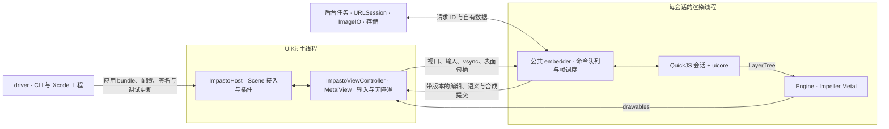

# Impasto iOS Embedder 实现方案

iOS 宿主交付独立应用、UIKit 嵌入、多窗口、原生输入与无障碍、平台服务、原生视图混排、媒体纹理和签名分发。以 iOS/iPadOS 15.0 为最低部署目标，与现有 Impeller SDK 一致。第一批交付面向 arm64 真机及 Apple Silicon 模拟器。仓库已有 x86_64 模拟器 SDK，该架构先保留构建检查，运行支持以 Intel 或兼容模拟环境实测为准。iPad 窗口与可用的外接显示器按系统能力接入。Mac Catalyst、应用扩展、CarPlay、watchOS 和 visionOS 另行定义宿主契约。

本方案以本地 `build/impeller-source/flutter` 的 `77f043bc63196b9979cc09c5b97bb6d9b00be34d` 为行为参考，源码入口为 `engine/src/flutter/shell/platform/darwin/ios/`，部分共享实现位于相邻的 `graphics` 和 `common`。Flutter 的 Dart VM 服务、Dart isolate、二进制消息编解码与插件 ABI 由 Impasto 自己的会话、模块和调试更新机制承接。系统行为按实际 iOS 版本和设备类型验收。 [Flutter iOS 源码](https://github.com/flutter/flutter/tree/77f043bc63196b9979cc09c5b97bb6d9b00be34d/engine/src/flutter/shell/platform/darwin/ios) · [Impeller SDK 锁定记录](../../crates/impeller-sys/sdk.lock)

## 实施进度

UIKit/Metal 宿主、Rust 静态库、公共输入与语义扩展、原生平台服务、原生内容混排和 CLI 交付链已接入。以下为本地实测范围。方案后文保留各阶段的设计目标和发布门槛。 [宿主使用入口](../platform-hosts.md#ios-宿主) · [构建与嵌入](../../crates/embedder/ios/README.md)

| 验收路径 | 实测结果 |
|---|---|
| 启动与开发更新 | iPhone 模拟器上启动 Gallery 的 debug ESM 与 release IQJS。后台恢复沿用原进程并重建绘制表面。开发更新在同一进程应用新画面，脚本失败后保留成功画面，再次修正后恢复更新。 |
| 视口与编辑 | UIKit 测试宿主验证组合区间、UTF-16 编辑、过期编辑确认、密码输入属性、键盘几何和语义动作。iPad 同进程两个 Scene 的导航和草稿分别保存，共享开关验证跨窗口 `WindowState` 读写和默认隔离。iOS 27 的模拟外接屏以独立非交互式 Scene 上屏。 |
| 系统服务 | iPad 模拟器验证冷启动链接、静止前台与后台暖链、同进程打开详情、终止进程后恢复导航、相机权限拒绝、文件选择器取消和分享面板。URLSession 的 HTTP 与 WebSocket 使用本地服务验证分块交付、收发和取消。独立 release IQJS 应用实测 Swift 插件的 JSON 往返、错误、超时和解除挂接取消。 |
| 混排、截图与媒体 | 在同帧混排两个 UIView 和三个 Metal 分片，逐像素验证双层遮挡、BGRA 和 NV12、连续 40 帧更新及方向变换。独立和嵌入宿主截图均包含混排结果，嵌入截图按控制器边界裁切。 |
| 归档与 SDK | 本机完成 arm64 设备归档和签名 IPA 导出，解包通过签名校验和 dSYM UUID 核对。独立 Swift/UIKit 客户端通过三架构 XCFramework 构建并在模拟器上屏。 |

物理 iPhone 14 Pro 当前为不可用状态。签名安装、USB 调试更新、最低系统版本实机、ProMotion 时序、VoiceOver、密码管理器、Scribble、相机采集与外屏硬件仍需设备验收。当前框架画面使用 sRGB。原生混排支持矩形、圆角及原生槽位的 SVG 形状裁剪和仿射变换。贯穿颜色协议、图像导入和离屏绘制的宽色域，以及跨 UIView 像素滤镜和祖先路径裁剪，仍需对应协议和渲染支持。

## 开工时的基础与实现差距

| 区域 | 仓库现状 | iOS 交付工作 |
|---|---|---|
| 启动与会话 | `embedder::start_async` 已支持启动检查点和结果回调。`Link` 支持表面回收确认。`WindowSession` 能在独立会话间共享有限状态。 [公共宿主](../../crates/embedder/common/src/host.rs) · [窗口状态](../../crates/embedder/common/src/window_session.rs) | 建立 UIKit 宿主、Scene 工厂、独立会话及同一会话的串行 View 迁移。补带代数的回调和显式关闭完成通知。 |
| 渲染 | macOS 使用 `Engine::create_metal` 和 `draw_metal`。iOS 已有目标专用静态 SDK 和 `link.txt`。 [macOS 表面](../../crates/embedder/macos/src/surface.rs) · [Engine Metal](../../crates/raster/src/player/mod.rs) · [SDK 链接](../../crates/impeller-sys/build.rs) | 先运行 `CAMetalLayer` 的单表面路径。补首帧呈现证据、可恢复的设备错误和混排所需的渲染分片、事务呈现。 |
| 视口与输入 | `Metrics`、`WindowDisplay`、`PlatformSettings`、`PointerEvent` 和 `InputEvent::Replace` 已覆盖基础视口、触摸与文本编辑。 [会话协议](../../crates/engine/src/session/mod.rs) · [指针协议](../../crates/engine/src/input/pointer.rs) | 补浮动键盘遮挡、编辑目标和版本、必要的笔数据、硬键盘与宿主响应者链的事件归属。 |
| 无障碍与平台内容 | 公共语义投影提供稳定代数 ID、角色与动作。原生 View placement 目前只有矩形裁剪。外部帧按图像源进入 CPU 像素缓存。 [语义投影](../../crates/embedder/common/src/semantics.rs) · [位置协议](../../crates/engine/src/tree/platform_view.rs) · [外部帧](../../crates/embedder/common/src/images.rs) | 提供 UIKit 语义树、编辑桥和焦点反馈。扩展绘制顺序与裁剪契约，加 Metal 纹理导入及生命周期。 |
| 构建和发布 | manifest 已接受 `ios`。CLI 的 iOS 构建和运行会报缺失宿主，按平台编译的模块表只识别 macOS、Android。 [应用配置](../../crates/cli/src/app.rs) · [构建](../../crates/cli/src/build.rs) · [运行](../../crates/cli/src/run.rs) | 加 Xcode 工程生成、运行目标发现、Swift 嵌入 SDK、签名和归档导出。打包与运行使用相同的模块配置。 |

## 模块边界与接入接口



- 新增 `crates/embedder/ios`，用 Rust `staticlib` 接入 `embedder::Boot`、标准模块、异步会话启动与 Metal 表面。Swift/Objective-C 代码与 Xcode 宿主模板放在该 crate 下的 `host/` 和 `template/`。Swift 持有 UIKit 对象、KVO/通知、显示链、插件和 UI 路由。Objective-C 可封装需要 Objective-C runtime 的 UIKit/Metal 操作。Rust 拥有渲染线程、QuickJS、UI 树、Impeller、缓存和与会话关联的异步结果。
- Swift 公开 `ImpastoHost(resources:initialURL:restoredState:windowGroup:)`、`prepare()` 的回调和可取消等待方式、`makeViewController()`、`attach` / `detach` / `close`，以及首帧、启动失败和关闭完成事件。嵌入方可在当前控制器中通过标准 child containment 安装 View，也可沿原生导航栈 push。生成的 AppDelegate/SceneDelegate 使用同一 API。嵌入方显式转交 Scene 事件、初始链接和恢复状态，无需全局代理替换。会话预热可在无 View 时准备资源，有尺寸依赖的首个 UI 帧等接入。
- C ABI 只提供不透明句柄、固定宽度枚举、长度标识的字节缓冲、版本化结构体，以及成对的保留与释放约定。每个输入缓冲在调用内复制，每个回调缓冲由接收方复制或通过明确的 release token 接管。Swift closure 通过 context 与释放回调传递。异常和 panic 在边界转换为状态，关闭、重复销毁及失效句柄有明确返回。只交换拥有所有权的数据和具有显式生命周期的原生 GPU 引用。整个 UIKit 树只在主线程操作。
- 单个 `ImpastoHost` 同时接入一个 View。传给同一应用的多个 Scene 默认独立 QuickJS/树/输入/插件呈现上下文，应用可显式共享 `WindowSession` 和持久化服务。保留会话迁移时前次表面必须退役后再连接新 View。Flutter 对应能力包括保留引擎、`FlutterEngineGroup` 和原生导航接入。未来若需单个 JS 环境同时运行多棵 UI 树，需扩展 `Session`、`LayerTree`、平台事件和插件路由的 view ID，作为独立架构演进。 [FlutterEngine](https://github.com/flutter/flutter/blob/77f043bc63196b9979cc09c5b97bb6d9b00be34d/engine/src/flutter/shell/platform/darwin/ios/framework/Source/FlutterEngine.mm) · [FlutterEngineGroup](https://github.com/flutter/flutter/blob/77f043bc63196b9979cc09c5b97bb6d9b00be34d/engine/src/flutter/shell/platform/darwin/ios/framework/Source/FlutterEngineGroup.mm) · [Impasto 公共接口](../../crates/embedder/common/src/lib.rs)

Flutter 在这个版本把平台和 Dart UI task runner 合并到主线程，并保留独立 raster/I/O runner。Impasto 使用现有的 `Boot`、`OpenSurface` 和 Rust 渲染线程，在那里同步推进 JS、布局、录制和绘制。需要异步移交整帧时再扩展帧提交边界，该边界也可由后续的 `Renderer` 实现承接。 [Flutter task runner 初始化](https://github.com/flutter/flutter/blob/77f043bc63196b9979cc09c5b97bb6d9b00be34d/engine/src/flutter/shell/platform/darwin/ios/framework/Source/FlutterEngine.mm#L917-L1010) · [Impasto 渲染后端设计](../rendering-design.md)

| 跨线程交付 | 顺序与丢弃条件 |
|---|---|
| UIKit → Rust | 一次提交包含 attachment 与 viewport generation。先应用视口、窗口环境、焦点和表面更新，再消费对应输入及帧时钟。旧接入的离散事件由终态取消或在入队前丢弃，避免重放到新控制器。 |
| Rust → UIKit | 就绪、编辑、语义及平台视图回调携带相应 generation 和帧序号。UIKit 主线程验收 owner 后应用，事务过期时销毁自有内容并归还所有 GPU 引用。 |
| 工作线程 → 会话 | 异步操作关联请求 ID、对应的 session 或 presentation scope。交换网络和解码缓冲时限制队列与在途数据，取消后停止生产。相同请求的成功、失败与取消只结算一次。 |

## 启动、窗口与恢复

| 状态 | 转移条件与行为 |
|---|---|
| 会话 | 准备 → 就绪 → 关闭中 → 关闭，任意初始化步骤可到失败。Swift 先拿到可取消句柄。配置、文件根目录、字体、恢复数据与初始 URL 在脚本 eval 前可读。迟到的启动回调只可结束原请求。 |
| Scene 与可见性 | Scene 前台且 View 可见时可呈现。活跃为 `Resumed`，失活但仍可见为 `Inactive`。后台或被遮蔽送 `Hidden` / `Paused` 并暂停 UI 帧、终止触摸，解绑送 `Detached`。key window / responder 焦点用独立 `WindowFocus` 更新。启动时直接读取有效状态，避免依赖事后通知。 |
| View 与表面 | View 隶属于 window、尺寸大于零且会话就绪后，设置像素尺寸并发送首个 `SurfaceReady`、视口及当前设置。在同一 drawable 目标上发 `SurfaceChanged`。切换 View、图层或显示接入代数时分配新 `SurfaceId`。进入后台立即关闭新 acquire/present 的宿主闸门，停止显示链。恢复先校验尺寸和所有权，再重新打开并 `Invalidate`。 |
| 首帧 | 分开记录脚本就绪、首次提交、首次上屏。启动占位用 LaunchScreen 与可配置的原生覆盖层衔接，当前 generation 的可见帧才移除覆盖层。实际呈现不可观测时，使用当前表面成功提交后的明确降级信号，性能统计保留缺失原因。失败页提供诊断与重试，重试创建新会话代数。 |

UIKit 事件按 `sessionID / attachmentGeneration / SurfaceId` 校验，另有 `frameID`、编辑和插件请求 ID。尺寸、环境和可替代移动样本可合并。输入开始、结束、取消、场景断开及请求完成保持顺序。解绑先封闭输入、下一帧、键盘和平台对象访问，发送触摸取消和失焦，然后调用 `begin_destroy`。主线程将 Metal 层留在退役集合，异步等渲染侧 `SurfaceDropped` 且 GPU 所持资源按完成回调归还后，释放各自的 retain。`SurfaceDropped` 表示渲染侧已停止访问旧表面，应用以 GPU 回调管理独立的在途资源。关闭先请求停止，后台等待结束再切回主线程通知。启动取消、正在取 drawable 的解绑和晚到 present 回调由统一的状态机处理。 [Flutter ViewController 生命周期和首帧](https://github.com/flutter/flutter/blob/77f043bc63196b9979cc09c5b97bb6d9b00be34d/engine/src/flutter/shell/platform/darwin/ios/framework/Source/FlutterViewController.mm) · [公共 `Link`](../../crates/embedder/common/src/host.rs)

冷启动使用 `UIScene.ConnectionOptions` 提取 URL 或 Universal Link，初始化 `Restoration` 后再执行应用脚本。暖启动将验证后的链接定向到交付它的 Scene，按系统交付身份与连接窗口限时去重，允许用户重复打开同一个 URL。每个 `UISceneSession.persistentIdentifier` 对应一份现有 32 KiB 小快照。通过 `stateRestorationActivity(for:)` 返回版本化 `NSUserActivity`，只把路由、滚动位置和显式草稿等可恢复内容交给系统。已恢复的导航先装载，当前显式链接随后应用。应用业务数据沿用私有存储，系统结束进程前的回调可缺席，因此关键快照在状态变化和进入后台时也做有界的原子写入，丢弃 Scene 时清理其存档。系统权限或文件面板的未完成调用在失去呈现上下文时结算，在新进程由业务恢复流程继续。 [Flutter Scene 生命周期](https://github.com/flutter/flutter/blob/77f043bc63196b9979cc09c5b97bb6d9b00be34d/engine/src/flutter/shell/platform/darwin/ios/framework/Source/FlutterSceneLifeCycle.mm) · [Flutter 恢复插件](https://github.com/flutter/flutter/blob/77f043bc63196b9979cc09c5b97bb6d9b00be34d/engine/src/flutter/shell/platform/darwin/ios/framework/Source/FlutterRestorationPlugin.mm) · [Impasto Restoration](../../crates/embedder/common/src/restoration.rs)

## Metal、帧时钟与视口

1. **单表面。** `UIView.layerClass` 配置系统 `CAMetalLayer`。主线程以该窗口 trait/屏幕 scale 取 View bounds 的物理像素大小，发布尺寸与代数，`contentsScale`、`drawableSize` 与 `Engine` 使用同一比例和舍入规则。layer 与 Impeller 使用同一个系统默认 `MTLDevice`。固定并验证 BGRA 像素格式、sRGB 输出、透明模式和不透明模式的清屏约定。光栅线程在 autorelease pool 内尽可能晚取 drawable，校验纹理尺寸，调用 `Engine::draw_metal`。实现捕获图像时使用受控读回或专用离屏路径。Flutter 锁定版本默认可走自有 `FlutterMetalLayer`，它的 drawable 池适合作为背压测量对照，初始实现以系统层为基线。 [Flutter 渲染选择](https://github.com/flutter/flutter/blob/77f043bc63196b9979cc09c5b97bb6d9b00be34d/engine/src/flutter/shell/platform/darwin/ios/rendering_api_selection.mm) · [Flutter Metal 表面](https://github.com/flutter/flutter/blob/77f043bc63196b9979cc09c5b97bb6d9b00be34d/engine/src/flutter/shell/platform/darwin/ios/ios_surface_metal_impeller.mm) · [Apple CAMetalLayer](https://developer.apple.com/documentation/QuartzCore/CAMetalLayer)
2. **帧时钟。** 每个有效接入通过主线程上的 `CADisplayLink` 实现 `Vsync`，使用屏幕关联 API 和 common run-loop modes，窗口迁屏后重绑。Flutter 在回调消费后暂停，其线程选择和 Impasto 有所不同。Impasto 的每一个 `FrameToken` 只取一次时钟回调，挂起或失效时取消，空闲无连续 tick。用 `timestamp`、`targetTimestamp` 和本次周期计算 `FrameTime`，动画采样 target，公共宿主填写计时器的 `mono_ms`。ProMotion 通过帧率范围和真机所需的 Info.plist 配置表达偏好，实际频率以回调周期为准。交互和动画结束后撤回高频请求。手势不会让 default-mode 限制饿死渲染。 [Flutter VSyncClient](https://github.com/flutter/flutter/blob/77f043bc63196b9979cc09c5b97bb6d9b00be34d/engine/src/flutter/shell/platform/darwin/ios/framework/Source/VSyncClient.swift) · [Flutter DisplayLinkManager](https://github.com/flutter/flutter/blob/77f043bc63196b9979cc09c5b97bb6d9b00be34d/engine/src/flutter/shell/platform/darwin/ios/framework/Source/DisplayLinkManager.swift) · [Apple ProMotion](https://developer.apple.com/documentation/quartzcore/optimizing-iphone-and-ipad-apps-to-support-promotion-displays)
3. **背压与恢复。** 维持公共 `Submit`、`PresentCached` 和 `Skip` 判断。一时 acquire 失败和 resize 时的尺寸过期归到有限退避并等待有效视口。后台、遮蔽或丢失当前挂接时取消重试。前台恢复复用有效层树并强制呈现。真正的设备错误要通过 Metal 命令缓冲完成回调或扩展的 Impeller 状态确认，当前布尔 ABI 只足以报告通用失败。重建设备时自动清理旧 drawable、管线、纹理和 picture，保留能重放的字体、图像来源和层树，失败达到预算后进入错误状态。内存警告走 `MemoryWarning`、图片/GPU trim 和显式插件处理。 [公共 present 策略](../../crates/embedder/common/src/present.rs) · [现有 Metal draw/present](../../crates/raster/src/player/mod.rs)
4. **逻辑空间。** `location(in:)`、布局、UIKit 叠层和场景都用左上原点的点，drawable 与截图才使用物理像素。`safeAreaInsets` 作为长期 padding，停靠键盘按宿主 View 中的可见交集发布临时 inset，现有 `Metrics::from_insets` 以逐边 max 消除重复扣减。根布局以这个 inset 设定起点，位置和输入使用全 View 的场景坐标。iPad 浮动/分离键盘发布可信的局部遮挡几何，交给光标滚动避让。只收到估计外包矩形时用保守避让。主线程可用 `UIKeyboardLayoutGuide` 与键盘过渡通知驱动动画，绑定首响应者所在窗口并处理坐标换算、交互式收起和拖动。覆盖其他 Scene 的通知、零面积或零时长的键盘帧、密码管理器紧随 show 的 hide。 [Flutter KeyboardInsetManager](https://github.com/flutter/flutter/blob/77f043bc63196b9979cc09c5b97bb6d9b00be34d/engine/src/flutter/shell/platform/darwin/ios/framework/Source/KeyboardInsetManager.swift) · [Apple 键盘布局指南](https://developer.apple.com/documentation/uikit/adjusting-your-layout-with-keyboard-layout-guide)
5. **环境更新。** 在 `layoutSubviews`、safe-area、trait、window 和 screen 变化时生成同代数快照，先送可用视口再放行新尺寸的帧。映射界面明暗、Dynamic Type、locale、RTL、Reduce Motion、Bold Text、Increase Contrast，事件变化可独立于 resize。UIKit 有效手势区域由容器策略和系统 API 决定，只有可可靠测量的 inset 才发布。横竖屏、Split View、Stage Manager 和外屏测试分别记录窗口点大小、实际 drawable 像素和系统刷新率。外接显示器采用所支持的 Scene 角色与系统版本守卫。
6. **截图与色彩空间。** `captureSnapshot()` 以 drawable 像素尺寸返回最近提交的 sRGB 画面，包含 UIKit 和 Metal 混排。控制器可用 `hidesContentInAppSwitcher` 在场景失活时覆盖内容。宽色域需要从颜色和纹理输入到 GPU 离屏目标和 drawable 一致保留色彩信息，跨屏重配时校验 sRGB 回退。 [Flutter View 的色彩设置与截图](https://github.com/flutter/flutter/blob/77f043bc63196b9979cc09c5b97bb6d9b00be34d/engine/src/flutter/shell/platform/darwin/ios/framework/Source/FlutterView.mm#L168-L205)

## 指针、键盘与编辑

### 指针与实体键盘

- 开启多点，按 `UITouch` 对象在当前接入期分配稳定整数 ID，`began / moved / ended / cancelled` 完整转发，结束后移除。保存有效的位置、时间戳和触摸类型，按顺序投送 coalesced 样本。预测样本仅可用于可撤销的低延迟笔迹预览。认领系统手势、View 脱附和后台切换时主动补 `Cancel`。同一触摸序列只向框架手势系统交付一次。 [Flutter 触摸与手势入口](https://github.com/flutter/flutter/blob/77f043bc63196b9979cc09c5b97bb6d9b00be34d/engine/src/flutter/shell/platform/darwin/ios/framework/Source/FlutterViewController.mm#L1091-L1292)
- 用 `UITouch.type`、button mask、间接输入、hover 与系统滚轮/pan/pinch recognizer 区分手指、Pencil、鼠标与触控板。鼠标左右中键和修饰键保留改变键与当前集合的区别。离散滚轮和连续触控板滚动归一成场景点，pinch 用相对缩放因子，按设备类型限制 recognizer，避免同一运动同时进 touch 与滚动。为 Pencil 压力、半径、倾角与方位补可选字段，严格处理 `estimatedPropertiesExpectingUpdates` 与迟到样本。若暴露手势旋转或笔 hover，在支持系统上补相应的协议、命中和事件测试。
- `UIPress` 的 HID usage、逻辑字符、修饰键、repeat 与取消分别建模。先根据同步可读的焦点和快捷键快照决定谁消费，再向 Rust 队列送完整事件。已认领的命令由框架处理，编辑器的字符和组合输入交给 UIKit 文本链。未认领事件当场交回原生 responder，避免按键等待 JS 和嵌套主 run loop。测试 Command/Option/Control、左右修饰键、Caps Lock、Tab、退格、重复键、系统快捷键和硬件键盘布局切换。UIKit 消费输入和框架文本提交之间只允许一个路径写入。 [Flutter 键盘管理](https://github.com/flutter/flutter/blob/77f043bc63196b9979cc09c5b97bb6d9b00be34d/engine/src/flutter/shell/platform/darwin/ios/framework/Source/FlutterKeyboardManager.mm#L53-L131) · [Flutter HID responder](https://github.com/flutter/flutter/blob/77f043bc63196b9979cc09c5b97bb6d9b00be34d/engine/src/flutter/shell/platform/darwin/ios/framework/Source/FlutterEmbedderKeyResponder.mm)
- iOS 返回语义由容器决定。原生导航栈优先使用 UIKit 自己的返回按钮与 interactive pop。框架自有路由可接边缘手势与 `accessibilityPerformEscape`，借 `back_enabled` 决定手势归属，单次转发开始、进度、取消或提交。编辑器占有的 Escape、控制器 dismiss 与路由返回各有顺序和回退，应用根场景停留在自身界面。 [现有返回与输入命令](../../crates/embedder/common/src/command.rs) · [Flutter 平台插件](https://github.com/flutter/flutter/blob/77f043bc63196b9979cc09c5b97bb6d9b00be34d/engine/src/flutter/shell/platform/darwin/ios/framework/Source/FlutterPlatformPlugin.mm)

### UITextInput、系统编辑操作与 AutoFill

1. 主线程维护接在当前 responder hierarchy 上的 `UITextInput` 代理和本地编辑镜像。视觉内容、选区、padding、命中与文字排版由 Impasto 绘制。代理同步应答 `UITextInput`、`UITextInputTraits`、tokenizer、文本位置与范围，以及 `caretRect`、`firstRect`、选择矩形、布局方向和最接近文本位置。Rust 在布局后提供可读取的文本几何快照，UIKit 按当前 viewport 转换。焦点 TextField 原生视图出现时释放框架代理的 responder 身份。
2. 以编辑节点及其代数、一次焦点连接的 ID、编辑序号和渲染状态版本扩展 `ImeUpdate` 与替换协议。UIKit 先应用系统同步编辑到镜像，发送含 UTF-16 选区、marked range 与目标的完整事务。框架处理格式化、受控值、选区和最终组合结果，再确认序号与权威状态。确认老版本时保留本地新事务，遇到明确受控覆盖或焦点迁移时以新 revision 重置，同一状态更新不重复回送。合并的是可替代的镜像更新，组合结束、用户提交与 Show/Hide 保持顺序。临时更改选区时成对调用规定的 UIKit input delegate 通知。 [现有 ImeState / InputEvent](../../crates/engine/src/session/mod.rs) · [当前 focused 路由](../../crates/javascript/src/ui/player/mod.rs) · [Flutter 编辑镜像与文本几何](https://github.com/flutter/flutter/blob/77f043bc63196b9979cc09c5b97bb6d9b00be34d/engine/src/flutter/shell/platform/darwin/ios/framework/Source/FlutterTextInputPlugin.mm#L1637-L2485)
3. 所有桥接位置按 NSString UTF-16 计数，入口验证范围、代理对边界和选区方向，逻辑编辑覆盖多码点字素与 IME 对当前 marked text 的逐段操作。功能包括 `insertText`、删除、set/unmark、替换、系统选择、软键盘 Done/Next/Search/Go/Send、换行、单行与多行、密码、键盘类型和交互式收起。测试中文拼音、日文转换、韩文、泰文、emoji ZWJ、重音死键、RTL 和受控组件切焦。退格、剪贴、撤销等编辑命令都进入同一事务与撤销栈。
4. 通过真实的输入代理承接用户名、现有/新密码和一次性验证码，映射 `textContentType`、secure traits、密码规则与输入组。稳定的 AutoFill 客户端 ID 绑定同一表单的字段，填入非焦点字段用带目标的动作，VoiceOver 开关独立于 AutoFill。密码只在必需的输入路径传递，语义值掩码，编辑、快照和诊断均不暴露原文。真机验证密码建议、填充、保存与取消，以及 autofill 注入后应用的受控值同步。 [Flutter AutoFill 生命周期](https://github.com/flutter/flutter/blob/77f043bc63196b9979cc09c5b97bb6d9b00be34d/engine/src/flutter/shell/platform/darwin/ios/framework/Source/FlutterTextInputPlugin.mm#L2952-L3140) · [Impasto AutoFill 字段](../../crates/engine/src/semantics/mod.rs)
5. UIKit 编辑菜单、拷贝/剪切/粘贴、菜单锚点、系统撤销重做、拼写建议、输入替代、选区手势、听写、iPad 空格拖动光标、Scribble/间接手写逐项接入；新版 API 按系统版本守卫。选区、替换、光标和撤销通过现有编辑通道或明确的新增事件连接，编辑菜单跨 iOS 15 的旧接口和新系统交互。平台可用的 Live Text、查询和翻译作为系统菜单能力通过可用性守卫呈现。验收用真实输入法选择、写入、取消、撤销和恢复。

## 无障碍

对同一接入期的稳定 `SemanticsId` 复用 `UIAccessibilityElement` 或容器。语义更新和删除以同一代数的快照或增量原子应用，保持阅读顺序和可达性。使用容器坐标或 UIKit 坐标转换，处理裁剪、变换、滚动、嵌入偏移和外屏。原生 View 区域挂真实 UIKit 元素，文本字段将辅助技术编辑动作交给与输入系统一致的代理，并避免 AX 树出现重复元素。

映射按钮、开关、图片、文本、滚动、编辑和选中/禁用/密码状态，向 Rust 回送当前元素对应的激活、滚动、编辑、选区和 AutoFill 操作。当前 `SemanticsAction` 与投影需按场景补方向滚动、焦点反馈、头部/可调元素的 traits 和动作、路由/模态变化、live region 与删除序列。以实际可滚范围与方向判断返回值。焦点对象仍存在时保留，导航切换时依更新类型通知 `screenChanged` 或 `layoutChanged`，滚动、播报使用相应通知。拦截被遮盖或已解绑表面的通知，避免把 VoiceOver 焦点拉回隐藏界面。语义是否启用由 VoiceOver、Switch Control 和其他可用系统状态决定，测试宿主可单独打开；动态字体、高对比、减弱动效等设置独立更新。 [Flutter AX Bridge](https://github.com/flutter/flutter/blob/77f043bc63196b9979cc09c5b97bb6d9b00be34d/engine/src/flutter/shell/platform/darwin/ios/framework/Source/accessibility_bridge.mm) · [Flutter 文本语义](https://github.com/flutter/flutter/blob/77f043bc63196b9979cc09c5b97bb6d9b00be34d/engine/src/flutter/shell/platform/darwin/ios/framework/Source/TextInputSemanticsObject.mm) · [现有语义定义](../../crates/engine/src/semantics/mod.rs)

## 平台服务与插件

| 接口 | iOS 行为与边界 |
|---|---|
| 插件注册与回包 | 每个 session 注册模块、原生 View factory、纹理 producer 及其权限和资源。现有 `ModuleRegistry` / `MethodExec` 继续承担调用边界，UIKit 工作异步派到主线程，I/O 和解码在工作线程。需要 UIKit completion 的接口接到一次性 `Settle`。按会话与呈现上下文管理注销、超时、取消和重复完成。插件可订阅 app/scene、attach、detach、内存、链接与恢复事件；明确消费语义和顺序，落实多 Scene 隔离。 |
| App State 与系统 UI | 发布每个场景的前后台与 focus。由当前 controller 仲裁状态栏样式、Home Indicator、系统边缘手势、支持方向与方向请求。iOS 16+ 的方向请求落在对应 `UIWindowScene`，拒绝可返回调用方。将 haptics、常用系统声音、原生导航 pop 和系统操作菜单接入公开宿主接口。 |
| Linking、剪贴板、分享 | 连接阶段准备初始链接，运行中发送增量。外开 URL 与 Universal Link 使用 `UIApplication` 完成回调，校验 scheme 和 entitlement 配置。由用户编辑操作触发粘贴读取，保留系统隐私提示。用 `UIActivityViewController` 分享文本和文件，iPad 使用场景内有效的 popover 锚点，取消结算。 |
| 文件、存储、资源 | Bundle 仅作只读安装资源。应用数据进入 Documents 或 Application Support，临时与可重建缓存按系统目录约定存放。复用路径约束和原子写。文档选择器按 UTType 过滤，在有效上下文打开 security-scoped URL，成对访问并将输入复制到应用允许的根目录再回传，失败清理临时文件。按 1x/2x/3x 解析资产，后台 ImageIO 解码时先校验尺寸、方向、解码色彩和内存预算。包内字体、fallback、字形覆盖与 CJK/RTL 度量通过 Impeller 同一排版链验证。 |
| 系统权限 | 支持配置声明的相机、麦克风、照片及业务所需的权限。用系统状态映射 denied、restricted、limited 等差异，保留模块已有的不可用语义。串行协调系统弹窗，使用当前 active 场景或平台规定的 API。校验 usage description 和 entitlement，设置页只能按系统允许方式跳转。应用前台恢复后重新查询系统状态。 |
| HTTP 与 WebSocket | JS 层继续掌握标准 API 语义。HTTP 由 `URLSession` 适配现有 `HttpClient` 的流式 head/body、取消、timeout 和背压。现有接口的阻塞适配只在工作线程，按量测决定是否为公共传输协议增加异步实现。WebSocket 用原生 `URLSessionWebSocketTask` 时，补现有 transport 注入及双端 close/error 语义。重用请求 ID 与连接代数，后台行为遵守 iOS 的进程挂起。代理、ATS、证书、重定向、断网、取消和队列上限均有回归。 |

URL、权限、面板和原生 View 的回调始终使用请求发起时的 session、scene 与 scope。系统弹窗期间只要所有者仍有效便可接收完成，宿主撤销时清理挂起状态，下一代 View 不会收到上一代结果。静态注册名单同时用于打包时模块解析和宿主启动；声明的能力、链接的模块与系统授权分别校验。 [Flutter Plugin 协议](https://github.com/flutter/flutter/blob/77f043bc63196b9979cc09c5b97bb6d9b00be34d/engine/src/flutter/shell/platform/darwin/ios/framework/Headers/FlutterPlugin.h) · [Flutter iOS 消息调度](https://github.com/flutter/flutter/blob/77f043bc63196b9979cc09c5b97bb6d9b00be34d/engine/src/flutter/shell/platform/darwin/ios/platform_message_handler_ios.mm) · [现有模块执行器](../../crates/embedder/common/src/exec.rs) · [HTTP transport 契约](../../crates/javascript/src/host/io.rs)

## UIKit 原生视图与外部纹理

### 原生 View 混排

第一步在现有 `PlatformView` 槽位挂 UIKit factory。按节点 ID 和接入代数管理 create、update、hide、dispose，校验逻辑尺寸、祖先滚动和矩形裁剪，保持视图内部交互与无障碍。开发模式报告缺失 factory 和当前不支持的变换。矩形覆盖层阶段可以先验证原生文本、地图或 WebView 的布局与生命周期。 [现有位置投影](../../crates/engine/src/tree/platform_view.rs) · [Flutter Platform Views API](https://github.com/flutter/flutter/blob/77f043bc63196b9979cc09c5b97bb6d9b00be34d/engine/src/flutter/shell/platform/darwin/ios/framework/Headers/FlutterPlatformViews.h)

完整混排需要同一帧的绘制和 UIKit 变更一起提交，实施顺序如下。

1. 在 `protocol` / `uicore` 层记录有序的原生视图占位和祖先变换栈。记录矩形、圆角、路径 clip、透明度、变换、可见区域与可触达区域，由布局、命中、语义和绘制共用。按绘制顺序生成底层 raster、原生 UIView、覆盖 raster 和后续原生 UIView。依据画面相交归并覆盖区域，并对 overlay surface 池设置可量测上限。无原生 View 的帧走单表面快路径。
2. 把单次 `draw_metal` 扩展为可准备并移交的渲染帧，携带当前 surface、viewport generation、frame ID、有序 UIKit placement、各渲染分片和 drawable 持有权。补 Impeller 记录/编码与事务 present 的边界。Swift 主线程只接收可提交的帧。按 Apple 规则先提交并确认 Metal command buffer 已排程，再在同一个 `CATransaction` 应用 UIKit 顺序、透明度、遮罩与对应 drawable 的 `present()`。等待排程放在渲染侧，主线程只应用就绪帧。尺寸变化、过期 ID、任何分片失败或未满足背压预算时放弃整帧并归还资源，保留上次完整画面。后端/宿主共同实现该契约，单独的 `Services::platform_views` 回调只能覆盖基础叠层。 [Flutter 混排提交与分片算法](https://github.com/flutter/flutter/blob/77f043bc63196b9979cc09c5b97bb6d9b00be34d/engine/src/flutter/shell/platform/darwin/ios/framework/Source/FlutterPlatformViewsController.mm#L745-L953) · [Apple Metal 事务呈现](https://developer.apple.com/documentation/quartzcore/cametallayer/presentswithtransaction) · [公共宿主现有回调时序](../../crates/embedder/common/src/host.rs#L1193)
3. 在 UIKit 使用裁剪容器与可复用遮罩表达裁剪和变换。实现主线程可决策的手势拦截、UIKit 优先或框架优先策略，以及必要的显式 accept/reject，包含父级滚动抢占、释放和取消。按钮遮挡原生 View 时触摸必须到可见的最上层。UIView 的焦点、可访问性和触摸派发随同帧合成计划更新，正在使用的 view 直到最后引用它的帧退役后才销毁。支持真实 UIView 的公开 UIKit 视觉效果。跨 UIView 边界的任意像素混合、精确滤镜和受保护内容读回受 UIKit 能力约束。需要精确像素效果的生产者可提供可导入纹理，经 Impeller 在单一场景内绘制。 [Flutter 手势与包装视图](https://github.com/flutter/flutter/blob/77f043bc63196b9979cc09c5b97bb6d9b00be34d/engine/src/flutter/shell/platform/darwin/ios/framework/Source/FlutterPlatformViewsController.mm)

### 媒体与 Metal 纹理

先用 `ExternalFrame` 验证图像 ID、注册/销毁、帧可用通知、当前帧重用和应用级相机/视频接入。CPU 路径按尺寸和色彩预算接受 RGBA，从后台生产并有界合并最新帧。高频媒体正式路径从 AVFoundation 等生产者接收有 retain 的 `CVPixelBuffer`，由光栅侧同一 Metal 设备的 `CVMetalTextureCache` 导入 BGRA 或 NV12 平面。明确全/视频范围、色彩矩阵、色域、旋转、裁剪与 alpha。NV12 直接采样时由 shader 转换，必要时允许一次 GPU 转换。锁定的 Impeller C API 支持 CPU 数据纹理和 OpenGL handle 包装，Metal 纹理导入、双平面组合、GPU 完成与引用归还需要补 SDK 接口和 Rust 绑定。 [Flutter Darwin 纹理导入](https://github.com/flutter/flutter/blob/77f043bc63196b9979cc09c5b97bb6d9b00be34d/engine/src/flutter/shell/platform/darwin/graphics/FlutterDarwinExternalTextureMetal.mm) · [现有 Impeller 纹理接口](../../crates/impeller-sys/include/impeller.h#L1332)

按 session、texture ID 和 generation 管理所有者。producer 通知只更新最新可用引用，消费时持有纹理、pixel buffer 和必要的同步对象，直到最后一次 GPU 读取结束。合并待消费帧，限制在途 GPU 引用和内存。无新帧保留最后一帧，明确冻结、恢复、丢失设备后重包与撤销注册的行为。在后台或失去 owner 时暂停生产，释放迟到帧。生产者和消费端不在各自持锁期间互相等待。相机、视频、撤销、分辨率变化、色彩范围和反复前后台作为真机验收场景。SDK 变更由锁定源码补丁、头文件与绑定、CI 验证 ZIP 和版本标识一起提交，保证现有平台链接及渲染回归。 [SDK 配置与补丁入口](../../crates/impeller-sys/README.md)

## Xcode、CLI 与发布

| 交付入口 | 实现与产物 |
|---|---|
| 工程生成 | 在 `build/ios/` 确定性生成 Xcode 工程及 scheme，分离宿主模板、资源清单和应用可扩展配置。添加 `[ios]` 的 bundle ID、build number、设备族、URL schemes、associated domains、usage descriptions、启动配置与签名参数。系统能力和权限生成 Info.plist / entitlements，证书和密钥由本机 Xcode 或 CI 注入。模板和原生工程编译脚本纳入可搬迁 CLI 发布包。 |
| 静态链接 | 用目标 triple、最低部署版本、SDK 路径和 Rust profile 构建宿主 `staticlib`，加载当前目标的 SDK。Xcode 最终链接只包含一份 Rust/Impeller 归档，根据 `link.txt`、Rust `native-static-libs` 和 Swift 宿主依赖生成系统库链接设置。分别核对 Mach-O platform、架构、`minos`、最低 SDK 兼容性和符号。设备 arm64 与模拟器 arm64 是不同平台切片。 |
| `impasto build ios` | 扩展命令接收明确的 simulator / device / archive / export 目标与签名选项。默认输出可签名真机 `.app`，签名条件缺失时显示具体错误，供本地开发的未签名模拟器 `.app` 由显式选项产生。签名归档使用 `xcodebuild archive`，导出用 `xcodebuild -exportArchive` 与指定导出配置生成 `.ipa`。每种模式校验真实产物路径。发布记录 App 与 dSYM UUID、源映射和 bundle/构建标识。 |
| `impasto run -d ios` | 用 `xcrun simctl`、`xcrun devicectl` 区分模拟器和已配对真机，提供显式设备 ID，多个可用目标时按确定性规则选择或提示选择。完成构建、安装、启动、日志、断开/重连和退出处理。模拟器默认可选已启动的设备，真机需要 Xcode 可安装的签名及设备配置。 |
| 嵌入 SDK | 用 Rust 静态库、模块化 C 头、公开 Swift 宿主、资源 bundle 和明确的系统框架依赖构建 `ImpastoHost.xcframework`。分别归档 device / simulator，验证 Swift 客户工程可链接、启动和归档。嵌入方独立携带自己的 JS bundle、asset、配置与插件注册；可选 Swift Package 暴露二进制和资源。 |
| 脚本及资源 | CLI 继续在开发工具侧编译 TSX，debug 打包 ESM，release 打包固定解释器版本的 IQJS 字节码。模板嵌入与运行时 registry 一致的启用模块及插件 specifier。资源以含 Bundle 根目录、entry、格式与 ABI 版本的清单寻址。真机带签名的 debug/release 构建都验证 CJK 资源加载和 JS 字节码兼容性。 |

开发时优先复用 `Command::UpdateSource` 和候选会话的校验/提交路径。模拟器和真机通过开发宿主的受控通道，提交带大小上限和 revision 的 ESM 包并等待应用侧确认。通道只编译进开发构建，按开发会话认证，会话断开后可重连。候选启动失败继续使用上个成功版本，候选成功才提交恢复状态和新会话代数。原生代码、模块注册、权限配置和静态资产变更触发重新构建、安装与启动。发布包只加载安装包内脚本，使用解释模式并通过真机验证 JavaScript 正常执行，JIT 相关 feature、调试更新服务和调试 entitlement 通过产物检查。 [现有候选会话](../../crates/javascript/src/ui/player/mod.rs#L745) · [Apple App Review Guidelines 2.5.2](https://developer.apple.com/app-store/review/guidelines/#software-requirements)

发布 CI 将最低系统版本、实际构建 SDK 版本和 App Store Connect 所需 SDK 版本分别校验。对应用与宿主资源生成相应的 `PrivacyInfo.xcprivacy`，登记实际采用的 required-reason API 和数据使用，不引入与框架无关的 entitlement。检查模拟器切片未进入设备应用，`codesign` 能校验最终 bundle，符号和映射能在一份故障报告中关联。 [Apple 分发归档](https://developer.apple.com/documentation/Xcode/distributing-your-app-to-registered-devices) · [Apple XCFramework](https://developer.apple.com/documentation/xcode/creating-a-multi-platform-binary-framework-bundle) · [Apple SDK 提交要求](https://developer.apple.com/news/upcoming-requirements/) · [Apple 隐私清单](https://developer.apple.com/documentation/bundleresources/privacy-manifest-files)

## 分阶段实施与验收

阶段 0 和 1 先验证真机的关键路径。阶段 2 至 4 可在阶段 1 的会话、ABI 与表面契约固定后并行推进。阶段 5 先验证 SDK 对纹理导入与事务合成的支持，再接入完整混排。阶段 6 汇总发布产物与验收证据。

| 阶段 | 修改面 | 完成条件 |
|---|---|---|
| 0 · ABI、解释器和 Metal 验证 | `impeller-sys`、`engine`、`javascript`。手工最小 Xcode 宿主链接 Rust 与 SDK。验证 Metal drawable、排版、资源加载、解释执行、系统库与最低部署版本。 | arm64 模拟器及签名 arm64 真机可运行相同测试 bundle，验证首次画面、编译端和运行端的 IQJS 一致性、静态链接与关闭。建立错误/故障注入和设备基线。 |
| 1 · 启动与可安装应用 | 新增 `embedder-ios`、C ABI、`Host/Scene/ViewController`、`Vsync`、Metal 表面与初始 CLI。 | 从 `impasto create` 到模拟器和开发签名真机安装启动。冷启动、首帧、旋转、后台恢复、前台不同顺序、启动取消、快速解绑、重复关闭、恢复旧尺寸及 drawable 获取失败均可复现并验证。 |
| 2 · 窗口环境与硬件输入 | `SurfaceChanged`、`Metrics`、`WindowDisplay`、`PointerEvent`、实体键盘、iPad 多 Scene 和原生嵌入。 | 两个 Scene 可同时工作，app-state 按显式设置共享，键盘、surface、深链、语义和插件隔离。宿主能保留会话迁移 View。iPhone / iPad resize、外屏、60 Hz / ProMotion、鼠标、触控板和 Pencil 用设备验证。截图和跨屏色彩重配有可复现样例。 |
| 3 · 编辑与无障碍 | 版本化 IME、文本几何、AutoFill、`Semantics` 和 UIKit 编辑代理。 | VoiceOver 真机遍历页面、返回、滚动、读写选区和切换路由。真机覆盖 CJK、RTL、emoji、密码填充、原生 View 焦点切换、浮动键盘、实体键和系统手写。旧窗口、旧编辑器和隐藏节点的迟到动作无副作用。 |
| 4 · 平台服务与恢复 | URL、标准模块、插件注册、文件选择、权限、网络传输、状态恢复及嵌入协议。 | 一个验收应用通过冷/暖 Universal Link 打开详情，恢复导航、滚动和草稿。真实相机权限、文件选择、分享、保存与重开，以及取消/拒绝/场景关闭后一次性回包。原生容器示例验证初始化、前后台和插件回调。 |
| 5 · 原生内容混排与媒体 | 扩展 `LayerTree`、有序分片、事务提交、Metal 导入 API 和成对保留/释放。 | 双原生 View 与 Canvas 内容按正确顺序交错，验证矩形/圆角/路径、滚动、变换、透明度、命中、键盘和 VoiceOver。相机/视频连续播放 BGRA 和 NV12，测试撤销、重绑、内存压力和 GPU context 重建，分片失败保留同一帧。 |
| 6 · 调试、分发与长期运行 | 同进程开发更新、Xcode 归档和 IPA、XCFramework、真机和性能 CI。 | 可安装签名产物运行字节码，具备可用的符号和源映射。独立 UIKit 工程消费 SDK 成功。设备断开可恢复开发更新，更新失败后旧画面继续可用。完成已有 Android 与 macOS 的帧、文字和绘制回归。 |

### 测试矩阵与发布门槛

- **无窗口与 ABI。** 使用可控时钟及伪表面验证 frame token、resize、close、回收确认、过期请求和单次完成。覆盖内存压力、启动失败、网络取消、失焦编辑、语义选择和混排部分失败。C/Swift 单测使用测试回调覆盖引用释放、错误码和布局尺寸。
- **模拟器 XCTest / XCUITest。** `just ios-build-check` 构建应用，`just ios-sim-test --debug --udid <UDID>` 安装独立副本并验证可见首帧。继续用当前 SDK 和最低可用 Runtime 分别验证旋转、回收、键盘桥、绘制像素和发布产物。构建运行保留 xcresult、屏幕截图、设备标识与对应 SDK 锁定文件。
- **真机验收。** 建议新增 `just ios-device-test` 和 `just ios-release`。覆盖至少一台 60 Hz iPhone、一台支持 ProMotion 的设备、一台 iPad 和最低支持系统上的样机。外屏/Stage Manager、Scribble、Pencil、真实 VoiceOver、相机、Keychain/密码管理器和签名安装用真机实测。做多轮后台、锁屏、来电式失活、内存警告、重复 attach/detach、进程回收和长时间媒体，观察表面、插件和渲染线程是否归零或回落到稳定值。
- **性能和画面。** 用 Gallery 列表、行情、Canvas、混排、长文编辑与视频做固定场景，同设备以 release 配置运行 Impasto 与 Flutter 对照。记录冷启动、恢复、CPU/布局/录制/提交、GPU 等待、实际呈现、触摸到上屏、挂起后唤醒、内存及热状态。用 `os_signpost` 与 Instruments 关联 frame ID，通过 `MTLDrawable.addPresentedHandler` 的有效 `presentedTime` 区分真实呈现和提交，报告 P50/P95/P99、样本数及配对覆盖率。初始目标是连续交互的 CPU 帧 P95 在一个显示周期内，错过目标周期低于 5%，输入至呈现 P95 在三个周期内。冷启动与恢复设独立目标，在阶段 0 用同设备数据定标。Golden 固定字体、分辨率、色彩和系统，非确定性系统控件用布局与行为断言。 [Apple Metal 呈现时间](https://developer.apple.com/documentation/metal/mtldrawable/presentedtime) · [Android 对照验收方法](android-framework-plan.md)
- **上架验证。** 用实际应用签名包做冷启动、恢复与升级，核对隐私权限、签名、架构、dSYM 与 JS source map 的对应项，以及发布包的调试入口关闭。只有执行过对应项目的设备和部署目标进入支持矩阵。发布时更新 README、平台矩阵、架构文档、CLI 帮助和独立 UIKit 嵌入步骤。 [现有 CI](../../.github/workflows/check.yml) · [现有 SDK 验证](../../.github/workflows/impeller-sdk.yml)

Flutter 用例可作验收行为的参照。场景测试覆盖晚接入、链接与恢复，编辑测试覆盖死键、组合与输入代理标识，混排测试覆盖遮挡、裁剪、手势争夺和辅助技术。使用 Impasto 的原生验收宿主、Gallery 和可控 Rust 事件实现同类断言。 [Flutter Scene 测试](https://github.com/flutter/flutter/blob/77f043bc63196b9979cc09c5b97bb6d9b00be34d/engine/src/flutter/shell/platform/darwin/ios/framework/Source/FlutterSceneLifeCycleTest.mm) · [Flutter IME 测试](https://github.com/flutter/flutter/blob/77f043bc63196b9979cc09c5b97bb6d9b00be34d/engine/src/flutter/shell/platform/darwin/ios/framework/Source/FlutterTextInputPluginTest.mm) · [Flutter 混排测试](https://github.com/flutter/flutter/blob/77f043bc63196b9979cc09c5b97bb6d9b00be34d/engine/src/flutter/shell/platform/darwin/ios/framework/Source/FlutterPlatformViewsTest.mm)

## 本次基线验证

本机 Xcode 27.2、iOS SDK 27.2，使用现有 SDK 归档和 `IPHONEOS_DEPLOYMENT_TARGET=15.0`。`aarch64-apple-ios`、`aarch64-apple-ios-sim` 与 `x86_64-apple-ios` 均完成以下交叉编译和链接检查。

```bash
(
  set -e
  export IPHONEOS_DEPLOYMENT_TARGET=15.0
  for impasto_target in aarch64-apple-ios aarch64-apple-ios-sim x86_64-apple-ios; do
    impasto_sdk="$(python3 tools/impeller_sdk.py prepare "$impasto_target")"
    export IMPASTO_IMPELLER_SDK_DIR="$impasto_sdk"
    cargo test --locked -p impeller-sys --features link --target "$impasto_target" --no-run
    cargo build --locked -p engine --features js --lib --target "$impasto_target"
    cargo test --locked -p embedder -p engine --features raster/impeller,engine/js \
      --target "$impasto_target" --no-run --lib
  done
)
```

用 `xcrun vtool -show-build` 检查三份 Impeller 测试可执行文件，最低部署版本均为 15.0。arm64 真机目标标记为 `IOS`，两份模拟器目标标记为 `IOSSIMULATOR`。签名真机上的 QuickJS 解释执行、UIKit 首帧与系统能力从阶段 0 开始验证。
