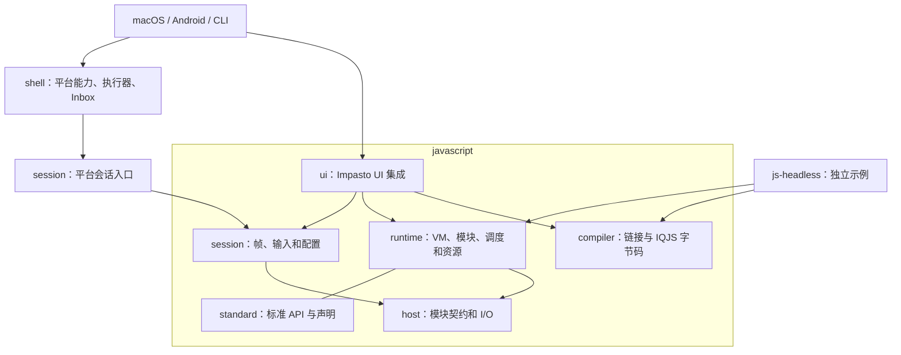

# Impasto JS 运行时与标准库重构设计

本文记录 `javascript` 的运行时接口、标准库、UI 绑定及与 `embedder` 的传输契约。实际验证见 [JS 运行时验收](runtime-and-standard-library-validation.md)。

## 1. 基线

`174c3663` 提取了 `js-host` 的宿主交换类型，`session` 按原名重导出。`c88bd4b` 引入 `js::Runtime`、内存模块、IQJS 封套和启动失败清理。运行时迁移以 `c0f409b` 为基线。固定盒子布局回放和屏外 Canvas 延迟绘制的回归纳入运行时验收。

## 2. Runtime 共用实现

`javascript::runtime::Runtime` 维护 VM、普通定时器、模块注册与调用、宿主 I/O 及资源状态。同步结果、异步结果与事件经过共享值转换。宿主二进制数据按实际视图读取。HTTP 执行模式互斥，取消在本地完成结算，资源额度由持有者在终结或读取时释放。UI 扩展保留渲染帧、Canvas 策略和响应式回调的顺序。

入口见 [Runtime](../../../crates/javascript/src/runtime/mod.rs)、[宿主绑定](../../../crates/javascript/src/runtime/io.rs)、[完成交付](../../../crates/javascript/src/runtime/delivery.rs)、[UI 装配](../../../crates/javascript/src/ui/player/vm/mod.rs)与 [宿主网络循环](../../../crates/embedder/common/src/net.rs)。

## 3. 依赖边界与所有权



`host` 使用 std，负责自有值、模块声明、一次性完成回调与传输契约。`runtime` feature 默认启用，包含 QuickJS 后端、编译器及标准库。`ui` feature 在此基础上接入树、响应式图、Canvas 与帧调度。`session` crate 重导出帧和输入契约，单独构建时只启用同名 feature。`embedder` 持有平台实现、网络传输、执行器与唤醒。

| 路径 | 职责 |
|---|---|
| `crates/javascript/src/host` | 宿主契约、模块元数据、声明渲染、传输身份与交付 |
| `crates/javascript/src/runtime` | VM 生命周期、模块目录、执行预算、调度、宿主绑定和资源表 |
| `crates/javascript/src/runtime/quickjs` | QuickJS 的 Context、持久引用、原生模块绑定、值转换和受信任字节码加载 |
| `crates/javascript/src/compiler` | 源码编译、静态导入检查、IQJS 封套格式与校验 |
| `crates/javascript/src/standard` | 标准 API 的原生实现、profile 与 TypeScript 声明 |
| `crates/javascript/src/ui` | UI 专用入口、ABI、场景和响应式绑定、帧编排 |
| `crates/javascript/src/session` | 平台与 UI 会话共享的生命周期、帧、输入和宿主配置 |
| `crates/embedder/common/src/{net.rs,http.rs,modules/,module_stubs.rs}` | 传输、首方模块实例收集、声明工具入口 |

## 4. Runtime API 与装配

Runtime 由所属线程创建、推进和关闭，保持 `!Send`。跨线程工作经 owned event 或 completion sender 回来。普通宿主入口包括 `builder`、`eval_script`、`start_module`、`take_module_result`、`drive`、`enqueue`、`take_jobs`、`counts`、`shutdown`。builder 接收 profile、模块目录、宿主绑定和限额，校验并装配后返回可启动的 Runtime。入口执行仍由调用者发起。

```rust
// 宿主收到事件或到达下一 deadline 时调用 drive。
let mut runtime = Runtime::builder()
    .standard(StandardProfile::legacy())
    .modules(catalog)
    .host(host_bindings)
    .limits(limits)
    .build()?;
let ticket = runtime.start_module("app:main")?;
let report = runtime.drive(now_ms)?;
let outcome = runtime.take_module_result(ticket)?;
```

`drive` 汇报这一轮执行的 timer、job、交付数量以及剩余可运行工作。下一 deadline 与在途 I/O 独立报告，宿主据此决定何时再次推进。结果待定的 ticket 保留，已完成的 ticket 读取一次后回收。

UI 需要的窄操作包括 `set_clock`、`begin_timer_turn`、`deliver_event`、`run_due_timers`、`checkpoint`、`next_deadline_ms` 和 `schedule_state`。一个动作只修改所负责的状态。推进时钟和推进 turn 分开，交付一条事件和排空一批事件分开。仅查询状态时使用共享引用。由 **宿主推进 Runtime** 和 **VM 栈内处理原生回调** 分别走适合当前借用的入口。JS 可重入操作之前释放资源表和 UI 状态的可变借用。关闭后的执行入口返回 `Closed`。

`javascript::runtime::ExtensionContext` 给受信任的原生扩展提供作用域内的 `Ctx`、带预算调用和受 Runtime 管理的 roots。VM 栈内回调复用当前 context。检查点由宿主推进器在栈外运行。跨调用持有 JS 引用时用后端 roots 或 UI owner 管理的短生命周期引用，随 VM 关闭前释放。延续现有稳定 `Box<Host>` 和 `Box<Inner>` 可作为第一步。登记指针的内部安装入口统一说明地址稳定期、有效的脚本阶段、移除点及销毁顺序。采用 `Rc` 时，VM 回调反向引用 UI 状态用 `Weak`。

普通 builder 可直接装配标准环境。UI 使用显式装配步骤，其中 **未启动** 表示应用入口尚未执行。`RuntimeBuilder::build_unstarted` 创建 VM 和值转换环境，UI 再按下一节的顺序安装绑定。`NativeFactory`、`Ctx` 和受信任字节码加载属于 QuickJS 后端。

## 5. 启动、失败与关闭

### UI 装配顺序

| 次序 | 操作 | 检查点 |
|---|---|---|
| 1 | 创建 VM 和 Context，固定 UI owner 地址，安装应用 loader | 安装 loader 时 UI 状态已就位 |
| 2 | 登记 userdata，安装 scene/Canvas 原生绑定、共享 console/timer/performance、UI rAF、`__host`、`#reactive` 原生模块 | 这一步完成基础原生环境 |
| 3 | 求值 ABI 和 scene，注册默认的 Rust 标准库 profile | 每段 `Host::eval` 后及标准库注册后运行 job checkpoint |
| 4 | 执行 reactive boot，保存 reactive 引用，移除临时 `__reactive` | reactive boot 求值后同样 checkpoint，并检查立即可见的拒绝 |
| 5 | 执行入口源码或 trusted bytecode | 保持各自现有 drain 与入口 Promise 检查，成功后扫除已脱离节点 |
| 6 | 由入口层调用 `install_io` | 外部 HTTP/socket 从此生效。入口期间走原有本地客户端或未连接分支 |

源码按现有 parser 判定脚本或模块。UI 兼容入口继续允许处于 pending 的 TLA。headless `eval_script` 保持只执行源码，`drive` 或显式 checkpoint 才推进 jobs。模块启动失败由入口调用者决定是否关闭 owner。UI 的入口构造失败关闭会话，显式 headless 调用仍可按错误类型保留 Runtime。

`legacy` 的本地 stream 把 head、chunk 或错误先暂存，待 JS 登记 token 后在帧内 I/O 点交付。测试覆盖入口源码、本地成功或错误、trusted bytecode 入口以及运行期外部完成。

### 生命周期与清理

```text
Allocated → Installing → Ready → Closing → Closed
                 失败 ───────────↗
```

1. 进入 `Closing` 后，撤销跨线程投递与新外部工作。封闭 completion sender 和唤醒登记。已有后台请求收到取消标记，唤醒等待额度的任务。
2. UI 结束活跃 Canvas lease 并归还 recorder 额度，保持 Tree、Graph、预算和 userdata 有效。在受限 cleanup 阶段运行 owner cleanup 和 driver 清理。cleanup 可以产生局部待释放资源，外部 I/O 的调用被阻止，错误在当前预算内记录。
3. 释放 UI callbacks、rAF、scene/reactive 引用及画布资源，移除 userdata。若原生 finalizer 依赖 UI 状态，其 owner 仍活到 Context 和 VM 销毁之后。
4. Runtime 丢弃未消费队列与通用 roots，清空 timers、listeners、tickets、pending 请求、socket 和 rejection 记录。随后卸载 tracker 和 interrupt，确认没有 active context 借用，依次销毁 Context 和 VM。
5. 释放 UI 原生状态并进入 `Closed`。重复 shutdown 无额外动作。清理错误经报告或日志交付，Drop 的工作受界限约束。

对 runtime 创建、context 创建、绑定组第 N 项注册、Web 标准绑定安装、UI bootstrap 和入口分别注入失败。每个 acquire 点验证 create/drop 与 roots，使用 RAII 保留部分安装资源直到清理完成。关闭验证包括二次关闭、`WeakRuntime` 失效、迟到消息没有 JS 回调、cleanup 中再次登记资源、Canvas/driver finalizer 访问合法状态。测试直接观测底层计数，既有 `BootStop` 测试继续运行。

## 6. 宿主调用、值与模块事件

### 绑定与解码

通用 binder 复用 `ModuleRegistry`、`Invoke`、`MethodExec` 和 `Settle`。宿主配置提供 registry、exec、completion 工厂与传输能力。调用顺序是运行 `OperationPolicy`，解码自有参数，取出该方法的 `Invoke`，在各自分支调用宿主。Promise 分支先保留 identity 与 roots，再调用宿主。解码或 reserve 失败立即返回，宿主同步 settle 只提交 owned 完成。现有 `Settle` 的一次性 `FnOnce` 和 drop-failed 语义保留。3.2 先适配 Shell 现有 completion 工厂，再与 UI 切换同步删除 `prepared`、`sync_result` 和失效的桥入口。

运行时的注册目录增加严格构建入口。目录验证 specifier、模块名歧义、重复导出和事件、对象导出冲突，以及有事件模块预留的 listener 名称。`delete` 等 ESM 导出名和 TypeScript 绑定标识符分别验证。旧 `ModuleRegistry::new` 保持 first-wins。`session` 的 `@impasto/<pkg>` 过滤继续由 UI 适配层执行。

唯一 Plugin codec 位于 `runtime/quickjs/codec.rs`。输入在借用结束后交给 Invoke，输出由同步返回、Plugin 完成和模块事件复用。HTTP 和 socket 复用其中的字节读取。Canvas 沿用原有直接批量路径。

| 值 | 保持的兼容与新增的验证 |
|---|---|
| Null / undefined、Bool、F64、Str | null 和 undefined 均映射到 `PluginValue::Null`。其余按原值转换。记录 NaN、Infinity、异常属性与非普通对象的现行表现 |
| Bytes | 返回少于 4096 字节用 `Uint8Array`，达到 4096 用 `ArrayBuffer`，以 UI 基线为准。输入复制真实 view 范围，覆盖 subarray、空 body、空 buffer、detached buffer。若扩到 `DataView` 等 view，单列 codec 支持变化 |
| List / Map | 递归转换。保留现有深度 256 上限，增加整次转换的元素和字节预算，遍历时检测活动路径上的循环。同一对象在不同分支出现仍可转换 |
| 对象、getter / Proxy | 保留现有取值与异常时机。访问属性时释放 registry 及 pending 的可变借用。Map 编码定义自有属性，维持约定的对象行为，覆盖 `__proto__` 等键 |
| Function / Symbol / BigInt | 先记录两条宿主入口当前行为。若改为显式拒绝，单独实施和验收 |

字节预算先检查再拷贝，参数解码先于 reserve。输入和输出各有边界。用两条已登记的完成事件验证失败隔离。第一条无法转换且 VM 仍可执行时，用最小错误值拒绝并清掉其资源，第二条照常交付。若 VM 进入不可恢复状态，由 owner 关闭并释放余下队列与 roots。Promise 创建到返回之间的出错用 guard 回收。调用 JS 的失败路径同样适用于可抛出的属性访问和 Promise resolve 引起的重入。

### 模块事件

`HostEvent` 携带模块身份、事件名与 `PluginValue`，外部线程向队列提交。先从 Runtime 取稳定订阅快照，再在无表借用时恢复并调用。当前 UI 允许重复加同一引用，remove 删除匹配项，已进入快照的回调仍可执行。新增项从下一次分发开始可见。UI 的非法参数或未知事件保持空操作，headless 普通 API 的校验错误独立约定。

`AppState.change` 保持字符串，`focus` 保持 `"true"` / `"false"`，`Linking.url` 保持每回调转换出 `{url}` 的现有行为。UI 生命周期、焦点和 URL 命令保持同步分发。监听错误保持各 driver 当前的继续或停止规则，新增诊断单列提交。订阅移除和关闭释放 root，唤醒由待运行任务或 UI 实际更新决定。模块事件声明中的 TypeScript 文本用于类型生成。

## 7. 调度、时钟与预算

### 交付与帧顺序

| 驱动入口 | 兼容顺序 |
|---|---|
| headless `drive(now_ms)` | 先交付 inbox，再推进 timer turn、更新 mono/origin，跑最多 64 个 timer，做 job checkpoint，刷新模块票据 |
| Shell 外部 `Command` | 入队后唤醒渲染线程，命令处理直接调用 `Session::io_event`。socket 回调可在下一帧前执行，此处沿用上一帧时钟。JavaScript 后续 jobs 仍由原检查点推进 |
| UI 帧内积压 | 本地/启动积压走帧内 `flush_pending`，保留 HTTP、Plugin、socket 的分组次序和各组内部顺序。同一条流按 head、chunk、终结顺序交付 |
| UI 模块事件 | 生命周期、窗口焦点和 launch URL 留在各自同步命令点，外部 producer 只投递 owned 数据 |

```text
motion / tree tick → gestures → jobs
→ set_clock + begin_timer_turn → Canvas errors（未暂停）→ flush_pending
→ timers → jobs → rAF → jobs → motion end → reactive
→ frame callbacks → jobs → reactive → mutations → sweep
→ styles / 必要布局 → drivers → mutations / 必要布局
→ layout listeners / reactive / mutations / 必要布局 → Canvas paint → record
```

`mono_ms` 用于 timeout 与 `performance.now()`。首轮时钟设置前 `performance.now()` 为 0。用非零时钟起点验收首轮行为。`target_ms` 和 `interval_ms` 由 UI 帧路径使用，rAF 保留当前回调参数传递规则。`Date` 沿用墙钟。负 delay 夹到 0，新 timer 下一 turn 才可运行，取消按 kind，单批最多 64 个，额外参数最多 8 个。UI 错误先记录再继续当批可执行项，headless 维持提前返回。错误退出仍清除已经停用的 timer roots。rAF 由 UI 单独持有，暂停及恢复保持基线。

用同一组可控事件固定检查点。让 UI 的 socket 回调读取 `performance.now()`，并登记微任务和零延时 timer。trace 应先见外部命令回调，随后在帧开头用上一帧时钟执行微任务，再更新时钟并运行 timer。另测在帧内 `flush_pending` 回调中登记的 timer，因 turn 已推进而等到下一 turn。headless 对照记录 inbox 回调读到的时钟及其登记的 timer 在本次 `drive` 的执行位置。

共享操作报告已执行数、剩余可运行工作、下一 deadline 和在途外部工作。headless 可用 `Yielding`，job 达上限时报告剩余工作。UI 使用 `LegacyStrict`，在原检查点排空 microtask 后进入 reactive 和 layout。空闲和暂停按可运行工作、有效 deadline、事件和 UI 需求唤醒。

### 预算

执行预算独立于注入的调度时钟，初始值沿用 eval 1000 ms 与其他执行 128 ms。UI 的 timer/rAF 使用整批预算，job checkpoint 按现行批次设置期限。预算 guard 保留阶段标签。嵌套入口取父子期限的较小值，退出恢复父作用域。此举改变 UI 中嵌套 `drain` 重设期限的现行规则，列入 3.0c 行为修正。入口覆盖 eval、模块/字节码入口、timer、listener、job、交付 hook 及可能执行 JS 的 native 重入。记录异常和堆栈时继续使用同一受限作用域，消费二次异常并给出稳定诊断。对子进程执行超时测试，并由独立于 JS 的外部期限收尾。

16 MiB VM heap 和 8 MiB stack 作为当前基线，队列、host bytes 和 native 资源单独计费。QuickJS interrupt 约束 JS 执行，宿主同步调用的超时或取消由宿主实现。通用诊断保留 kind、message、stack、phase 和 module。UI 添加 node/frame 上下文并映射到 `ScriptFault`。未处理 rejection 的记录有界，跟踪何时产生、checkpoint 后何时报告、随后被处理时何时释放，以及溢出计数。原生失败通过结构化错误返回，FFI 边界按 Rust panic 策略设计。

## 8. I/O 执行、身份与终结

### 传输能力

HTTP 使用互斥的执行策略。External 将请求交给外部 host，headless 的默认做法是通过 `take_jobs` 取出可执行任务。Inline 显式配置阻塞 `HttpClient`，结果按已有检查点交付，执行过的请求只出现在诊断记录。UI 还有未连接分支，从入口启动一直适用到 `install_io`。本地客户端存在时可在调用线程执行，缺少客户端时交付约定的连接错误。socket 通过单独的外部传输能力接入，或沿用未连接行为。这个拆分允许 headless 同时使用 Inline HTTP 和外部 socket。

`take_jobs()` 交出待执行的外部任务。传输登记失败、完成、取消与关闭经过同一资源终结路径。stream 的 head 更新状态并交出响应，body 继续由 reader 消费。

### 请求身份和资源表

```text
RuntimeKey = (instance, generation)
RequestKey = (RuntimeKey, sequence)
Delivery   = (RuntimeKey, owned event)
```

`instance` 区分多个 Runtime，`generation` 使同一个宿主路由重启时的旧消息失效。`sequence` 对单次在途操作唯一，资源表同时验证种类和阶段。HTTP、Plugin、reader 和 socket 可共用身份与配额机制，各自有具体状态。后台 sender 和 Shell `Command` 路由在投递和接收边界验证 generation。`Delivery` 携带运行时身份，`IoEvent` payload 里的 token 标识具体操作。JS 可见 Number ID 必须是正的安全整数，范围上限为 `2^53 - 1`，耗尽时报错。

普通请求从 Pending 进入 Completed、Failed、Canceled 或 Closed。stream 在 Pending 内区分等待 head 和读取 body，允许 HTTP 传输结束后仍有已入队 body 可读。一个请求的 Promise、取消标记、队列额度和平台传输句柄都有明确释放点。

1. 先校验事件属于当前 generation，再查 pending 表与事件种类。丢弃未知、重复及迟到事件，并记录有界诊断计数。
2. 终结时在所属线程取得资源。释放表借用后转换值和结算。转换失败归同一终结流程，按第 6 节处理当前和余下事件。
3. 取消在本地即结算或改变 reader 状态。先标记后台取消，清除待投递数据，唤醒工作线程，归还额度。后台的迟到结果走普通失效验证。
4. 结束时按所有权释放取消标记、native payload、等待中的 Promise、reader、socket 和 transport 句柄。stream 正常结束时，已入队数据由 body 队列保有到消费或释放。失败和取消按各自规则丢弃队列。
5. 模块票据保留 Runtime 身份。pending 可轮询，完成后用自有结果替换 root。`take_module_result` 消费完成记录。foreign 与已消费票据可区分。配额与放弃票据的行为要明确，放弃观察只回收跟踪状态。TLA 的执行仍依 QuickJS 模块状态推进。

`RuntimeCounts` 逐步分出在用数和高水位，包括 promises、timers、tickets、rejections、listeners、requests、sockets、queued events 和 queued bytes。UI 继续独立统计 Canvas lease、recorder、布局和 picture。完成记录与其他资源的计数可单独核对。

### 队列、流控与唤醒

在 JS 线程提交请求和 socket send 时使用非阻塞、有界的 admission。未能登记时保留输入或返回可处理的错误。后台向 Runtime 交付前同时取得事件数量和 payload 字节额度。额度覆盖等待投递、Shell Inbox 和 JS body 队列里同一份待消费数据，转移所有权时同步转移记账。若必须复制，计入两份并存期间的内存。全局和单资源限额分别配置。

终结事件按最大在途资源数预留容量，终结 payload 自身也有上限。预留容量保证可以入队，同一资源仍按 head、chunk、end 的顺序消费。取消主动弃掉未读数据时，按失效规则处理已经入队的 chunk。对于能持续提交的普通 owned event，调用方可收到 `QueueFull(event)` 并决定重试或施加节流。完成 sender 的预留容量应让 `Settle::Drop` 一类路径也能非阻塞终结 Promise。

先入队再发 wake，调用 wake 回调前释放队列锁。合并 wake 时，用同一锁内的队列检查或 epoch 协议处理消费者刚看到空队列时的并发入队。挂起的 I/O 只计在途。实际进入队列的事件、可运行的任务或更早的 deadline 才产生唤醒依据。关闭端先使投递和 wake 失效，再释放资源并唤醒等待 credit 的任务。

`embedder` 将 `net::serve` 的命令接收与会阻塞的 HTTP 请求任务分开。后台等待流额度时，命令循环仍能处理取消、短请求与 socket 控制。超时、取消与 shutdown 会结束等待。`embedder` 的回归测试让无人读取的流耗尽额度，再验证短请求和 socket 仍能推进。见 [宿主网络循环](../../../crates/embedder/common/src/net.rs)和 [OpenWire 适配](../../../crates/embedder/common/src/http.rs)。

## 9. 标准库与支持范围

`legacy` 的行为夹具固定兼容边界。`crates/javascript/src/standard` 用 Rust 注册公开构造器、原型和方法。事件监听、取消、编码与 URL 状态、Headers、Body 队列、reader 锁、Fetch 结算和 WebSocket 状态由同一线程的 Rust 对象持有。JS 引用通过 QuickJS class tracing 保持可达，调用 JS 前释放资源状态的借用。普通 Promise、回调和对象继续使用 QuickJS 自身实现。各 Rust 绑定模块维护 TypeScript 签名。`StandardProfile::declarations()` 按 profile 和传输能力选择模块，再拼接声明。`just standard-check` 用 `legacy` 和 `portable` 的四种传输组合核对 TypeScript 声明与实际 QuickJS 全局值、原型和继承，并在两侧执行代表性用例。

`legacy` 保持默认和已有 API，其中包括 `fetchStream`。`portable` 只发布已有行为夹具和类型声明覆盖的子集。两者共用实现，差异由安装清单及兼容适配表达。只在测到显著启动成本并且初始化与 bootstrap 独立时考虑 lazy。按需安装验证首次读取/赋值、递归访问、失败缓存和属性描述符。

| 模块 | 实施与验收 |
|---|---|
| console、performance、timer | 共用 Rust 绑定，记录限额和诊断。rAF 由 UI 调度 |
| Event/EventTarget、Abort | 选择可复用语义子集，覆盖分发重入、增删、once、abort 幂等、reason、异常和监听释放 |
| Encoding | UTF-8 TextEncoder/TextDecoder，覆盖代理对、孤立代理项、非法字节、replacement/fatal、BOM 与跨 chunk/流式 decode。声明仅发布实际支持的参数 |
| URL、URLSearchParams | 优先评估成熟解析器，覆盖相对路径与 base、Unicode、重复键、空值、迭代和 percent 编码 |
| Headers、Request、Response、Body | 大小写、多值、null body 和有 body 的行为、消费规则、字节/文本/JSON。流接入前保留同一消费入口，标准 stream 的锁定行为在流接通后验收 |
| fetch、ReadableStream | 第 10 节的同一 transport、资源表和额度。portable 只在配置满足并完成语义测试后公开对应 API |
| WebSocket | 独立连接状态，复用 bytes codec、身份和终结规则。readyState、二进制类型、事件、关闭后发送和缓冲限额需验收 |
| buffer、crypto、path、压缩 | 有实际需求再按模块决策，单独审查依赖、权限和平台 |

依赖以仓库 `quickjs-jit =0.14.2` 与现有 feature 为基线。候选库固定版本，核对许可证、sys ABI、全局安装副作用、线程和 fs/process 暴露，验证 Linux、macOS 和 Android 构建及实际 QuickJS 语义。当前仓库约束排除 `quickjs-jit-stdlib`、`quickjs-jit-runtime`、第二引擎以及未启用的引擎特性。若将来调整取舍，先单独修订依赖决定。第三方纯实现仍由项目的 profile、声明、limits 和 transport adapter 接入，网络请求继续经过已有后端和能力检查。默认标准库范围限于本表，DOM、任意本地路径、进程环境与进程控制属于宿主能力之外的范围。

## 10. Fetch、Streams 与 Socket

```text
Request / Body 校验 → owned 请求参数 → reserve RequestKey → 传输
  ├─ head 前失败 → reject fetch Promise → 释放请求
  └─ head → resolve Response → chunk 进入有界 Body 队列
                               ├─ End → 消费完已排队数据后关闭
                               ├─ Error → body errored，拒绝待读取
                               └─ cancel/abort → 按来源转换并释放
```

### Body 状态

保持独立的 body 是否存在、reader 锁、`disturbed` 标记和 readable/closed/errored 状态。取得 reader 只建立锁。释放锁可以使尚未开始读取的 body 恢复可消费。开始读取或取消会设置 disturbed，设置后保持。portable 的 `bodyUsed` 反映 disturbed，消费入口对 locked 或 disturbed body 拒绝。null body 的消费由 Fetch 规则测试。读取 waiter 有明确归属与限额，释放锁、关闭、失败和取消分别结算。见 [WHATWG Fetch Body](https://fetch.spec.whatwg.org/#body-mixin) 和 [WHATWG Streams 锁定](https://streams.spec.whatwg.org/#locking)。

`text()`、`json()`、`arrayBuffer()` 经同一消费入口。读出的 chunk 移交物化缓冲后归还队列 credit。物化缓冲有独立的总字节预算，超限时拒绝并终结读取。最终构造 JS 值所需的复制计入峰值，以免整响应聚合把 credit 一直占到 end，或把有界队列转成无界物化。第一轮声明省略 clone/tee，直到能定义两端共享流量和滞后端额度。

### 传输与兼容

External transport 提供真正的增量读取。收到 head 后可发出 Response，HTTP 请求可以继续读取。head 后失败只改变 body 的错误状态。reader cancel 在首个无 tee 的实现中取消其整个 body。AbortSignal 在请求终结后移除登记。Inline 可按 legacy 使用有界的整响应交付，portable 的流式入口需要 External。Inline 回调在本次调用内完成传输和交付登记。

`fetchStream` 适配到同一个 body 状态，锁定旧的 `getReader()`、status、headers 和 Promise 结算点。legacy `fetch` 的兼容包装保留整响应结算时机及旧错误映射，迁到 head 时结算的语义由 portable 显式提供。对旧错误和终结的修正分别写明行为和测试。后端正常 EOF 必须产生一次结束。head 前失败、结束遗漏、done/abort 竞争、读取前与 head 后取消各有明确终结结果。对不遵守完成契约的外部端，需定义断开或超时触发本地终结。

慢消费者、无 reader、并发多流、跨 chunk UTF-8、空响应及跨边界的大 chunk 都进入测试。现有请求/响应总量上限继续记作兼容基线，队列上限与新物化上限按测量确定。

socket 的状态为 Connecting、Open、Closing、Closed。关闭、握手失败、远端 EOF 和传输错误归同一终结入口，分别产生约定的 JS 事件与一次资源回收，释放 sender、排队字节和 roots。按连接限额、Runtime 总额和后台队列限额记账。

## 11. 模块目录、编译、声明与权限

### Loader 与编译

通用目录负责组合内存源码和原生模块、发现冲突、生成导出视图。解析顺序为内置精确模块、已注册宿主模块、应用授权源码、明确未找到。权限拒绝与非法路径是终止错误。内存 source 维持显式名称和相对名归一，UI 使用自己的应用根目录、路径校验和 `@impasto/` 政策。文件身份与物理路径区分，验证 canonical root、symlink、遍历、文件与目录、大小写和分隔符。

原生模块的运行时导出、声明渲染与编译声明从同一可信描述生成。宿主模块以现有 `Module`、`MethodTypes`、`ModuleExports`、`EventType` 为源，目录派生 specifier、导出名和声明视图。UI 独立提供 `scene`、`reactive`、`#reactive` 的导出描述。

CLI 按目标和应用权限组装编译目录。独立 bundle 使用首方模块目录，macOS 和 Android 使用目标和应用声明的模块目录。编译检查合法导入、缺失导出和重复 specifier，宿主方法在编译期间保持零调用。见 [UI 编译 loader](../../../crates/javascript/src/ui/player/vm/modules.rs)和 [CLI bundle](../../../crates/cli/src/build.rs)。

公共编译产物沿用 IQJS 的 engine/version/kind 封套和已钉引擎。源代码入口保持明确。外来字节码仅从受信任的 unsafe 路径加载，版本和封套只负责兼容性检查。本进程编译的产物由已有安全包装入口接收。目录/profile 指纹优先作为缓存 key 和诊断元数据。改变封套时单列格式版本及重编策略。

### 声明与能力

纯声明渲染放在无 UI 依赖的层，首方模块实例和输出路径由现有 Shell 工具收集。`module-stubs` 生成 `packages/<pkg>/src/native.d.ts`，`--check` 只读校验。声明快照与 runtime export snapshot 用同一 metadata，覆盖具名/对象导出、保留字、Promise 类型、事件 payload、可选功能和负例。标准全局声明由 profile 产生，发布实际支持的 Web 子集。UI 声明保持独立。

按构建实现、目录安装、宿主授权、当次执行阶段四层判断能力。`hasModule` 只描述链接状态，UI 的旧模块名查询和 headless 的 specifier 查询通过兼容入口保留各自含义。TypeScript 展示文本用于生成声明，运行时参数检查由 binder 或能力实现执行。文件、剪贴板和网络授权在宿主实际操作点校验，具有重定向等再访问行为的传输需要覆盖后续目标。Canvas 的 `OperationPolicy` 保持原阻止副作用的范围，console、performance 和 timer 沿用当前语义。

## 12. 测试与跨平台验收

| 范围 | 必测用例与证据 |
|---|---|
| Rust 依赖边界 | 用 `cargo tree` 分别核对各 feature 的运行和构建依赖，保留边界脚本。独立 consumer 无需 Shaper、Tree 或 Session，实际运行同步/Promise 模块、事件、标准库和外部 I/O |
| 值与模块 binder | 同步/异步/事件同值、嵌套、空/字节、view offset、4095/4096、getter 重入、特殊键、深度及总量预算，坏完成后正常完成仍结算 |
| 调度顺序 | 手动时钟下记录启动、命令、帧、本地与外部交付，timer kind/turn/参数、32 jobs/64 timers、暂停与恢复，记录回调异常后的继续/退出 |
| 预算与释放 | eval、TLA、job、timer、listener 超时由子进程隔离，外部超时只在测试无法退出时收尾。partial startup、cleanup 再登记、二次关闭、Weak、迟到结果、roots 归零 |
| loader 与编译 | 正确/重复/缺失名称和导出、动态导入、循环、TLA resolve/reject、foreign/已消费 ticket、应用根拒绝和不执行宿主方法 |
| I/O 与唤醒 | fake transport 固定完成顺序和竞争。真实 Shell 测慢流与短请求/socket 同推、shutdown 唤醒等待者、后端断开、上限和 queued bytes 高水位。验证旧 generation 在路由切换后失效 |
| Web 子集 | 每个模块列出选用的 WPT 用例或等价测试及排除范围。验证 Abort、UTF-8、URL、Headers、body 锁定/释放/消费与关闭状态 |
| UI 与性能 | 输入、IME、帧/布局回调、两个 reactive 点、driver、Canvas policy、屏外重绘和固定盒子回放。阶段迁移按相同脚本和日志顺序逐步比对 |
| 声明与权限 | `native.d.ts` 漂移、profile exports、TS 编译正反例、拒绝的能力和传输重定向策略 |
| 资源与进程 | 重复启动和关闭、完成/取消/票据回收、accept/reject 计数与高水位，加单独的 RSS 采样和本地记录 |

以下是实施验收入口，结果按实际运行记录。

```bash
cargo fmt --all -- --check
python3 tools/check-javascript-boundaries.py
cargo run --locked -p javascript --bin js-headless
cargo run --locked -p uicore --bin style-types -- --check --root .
RUSTFLAGS="-D warnings" cargo check --workspace --exclude embedder-macos
cargo clippy --workspace --exclude embedder-macos --all-targets -- -D warnings
pnpm install --frozen-lockfile
just gallery-dist
cargo test --workspace --exclude embedder-macos
pnpm -r test
```

CI 运行 `cargo run --locked -p embedder --bin module-stubs -- --check` 和 `just standard-check` 对应的标准库契约检查。macOS runner 在同一 SHA 执行本机 `cargo clippy -p embedder-macos --all-targets -- -D warnings` 和 `cargo test -p embedder-macos`，另记带 SDK 的宿主启动结果。Android 将 `just android`、`just android-release`、`android-x64` 模拟器和实体设备分别记录，注明 ABI、构建 profile、SDK/NDK 与运行场景。iOS 尚无宿主。可用命令与系统矩阵见 [justfile](../../../justfile) 和 [CI](../../../.github/workflows/check.yml)。

## 13. 性能与资源保护

| 现有路径与用例 | 验收不变量 |
|---|---|
| `offscreen_canvas_releases_dependencies_and_draws_latest_once` | 屏外 callback/preparation 为零且 `again == false`，回到视口只画最新值一次 |
| `fixed_boxes_relayout_with_their_parent_input_and_match_a_root_pass` | 固定盒子保持原父约束，局部回放几何与 root pass 一致。对照 root/local work |
| `fixed_text_keeps_layout_when_new_ink_stays_inside_its_box` | 文字仍落在固定盒子时保留布局，观察 `same_text_layouts` 和 `root_layouts` |
| `canvas_batches_match_scalar_paint_order_and_reject_bad_points` 与 bytes fixture | 批量命令绘制顺序一致，校验范围保持，使用真实 view 子区间。检查拷贝及原生调用次数 |
| 高频 scene/reactive | 直接调用现有树与图，不引入每节点的通用值编码和额外目录查找 |
| idle/暂停 | I/O 在途期间保持事件与 deadline 驱动，记录 wake、vsync 与恢复行为 |

用稳定基线和改动提交做同机 A/B，记录工具链、系统、SDK、锁文件、release 配置和负载。两边预热、交错执行，保存原始样本与 median / p95 / max。覆盖空 Runtime 和 UI 启动、scene 高频调用、reactive burst、固定布局文字、屏外 Canvas、Promise/timer、嵌套宿主值、慢流和 idle/恢复。除耗时外，记录 JS/native 分配与拷贝字节、各资源高水位、queue bytes、Canvas callback/preparation、root/local layout、picture writes 和 wake。

将正确性不变量和耗时阈值分别验收。零工作的路径继续保持为零，耗时阈值等新基线测出波动后确定。资源循环包含 warm-up、重复运行、关闭和空闲回收。结合原生计数、drop 记录和 RSS 解释 allocator 缓存与资源滞留，按阶段保存原始记录。测试落点见 [UI 会话回归](../../../crates/javascript/src/ui/tests.rs)和 [uicore 布局回归](../../../crates/uicore/src/tree/layout.rs)。

## 14. 验收条件

- 独立程序通过 `js` 启动标准模块，使用宿主同步与异步方法、事件和外部 I/O。普通 API 使用自有值与句柄。
- Impasto 作为显式扩展使用同一 Runtime，通用执行、标准库、值转换和资源终结共用实现。UI 帧执行及优化通过回归。
- 请求、reader、socket、listener、ticket 和 roots 的终结有计数与竞态用例。旧路由的迟到事件被拒绝，慢消费者的内存和等待有上限。
- 运行时安装目录、模块导出、声明、能力和支持平台一致。已实现的 Web 子集与仍待验证的行为具备明确清单。
- UI 的交付时序、布局与 Canvas 不变量用同一代码提交验收。性能和资源结论有新基线及原始样本。
