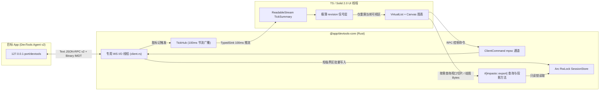
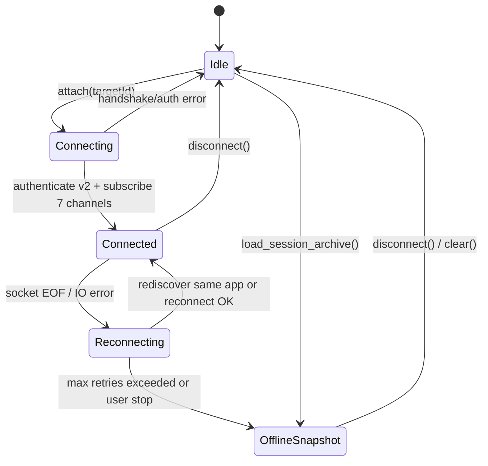

# `examples/devtools-desktop` 实现方案 1：工程架构、协议微补丁与 Rust Core（`@app/devtools-core`）

> **适用范围与前置约束**
> - 本文档是 [独立进程外 DevTools 规划](standalone-devtools-plan.md) 的 Stage 2 细化落地文档（第 1/3 篇），定义 `examples/devtools-desktop/` 的工程骨架升级、3 处极小向后兼容协议补丁，以及 Rust 核心层 `@app/devtools-core` 的完整并发模型、有界时序存储、分析引擎与视口切片投影协议。
> - **前置基线**：5 项前置改造（[协议与发现](devtools-protocol-and-discovery.md)、[重绘与 Overlay](devtools-engine-repaint-and-overlay.md)、[全链路网络](devtools-network-full-tracing.md)、[JS Runtime](devtools-js-runtime-observability.md)、[macOS 底座](devtools-macos-desktop-foundation.md)）均已落地，且 [examples/devtools-desktop/](../examples/devtools-desktop/app.toml) 已具备最小可运行的 smoke 骨架。
> - **核心铁律**：重逻辑全部留在 `examples/devtools-desktop/rust/`，JS/Solid 层严禁持有全量帧/请求/Span/JSON 原始大对象，仅通过低频 `TypedSink<TickSummary>` 通知与按需 Viewport Projection 拉取可视切片及紧凑绘图缓冲区。
> - **边界与安全规则**：严格遵守 `just boundaries`（`examples/devtools-desktop/rust` 仅依赖 `impasto` SDK、插件包、`devtools-protocol`、`devtools-symbols` 及纯 Rust 工具 crate，不反向依赖 `engine` / `raster` / `embedder*` / QuickJS）；全面执行 `unsafe_code = "deny"`、`unwrap_used = "deny"`、`expect_used = "deny"`。

---

## 1. 现状盘点与 3 处极小协议微补丁（M0）

### 1.1 Stage 1 骨架与 Stage 2 对应实现

下表记录 [桌面应用](../examples/devtools-desktop/app.toml) 从 Stage 1 骨架到 Stage 2 的改动：

| Stage 2 文件 | Stage 1 能力 | Stage 2 演进方向 |
|---|---|---|
| [app.toml](../examples/devtools-desktop/app.toml) | 配置了 `targets = ["macos"]`、`[macos.window]`（`1360×860` / 最小 `840×520` / `autosave_name`）及 `@impasto/solid-renderer`、`@impasto/solid-ui`、`@impasto/file-system` | 增补 `@impasto/clipboard` 内置插件依赖 |
| [rust/Cargo.toml](../examples/devtools-desktop/rust/Cargo.toml) | 已引入 `impasto`、`impasto-file-system`、`devtools-protocol`、`devtools-symbols`、`serde`、`serde_json`、`tungstenite` 并启用完整 lints | 增补 `flate2`（离线归档 `.impasto-session` 压缩/解压）与可选 `url`（编辑器协议 URI 编码） |
| [rust/src/discovery.rs](../examples/devtools-desktop/rust/src/discovery.rs) | 已支持读取私密目录 `$TMPDIR/impasto-devtools/{sessions,devices}`、PID 存活校验、拉起/回收 `adb forward` 与 `iproxy` 隧道 | 补充 `project_root` / `framework_root` / `source_map` 元信息暴露、进程/设备定时热发现与僵尸文件忽略 |
| [rust/src/client.rs](../examples/devtools-desktop/rust/src/client.rs) | 同步单锁 `WebSocket<TcpStream>`，仅订阅 `Channel::Frames` 并缓存单条 `last_frame`，依赖 TS 侧 `500ms` 轮询 | 重构为后台专用双工 I/O 线程 + 全 7 通道流式摄入 + Binary Frame 关联解码 + 指数退避自动重连与**断线快照保留** |
| [rust/src/archive.rs](../examples/devtools-desktop/rust/src/archive.rs) | 校验 `.pftrace` / `.impasto-session` / `.impsym` / `.map` / `.json` 基本格式 | 扩展为完整 `archive.rs`，支持 `.impasto-session` 读写、`.pftrace` 落盘导出、`bundle-size.json` 解析加载 |
| [src/main.tsx](../examples/devtools-desktop/src/main.tsx) | 144 行双栏文本 smoke 页，展示目标列表和最新一帧 3 项数字 | 替换为完整 5 区域 Workbench、Canvas 图表引擎与 6 大诊断页面 |

### 1.2 需先行合入的 3 处极小后端/协议微补丁（总计 ~70 行，100% 向后兼容）

核对已落地的服务端代码后，发现有 3 项已在目标进程内部采集或持有的字段尚未透出给远端客户端，建议在进入 M1 前一次性补齐：

1. **微补丁 A：暴露 Layout Overflow 报告（`view.layout_issues` RPC）**
   - **现状**：[ui_frame.rs](../crates/embedder/common/src/host/ui_frame.rs#L641-L645) 已在开启 `layout_scan` 时调用 `hub.set_layout_report(report)`，[hub.rs](../crates/embedder/common/src/diagnostics/hub.rs#L554-L556) 已有 `pub fn layout_report(&self) -> String`，但 [remote.rs](../crates/embedder/common/src/diagnostics/remote.rs#L567-L784) 尚未提供查询入口。
   - **改动**：在 `remote.rs` 的 `request_v2` 新增 `"view.layout_issues"` 分支：直接读取 `hub.layout_report()` 并解析 JSON 返回；若当前未开启周期扫描且传参 `{"inspect": true}`，通过 `DevtoolsQuery::ViewLayoutIssues` 调用 `session.inspect_layout_issues()` 执行单次按需扫描返回 `{"issues":[...]}`。
2. **微补丁 B：在 `FrameRecord` 透出已采集的 Raster 4 阶段耗时与资源池峰值**
   - **现状**：[crates/raster/src/lib.rs](../crates/raster/src/lib.rs#L97-L117) 的 `SubmitStats`、`AtlasStats`、`ImageUploadStats`、`RenderStats` 已随每帧进入 `FrameSample.raster`，但 [frame.rs](../crates/devtools-protocol/src/frame.rs) 与 [remote_frame.rs](../crates/embedder/common/src/diagnostics/remote_frame.rs) 尚未将其映射到线协议。
   - **改动**：在 `devtools_protocol::FrameRecord` 末尾新增 `#[serde(default)]` 加性字段并在 `remote_frame::record` 填充：
     - Raster 细分耗时（ms）：`picture_prepare_ms`、`glyph_prepare_ms`、`compose_ms`、`encode_ms`、`raster_flush_ms`、`queue_submit_ms`、`acquire_ms`；
     - Atlas 与纹理池：`atlas_misses: u32`、`atlas_evictions: u32`、`atlas_bytes: u64`、`image_resident_bytes: u64`、`offscreen_peak_bytes: u64`、`offscreen_passes: u32`、`direct_present: bool`。
   - **兼容性**：全部标量均为 `#[serde(default)]`，旧客户端反序列化自动忽略未知字段，新客户端连接旧 Agent 自动回落零值。
3. **微补丁 C：USB 设备自动符号表透传（`DeviceSessionEntry.source_map`）**
   - **现状**：[devtools-protocol/src/lib.rs](../crates/devtools-protocol/src/lib.rs#L123-L130) 中 `LocalSessionEntry` 有 `source_map: Option<PathBuf>`，但 `DeviceSessionEntry` 缺少该字段，导致真机调试时必须手动导入 `.impsym`。
   - **改动**：为 `DeviceSessionEntry` 增加 `#[serde(default)] pub source_map: Option<PathBuf>`；[cli/src/devtools.rs](../crates/cli/src/devtools.rs#L114-L146) 在 `register_device` 写入构建产出的 `.impsym`/`.map` 路径（若存在）；`examples/devtools-desktop/rust/src/discovery.rs` 的 `Target::symbol_path()` 同步返回设备 `source_map`。

---

## 2. 工程配置与模块目录布局

### 2.1 工程清单更新

- **[examples/devtools-desktop/app.toml](../examples/devtools-desktop/app.toml)**：
  ```toml
  name = "devtools-desktop"
  version = "0.1.0"
  targets = ["macos"]

  [macos.window]
  title = "Impasto DevTools"
  width = 1400
  height = 880
  min_width = 960
  min_height = 600
  autosave_name = "impasto.devtools.main"

  [dependencies]
  "@impasto/solid-renderer" = "builtin"
  "@impasto/solid-ui" = "builtin"
  "@impasto/file-system" = "builtin"
  "@impasto/clipboard" = "builtin"
  ```
- **[examples/devtools-desktop/package.json](../examples/devtools-desktop/package.json)**：同步在 `dependencies` 增补 `"@impasto/clipboard": "workspace:*"`。
- **[examples/devtools-desktop/rust/Cargo.toml](../examples/devtools-desktop/rust/Cargo.toml)**：保留原有 `impasto`、`impasto-file-system`、`devtools-protocol`、`devtools-symbols`、`serde`、`serde_json`、`tungstenite`，仅增量添加：
  - `flate2 = "1"`（`.impasto-session` 归档 gzip 压缩/解压）
  - `url = "2"`（生成 `vscode://file...` / `cursor://file...` / `zed://file...` 安全 URI）
  - 不引入 `tokio`（`Desktop` 直接运行独立 `std::thread` 驱动阻塞式非阻塞轮询的 `tungstenite` 套接字，配合 `impasto::Runtime::spawn_blocking` 与 `TypedSink`，二进制体积最小且无双异步运行时冲突）。

### 2.2 `examples/devtools-desktop/rust/src/` 模块目录规划

```text
examples/devtools-desktop/rust/src/
├── lib.rs                 # #[impasto::module(specifier = "@app/devtools-core")] + 全部 #[impasto::export] 入口
├── error.rs               # DesktopError（细化 scope/code：disconnected/timeout/invalid_input/io/protocol）
├── types.rs               # 跨 FFI 的 #[derive(ImpastoType)] 轻量视图模型与 TickSummary
├── discovery.rs           # 本机 sessions/ + devices/ 发现、PID 存活检测、adb/iproxy 隧道生命周期
├── client.rs              # 后台双工 WS v2 引擎、7 通道游标、Binary Frame 解码、自动重连与快照保留
├── store/
│   ├── mod.rs             # SessionStore 总枢（会话元信息、连接态、各子库 revision、暂停控制）
│   ├── frames.rs          # FrameStore（2400 帧环形索引 + GPU 回填原地更新 + 多帧统计窗口）
│   ├── repaints.rs        # RepaintStore（帧级重绘批次、节点热力累计、最新 View/Layer 快照与选中态）
│   ├── network.rs         # NetworkStore（2000 请求流式表、按需 Body LRU 缓存、WS 帧流缓冲）
│   ├── js_runtime.rs      # JsStore（内存时序 300 点、Timers/Promises 快照、GC Diff 历史、原始采样栈）
│   ├── logs.rs            # LogStore（Logs 4000 + Errors 500 + SourceMap 符号化缓存）
│   └── resources.rs       # ResourceStore（Atlas/Offscreen/Image 时序 + BundleReport 树索引）
├── analyzer/
│   ├── mod.rs
│   ├── gantt.rs           # 单帧 5 泳道甘特区间构造（Platform/UI/Raster/IO/GPU 归一化）
│   ├── flamegraph.rs      # 采样栈符号化、前缀树折叠、Top-Down/Bottom-Up 汇总与矩形布局
│   ├── json_index.rs      # 大 JSON 只读扁平节点索引（支持 O(1) 折叠展开、路径检索与虚拟切片）
│   ├── audits.rs          # Live Audits 确定性规则引擎（7 类规则与跨面板跳转定位）
│   └── treemap.rs         # bundle-size.json 解析与 Squarified Treemap 矩形布局
├── projection.rs          # Viewport Projection：列表切片 + 紧凑 Float64 二进制 Canvas 绘图缓冲
├── archive.rs             # .impasto-session 归档读写、.pftrace 导出、.impsym/.map 与 bundle-size.json 导入
└── actions.rs             # open_in_editor（含 canonicalize 越界防护）、open_perfetto、format_curl
```

---

## 3. 并发与传输架构（全双工 WS v2 + 零轮询推流）

### 3.1 线程与数据流拓扑



### 3.2 后台双工 WS I/O 线程设计（`client.rs`）

现有 [connection.rs](../examples/devtools-desktop/rust/src/connection.rs) 每次 `snapshot()` 都会阻塞 `Mutex` 并同步等待服务器响应，无法消费连续 `stream.batch` 推送。升级后采用单专用 I/O 线程模型：

1. **短读超时事件循环（非阻塞复用单连接）**：
   - 将底层 `TcpStream` 的 `read_timeout` 设为 `25ms`（写超时保持 `2s`），避免 `tungstenite::WebSocket::read()` 无限阻塞导致无法及时发送出站 RPC；
   - 每轮循环顺序执行：
     1. `try_recv` 消费全部待发送的 `ClientCommand`（如 `CallRpc { method, params, reply }`、`SetPaused(bool)`、`Disconnect`），分配单调 `request_id`，写入 `pending_rpcs: HashMap<u64, PendingRpc>`（含超时时间戳 `deadline`）并发送 `Message::Text`；
     2. 读取 WS 帧（遇到 `WouldBlock` / `TimedOut` 立即进入下一拍，零 CPU 空转）：
        - `Message::Text`：按 `id` 路由到 `pending_rpcs` 唤醒等待方；按 `method == "stream.batch"` 直接解包 7 个通道并写入 `SessionStore`；
        - `Message::Binary`：通过 `BinaryEnvelopeHeader::decode(&bytes)` 解析 20 字节固定头，按 `header.request_id` 唤醒对应的 `PendingRpc`，透传 `(header.msg_type, header.flags, payload)`（若设 `BINARY_FLAG_ZSTD` 先解压）；
        - `Message::Ping`：自动回 `Pong` 并记录 RTT；
        - `Message::Close` / I/O 断开：进入**断线快照保留 + 自动重连**流程；
     3. 清理超时的 `pending_rpcs`（返回 `DesktopError::timeout`）；
     4. 每 `100ms` 若 `store` 脏标记为真，构造轻量 `TickSummary` 并经由活跃 `TypedSink<TickSummary>` 推送给 JS（若通道满则用 `try_send` 丢弃旧帧提示并保持下一拍合并，永不阻塞 I/O 线程）。

2. **连接状态机与断线现场保留**：



   - **断线不清空数据**：从 `Connected` 进入 `Reconnecting` 时，**严禁清空 `SessionStore`**；顶部状态栏展示琥珀色 `Reconnecting (attempt N) · Viewing Last Snapshot`，用户仍可自由翻看断线前的掉帧、重绘清单、网络包体与崩溃日志。
   - **重连策略**：指数退避 `250ms → 500ms → 1s → 2s → 4s`（最多持续 `60s`）；每次重连先尝试原端口，失败则重新扫描 `discovery::targets()` 查找同 `app_name + platform`（或同 `device_kind + serial + package`）的新 PID/新端口实例（无缝兼容目标 App 重新编译重启）。
   - **新实例接续**：若新实例 `pid` 变化，重置远端 `ChannelCursors` 为 `None`（拉取新会话全量快照），并在 `TickSummary` 标记 `reconnected_new_pid: true`，由 UI 提示"已自动接续新启动的进程"或支持用户选择保留旧现场。

3. **通道按需订阅与零观测污染**：
   - 建立连接后默认订阅：`[Frames, Network, Logs, Errors]`（开销极低）；
   - 当用户切换到 **Views** 页、打开 Frames 的 `Repainted Views` 检查器、或开启 `Repaint Rainbow` / `Pick` 时，动态发送 `subscribe` 增补 `Channel::Repaints`（服务端 [remote_stream.rs](../crates/embedder/common/src/diagnostics/remote_stream.rs#L43-L49) 自动按订阅者引用计数启停 `Tree::begin_repaint_frame`）；
   - 当用户进入 **JS Runtime** 或 **Resources** 页时，动态增补 `Channel::Runtime` 与 `Channel::Resources`（服务端 [ui_frame.rs](../crates/embedder/common/src/host/ui_frame.rs#L535-L543) 仅在有订阅者时每 1s 采集详细内存与异步资源）。
   - 离开高成本页面超过 `5s` 后自动退订 `Repaints` / `Runtime` / `Resources`（除非当前正在录制 Trace 或开启了 Rainbow/Pick），将目标 App 的观测开销压至最低。

---

## 4. 有界时序数据仓库（`store/`）

所有子库受单一 `Arc<RwLock<SessionStore>>` 管理，写入只在 I/O 线程聚合后一次性获取写锁（微秒级），UI 投影查询仅持读锁并快速释放。各子库均设有严格容量上限，防止长时间联调导致桌面端内存膨胀：

| 子库 | 容量上限 | 核心数据结构与索引 | 增量更新策略 |
|---|---|---|---|
| `FrameStore` | `2400` 帧（120Hz 约 20s，60Hz 约 40s） | `VecDeque<FrameRecord>` + `HashMap<u64, usize>`（或二分按 `id` 定位）+ 滚动 KPI 缓存 | 收到同一 `frame.id` 更高 `revision`（GPU 时间回填）时**原地覆写**，不重复追加；`paused = true` 时缓存到后台暂存区，恢复后再合并或截断 |
| `RepaintStore` | `480` 帧明细 + 全量活跃节点累计表 | `VecDeque<FrameRepaintBatch>`（按 `frame_number` 索引）、`HashMap<u64, NodeRepaintAgg>`、`Option<ViewTreeIndex>`、`Option<LayerTreeData>`、`Vec<LayoutIssue>`、`Option<PickedViewEvent>` | 收到 `repaints` 通道批处理时同步更新节点累计热度与 `recent_mask`；点选某帧未命中本地缓存时自动发 `frame.repaints` RPC 拉取 |
| `NetworkStore` | `2000` 请求 + `64 MiB` 客户端 Body LRU + `2000` WS 帧 | `Vec<NetRecord>` + `HashMap<u64, usize>`（按 `token` 索引）+ 完整请求/响应体字节池 + 预构建 `HashMap<(u64, BodySide), Arc<JsonIndex>>` | `network` 通道按 `token` 原地合并 `Pending → Streaming → Completed/Failed/Canceled`；`net.get_body` 走 Binary Frame 拉取后入客户端 LRU，同时惰性构建 `JsonIndex` |
| `JsStore` | `300` 内存采样点 + `16` 次 GC Diff + `8192` 采样栈 | `VecDeque<JsMemoryPoint>`、`Option<JsResourcesData>`、`Vec<GcDiffRecord>`、`Vec<RawStackSample>`（关联 `frame_id`） | `runtime` 通道写入内存点，`resources` 通道按 `kind: "async" | "stack"` 分流写入异步资源或原始调用栈；调用 `js.run_gc` 记录回收前后全分类差值 |
| `LogStore` | `4000` Logs + `500` Errors | `VecDeque<LogRow>` + `VecDeque<ErrorRow>`（含原始 `raw_stack` 与符号化后 `resolved_stack`） | 新到 `ErrorRow` 若已加载 `SymbolTable`，立即通过 `Resolver::remap` 离线符号化；导入新 `.impsym`/`.map` 时全量重算一次 |
| `ResourceStore` | `300` 资源采样点 + `Option<BundleReport>` | 从 `FrameRecord`（Atlas/Offscreen/Image）与 `JsStore`（Heap）派生统一时序；存储导入的 `bundle-size.json` 结构与 Treemap 索引 | 帧到达时每 `250ms` 采样一次资源快照进入趋势序列；导入 `bundle-size.json` 后常驻直到清空或替换 |

> **关键细节：单帧与全量 Trace 录制归集**
> - `SessionStore` 另维护 `active_capture: Option<ActiveCaptureState>` 与 `retained_capture: Option<CapturedTraceMeta>`（记录 `capture_id`、`frame_ids`、已缓存的 `HashMap<u64, FrameSpansPayload>`、以及通过 `trace.export_pftrace` 拉回的原始 `.pftrace` 字节缓存，上限 `32 MiB`），保证在 Frames 页点选录制窗口内任意帧时无需重复导出。

---

## 5. Rust 重计算分析引擎（`analyzer/`）

### 5.1 单帧 5 泳道甘特构造器（`analyzer/gantt.rs`）

- **数据源融合**：
  - **常规模式（未录 Trace）**：直接从 `FrameRecord` 构造 4 条确定性泳道段：
    - `UI`：`motion` / `dispatch` / `timer` / `raf` / `callback` / `flush` / `layout_cb` / `laywork` / `record` / `canvas_record` / `semantics`；
    - `Queue`：UI 完成到 Raster 启动的排队间隙 `queue_ms`；
    - `Raster`：`picture_prepare` / `glyph_prepare` / `compose` / `encode` / `flush` / `queue_submit` / `acquire` / `present`；
    - `GPU`（独立时间轴原点 `t = 0`，显式标注 `GPU Clock Relative`，防跨时钟域误判）：按 `gpu.passes` 的 `(start_us, duration_us)` 铺设每个 Pass 块并附带 `kind`、`draws`、`shader_id`、`view_id`。
  - **录制模式（有 `trace.get_frame_spans` 返回）**：按 `span.queue`（`platform` / `ui` / `raster` / `io` / `gpu`）归入 5 条泳道，利用 `parent_id` 与 `(offset_ns, duration_ns)` 计算每条泳道内部的嵌套深度 `depth`，输出可直接用于 Canvas 绘制与命中测试的扁平 `GanttBar` 列表。

### 5.2 离线符号化与 JS 火焰图引擎（`analyzer/flamegraph.rs`）

- 直接复用仓库共享 crate [crates/devtools-symbols/src/lib.rs](../crates/devtools-symbols/src/lib.rs) 的 `SymbolTable` 与 `Resolver`：
  - `SymbolTable::load` 同时支持 plain `.map`、`IMPSYM\x01` 与 chunked `IMPSYM\x02`；
  - 将 `JsStore` 中采集的 `StackSample`（支持按时间区间 `[t0, t1]` 或单帧 `frame_id` 过滤）逐帧还原原始函数名与 `source:line:col`；
  - 构造加权前缀调用树（root → leaf），一次遍历同时产出三种视图：
    1. **Flamegraph 矩形集**：`(depth, x0_norm, x1_norm, self_samples, total_samples, func_name, file, line, col, color_bucket)`，支持选中任意节点 `zoom_node_id` 重新归一化到 `[0.0, 1.0]`；
    2. **Top-Down 树表**：按 `total_samples` 降序；
    3. **Bottom-Up（Heavy）倒排表**：按 `self_samples` 降序，直接揪出热点叶子函数。

### 5.3 大 JSON 只读扁平索引（`analyzer/json_index.rs`）

为解决 Network 检查器预览 `500 KiB ~ 1 MiB` JSON 响应体时 QuickJS 卡顿问题：
- 当 `net.get_body` 返回 `Content-Type` 含 `json`（或首字节为 `{`/`[`）的载荷时，Rust 用 `serde_json::Value` 一次解析为紧凑平铺的 `JsonNode` 数组（每个节点仅存 `parent`, `depth`, `key`, `kind`, `preview_value`, `child_count`, `first_child`, `next_sibling`, `subtree_len`）；
- 客户端仅维护一个轻量 `expanded: HashSet<u32>` 与 `search_query: String`；
- 滚动查看时调用 `query_json_rows(token, side, expanded_ids, filter, offset, limit)`，Rust 按 DFS 跳过折叠子树，每次仅返回可视区的 `40` 行 `JsonRowView`。无论 JSON 有 500 行还是 50,000 行，QuickJS 始终只挂载 ~40 行 UI 节点。

### 5.4 Live Audits 智能诊断规则引擎（`analyzer/audits.rs`）

在 `SessionStore` 每次窗口刷新（每 `500ms` 至多评估一次）运行 7 条确定性规则，输出去重、按严重级别排序的 `Vec<AuditFinding>`（每条含 `id`, `severity: "critical" | "warning" | "info"`, `category`, `title`, `summary`, `metric_text`, `target_intent` 供一键跳转）：

| 规则 ID | 触发条件 | 建议与深链目标（`target_intent`） |
|---|---|---|
| `frame.jank_burst` | 最近 60 帧的 Hitch 达到 `10 ms/s`、累计掉帧达到 3 次或单帧瓶颈超过预算两倍时为 critical。Hitch 从 `5 ms/s` 起为 warning | 定位到掉帧最多的帧 → `Frames` 页选中该 `frame_id` 并展开 `Breakdown` |
| `frame.idle_repaint_churn` | 最近 5 秒内的帧跨度至少 2 秒且包含至少 10 帧。无输入的 Wake 呈现从 `2/s` 起为 info，从 `20/s` 起为 warning | 定位到瓶颈耗时最高的后台帧，列出布局原因、定时器耗时与重绘数 |
| `frame.compositor_block` | 连续 `>= 5` 帧出现 `compositor_block.is_some()` | 指出阻断原因 `reason` 与 `node` → 跳转 `Views` 选中该节点 |
| `view.repaint_hotspot` | 某节点在近 60 帧重绘次数 `>= 30` 且含 `FullPictureRebuild` 或 `CanvasRedraw` | 提示加 `RepaintBoundary` 或隔离响应式读取 → 跳转 `Views` 选中该节点 |
| `view.layout_overflow` | `RepaintStore.layout_issues` 非空 | 列出溢出像素 `excess` 最大的容器 → 跳转 `Views (Layout Issues)` |
| `net.slow_ttfb` | 存在已完成 HTTP 请求 `timing.waiting_ttfb_ms > 800.0` 或 `total_ms > 3000.0` | 跳转 `Network` 选中该 `token` 并打开 `Timing` 页签 |
| `net.error_rate` | 最近 50 条网络请求中 `4xx/5xx/Failed` 占比 `>= 15%`（且至少 3 条） | 跳转 `Network` 并应用 `status=error` 过滤 |
| `js.memory_or_timer_growth` | 连续 10 个采样点 `memory_used_size` 单调净增 `> 8 MiB`，或 `active_timers` / `job_limit_hits` 异常攀升 | 跳转 `JS Runtime` 并提示执行 GC 与检查 `Timers & Promises` |

### 5.5 Bundle Treemap 布局引擎（`analyzer/treemap.rs`）

- 严格按 [crates/cli/src/size.rs](../crates/cli/src/size.rs#L217-L224) 输出的真实 schema 解析 `bundle-size.json`：
  - 顶层：`schemaVersion`（校验 `== 1`）、`artifactBytes`、`startupBytes`、`chunks: BTreeMap<String, Chunk>`、`pools: BTreeMap<String, Pool>`、`externalAssets: BTreeMap<String, u64>`；
  - `Chunk`：`renderedJavascriptBytes`、`bytecodePayloadBytes`、`unattributedBytecodeBytes`、`startup`、`modules: Vec<Module>`；
  - `Module`：`path`、`group`（`"application" | "framework" | "dependency" | "compiledAsset" | "staticPool"`）、`renderedBytes`、`apportionedBytecodeBytes`、`retainedPoolBytes`、`amortizedPoolBytes`。
- 将所有 chunk 与模块组织为目录层级树（`Root → Chunk → Directory → Module`），实现经典 **Squarified Treemap** 算法：给定 `(width, height, drill_path, metric: "bytecode" | "rendered")`，返回扁平矩形数组与文本标签列表，支持 O(1) 点击坐标反查命中模块与面包屑下钻。

---

## 6. Viewport Projection 协议与紧凑 Canvas 缓冲区（`projection.rs`）

Impasto 的 `CanvasRenderingContext2D`（[canvas/types.ts](../packages/solid-renderer/src/canvas/types.ts#L112-L117)）原生支持按 `Float64Array` 批量提交图形：
- `ctx.fillRects(rects: Float64Array)`（每 4 个 `f64` 为 `[x, y, w, h]`）
- `ctx.polyline(points: Float64Array)`（每 2 个 `f64` 为 `[x, y]`）
- `ctx.lineSegments(points: Float64Array)`（每 4 个 `f64` 为 `[x0, y0, x1, y1]`）

同时，[crates/impasto/src/value.rs](../crates/impasto/src/value.rs#L359-L378) 的 `impasto::Bytes` 直接映射为 JS `Uint8Array`（零 JSON 编码）。据此设计统一的 **色桶二进制投影协议**：

```rust
#[derive(Clone, ImpastoType)]
pub struct RectBucket {
    /// 对应前端语义色表索引（见 UI 文档 ColorBucket 枚举）
    pub color: u16,
    /// Little-Endian f64 数组：[x, y, w, h, ...]，长度必为 32 的倍数
    pub rects: impasto::Bytes,
}

#[derive(Clone, ImpastoType)]
pub struct LineBucket {
    pub color: u16,
    pub width: f64,
    pub dashed: bool,
    /// Little-Endian f64 数组：[x0, y0, x1, y1, ...] 或折线 [x, y, ...]
    pub points: impasto::Bytes,
}

#[derive(Clone, ImpastoType)]
pub struct CanvasLabel {
    pub x: f64,
    pub y: f64,
    pub max_width: f64,
    pub color: u16,
    pub align: u8, // 0 = left, 1 = center, 2 = right
    pub text: String,
}

#[derive(Clone, ImpastoType)]
pub struct ProjectedCanvas {
    pub rect_buckets: Vec<RectBucket>,
    pub polylines: Vec<LineBucket>,
    pub segments: Vec<LineBucket>,
    pub labels: Vec<CanvasLabel>,
    /// 供图表坐标反查或辅助线展示的元信息（如 yMax、时间范围）
    pub min_x: f64,
    pub max_x: f64,
    pub max_y: f64,
}
```

- **性能收益**：即使帧条带绘制 `480` 帧 × `6` 堆叠阶段（近 `3000` 个矩形），Rust 按颜色归入 `8` 个 `RectBucket`，跨 FFI 仅传递 `8` 个 `Uint8Array`，TS 侧执行 `8` 次 `ctx.fillStyle = palette[b.color]; ctx.fillRects(asFloat64(b.rects))` 即可完成全帧录制，**JS 帧耗时稳定低于 `0.3ms`**。
- **对齐保障工具**：TS 侧统一用 `asFloat64(bytes: Uint8Array): Float64Array` 辅助函数：若 `bytes.byteOffset % 8 === 0` 则零拷贝视图 `new Float64Array(bytes.buffer, bytes.byteOffset, bytes.byteLength >>> 3)`，否则 `bytes.slice().buffer` 安全复制。

---

## 7. 完整 `#[impasto::export]` 接口契约（`@app/devtools-core`）

以下方法全部由 [examples/devtools-desktop/rust/src/lib.rs](../examples/devtools-desktop/rust/src/lib.rs) 的 `Desktop` 模块导出，经 `impasto sync --platform macos` 自动生成 `.impasto/types/` TypeScript 声明：

### 7.1 会话发现、连接与低频推流

| 导出方法 | 类型/签名 | 说明 |
|---|---|---|
| `preferred_target()` | `() -> Option<String>` | 解析启动参数 `--attach <pid\|android:serial\|ios:udid>` |
| `discover()` | `async () -> Vec<TargetSummary>` | 扫描本机 `sessions/` 与 `devices/`，附带 `pid`、`platform`、`appName`、`hasSourceMap` |
| `attach(target_id)` | `async (String) -> SessionOverview` | 打开隧道（若为 USB 设备）、握手 v2、启动后台双工 I/O 线程并返回初始会话信息 |
| `disconnect()` | `async () -> ()` | 断开连接、回收隧道并清空活动会话（不删除已导出的离线文件） |
| `reconnect_now()` | `async () -> ()` | 在 `Reconnecting` / `OfflineSnapshot` 态立即触发重连 |
| `watch_ticks(sink, cancel)` | `async (TypedSink<TickSummary>, CancelToken) -> ()` | 生成 TS `ReadableStream<TickSummary>`，按 `<= 100ms` 节拍推送各通道 `revision`、连接态、实时 KPI、告警计数、最新 `pickedNodeId` |
| `set_paused(paused)` | `(bool) -> ()` | 暂停/恢复前端实时视图推进（后台可选择丢弃或缓冲） |
| `clear_session(scope)` | `(String) -> ()` | 清空 `"all" \| "frames" \| "network" \| "logs" \| "repaints"` 对应桌面端缓存 |
| `set_active_channels(channels)` | `async (Vec<String>) -> ()` | 动态调整服务端订阅通道集合（实现按页订阅与零观测污染） |
| `set_profile(profile, repaint_tracking)` | `async (String, Option<bool>) -> ()` | 切换 `off \| counters \| gpu_timeline \| deep_inspect` 并联动重绘追踪开关 |

### 7.2 Frames & Trace 查询与投影

| 导出方法 | 说明 |
|---|---|
| `project_frame_strip(width, height, start_idx, visible_count, selected_id, range_start, range_end)` | 返回 `ProjectedCanvas`（Split 阶段并排柱 + 预算红线 + 选中框） |
| `hit_test_frame_strip(x, width, start_idx, visible_count)` | 返回命中 `Option<u64>`（`frame_id`）及轻量悬浮 Tooltip 摘要 |
| `get_frame_detail(frame_id)` | 返回单帧完整分阶段指标、Raster 4 阶段与上传字节、GPU Pass 列表、响应式计数 |
| `compare_frame_range(start_id, end_id)` | 返回多帧框选区间的 P50/P95/均值/掉帧数对比统计 |
| `project_frame_gantt(frame_id, width, height, view_start_ms, view_end_ms)` | 返回单帧 5 泳道甘特 `ProjectedCanvas`（自动融合 Trace Span 或实时 FrameRecord） |
| `hit_test_frame_gantt(frame_id, x, y, width, height, view_start_ms, view_end_ms)` | 返回命中 Span/Stage 的详情与属性字段 |
| `trace_start(detail, gpu, js_sampling)` / `trace_stop()` | 启停目标端 Trace 录制；停止后自动拉取录制摘要并缓存 `frame_ids` |
| `load_frame_spans(capture_id, frame_id)` | 调 `trace.get_frame_spans` 拉取指定帧 5 泳道详细 Span 并缓存 |
| `stage_pftrace_export(capture_id)` | 通过 Binary Frame 拉取 `.pftrace` 并写入 `Scope::Cache` 临时文件，返回相对路径供 `@impasto/file-system` `saveFile({ sourcePath, scope: "cache" })` 保存 |

### 7.3 Views & Repaint 查询与远程 Overlay

| 导出方法 | 说明 |
|---|---|
| `refresh_view_snapshot(max_nodes)` | 通过 Binary Frame 拉取 `view.snapshot` 并重建树索引，返回树根节点统计 |
| `query_view_tree(expanded_ids, query, filter_path, offset, limit)` | 返回可视区扁平 `Vec<ViewTreeRow>`（含缩进深度、节点类型、组件名、累计重绘数、近 60 帧热力等级、源码位置） |
| `get_view_node_detail(node_id)` | 返回单节点盒模型、属性、累计重绘分布（4 路径）、近 60 帧历史帧号与源码位置 |
| `query_frame_repaints(frame_id, filter_path, sort_by, offset, limit)` | 返回单帧重绘 View 清单（本地未命中则触发 `frame.repaints` RPC） |
| `refresh_repaint_leaderboard(limit)` | 调用 `view.repaint_leaderboard` 并返回排序后的重绘热力排行榜 |
| `refresh_layout_issues(inspect)` | 调用 `view.layout_issues` 拉取溢出问题列表 |
| `load_layer_tree(frame_id)` | 调用 `frame.layer_tree`（DeepInspect 下）返回 Layer / Picture 列表视图 |
| `set_overlay(config)` | 发送 `view.set_overlay({ highlight_node, pick_mode, repaint_rainbow, layout_scan })` |

### 7.4 JS Runtime、Console & SourceMap

| 导出方法 | 说明 |
|---|---|
| `refresh_js_runtime()` | 并行拉取 `js.memory_detail` 与 `js.resources` 并写入 `JsStore` |
| `run_js_gc()` | 调用 `js.run_gc`，记录并返回回收前后细分内存 Diff 与耗时 |
| `set_js_sampler(enabled, interval_us, max_depth, max_samples)` | 调用 `js.set_sampler_config` 调节高频采样栈参数 |
| `project_js_memory_chart(width, height)` | 返回 `JSMemoryUsage` 7 分类堆叠面积图 `ProjectedCanvas` |
| `project_flamegraph(width, height, frame_id_opt, zoom_node_id, search)` | 基于符号化采样栈生成火焰图 `ProjectedCanvas` |
| `hit_test_flamegraph(x, y, ...)` / `query_profile_table(mode, search, offset, limit)` | 火焰图悬停/点击命中，以及 `"top_down" \| "bottom_up"` 表格切片 |
| `query_logs_slice(level_mask, source_mask, search, offset, limit)` | 返回过滤后的 Logs 视口切片 |
| `query_errors_slice(search, offset, limit)` | 返回已自动 SourceMap 还原堆栈的 Errors 列表 |

### 7.5 Network & WebSocket

| 导出方法 | 说明 |
|---|---|
| `query_network_slice(query, kind_filter, status_filter, sort_by, offset, limit)` | 返回网络请求视口切片（含内联 9 阶段比例数组，直接给行内微型瀑布渲染） |
| `get_network_detail(token)` | 返回连接元数据、完整 9 阶段耗时、Redirect Hops、脱敏 Headers 与 Body 状态标志 |
| `fetch_network_body(token, side)` | 通过 Binary Frame 拉取 `net.get_body` 并入缓存（返回 `BodySummary`: `mode: "json" \| "text" \| "image" \| "hex"`, `bytes`, `truncated`, `evicted`, 文本/Hex 切片或图片临时缓存路径） |
| `query_json_rows(token, side, expanded_ids, search, offset, limit)` | 针对 JSON 响应/请求体返回虚拟化折叠树行切片 |
| `query_ws_frames(token, direction, search, offset, limit)` | 拉取并分页返回指定 WebSocket 连接的双向帧流 |
| `format_curl(token)` | 生成可直接复制到剪贴板的 cURL 命令（默认保留脱敏后的 `***` 避免意外泄露密钥） |

### 7.6 Overview、Resources、Bundle、Archive 与外部动作

| 导出方法 | 说明 |
|---|---|
| `project_overview_tracks(width, height, window_sec)` | 返回 4 轨时间同步心电图（Frame / CPU+GPU / Heap / Net）的 `ProjectedCanvas` 数组与当前 KPI |
| `get_live_audits()` | 返回 Live Audits 当前有效诊断列表（含严重级别与跳转 Intent） |
| `project_resource_trends(width, height)` | 返回 Atlas / Offscreen Peak / Image Resident / Heap 多维资源趋势图 |
| `project_bundle_treemap(width, height, drill_path, metric)` / `hit_test_bundle_treemap(...)` | 返回 `bundle-size.json` Squarified Treemap 绘图缓冲与命中节点信息 |
| `import_artifact(relative_path)` | 通过 `impasto_file_system::consume_import` 自动识别并加载 `.impasto-session`（恢复离线现场）、`.impsym`/`.map`（加载符号表并重算错误栈）、`bundle-size.json`（加载包体树）、`.pftrace`（校验并索引） |
| `stage_session_export()` | 将当前 `SessionStore` 序列化为版本化 Gzip `.impasto-session` 写入 `Scope::Cache`，返回相对路径供 `saveFile` 导出 |
| `open_source_in_editor(path, line, col, editor)` | 校验目标文件位于当前会话 `project_root` 或 `framework_root`（防路径穿越），唤起 `vscode://` / `cursor://` / `zed://` |
| `open_in_perfetto(capture_id)` | 导出 `.pftrace` 并在本地启动一次性回环静态端口或用系统默认方式打开 Perfetto UI 引导载入 |

---

## 8. 安全与工程护栏

1. **大文件与内存有界**：
   - `import_artifact` 延续 `128 MiB` 硬上限；`.impasto-session` 解压流必须使用 `GzDecoder::new(file).take(MAX_ARTIFACT_BYTES + 1)` 防止 gzip 炸弹；
   - `NetworkStore` Body LRU 上限 `64 MiB`，超出淘汰最旧条目。
2. **编辑器跳转防路径穿越**：
   - `open_source_in_editor` 严格参照 [snapshot.rs](../crates/embedder/common/src/diagnostics/snapshot.rs#L528-L582)：对 `root` 与 `root.join(path)` 均调用 `fs::canonicalize()`，验证 `file.starts_with(&root) && file.is_file()`，拒绝 `..` 逃逸与符号链接越界；`editor` 白名单仅允许 `"vscode" | "cursor" | "zed"`。
3. **脱敏边界**：
   - `format_curl` 与 `.impasto-session` 导出默认原样保留目标端已脱敏的 `***` 敏感头，不主动索取明文凭证。
4. **零 `unsafe` / 零 `unwrap`**：
   - `examples/devtools-desktop/rust/Cargo.toml` 已声明 `unsafe_code = "deny"`、`unwrap_used = "deny"`、`expect_used = "deny"`；互斥锁统一使用 `.unwrap_or_else(|e| e.into_inner())`（或 `RwLock` 同样处理毒化），保证任何后台线程异常不致桌面进程崩溃。
