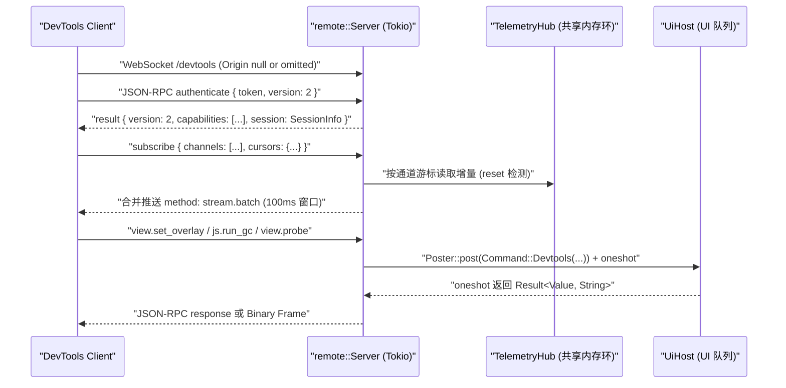

# 前置改造 1：共享协议（`crates/devtools-protocol`）、双通道服务端与零摩擦发现

> **适用范围与前置约束**
> - 本文档细化 [独立进程外 DevTools 规划](standalone-devtools-plan.md) 中的共享协议、双向传输升级与设备自动发现方案。
> - **依赖隔离边界**：拟新建的 `crates/devtools-protocol` 仅允许依赖 `serde`（与 `serde_json` 可选或基础类型），不得引入 `tokio`、`wgpu`、`rquickjs`、`quickjs-jit` 或任何平台框架；`crates/javascript`、`crates/engine`、`crates/raster` 均不得对其产生反向非法耦合，确保 `just boundaries`（[check-javascript-boundaries.py](../tools/check-javascript-boundaries.py)）持续通过。
> - **安全与 Lint 规则**：严守 `unsafe_code = "deny"` 与 `unwrap_used` / `expect_used = "deny"`；回环监听器仅绑定 `127.0.0.1`，所有本机会话文件权限严格收口至 `0600` 并校验 Origin 与恒定时间 Token。

---

## 1. 改造目标与文件清单

| 目标文件 | 动作 | 核心职责 |
|---|---|---|
| `crates/devtools-protocol/Cargo.toml`、`src/lib.rs`、`src/*.rs` | 新建 | 定义协议 v2 纯数据结构、能力枚举、Binary Envelope 编解码与多通道增量模型 |
| [Cargo.toml](../Cargo.toml) | 修改 | 将 `crates/devtools-protocol` 加入 `members` 与 `[workspace.dependencies]` |
| [crates/embedder/common/Cargo.toml](../crates/embedder/common/Cargo.toml) | 修改 | 依赖 `devtools-protocol`，引入 `rand`（或 `getrandom`）生成会话 Token |
| [command.rs](../crates/embedder/common/src/command.rs) | 修改 | 新增 `Command::Devtools(DevtoolsCommand)` 及 `command_tag` 分支 |
| [host.rs](../crates/embedder/common/src/host.rs) · [session_cmds.rs](../crates/embedder/common/src/host/session_cmds.rs) | 修改 | 向 `remote::Server` 注入 `Poster`，并在 UI 队列处理 DevTools 控制与查询命令 |
| [hub.rs](../crates/embedder/common/src/diagnostics/hub.rs) | 修改 | 扩展完整遥测字段、多通道游标、Overlay 状态、JS 内存/资源与 `NetBodyPool` 存取接口 |
| [remote.rs](../crates/embedder/common/src/diagnostics/remote.rs) | 修改 | 支持 JSON-RPC v2 + Binary Frame 双通道、`100ms` 合并推送、UI 双向桥接与零摩擦会话文件注册 |
| [devtools.rs](../crates/cli/src/devtools.rs) · [run.rs](../crates/cli/src/run.rs) · [ios.rs](../crates/cli/src/ios.rs) | 修改 | Debug 自动注入/注册会话信息，`impasto devtools` 与 `impasto run --devtools` 直连原生桌面端 |

---

## 2. 共享协议 Crate：`crates/devtools-protocol`

### 2.1 Crate 依赖与边界控制

```toml
# crates/devtools-protocol/Cargo.toml
[package]
name = "devtools-protocol"
version = "0.1.0"
edition.workspace = true
license.workspace = true
publish = false

[dependencies]
serde = { version = "1", features = ["derive"] }

[lints]
workspace = true
```

> 说明：不直接引入 `serde_json`、`tokio` 或业务运行时依赖，保持纯数据结构与零分配字节头解析；序列化格式由调用方（`embedder/common` 与 `examples/devtools-desktop/rust`）统一选择。

### 2.2 核心协议类型设计

```rust
pub const PROTOCOL_VERSION_V1: u8 = 1;
pub const PROTOCOL_VERSION_V2: u8 = 2;

#[derive(Clone, Copy, Debug, PartialEq, Eq, Hash, serde::Serialize, serde::Deserialize)]
#[serde(rename_all = "snake_case")]
pub enum Capability {
    FrameSpans,
    CaptureStatus,
    TraceDetail,
    CaptureGpu,
    Inspector,
    MultiChannelSubscribe,
    BinaryFrames,
    ViewRepaintTracker,
    RemoteOverlay,
    NetworkTimings,
    NetworkBodies,
    JsRuntimeDetail,
    SourceMapSymbols,
}

#[derive(Clone, Copy, Debug, PartialEq, Eq, Hash, serde::Serialize, serde::Deserialize)]
#[serde(rename_all = "snake_case")]
pub enum Channel {
    Frames,
    Repaints,
    Network,
    Logs,
    Errors,
    Runtime,
    Resources,
}

#[derive(Clone, Debug, Default, serde::Serialize, serde::Deserialize)]
pub struct ChannelCursors {
    pub frames: Option<u64>,
    pub repaints: Option<u64>,
    pub network: Option<u64>,
    pub logs: Option<u64>,
    pub errors: Option<u64>,
    pub runtime: Option<u64>,
    pub resources: Option<u64>,
}
```

### 2.3 Binary Frame 信封格式（消除 Base64 开销）

针对大载荷（`.pftrace` 导出、`net.get_body` 完整包体、`frame.layer_tree`、`view.snapshot`），WebSocket 发送 `Message::Binary` 而非 JSON 文本，固定使用 **20 字节 Little-Endian 信封头**：

```rust
pub const BINARY_MAGIC: [u8; 4] = *b"IMDT";
pub const BINARY_FLAG_ZSTD: u16 = 1 << 0;

#[repr(u8)]
#[derive(Clone, Copy, Debug, PartialEq, Eq)]
pub enum BinaryMsgType {
    RpcResponse = 1,   // 对应 text JSON-RPC 请求的二进制响应
    TraceExport = 2,   // .pftrace 原始字节流
    NetBody = 3,       // HTTP/WS 原始请求或响应体
    ViewSnapshot = 4,  // 大体积 View/Layer 树 JSON 或结构载荷
    FrameRepaints = 5, // 单帧大量重绘 View 明细
}

#[derive(Clone, Copy, Debug, PartialEq, Eq)]
pub struct BinaryEnvelopeHeader {
    pub magic: [u8; 4],     // "IMDT"
    pub version: u8,        // 2
    pub msg_type: u8,       // BinaryMsgType as u8
    pub flags: u16,         // bit 0: zstd 压缩
    pub request_id: u64,    // 关联对应的 JSON-RPC 请求 id（事件流为 0）
    pub payload_len: u32,   // 后续负载字节长度
}
```

- **分包契约**：Client 发送普通 JSON-RPC 文本请求（如 `{"jsonrpc":"2.0","id":17,"method":"net.get_body","params":{...}}`）；若服务端以 Binary Frame 返回，先返回对应 `request_id = 17` 的 Binary Frame（或在 Text 响应中仅返回 `{ "binary": true, "content_type": "...", "bytes": 1048576 }` + 紧随的 Binary Frame，推荐**直接返回 `request_id` 匹配的 Binary Frame**，Client 按 `request_id` 映射表完成 `oneshot` 唤醒）。

### 2.4 完整 FrameRecord 与 SessionInfo 契约

`FrameRecord` 补全当前 [remote.rs](../crates/embedder/common/src/diagnostics/remote.rs) 缺失但 [hub.rs](../crates/embedder/common/src/diagnostics/hub.rs) 已具备的全部指标：

- **调度与流水线耗时**：`ui_ms`、`queue_ms`、`raster_ms`、`e2e_ms`、`budget_ms`、`work_ms`、`session_ms`、`gesture_ms`、`script_ms`、`layout_ms`、`record_ms`、`submit_ms`、`present_ms`、`over_budget`、`topology`、`compositor_only`、`compositor_block`、`in_flight_depth`、`skip_reason`；
- **Script 与 Reactive（来自 `PhaseSample` & `FrameTrace`）**：`motion_ms`、`dispatch_ms`、`timer_ms`、`raf_ms`、`callback_ms`、`flush_ms`、`layout_cb_ms`、`sync_ms`、`semantics_ms`、`laywork_ms`、`layout_passes`、`layout_cause`、`updates`、`sets`、`nodes_created`、`ffi_batches`、`ffi_calls`、`style_resolves`、`repaint_boundaries_dirtied`；
- **Text & Canvas 统计**：`text_reused`、`text_shaped`、`canvas_record_ms`、`canvas_prepare_ms`、`canvas_ops`、`canvas_segments`、`canvas_redraws`、`canvas_reused`；
- **Raster 与 GPU 统计**：`draws`、`passes`、`layers`、`pictures`、`picture_rebuilt`、`picture_reused`、`textures`、`atlas_entries`、`atlas_hits`、`vertex_bytes`、`uniform_bytes`、`stop_bytes`、`extra_bytes`、`mesh_upload_bytes`、`atlas_upload_bytes`、`gpu { state, generation, frame_span_us, passes_sum_us, passes }`；
- **帧级重绘与 JS 摘要**：`repainted_view_count`、`runtime_sample`（`promises` / `timers` / `requests` / `queued_events` / `queued_bytes` / `heap_bytes`）。

---

## 3. 升级 `remote.rs`：双通道、多订阅与 UI 线程双向桥接

### 3.1 握手与协议升级（向后兼容 v1）



1. **握手兼容**：[remote.rs](../crates/embedder/common/src/diagnostics/remote.rs) 的 `authenticate` 接受 `version: 1` 或 `version: 2`。当 `version == 1` 时保持现有 `frames` 推送与 Base64 `capture` 格式，不破坏既有单测和老客户端；当 `version == 2` 时启用 `stream.batch` 批量推送及以下全套 RPC v2 方法。
2. **100ms 窗口多通道合并推送**：
   - 将 `UPDATE_INTERVAL` 由 `250ms` 调整为 `100ms`，同时按需仅在连接后有任意订阅通道修订号（`hub.revision()`）递增时才扫描各通道 `since` 游标。
   - 每个通道独立返回 `{ revision, reset, entries }`；若客户端游标落后于环头（已被覆盖），对应通道 `reset = true` 并下发当前环内全量条目。

### 3.2 `remote::Server` → `UiHost` 双向命令桥

当前 [remote.rs](../crates/embedder/common/src/diagnostics/remote.rs) 只有 `Arc<TelemetryHub>`，无法访问 UI 队列独占的 `Tree`（视图拾取、Overlay 开关、实时快照）与 `QuickJS Vm`（详细内存、Timer 枚举、主动 GC）。改造方案如下：

1. **在 [command.rs](../crates/embedder/common/src/command.rs) 新增命令与 Tag**：
   ```rust
   pub enum DevtoolsQuery {
       ViewSnapshot { max_nodes: usize },
       ViewProbe { x: f32, y: f32 },
       ViewSetOverlay(devtools_protocol::OverlayConfig),
       ViewRepaintLeaderboard { limit: usize },
       JsMemoryDetail,
       JsResourcesSnapshot,
       JsRunGc,
       SetSamplerConfig { interval_us: u64, max_depth: usize, max_samples: usize },
       SetLayoutScan(bool),
   }

   pub enum Command {
       // ... 既有变体 ...
       Devtools {
           query: DevtoolsQuery,
           reply: tokio::sync::oneshot::Sender<Result<Vec<u8>, String>>,
       },
   }
   ```
   同步更新 `command_tag` 返回 `"devtools"`（受 `command.rs` 全枚举覆盖测试约束）。
2. **向 `remote::Server::start` 注入 `Poster`**：
   - 在 [host.rs](../crates/embedder/common/src/host.rs) `run_boot` 中，`shell.inbox` 已在 `open_ui` 前存在；构造 `Poster` 传入 `remote::Server::start(config, hub, poster)`。
   - `remote::serve` 处理需要 UI 线程的 RPC 时，通过 `poster.post(Command::Devtools { query, reply: tx })` 投递，并立即触发一次 `wake_main` / `arm`（若 UI 队列当前休眠则唤醒执行，不额外等待下一帧 vsync），同时包裹 `timeout(IO_TIMEOUT, rx)` 防止 App 正在退出或主线程卡死导致 RPC 永久挂起。
3. **在 [session_cmds.rs](../crates/embedder/common/src/host/session_cmds.rs) 分发执行**：
   - `UiHost` 直接持有 `runtime.session`（`Option<Box<dyn Session>>`）与 `runtime.telemetry`；收到 `Command::Devtools` 后调用 `Session` 对应方法并将序列化的 JSON/二进制结果通过 `reply.send(...)` 回传；若修改了 Overlay 或需要立即刷出高亮帧，调用 `arm(runtime)`。

### 3.3 RPC v2 方法清单

| 方法名 | 方向 | 触发线程 | 返回类型 | 说明 |
|---|---|---|---|---|
| `authenticate` | C→S | Tokio | Text | 校验 Token 与版本（1/2），返回 `capabilities` 与 `SessionInfo` |
| `session.info` | C→S | Tokio/Hub | Text | 平台、OS、窗口尺寸/DPR/刷新率、拓扑（`ui-boot`/`platform`）、版本信息 |
| `telemetry.set_profile` | C→S | Tokio/Hub | Text | 切换 `off` / `counters` / `gpu_timeline` / `deep_inspect` 与 `repaint_tracking` 开关 |
| `subscribe` | C→S | Tokio/Hub | Text | 订阅指定通道与起始游标，触发 `stream.batch` 定时增量推送 |
| `frame.detail` | C→S | Tokio/Hub | Text | 查询指定 `frame_id` 完整 `FrameRecord`（含 GPU Pass 与 Phase 明细） |
| `frame.repaints` | C→S | Tokio/Hub | Text / Binary | 获取指定帧重绘的 View 明细清单（超阈值走 Binary Frame） |
| `frame.layer_tree` | C→S | Tokio/Hub | Binary | 获取最近保留帧的 `LayerTree` 与 Picture 摘要（DeepInspect 档） |
| `view.snapshot` | C→S | UI 队列 | Binary | 实时遍历 `Tree` 生成带组件/源码/重绘计数的 View 树快照 |
| `view.repaint_leaderboard` | C→S | UI 队列 | Text | 返回累计/近 60 帧重绘次数 Top N 节点列表 |
| `view.probe` | C→S | UI 队列 | Text | 按场景坐标执行 `debug_probe(x, y)`，返回命中链路 |
| `view.set_overlay` | C→S | UI 队列 | Text | 控制设备端 `highlight_node`、`pick_mode`、`repaint_rainbow`、`layout_scan` |
| `js.memory_detail` | C→S | UI 队列 | Text | 采集 QuickJS `JSMemoryUsage` 完整 23 项细分指标 |
| `js.resources` | C→S | UI 队列 | Text | 返回活跃 Timers、Pending Promises、队列积压与峰值 |
| `js.run_gc` | C→S | UI 队列 | Text | 触发 QuickJS GC 并返回回收前后内存差值与耗时 |
| `net.get_body` | C→S | Tokio/Hub | Binary | 从 `NetBodyPool` 读取指定 `token` 的完整请求或响应体 |
| `net.get_ws_frames` | C→S | Tokio/Hub | Text | 获取指定 WebSocket 连接的双向帧历史 |
| `trace.start` / `trace.stop` | C→S | Tokio/Hub | Text | 启停 `TimelineRecording`（支持 `detail: stages|detailed`、`gpu: bool`、`js_sampling`） |
| `trace.get_frame_spans` | C→S | Tokio/Hub | Text | 查询录制归档中单帧的 CPU Span 调用树与跨队列 Flow |
| `trace.export_pftrace` | C→S | Tokio/Hub | Binary | 通过 Binary Frame 直接下发 `.pftrace` 原始字节流 |

---

## 4. 零摩擦发现与 CLI 工具链集成

### 4.1 目标 App 侧自动启动与会话文件注册

在 [remote.rs](../crates/embedder/common/src/diagnostics/remote.rs) 中升级 `Config::configured()` 逻辑：

1. **配置优先级**：
   - 若显式传入 `IMPASTO_DEVTOOLS_PORT` 与 `IMPASTO_DEVTOOLS_TOKEN`（或 Android 私有缓存 `cache/impasto-devtools`），按显式配置绑定；
   - 否则，若为 `cfg!(debug_assertions)` 或环境变量 `IMPASTO_DEVTOOLS=1`（且未设置 `IMPASTO_DEVTOOLS=0`），自动进入 **Auto-Discovery 模式**：
     - 绑定 `127.0.0.1:0` 让操作系统分配空闲回环端口；
     - 使用操作系统熵源生成 32-byte 随机 hex Token（64 个十六进制字符）。
2. **受限本地注册目录（macOS / iOS Simulator）**：
   - 写入路径：`$TMPDIR/impasto-devtools/sessions/<pid>.json`（确保父目录权限 `0700`，文件权限 `0600`，先写 `.tmp` 再原子 `rename`）。
   - 文件内容（`LocalSessionEntry`）：
     ```json
     {
       "pid": 48210,
       "appName": "gallery-solid",
       "platform": "macos",
       "port": 54321,
       "token": "...",
       "protocolVersion": 2,
       "projectRoot": "/abs/path/to/app",
       "frameworkRoot": "/abs/path/to/Impasto",
       "sourceMap": "/abs/path/to/app.js.map",
       "startedAtMs": 1764290000000
     }
     ```
   - 生命周期清理：`Server` 结构体保存 `session_file: Option<PathBuf>`，在 `Drop::drop` 时删除对应 `.json`；客户端发现器在扫描目录时对每个 `<pid>.json` 执行 `kill(pid, 0)`（或 `ps`）探测，清理异常崩溃残留的僵尸会话文件。

### 4.2 CLI 联动（`crates/cli`）

1. **`impasto run`（[run.rs](../crates/cli/src/run.rs) 与 [ios.rs](../crates/cli/src/ios.rs)）**：
   - **macOS**：[launch_macos](../crates/cli/src/run.rs#L302-L319) 默认保留 `IMPASTO_DEVTOOLS_PROJECT` 与 `IMPASTO_DEVTOOLS_FRAMEWORK`（即使不开启 `--watch` 也写入），让 App 写入的 `<pid>.json` 携带准确源码根目录。
   - **Android**：`impasto run -d android` 未显式设置端口/Token 时，CLI 自动分配固定应用侧端口（如 `8765`）与随机 Token，调用 [configure_android](../crates/cli/src/devtools.rs#L55-L81) 写入设备私有目录，并在本机 `$TMPDIR/impasto-devtools/devices/android-<serial>.json` 登记 `{ deviceKind: "android", serial, package, remotePort, token, projectRoot }`。
   - **iOS**：Simulator 直接使用宿主机 `$TMPDIR`（或由 CLI 统一在 [ios.rs](../crates/cli/src/ios.rs#L745-L754) 注入 `SIMCTL_CHILD_IMPASTO_DEVTOOLS_*`）；USB 真机通过 `impasto run -d ios:<UDID>` 注入环境变量并写入 `devices/ios-<udid>.json`。
   - 新增 `--devtools` 参数：启动目标应用后自动唤起 `examples/devtools-desktop`（或已安装的 `Impasto DevTools.app`）并传入 `--attach <pid|device>`。
2. **`impasto devtools`（[devtools.rs](../crates/cli/src/devtools.rs)）**：
   - 默认行为改为探测并唤起原生桌面应用（优先查找 `toolchain::distribution()` 中的 `Impasto DevTools.app`，开发仓库内则回退调用 `cargo/impasto` 构建的 `examples/devtools-desktop` 产物）。
   - 保留 `--html` 开关（过渡期内继续生成静态 HTML），待 Phase 1 稳定后标记废弃。

---

## 5. 并发、边界与安全性注意项

- **UI 阻塞防卡死**：`Server` 向 `UiHost` 发送 `Command::Devtools` 时绝对不能持有 `TelemetryHub` 锁等待 `oneshot`；必须先释放所有内部锁再 `await` `oneshot`，避免与 UI 线程写入 `TelemetryHub` 形成 AB-BA 死锁。
- **App 退出或重启竞态**：当 `UiHost` 析构时未执行的 `oneshot::Sender` 被 Drop，`remote::serve` 侧立即收到 `RecvError` 并优雅返回 `-32004 ("session closed")`，不引发 panic。
- **WebSocket 单帧上限**：`REQUEST_LIMIT` 保持对客户端入站请求的限制（例如 64 KiB 以容纳过滤条件和 Overlay 配置）；服务端出站 Binary Frame 不受 `4096` 小包限制，大包体按最大 16 MiB 单体拦截。

---

## 6. 测试与验证清单

1. **协议 crate 单测**：`cargo test -p devtools-protocol`（校验 `BinaryEnvelopeHeader` 字节序 round-trip、协议枚举序列化）。
2. **服务端集成单测**：`cargo test -p embedder`（覆盖 v1 向后兼容握手、v2 多通道 `stream.batch`、`reset` 逻辑、Binary Frame 下发、UI 双向命令超时与 `oneshot` 正常返回、Auto-Discovery 生成 `0600` 文件及 `Drop` 清理）。
3. **边界与代码风格门禁**：
   ```sh
   just boundaries
   just check
   cargo fmt --all -- --check
   ```
