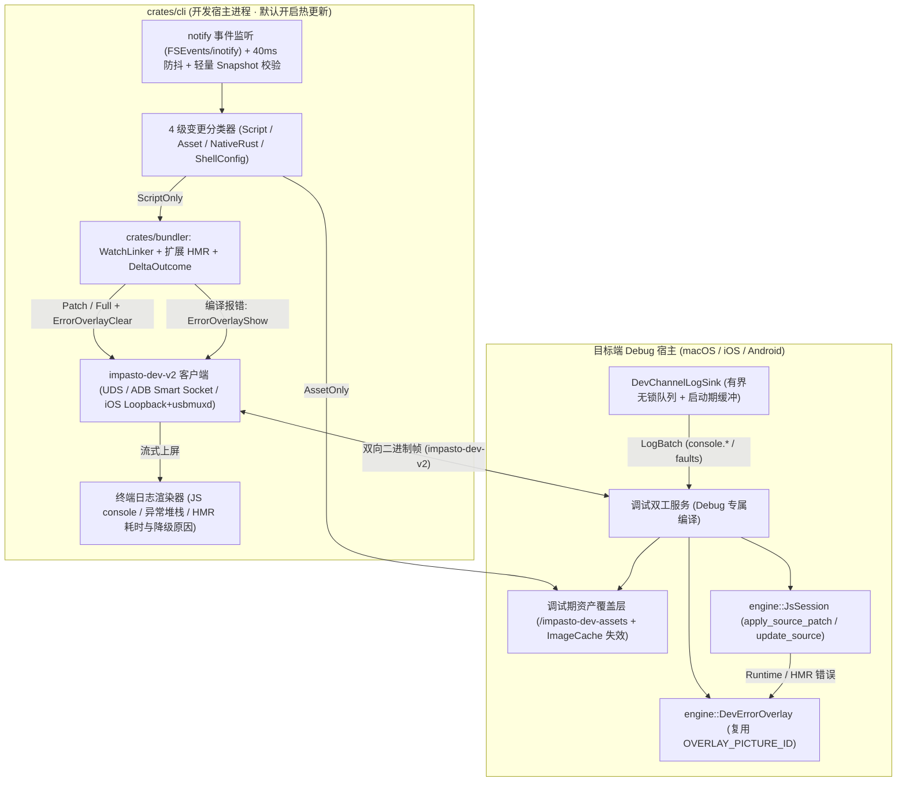

# 热更新与实时开发体验全链路升级规划

本文档定义 Impasto 在 `macos` / `ios` / `android` 三端真机与模拟器上的**热更新（HMR / 全量脚本重载 / 资产热替换）、事件驱动监听、终端日志聚合、设备端错误浮层与 CLI 开发体验**的完整技术实现方案。

> **适用范围、前提与显式非目标**
> - **目标平台边界**：覆盖 `macos`、`ios`（模拟器与 USB 真机）以及 `android`（模拟器与 USB 真机）。
> - **显式非目标（Out of Scope）**：
>   1. **独立 DevTools 桌面端（`examples/devtools-desktop/`）不在本文范围**：Frame 瀑布、View Tree 检查、Network 抓包与 JS 火焰图已独立规划于 [独立进程外 DevTools 规划](standalone-devtools-plan.md)。
>   2. **不引入手动终端快捷键交互（如按 `r`/`R`/`d`/`q` 触发命令）**：遵循“能自动处理的就不要手动来处理”原则。保存即自动增量更新或按需重启、改错即自动弹窗并在修复后自动清除、断线自动重连、`Ctrl-C` 干净退出并清理隧道，不要求开发者在终端窗口切换焦点并敲快捷键。
> - **硬性约束基线**：严格遵守仓库 [AGENTS.md](../AGENTS.md) 的依赖隔离（`just boundaries`）、单主力渲染路径（禁止新增渲染 Pass 或多套叠层管线）、零 `unsafe` 与零 `unwrap`/`expect`（`Cargo.toml` workspace lints），且所有调试通道、资产覆盖层与错误浮层在 Release 构建中完全编译剔除。

### 实现说明

macOS 使用私有 UDS，iOS 模拟器使用反向回环 TCP。反向连接先由宿主发出带会话令牌的握手。iOS 真机用 usbmuxd，Android 的 Kotlin 宿主校验 ADB 对端 UID 后将字节流转发到 Rust 调试端点。Wi-Fi 或不兼容的自定义 ADB 服务器使用文件传输，日志附在更新回执中。iOS Wi-Fi 在复制完整帧后另写就绪标记。双工连接会持续推送日志，并区分同一宿主的连接恢复与宿主重启。

Linux 逐目录注册 inotify 监听，生成目录不会进入内核监听表。资产删除通过独立的标记目录阻止回落到内置文件。图片替换只有在导出尺寸或倍率变化时才需要重链。依赖变更需要重新注册顶层 shader 时，会创建候选脚本会话并保留应用进程。

本文后续章节保留设计前的现状和验收目标。延迟指标需通过对应设备测量。

---

## 1. 现状基线与核心缺口

Impasto 目前已经打通了从编译器 AST 边界分析到设备端原子切换的底层链路，但各端实现节奏不统一，体验上存在明显的“最后一公里”断点。

### 1.1 已有可复用底座

| 层次 | 现有实现 | 已有能力 |
|---|---|---|
| AST HMR 与 Patch 生成 | [hot.rs](../crates/bundler/src/hot.rs) · [hot.js](../crates/bundler/src/hot.js) | Oxc AST 识别组件、`helper` 闭包与模块级 `keep` 状态；Solid Signal 代理组件实现；`bundler::delta()` 输出 `// impasto:hot-patch/1` 增量包与 `symbolize()` 开发期堆栈还原 |
| 增量打包器 | [WatchLinker](../crates/bundler/src/bundle.rs#L166-L212) | 启用了 Rolldown `incremental_build` 与 `preserve_modules`，支持按变更文件列表增量重链 |
| 引擎原子回滚 | [player/mod.rs](../crates/engine/src/js/player/mod.rs#L791-L839) · [vm/mod.rs](../crates/engine/src/js/player/vm/mod.rs#L367-L397) | `apply_source_patch()` 原地打补丁；全量重载 `update_source()` 先建 candidate VM 并试跑首帧，校验成功后再原子替换，异常时不黑屏不闪退 |
| Android 直连通道 | [android_watch.rs](../crates/cli/src/android_watch.rs) · [DevelopmentUpdates.kt](../crates/embedder/android/host/src/main/kotlin/dev/impasto/host/DevelopmentUpdates.kt) | 通过 ADB Smart Socket 直连 `localabstract:impasto-hot-v1-<pkg>`（内核校验 peer UID ∈ `{0, 2000}`），支持断线重连与 `run-as` 文件降级 |
| 日志与场景覆盖层基础设施 | [log_sub.rs](../crates/embedder/common/src/log_sub.rs) · [host.rs](../crates/embedder/common/src/host.rs#L45-L52) · [repaint.rs](../crates/engine/src/tree/repaint.rs#L358-L480) | QuickJS `console.*` 已统一路由至 `impasto::script::console` / `impasto::script::promise` 并由 `LogLayer` 分发；引擎已具备 `OVERLAY_PICTURE_ID` 末帧追加绘制通路 |

### 1.2 当前 6 个核心缺口

1. **`impasto run` 三端默认行为割裂**：[run.rs](../crates/cli/src/run.rs#L38-L51) 与 [ios.rs](../crates/cli/src/ios.rs#L904-L919) 中，不传 `--watch` 时 iOS 安装启动后直接退出；macOS/Android 不传 `--watch` 时以 250ms 轮询并走全量 JS 重载（丢失页面滚动、输入与 Signal 状态）。开发者很容易误以为真机/iOS 不支持热更新。
2. **全量递归文件轮询开销高且缺少防抖**：[run.rs](../crates/cli/src/run.rs#L209-L253)、[ios_watch.rs](../crates/cli/src/ios_watch.rs#L372-L377) 与 [test.rs](../crates/cli/src/test.rs#L189) 每 10ms–20ms 全量递归 `fs::read_dir` + `stat` 扫描工程（`ios_watch.rs` 甚至同步扫描框架多个 crate 目录）；macOS 宿主 `SourceMailbox`（[app.rs](../crates/embedder/macos/src/app.rs#L1285-L1331)）与 CLI `publish_source()` 也在 10ms 轮询临时文件与 `.result` 回执。无防抖导致编辑器的“写临时文件 → rename → chmod”原子保存可能触发连续多次无效构建。
3. **iOS 真机热更新传输链路过慢**：[ios_watch.rs](../crates/cli/src/ios_watch.rs#L231-L296) 在真机上每次更新都要多次派生 `xcrun devicectl device copy` 进程读写容器目录，并每 250ms 轮询一次 `receipt.json`，单次热更新体感延迟在秒级，且无法双向推送日志。
4. **`console.log` 与脚本错误未接入 `impasto run` 终端，设备端无错误浮层**：iOS `--watch` 模式刻意跳过了 `--console`（[ios.rs](../crates/cli/src/ios.rs#L833)），Android 也未自动转发精简日志；同时当编译报错或 HMR 被拒时，仅 CLI stderr 打印一行字，真机画面静止不动，开发者难以及时感知“为何没刷新”。
5. **HMR 边界偏窄，且修改资产/主题/多语言即触发整包重编**：
   - [run.rs](../crates/cli/src/run.rs#L380-L416) 的 `script_only()` 把 `assets/`、`locales/`、`src/theme.ts` 一律判为非脚本变更，导致改一张图、改一个翻译词条或主题 token 就重编重装整个 APK / Xcode App；
   - [hot.rs](../crates/bundler/src/hot.rs#L573-L597) 与 [hot.js](../crates/bundler/src/hot.js#L104-L115) 对“非入口文件增删”、“纯 `.ts` 工具/样式常量模块编辑”缺少依赖图冒泡失效，直接退化为全量重载；终端也不说明“究竟走了 HMR 还是 Full Reload、原因是什么”。
6. **多设备发现与环境体检门槛偏高**：缺少 `impasto devices` 与 `impasto doctor`，iOS 真机需要自行去系统/Xcode 查找 UDID 并在 `app.toml` 排错。

---

## 2. 目标端到端架构

### 2.1 系统总览



### 2.2 四条核心设计原则

1. **全自动化闭环**：`impasto run` 在 Debug 模式下默认启动完整热更新链路（提供 `--no-watch` 显式关闭）。不设置任何需要开发者手动敲入的控制台热键命令。
2. **零空转、全事件驱动**：CLI 文件监听改用操作系统原生通知（`notify`），主循环阻塞在 `mpsc::Receiver<DevEvent>`；三端传输（macOS UDS / Android ADB Smart Socket / iOS Loopback TCP + `usbmuxd`）全部改为全双工事件驱动长连接，彻底消灭两端 10ms/250ms 轮询。
3. **透明可解释的刷新反馈**：每次保存文件，终端必须给出单行、带耗时与结果原因的确定性回执（HMR 命中模块 vs. 降级 Full Reload 的精确原因 vs. 原生重编）。
4. **单线不卡 UI、Release 零残留**：设备端 `DevChannelLogSink` 使用有界非阻塞通道，绝不阻塞 UI/Raster 线程；所有新协议、资产覆盖目录与 RedBox 绘制代码严格置于 `#[cfg(debug_assertions)]` / `#if DEBUG` / `isDebuggable()` 守卫之内。

---

## 3. CLI 默认 Watch 与事件驱动监听

### 3.1 `impasto run` 默认参数调整

涉及文件：[crates/cli/src/main.rs](../crates/cli/src/main.rs#L59-L81)、[crates/cli/src/run.rs](../crates/cli/src/run.rs#L14-L51)、[crates/cli/src/ios.rs](../crates/cli/src/ios.rs#L904-L919)。

- 将 `Run` 子命令中的 `--watch` 语义调整为默认开启：
  - `impasto run`（即 Debug 模式）：默认 `watch = !options.release && !options.no_watch`。
  - 新增 `--no-watch`（与 `--release` 等价关闭热更新监听，保留单次打包安装启动后直接退出的脚本/CI 行为；保留 `--watch` 作为向后兼容的隐藏或无操作别名以免破坏已有脚本）。
- 影响：`impasto run`、`impasto run -d android`、`impasto run -d ios`、`impasto run -d ios:<UDID>` 启动后**统一进入热更新与日志监听状态**。

### 3.2 `notify` 定向监听 + 防抖 + 混合校验

涉及 crate：[crates/cli/Cargo.toml](../crates/cli/Cargo.toml)（仅 `crates/cli` 新增 `notify` 依赖，不污染任何引擎或 embedder crate）。

1. **禁止对工程根目录做全量 `Recursive` 监听**：
   - 在 Linux 上对包含 `node_modules/`、`target/`、`build/`、`.gradle/` 的目录做 `Recursive` 会耗尽 `inotify` `max_user_watches`，在 macOS FSEvents 下也会收到海量构建产物事件。
   - **注册策略**：
     - `RecursiveMode::Recursive` 仅注册到受控源码目录（存在才注册，并在新创建目录时动态补挂）：
       - `<app>/src`
       - `<app>/assets`
       - `<app>/locales`
       - `<app>/rust`
       - `<app>/android`、`<app>/ios`、`<app>/macos`（需在回调里过滤掉 `.gradle/`、`.kotlin/`、`.build/`、`.swiftpm/`、`xcuserdata/`、`build/`、`local.properties`）
       - `plugins::watched_paths(app)` 返回的本地插件目录
       - `app.sources` 中额外声明的源码路径
       - （仅当处于框架仓库自身开发态且存在对应路径时，iOS 原生源码变动才由独立 watcher 按 `crates/embedder/{ios,common}/src` 监听，避免在普通用户工程下做无效扫描）
     - `RecursiveMode::NonRecursive` 注册到 `<app>` 根目录本身：仅放行 `app.toml`、`impasto.lock`、`package.json`、`pnpm-lock.yaml`、`package-lock.json`、`tsconfig.json` 的直接子项事件。
2. **40ms 防抖窗口（Debounce）**：
   - 独立监听接收线程收到首个 `notify::Event` 后进入 **40ms** 收集窗口（利用 `mpsc::Receiver::recv_timeout` 滑动合批，设置最大等待上限 120ms 防止连续写入饿死），将 VSCode/Cursor/Zed/Vim 原子保存产生的 `Create(temp)` / `Write` / `Rename` / `Chmod` 合并为一批去重后的路径集合 `BTreeSet<PathBuf>`。
   - 忽略只读属性访问事件（`EventKind::Access(_)`）。
3. **混合模式：事件唤醒 + 轻量校验**：
   - 主线程平时完全阻塞在 `rx.recv()`，**0 CPU、0 磁盘 `stat`**。
   - 收到防抖后的路径列表 `candidates` 后：
     - 若事件含 `Rescan` 标记或涉及根目录配置（`app.toml` 新增/删除插件），做一次完整 `files(&app)` diff，并同步更新 `notify` 注册表；
     - 否则仅对 `candidates` 及其直接关联目录做局部 `metadata()`（`modified`, `len`）比对与过滤：如果内容/时间戳实际未变化（例如 `chmod` 或编辑器无效保存），直接丢弃本次事件；否则生成准确的 `changed: Vec<PathBuf>` 交由分类器与 `WatchLinker::set_changes(Some(changed))`。
4. **统一 `DevEvent` 主循环（无手动按键分支）**：
   ```rust
   enum DevEvent {
       FilesChanged(Vec<PathBuf>),
       WatcherWarning(String),
       DeviceLog(Vec<DevLogEntry>),
       DeviceDisconnected,
       DeviceReconnected,
       ChildExited(std::process::ExitStatus), // 仅 macOS 本地子进程
       Shutdown,                              // Ctrl-C / SIGTERM
   }
   ```
   - macOS 子进程退出改由轻量 wait 线程在 `child.wait()` 返回后发送 `DevEvent::ChildExited`，移除原来的 10ms `try_wait()` 轮询。
   - 同步将 [crates/cli/src/test.rs](../crates/cli/src/test.rs#L189) 的 `impasto test --watch` 从 20ms 轮询切换至同一套 `notify` + 40ms 防抖组件。

---

## 4. 统一双向调试通道（`impasto-dev-v2`）与三端传输

### 4.1 协议设计（长度前缀二进制帧）

三端（macOS / Android / iOS）共享同一套应用层帧协议 `impasto-dev-v2`（无需引入大型 RPC 框架，使用极简二进制帧头 + UTF-8 JSON 控制面 / 原始字节负载，保证 Swift / Kotlin / Rust 三端零依赖解析）：

```text
+--------+---------+----------+--------+-------------+------------------+
| Magic  | Version | MsgType  | Seq    | PayloadLen  | Payload          |
| 4 B    | 2 B     | 1 B      | 8 B    | 4 B         | N bytes (<=16MB) |
| "IDEV" | u16 BE  | u8       | u64 BE | u32 BE      |                  |
+--------+---------+----------+--------+-------------+------------------+
```

| 方向 | MsgType | 名称 | Payload 格式与语义 |
|---|---|---|---|
| CLI → Device | `0x01` | `Hello` | JSON `{ "token": "<64-hex>", "protocol": 2, "cli_version": "..." }` |
| Device → CLI | `0x02` | `HelloAck` | JSON `{ "ok": true, "platform": "ios", "app_id": "...", "capabilities": ["hmr", "logs", "assets", "redbox"] }` |
| CLI → Device | `0x10` | `SourceUpdate` | `[rev: u64 BE][kind: u8 (1=Patch, 2=Full)][utf8 bytes...]` |
| Device → CLI | `0x11` | `UpdateReceipt` | JSON `{ "revision": 42, "ok": true, "applied": "patched" \| "reloaded" \| "rejected", "apply_ms": 4, "error": null }` |
| CLI → Device | `0x12` | `AssetUpdate` | `[rev: u64 BE][path_len: u16 BE][relative_path utf8][raw bytes...]` |
| CLI → Device | `0x13` | `AssetRemove` | `[rev: u64 BE][relative_path utf8]` |
| Device → CLI | `0x14` | `AssetReceipt` | JSON `{ "revision": 43, "ok": true, "error": null }` |
| CLI → Device | `0x20` | `ErrorOverlayShow` | JSON `{ "source": "compiler" \| "linker" \| "native", "title": "...", "message": "...", "file": "...", "line": 12, "column": 5, "snippet": "..." }` |
| CLI → Device | `0x21` | `ErrorOverlayClear` | 空负载（构建恢复通过时发送） |
| Device → CLI | `0x30` | `LogBatch` | JSON `{ "entries": [{ "seq": 1, "ts_ms": 1234, "level": "info", "target": "impasto::script::console", "message": "...", "frame": 12 }] }` |
| 双向 | `0x40` / `0x41` | `Ping` / `Pong` | `[ts_ms: u64 BE]`，用于连接保活与半开连接快速探测 |

### 4.2 安全边界

- **macOS**：Unix Domain Socket 创建在权限 `0o700` 的独立临时目录中，socket 文件本身仅同 UID 可连接；仍要求首包 `Hello` 校验一次性 64-hex `token`。
- **Android**：延续 [DevelopmentUpdates.kt](../crates/embedder/android/host/src/main/kotlin/dev/impasto/host/DevelopmentUpdates.kt#L41) 的 `socket.peerCredentials.uid in setOf(0, 2000)`（仅允许 root 与 ADB shell UID 连接抽象命名空间 socket），再加上 `Hello` 会话校验。
- **iOS**：Loopback TCP 仅绑定 `127.0.0.1`（不绑定 `0.0.0.0`），首包必须通过**常量时间（constant-time）**校验 `IMPASTO_DEV_SESSION` 64-hex token；校验失败立即 `shutdown` 并关闭连接。
- **Release 隔离**：所有传输监听端代码均使用 `#[cfg(debug_assertions)]` / `#if DEBUG` / `isDebuggable()` 隔离，Release 包中零端口暴露。

### 4.3 三端具体传输实现（彻底消灭轮询）

#### (1) macOS：Unix Domain Socket 取代 `SourceMailbox` 文件轮询
- **现状清理**：移除 [crates/embedder/macos/src/app.rs](../crates/embedder/macos/src/app.rs#L1285-L1331) 的 `SourceMailbox`（10ms `stat`）与 [crates/cli/src/run.rs](../crates/cli/src/run.rs#L314-L338) 的 `publish_source()`（10ms 轮询 `.result`）。
- **新实现**：
  - CLI 启动 macOS 应用时创建私有临时目录，通过环境变量 `IMPASTO_DEV_SOCKET=<path>` 与 `IMPASTO_DEV_SESSION=<token>` 传入子进程（由 CLI 或宿主 `UnixListener::bind`）。
  - 为避免竞态，**由 CLI 侧先创建 `UnixListener::bind(&socket_path)`（权限 `0o700` 目录 + `0o600` socket），再 `spawn` macOS App**：macOS 宿主启动即作为 client 主动 `UnixStream::connect` 并立即发送 `HelloAck` 与启动期日志，**0 握手等待、0 重试轮询**。
  - 纯 Rust 标准库 `std::os::unix::net`，零新增 crate，零 `unsafe`。

#### (2) Android：升级 `impasto-hot-v1` 为全双工 `impasto-dev-v2`
- **现状升级**：保留 [crates/cli/src/android_watch.rs](../crates/cli/src/android_watch.rs) 直连 ADB Server `5037` 端口的 `host:transport:<serial>` + `localabstract:impasto-dev-v2-<pkg>` 架构（无需额外 `adb forward` 占本地端口）。
- **双工改造**：
  - [DevelopmentUpdates.kt](../crates/embedder/android/host/src/main/kotlin/dev/impasto/host/DevelopmentUpdates.kt) 与 CLI 客户端拆分为独立 `reader` / `writer` 线程，支持在不发送源码更新时**主动异步上行 `LogBatch`**；
  - `SourceUpdate` / `AssetUpdate` 不再阻塞在 `Thread.sleep(1)` 轮询 `v1-<rev>.result` 文件，而是由 `NativeBridge` 回调直接在内存 `ConcurrentHashMap<revision, CompletableFuture>` 或回调通道中写入 `UpdateReceipt` 帧返回；
  - **断线重连**：拔掉 USB 或重启设备后，`reader` EOF 触发 `DevEvent::DeviceDisconnected`，后台连接线程按 500ms 退避等待 `adb get-state == device` 后自动重建连接（若进程曾被系统杀死则自动 `am start` 拉起）。
  - 当检测到自定义 `ADB_SERVER_SOCKET` 环境变量无法直连 TCP 5037 时，保留 `run-as` 文件通道作为兜底兼容路径。

#### (3) iOS（模拟器 & 真机）：Loopback TCP + 纯 Rust `usbmuxd` USB 隧道
- **彻底解决 iOS 真机秒级延迟问题**：
  - 在 `crates/embedder/ios` 中（`#[cfg(debug_assertions)]`）于后台 IO 线程启动 `127.0.0.1:0`（或由 CLI 指定 / 写入容器端口文件供发现）的轻量 TCP Server，使用固定本地端口策略配合 `IMPASTO_DEV_PORT` + `IMPASTO_DEV_SESSION` 注入（若端口被占用则回退动态端口并通过发现文件告知，或由 **CLI 监听 vs 宿主监听** 按场景最优选择）：
    - **模拟器**：`simctl` 与宿主机共享回环网络，**直接由 CLI 在本地绑定 `127.0.0.1:<ephemeral_port>` 并通过 `SIMCTL_CHILD_IMPASTO_DEV_ADDR` 传给模拟器进程**——模拟器一启动即反向连回 CLI，0 端口冲突、0 轮询、<2ms 延迟。
    - **iOS 真机**：真机无法直连 Mac 本地端口，由 **iOS 宿主内绑定 `127.0.0.1:<device_port>`**（通过 `DEVICECTL_CHILD_IMPASTO_DEV_PORT` 传入首选端口如 `18765`，若被占则回退并写入一次性 `Caches/ImpastoUpdates/<token>/port`），Mac 侧 CLI 通过 **`/var/run/usbmuxd` 纯 Rust Plist-over-LengthPrefix 协议**直接向 `usbmuxd` 发起 `Connect` 请求转发到真机 `device_port`：
      - 不依赖外部安装 `iproxy`（若 `/var/run/usbmuxd` 不可用再尝试 `iproxy`，最后才降级 `xcrun devicectl device copy` 兼容纯 Wi-Fi 调试模式）；
      - 建立真机长连接后，热更新延迟从 ~1–2s 降至 **<15ms**，且同时拥有双向日志流与资产实时推送能力。
  - 保留 `ImpastoDevelopmentSession.swift` 的生命周期绑定，在 `detach` / App 退后台再回前台时自动恢复或重连。

---

## 5. `console.log` 与框架日志实时流式接入

### 5.1 已有链路复用与新增 `DevChannelLogSink`

当前 [crates/embedder/common/src/host.rs](../crates/embedder/common/src/host.rs#L45-L52) 已经将 QuickJS 的日志全部转为 `tracing` 事件：
- `console.log` / `console.info` → `INFO` (`target: "impasto::script::console"`)
- `console.warn` → `WARN` (`target: "impasto::script::console"`)
- `console.error` → `ERROR` (`target: "impasto::script::console"`)
- `console.debug` / `console.trace` → `DEBUG` (`target: "impasto::script::console"`)，其中 `console.trace` 在 [hot.js](../crates/bundler/src/hot.js#L34-L37) 中已走 `__impasto_hot.symbolize` 还原为 `.tsx` 行列号
- 未捕获 Promise rejection → `ERROR` (`target: "impasto::script::promise"`)
- 脚本/响应式异常 → `ERROR` (`target: "impasto::script"`)

在 [crates/embedder/common/src/log_sub.rs](../crates/embedder/common/src/log_sub.rs) 中新增（仅 `#[cfg(debug_assertions)]`）：

1. **`DevChannelLogSink`（实现 `LogSink`）**：
   - 内部持有有界线程安全通道（容量如 `512` 条，`try_send` 永不阻塞 UI / Raster / IO 线程；溢出时累加 `dropped` 计数器并在下一批发送一条汇总告警）。
   - **启动期环形缓冲（Boot Ring Buffer）**：App 启动早期（`impasto-dev-v2` 握手尚未完成前）产生的首屏 `console.log` 与初始化报错先暂存在容量 256 的环形队列中；`HelloAck` 建立后**第一时间一次性冲刷给 CLI**，保证不丢首屏日志。
   - 后台发送线程每 16ms 或攒满 32 条（遇到 `ERROR`/`WARN` 立即刷新，不攒批）打包为一个 `LogBatch` 帧发出。
2. **避免 macOS 双重打印**：
   - 在 macOS `impasto run` 下，子进程的 stdout/stderr 若直接继承父终端会导致 `ConsoleSink` 与 `DevChannelLogSink` 重复输出同一行。
   - **处理方式**：当子进程检测到 `IMPASTO_DEV_SOCKET` 存在时，`ConsoleSink` 默认只保留崩溃前未经过 `tracing` 的原生 stderr，或将子进程标准输出重定向到轻量管道由 CLI 标注 `[stdout]`/`[stderr]` 转发，同时 `ConsoleSink` 在已连接 `DevChannelLogSink` 时跳过重复文本行（`XlogSink` 写入本地日志文件与 `DevtoolSink` 写入遥测不受影响）。

### 5.2 CLI 终端日志过滤与排版规范

- **默认输出级别（无需额外参数）**：
  - `impasto::script::console`：全级别（`ERROR` / `WARN` / `INFO` / `DEBUG`）全部显示，对应 `[JS ERR]` / `[JS WARN]` / `[JS]` / `[JS DBG]`；
  - `impasto::script::promise` / `impasto::script`：全级别显示（含自动符号化后的源码位置 `src/pages/home.tsx:42:13`）；
  - 框架与插件日志（`impasto::*`）：默认显示 `WARN` 与 `ERROR`（例如图片解码失败、权限拒绝、HTTP 异常），保持终端清爽不刷屏。
- **`--verbose` 模式**：放开全部框架 `INFO` / `DEBUG` target 及编译链耗时细节。
- **终端渲染细节**：自动检测 `std::io::IsTerminal` 与 `NO_COLOR`，TTY 下使用清晰低饱和色彩区分热更新状态行、JS 日志与错误堆栈；多行堆栈自动缩进对齐，绝不和进度输出交叉打断。

---

## 6. 扩展 HMR 边界、刷新诊断与资产/主题/i18n 热更新

### 6.1 四级变更分类器（取代粗粒度 `script_only`）

将 [crates/cli/src/run.rs](../crates/cli/src/run.rs#L380-L416) 的二元判断重构为四级精确分类器：

| 级别 | 触发文件路径 | 执行动作 | 是否重启 App |
|---|---|---|---|
| **Tier 1: `ScriptAndConfig`** | `src/**/*.{ts,tsx,js,jsx,wgsl,svg}`、插件 JS 包装源码、`locales/**/*`、`src/theme.ts` | ① 若改了 `locales/`、`src/theme.ts` 或 `.wgsl`，自动增量刷新 `.impasto/types/{i18n,tokens,shaders}.d.ts`；② `WatchLinker` 增量打包；③ 发送 `SourceUpdate`（HMR Patch 或 Full Reload） | **否（保活更新）** |
| **Tier 2: `AssetOnly`** | `assets/**/*.{png,jpg,jpeg,webp,ttf,otf}` | ① 读取变更资产字节并经 `AssetUpdate` / `AssetRemove` 推送至设备覆盖目录；② 设备端失效对应 `asset:<name>` 缓存与渲染图片缓存；③ 若新增/删改图片改变了静态导出的宽高/倍率元数据（[assets.rs](../crates/bundler/src/assets.rs)），紧接着自动补发一次 Tier 1 `ScriptAndConfig` | **否（零重建热替换）** |
| **Tier 3: `NativeRust`** | `<app>/rust/**/*` 或本地插件 `rust/**/*` | ① 自动运行增量类型生成（若 `#[impasto::module]` 导出签名变化则刷新 `.impasto/types/`）；② 重编原生静态库 / JNI `.so` 并打包重装重启 | 是（自动重装重启） |
| **Tier 4: `ShellOrManifest`** | `app.toml`、`impasto.lock`、`package.json`、`android/**`、`ios/**`、`macos/**` | 完整执行 `sync` + 平台工程构建 + 重装重启 | 是（自动重装重启） |

### 6.2 扩展组件级 HMR 边界与可解释诊断

涉及文件：[crates/bundler/src/hot.rs](../crates/bundler/src/hot.rs)、[crates/bundler/src/hot.js](../crates/bundler/src/hot.js)、[crates/bundler/src/bundle.rs](../crates/bundler/src/bundle.rs)。

1. **结构化 `DeltaOutcome` 与明确的终端反馈**：
   - 将 `bundler::delta()` 的返回从 `Option<String>` 升级为结构化结果：
     ```rust
     pub enum DeltaOutcome {
         Patch {
             code: String,
             changed_modules: Vec<String>,
             updated_components: Vec<String>,
         },
         FullReload {
             reason: ReloadReason,
         },
     }

     pub enum ReloadReason {
         EntryModuleChanged(String),
         TopLevelSideEffectChanged { module: String, detail: String },
         NativeExportsChanged(Vec<String>),
         SessionNotHotCapable,
         RuntimePatchRejected(String),
     }
     ```
   - CLI 收到设备 `UpdateReceipt` 后打印清晰反馈：
     - HMR 成功：`impasto: HMR patched SearchResult (src/pages/search.tsx · build 14ms · apply 3ms)`
     - 自动降级 Full Reload：`impasto: Full reload (reason: entry module src/main.tsx changed · build 28ms · apply 19ms)`
2. **放宽 3 类高频场景的 HMR 边界（不再动辄全量重载）**：
   - **场景 A：修改被组件引用的纯 `.ts` 工具 / 样式常量 / 状态辅助模块**
     - 当前 `hot.rs` 中非 JSX 模块 `boundary` 为 `None`，一改就触发整页 Full Reload。
     - **改进**：`hot.rs` 记录模块间引用关系（或由 Rolldown chunk `imports` 反向构建 `importers` 邻接表）。当纯 `.ts` 模块（非 `state.entry` 且不含不可重入顶层副作用）变更时，沿 `importers` 向上**冒泡查找最近的组件边界模块集合**：在 `hot.js` 中按拓扑序重新执行该纯 `.ts` 模块并清理其下游受影响边界模块的导出代理，再更新对应组件 Signal。其余未受影响的组件树、导航栈与状态全部保留。
   - **场景 B：在组件模块内新增/删除 `import`、或新增/删除非入口 `.tsx`/`.ts` 文件**
     - 当前 `hot.js` 要求 `priorIds.length === nextIds.length` 且 `before.boundary === after.boundary`（[hot.js](../crates/bundler/src/hot.js#L104-L115)）。
     - **改进**：支持在 `patch` payload 中携带 `added` / `removed` 模块列表；当非入口模块被新增、删除或修改 `import` 列表（只要未改变原生插件 `natives` 契约且顶层没有 `await` / 不可恢复副作用）时，允许增量替换 `state.factories` 并重执行受影响模块，仅在模块导出被完全移除且调用方编译报错时才退回 Full Reload。
   - **场景 C：修改 `locales/` 与 `src/theme.ts`**
     - 修复 [WatchLinker](../crates/bundler/src/bundle.rs#L194-L206) 的缓存策略：检测到 `locales/` 或 `src/theme.ts` 变更时，只重建虚拟模块 `locales` 与 `ThemeTokens` 并标记依赖它们的模块为脏，避免因为 `config_inputs` 命中就直接丢弃整棵 `Linker` 增量图。

### 6.3 设备端 Debug 资产覆盖层与缓存失效

涉及文件：[crates/embedder/common/src/images.rs](../crates/embedder/common/src/images.rs)、[crates/engine/src/session/mod.rs](../crates/engine/src/session/mod.rs)、[crates/embedder/macos/src/assets.rs](../crates/embedder/macos/src/assets.rs)、[crates/embedder/android/src/app.rs](../crates/embedder/android/src/app.rs)、[crates/embedder/ios/src/bundle.rs](../crates/embedder/ios/src/bundle.rs)。

- **查找优先级（仅 Debug 会话启用）**：
  1. 优先查 `<app_caches>/impasto-dev-assets/<relative_path>`（若存在同名的 `.deleted` 标记文件则视作已删除，不回落内置包）；
  2. 回落至应用随包打包的只读资产（macOS `Contents/Resources` / iOS `Bundle` / Android `AssetManager`）。
- **缓存联动失效**：
  - 宿主收到 `AssetUpdate` / `AssetRemove` 写入覆盖文件后，向 UI 队列投递资产失效命令：
    - 图片资产：调用 `ImageCache::reload(&format!("asset:{logical_name}"))` 并通知 `Rasterizer` 失效对应纹理/Picture 缓存，随后 `arm(runtime)` 触发重绘；
    - 字体资产：重新调用系统/Parley 字体库注册接口更新对应字族数据并触发文本重新排版。
- **会期清理**：App 下一次冷启动新 Debug 会话（无当前会话 token 继承）时，自动清空旧的 `impasto-dev-assets/` 覆盖目录，防止与打包后新资产产生陈旧冲突。

---

## 7. 设备端自动错误浮层（RedBox）

当前当开发者写出语法错误、导入不存在的模块或 HMR 运行时抛错时，设备画面维持旧状态无任何提示，非常容易误判为“没触发热更新”。本方案在引擎层实现**零侵入、自动弹出、修复即自动消失**的错误浮层。

### 7.1 渲染管线合规设计

- **严格复用 [crates/engine/src/tree/record/mod.rs](../crates/engine/src/tree/record/mod.rs#L263-L273) 与 [crates/engine/src/tree/repaint.rs](../crates/engine/src/tree/repaint.rs#L392-L480) 的 `OVERLAY_PICTURE_ID` 机制**：
  - 在 `crates/engine/src/tree/` 中新增 `DevErrorOverlay`（置于 `#[cfg(debug_assertions)]` 下，与 `RemoteOverlayState` 并列）：
    ```rust
    pub struct DevErrorOverlay {
        pub category: DevErrorCategory, // Build | Linker | HmrRejected | Runtime
        pub title: String,
        pub message: String,
        pub location: Option<SourceLocation>, // file, line, column
        pub stack: Vec<String>,
        pub snippet: Option<String>,
        pub collapsed: bool,
    }
    ```
  - **不修改用户 Solid View 树、不新增 `RenderPass`、不增加任何 Shader**：仅在 `overlay_visible()` 返回 `true` 时，通过标准 `Command::FillRect` / `Command::StrokeRect` 与 `Shaper` 排版出的 `Command::Text` 生成 `OVERLAY_PICTURE_ID` 追加到图层树最顶层。
  - **单主力路径保证**：普通无报错帧完全不触发任何额外指令或内存分配。

### 7.2 自动生命周期与交互

1. **自动触发**：
   - **构建/链接阶段失败**（Oxc 语法/JSX 错误、Rolldown 解析失败、`plugins-manifest` 契约不匹配）：CLI 从 stderr 提取结构化错误位置与 3 行源码上下文，通过 `ErrorOverlayShow` 推送到设备端；设备在保留后台上一版 JS 会话的同时，立即在屏幕上渲染错误卡片。
   - **运行时 / HMR 阶段失败**：`apply_source_patch()`、`update_source()` 或首帧/监听器中产生的 `ScriptFault`（已通过 `__impasto_hot.symbolize` 还原源码行列）直接写入引擎 `DevErrorOverlay` 并请求重绘，同时通过 `LogBatch` 回传 CLI。
2. **自动消失（零手动操作）**：
   - 开发者在编辑器修正代码并保存 → CLI 编译通过并下发 `SourceUpdate`（且首帧无新 fault）→ 引擎自动清空 `DevErrorOverlay`（同时若此前处于仅 CLI 编译错状态，CLI 也可显式发送 `ErrorOverlayClear`），画面瞬间回到正常应用。
3. **可选折叠条**：如果开发者需要核对错误浮层遮挡住的底层界面位置，仅在点击卡片右上角的缩小胶囊时将卡片折叠为顶部窄提示条（由引擎指针命中优先拦截，不触发下层业务点击；再次点击展开），下一次成功热更新仍自动彻底销毁。

---

## 8. 配套 CLI 易用性补强

为降低真机首次连线与排障成本，补充两项高频诊断命令与一处自动化联动：

1. **`impasto devices`**：
   - 统一枚举当前可用目标：本机 macOS、已连接 Android 设备/模拟器（`adb devices -l` 型号与状态）、iOS 模拟器（`xcrun simctl list`）及 iOS 真机（`xcrun devicectl` / `usbmuxd` 名称与 UDID）。
   - 直接打印可直接复制的启动命令，例如 `impasto run -d ios:00008130-xxxx`。
2. **`impasto doctor`**：
   - 一键体检开发环境并给出明确修复建议：
     - Rust toolchain 与已安装的交叉编译 target（`aarch64-apple-ios`、`aarch64-apple-ios-sim`、`aarch64-linux-android`、`x86_64-linux-android` 等）；
     - Xcode CLI Tools、iOS Simulator Runtime、Apple Developer Signing Team 可用性；
     - Android SDK / NDK / `adb` 版本与连接状态；
     - `/var/run/usbmuxd` 守护进程可达性。
3. **Rust 原生导出变化自动同步 TypeScript 类型**：
   - 当 Tier 3（`rust/`）重新构建并检测到 `.impasto/plugins-manifest.<platform>.json` 或 `#[impasto::module]` 导出契约变化时，Watch 循环自动调用一次 `sync::sync()` 更新 `.impasto/types/`，确保开发者在 IDE 中写 TS/TSX 调用新增的 Rust 方法时**无需手动执行 `impasto sync`** 即可立即获得类型提示。

---

## 9. 依赖边界与安全护栏

### 9.1 `just boundaries` 依赖隔离矩阵

| Crate / 模块 | 允许新增依赖 | 严禁越界行为 |
|---|---|---|
| `crates/cli` | `notify`（平台原生文件监听） | 不得将 `notify` 向上或向 `engine` / `raster` / `embedder` 传播 |
| `crates/bundler` | 无新增外部依赖（复用已有 Oxc / Rolldown / serde） | 不得引入任何运行时/图形/平台依赖 |
| `crates/engine` | 无新增外部依赖 | 保持默认构建不依赖 `rquickjs` / `wgpu` / 平台库；`DevErrorOverlay` 仅依赖 `crates/engine` 自身 `scene::Command` 与 `Shaper` |
| `crates/embedder/{common,macos,ios,android}` | **零重型第三方依赖**（传输层全部使用 `std::os::unix::net` / `std::net::TcpListener` / 原生系统 Socket） | 严格遵守零 `unsafe`（Android JNI 现有安全边界除外）、零 `unwrap()` / `expect()` |

### 9.2 并发、背压与崩溃隔离

- **`DevChannelLogSink` 防阻塞**：UI 线程与 Raster 线程调用 `tracing::*!` 时只做 `try_send`，队列满时丢弃最旧或新记录并计数，**绝对禁止在日志路径等待 socket I/O**。
- **IO 线程隔离**：`usbmuxd` 握手、Unix Domain Socket 读写、Loopback TCP Server 全部运行在专用背景线程中；向 UI 队列投递 `Command::UpdateSource` / `Command::InvalidateAsset` 复用现有 `Poster` 通道。
- **原子状态机**：即使 `SourceUpdate` 携带非法 JS 语法、HMR patch 版本号不匹配或首帧渲染抛错，宿主也只更新 `DevErrorOverlay` 并返回 `UpdateReceipt { ok: false }`，**保留上一个稳定运行的 `JsSession` 不退出**。

---

## 10. 分阶段落地路线图与验证清单

### Phase 1：默认 Watch + `notify` 事件驱动 + macOS UDS（体感立竿见影）
- **改动范围**：
  - [crates/cli/Cargo.toml](../crates/cli/Cargo.toml)、[crates/cli/src/main.rs](../crates/cli/src/main.rs)、[crates/cli/src/run.rs](../crates/cli/src/run.rs)、[crates/cli/src/ios.rs](../crates/cli/src/ios.rs)、[crates/cli/src/test.rs](../crates/cli/src/test.rs)
  - [crates/embedder/macos/src/app.rs](../crates/embedder/macos/src/app.rs)
- **交付内容**：
  1. `impasto run` 三端默认开启热更新（新增 `--no-watch`）；
  2. 新增 `crates/cli/src/watch.rs` 封装 `notify` + 40ms 防抖 + 定向目录注册 + 混合校验，替换 `run.rs` / `ios_watch.rs` / `test.rs` 的 10ms/20ms 全量轮询；
  3. 用 `std::os::unix::net` Unix Domain Socket 替换 macOS `SourceMailbox` 与 `.result` 轮询；
  4. 终端打印明确的构建/应用耗时与 HMR / Full Reload 原因。
- **验收标准**：空闲 CPU 0%（`top` / Activity Monitor 验证无轮询唤醒）；macOS 保存 `.tsx` 到画面刷新端到端耗时 < 40ms；`just check`、`cargo clippy -p embedder-macos --all-targets -- -D warnings` 全绿。

### Phase 2：`impasto-dev-v2` 双工通道 + iOS Loopback/usbmuxd + `console.log` 全端直出
- **改动范围**：
  - `crates/embedder/common/src/dev_channel.rs`（新增 `impasto-dev-v2` 帧编解码与状态机）、[log_sub.rs](../crates/embedder/common/src/log_sub.rs)、[host.rs](../crates/embedder/common/src/host.rs)
  - [crates/cli/src/android_watch.rs](../crates/cli/src/android_watch.rs)、[DevelopmentUpdates.kt](../crates/embedder/android/host/src/main/kotlin/dev/impasto/host/DevelopmentUpdates.kt)、[ImpastoActivity.kt](../crates/embedder/android/host/src/main/kotlin/dev/impasto/host/ImpastoActivity.kt)
  - `crates/cli/src/usbmuxd.rs`（新增）、[crates/cli/src/ios_watch.rs](../crates/cli/src/ios_watch.rs)、[crates/embedder/ios/src/bridge.rs](../crates/embedder/ios/src/bridge.rs)、[ImpastoDevelopmentSession.swift](../crates/embedder/ios/host/ImpastoDevelopmentSession.swift)
- **交付内容**：
  1. 三端统一切换至 `impasto-dev-v2` 双工协议；
  2. iOS 模拟器直接回环、iOS 真机走纯 Rust `/var/run/usbmuxd` 隧道（保留 `devicectl` 为 Wi-Fi 兜底）；
  3. 落地 `DevChannelLogSink` 与启动期日志缓冲，三端 `console.log`/`warn`/`error` 与异常堆栈直出 `impasto run` 终端，macOS 无重复打印。
- **验收标准**：iOS 真机 USB 热更新端到端延迟 < 100ms；三端首屏及运行期 `console.log` 100% 在 `impasto run` 终端按序可见；Android/iOS 拔插 USB 后自动重连恢复更新与日志流。

### Phase 3：HMR 边界扩展 + 资产/主题/i18n 零重建热更新 + 设备端 RedBox
- **改动范围**：
  - [crates/bundler/src/hot.rs](../crates/bundler/src/hot.rs)、[crates/bundler/src/hot.js](../crates/bundler/src/hot.js)、[crates/bundler/src/bundle.rs](../crates/bundler/src/bundle.rs)
  - [crates/engine/src/tree/repaint.rs](../crates/engine/src/tree/repaint.rs)、[crates/engine/src/tree/record/mod.rs](../crates/engine/src/tree/record/mod.rs)、[crates/engine/src/session/mod.rs](../crates/engine/src/session/mod.rs)、[crates/engine/src/js/player/mod.rs](../crates/engine/src/js/player/mod.rs)
  - [crates/embedder/common/src/images.rs](../crates/embedder/common/src/images.rs)、[crates/embedder/macos/src/assets.rs](../crates/embedder/macos/src/assets.rs)、[crates/embedder/android/src/app.rs](../crates/embedder/android/src/app.rs)、[crates/embedder/ios/src/bundle.rs](../crates/embedder/ios/src/bundle.rs)
- **交付内容**：
  1. 4 级变更分类器：`locales/`、`src/theme.ts`、`.wgsl` 与 `assets/` 修改不再触发整包重装；
  2. 纯 `.ts` 依赖模块冒泡 HMR、非入口模块增删 HMR 支持与 `DeltaOutcome` 诊断；
  3. 引擎 `DevErrorOverlay`（RedBox）自动展示编译/链接/运行时报错，并在下次成功热更新时自动清除。
- **验收标准**：修改图片资源、翻译词条、主题色或纯工具 `.ts` 文件时，三端均不重启进程且页面状态无损；故意写错 TSX 语法时真机 100ms 内弹出 RedBox，修复保存后自动消隐并恢复界面；扩展 [hot_gallery.rs](../crates/cli/src/test/hot_gallery.rs) 与 [crates/testing/tests/hot.rs](../crates/testing/tests/hot.rs) 覆盖上述边界。

### Phase 4：`impasto devices` / `impasto doctor` 与原生导出自动同步
- **改动范围**：`crates/cli/src/devices.rs`、`crates/cli/src/doctor.rs`、[crates/cli/src/sync.rs](../crates/cli/src/sync.rs)
- **交付内容**：设备枚举、环境一键体检、`rust/` 导出变更自动刷新 `.impasto/types/`。
- **全量验证入口**：
  - 边界与静态门禁：`just boundaries`、`just check`、`cargo fmt --all -- --check`
  - 宿主与集成测试：`cargo test -p cli`、`cargo test -p bundler`、`just gallery-tests`、`cargo test -p embedder-macos`
  - 三端真机/模拟器实测：`just host`、`just ios-build-check` + `just ios-sim-test`（及真机 `-d ios:<UDID>`）、`just android-build-check` + 真机 `-d android`
