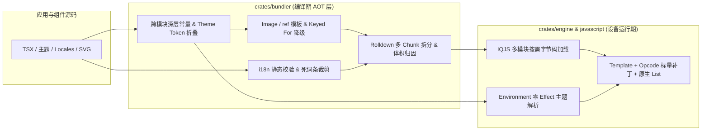
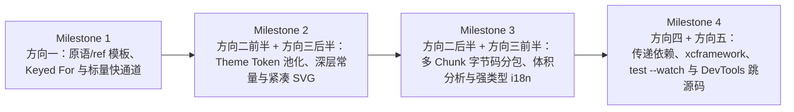

# 原生编译与开发工具链二期演进路线图

本文档在已完成的一期原生工具链与首轮共享池优化（见 [`docs/native-toolchain-plan.md`](native-toolchain-plan.md)）基础上，规划 Impasto 自研工具链的**二期深度演进路线**。

适用前提：全套编译、打包、静态分析与无头测试组件严格留在宿主开发侧（`crates/{bundler,testing,cli,shader}`），设备运行时（`crates/{javascript,engine,raster,embedder,impasto}`）的依赖边界继续受 [`tools/check-javascript-boundaries.py`](../tools/check-javascript-boundaries.py) 强门禁保护。仓库当前已落地的接口与实测口径以 [`docs/native-toolchain-plan.md`](native-toolchain-plan.md) 与源码为准。

---

## 1. 起点评估与二期核心命题

一期建设已完成 Oxc JSX 降级、Rolldown 内存链接、`@impasto/solid-ui` 基础盒模型入池、`postcard` 模板编码、三端 < 50ms 组件级热更新、`app.sym` 遥测反解与 `impasto:test` 无头测试底座。

在此基座上，工具链二期聚焦解决以下**五个深水区命题**：

| 维度 | 现状边界 | 二期目标 | 配套详细设计文档 |
|---|---|---|---|
| **一、编译与运行时协同最后一公里** | `Image` 与带 `ref` 节点未入模板；`Pressable`/`Button` 仍走运行时 `spread()`；`<For>` 存在双重 $O(N^2)$ JS 调和；动态单属性补丁每次传属性名字符串。 | 图文与带 `ref` 控件全量模板化；移除内部 `spread`；原生 $O(N)$ Keyed List 调和；整数 Opcode 标量/颜色样式快通道。 | [`toolchain-v2-primitives-and-reconciler.md`](toolchain-v2-primitives-and-reconciler.md) |
| **二、主题 Token 编译期化、异步分包与体积透视** | `theme()` 读取迫使主题样式退化为动态 Effect；`code_splitting` 关闭导致全应用打入单一 `app.bin`；缺少字节码体积归因工具。 | 强类型 `tokens.d.ts` + 主题样式入静态池 + 零 JS Effect 原生换肤；动态 `import()` 多 Chunk IQJS 按需加载；`--analyze-size` 体积透视。 | [`toolchain-v2-tokens-splitting-and-size.md`](toolchain-v2-tokens-splitting-and-size.md) |
| **三、强类型 i18n、深层常量折叠与紧凑矢量资产** | 多语言缺少编译期校验与参数类型；跨文件常量折叠仅支持显式后缀与单层冻结对象；SVG 逐段生成冗余 JS 调用且不支持动态着色。 | `locales/` 编译期完整性门禁 + `i18n.d.ts` + 死词条消除；无后缀/重导出/嵌套只读常量折叠（含 Watch 反向失效）；基于 `Path2D::from_svg` 的紧凑 SVG 与 `currentColor` 着色。 | [`toolchain-v2-i18n-constants-and-assets.md`](toolchain-v2-i18n-constants-and-assets.md) |
| **四、插件传递依赖闭包与嵌入式产物打通** | [`dependencies.rs`](../crates/cli/src/dependencies.rs) 仅解析根配置单层依赖；包管理缺少 `remove`/`update`/插件脚手架；带 Rust 插件的应用尚不支持 `ios-xcframework`。 | 完整拓扑递归解析与版本冲突检测；补齐 `remove` / `update` / `create --plugin`；打通带存活 Rust 插件静态链接的 `ios-xcframework`。 | 见本文第 3 节 |
| **五、多目标一键静态门禁、增量测试监听与 DevTools 联调** | `impasto analyze` 单次仅检单平台且未串联本地 `rust/` 检查；`testing` 循环含 1ms 轮询等待且无 `--watch`/虚拟时钟；DevTools 需手工编译 Wasm 且不支持点击节点跳编辑器源码。 | `analyze --all-targets --deny-warnings` 全栈门禁；`impasto test --watch`、`-k` 过滤与确定性虚拟时钟；SDK 预置编译器 Wasm 与 Inspector 点击跳 `.tsx` 源码。 | 见本文第 4 节 |

---

## 2. 核心三方向架构总览（方向一～三）

前三项核心能力的具体协议、数据结构、边界条件与实施步骤分别由三份独立方案文档定义：

1. **[原语模板扩展、Keyed 列表原生调和与标量样式快通道](toolchain-v2-primitives-and-reconciler.md)**：聚焦单帧 CPU 预算、长列表重排复杂度与控件挂载 FFI 次数。
2. **[编译期主题 Token、路由级多 Chunk 分包与产物体积透视](toolchain-v2-tokens-splitting-and-size.md)**：聚焦主题切换零 JS 开销、大型应用冷启动耗时/内存峰值与 OTA 包体积治理。
3. **[编译期强类型 i18n、跨模块深层常量折叠与紧凑矢量资产](toolchain-v2-i18n-constants-and-assets.md)**：聚焦业务工程化类型安全、常规 TS 代码的静态池命中率与矢量图标体积/着色表现。

---

## 3. 方向四规划：包与插件生态工程化闭环

### 3.1 插件传递依赖闭包与冲突守卫（升级 [`crates/cli/src/dependencies.rs`](../crates/cli/src/dependencies.rs)）

* **拓扑递归解析**：从应用根 `app.toml` 出发，采用广度优先遍历读取每个被引用包目录下的 `plugin.toml` `[dependencies]`，直至收敛出完整依赖有向无环图（DAG）。
* **环与版本冲突裁决**：
  - 检测到包依赖环时输出完整引用链并终止同步；
  - 同一包名被多条路径依赖时：若均为 `"builtin"` 则幂等合并；若指向不同本地路径或不同 Git URL / Tag，在 `impasto sync` 阶段直接报错列出冲突双方来源，拒绝隐式多版本并存（保障原生插件全局注册表唯一性）。
* **`impasto.lock` 架构升级**：升级锁文件 Schema（`version = 2`），完整记录直接与传递 Git 依赖的 `git`、`tag`、`revision` 及依赖边（`dependencies = [...]`），确保离线缓存命中时无需重新读取外部清单即可校验整棵树一致性。

### 3.2 包生命周期命令与插件工程脚手架（升级 [`crates/cli/src/main.rs`](../crates/cli/src/main.rs)）

* **`impasto remove <package>`**：从 `app.toml`（及应用 `rust/Cargo.toml` 中对应的 `registry = "impasto"` 依赖项）移除声明，清理不再可达的传递锁记录并重跑 `sync`。
* **`impasto update [package]`**：校验远程 Git 标签或切换指定标签后刷新 `impasto.lock` 中的 commit SHA，并触发平台胶水同步。
* **`impasto create <name> --plugin [--platforms ios,android,macos]`**：一键生成符合 [`docs/rust-plugins-and-native-modules.md`](rust-plugins-and-native-modules.md) 规范的标准插件工程骨架（含 `plugin.toml`、`package.json`、`src/index.ts`、`rust/` `#[impasto::module]` 模板、所选平台的 Gradle Library / SwiftPM Package，以及 `tests/plugin.test.ts` 无头契约测试）。

### 3.3 带 Rust 插件的 `ios-xcframework` 构建（升级 [`crates/cli/src/build.rs`](../crates/cli/src/build.rs) 与 `ios.rs`）

* 解除当前 `build ios-xcframework` 对含 Rust 插件应用的限制：
  1. 先对入口执行 Release 链接拿到存活的 `NativeUse` 清单；
  2. 生成仅包含存活插件与宿主桥接入口的静态库聚合 crate，分别面向 `aarch64-apple-ios` 与 `aarch64-apple-ios-sim`（含 `x86_64-apple-ios` 按需支持）编译静态归档并合并为 `.xcframework`；
  3. 同步在产物目录输出伴随的 `Package.swift` 伞包说明（声明所需 Apple 原生插件模块与 `Info.plist` 隐私权限键），对齐 Android `impasto build aar` 的宿主嵌入体验。

---

## 4. 方向五规划：全栈静态门禁、即时测试与 DevTools 联调

### 4.1 多目标联合静态门禁（升级 [`crates/cli/src/analyze.rs`](../crates/cli/src/analyze.rs)）

* 新增 `--all-targets` 与 `--deny-warnings` 选项：
  1. 若应用存在本地 `rust/` crate（或当前目录为含 `[rust]` 的插件工程），先执行 `cargo check --all-targets` 校验原生侧编译与宏导出；
  2. 执行原生 `tsc --noEmit` 校验全部平台共享与生成的 `.impasto/types/` 声明；
  3. 遍历 `app.toml` 声明的全部 `targets`（如 `["ios", "android", "macos"]`），复用 `ModuleCache` 分别执行一次快速链接预检，一次性捕获跨平台禁用插件误引、Android 权限变更、浏览器全局变量误用以及 Oxc 响应式/WGSL 告警；开启 `--deny-warnings` 时任何编译器警告均返回非零退出码供 CI 门禁使用。

### 4.2 依赖感知的 `impasto test --watch` 与确定性虚拟时钟（升级 [`crates/testing`](../crates/testing)）

* **反向依赖图精准重跑**：在 `impasto test --watch` 模式下，维护每个测试入口经过 Rolldown 解析出的模块集合 `Map<SourceFile, BTreeSet<TestEntry>>`。保存任意业务或组件文件时，仅结合 `ModuleCache` 重链并重跑受影响的测试文件，支持 `-k / --filter <pattern>` 按用例名子串过滤。
* **事件驱动唤醒与虚拟时钟（`clock`）**：
  - 将 [`crates/testing/src/lib.rs`](../crates/testing/src/lib.rs) 中等待异步任务时的 `sleep(1ms)` 替换为 `mpsc::Receiver::recv_timeout`，异步 I/O 完成瞬间立即唤醒推进帧，消除空等延迟；
  - 在 `impasto:test` 中新增 `clock.install()` / `clock.advance(ms)`，接管 `javascript` 运行时的定时器队列（`setTimeout`/`setInterval`）与 `Session` 帧时间戳 `FrameTime`，使防抖输入、Toast 自动消失、长按手势阈值与网络超时重试测试在亚毫秒内 100% 确定性跑完。

### 4.3 DevTools 内置 Wasm 编译器与点击跳编辑器源码（升级 [`crates/cli/src/devtools.rs`](../crates/cli/src/devtools.rs)）

* **开箱即用 Wasm Playground**：在 `impasto sdk-dist` 发布流水线中（当构建机具备 `wasm32-unknown-unknown` 目标时）预编译 `bundler` 的 Wasm 产物放入 SDK 目录，`impasto devtools` 自动加载内置字节，无需用户手工调用 `wasm-bindgen`。
* **Inspector 点击跳源码（Open in Editor）**：在 `hot` 开发模式下，编译器为组件根元素注入开发态调试源映射（组件名 + 相对路径 + 行列号），通过 `engine` 调试快照同步至应用内与进程外 DevTools Inspector 面板；点击节点旁源码徽标即可唤起本地 `vscode://file/...` / `zed://file/...` 或可配置的 `$VISUAL` 编辑器定位到对应 `.tsx` 行。

---

## 5. 分批交付顺序与里程碑门禁

为保持主干随时可发布、性能收益每步可独立归因，二期按以下四个批次推进：

| 里程碑 | 核心交付 | 验收门禁 |
|---|---|---|
| **M1：渲染与调和极限优化** | `Image`/`ref` 模板、`Pressable` 去 `spread`、原生 Keyed `<For>`、整数 Opcode 样式补丁 | `just check`、`just boundaries`；Gallery 与 200 项动态重排列表基准中 FFI 调用数与 `script_us` 进一步下降 ≥ 20%，`Button`/`Field`/`Pressable` 单测结构计数上限下调并锁死。 |
| **M2：静态覆盖率与主题零开销** | `Environment` 长度 Token、`tokens.d.ts`、`theme()` 编译期折叠、无后缀/深层冻结常量折叠、紧凑 SVG + `currentColor` | 切换 Gallery 深浅色与字号密度档位时 **JS `RenderEffect` 触发数为 0**；修改被跨文件折叠的常量文件时 `impasto run --watch` 100% 准确热更新依赖组件；SVG 编译产物体积缩减 ≥ 60%。 |
| **M3：大型应用工程化与全球化** | Rolldown 动态 `import()` 多 `.bin` 字节码分包、`--analyze-size`、`locales/` 编译期强类型 i18n | Gallery 次级页面拆分为懒加载 Chunk 后首帧加载字节码缩减 ≥ 35%，三端按需跳转与 OTA 清单校验全部通过；缺漏词条或参数类型不匹配在 `impasto analyze` 精确报错。 |
| **M4：生态闭环与开发体验完备** | 传递插件依赖解析、`remove`/`update`/`create --plugin`、带插件 `ios-xcframework`、`analyze --all-targets`、`test --watch`/虚拟时钟、DevTools 跳源码 | 含二层传递插件依赖的测试工程通过三端构建与 `ios-xcframework` 导出；`impasto test --watch` 单文件修改回归耗时 < 50ms。 |
