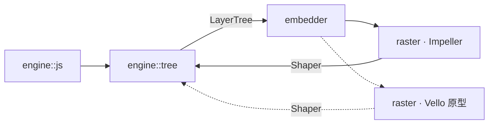

# 渲染后端

本文描述 `LayerTree` 与绘制后端之间的接口设计。构建命令见 [Impeller SDK](../crates/impeller-sys/README.md)。

## 后端接口



`embedder` 继续掌管输入、vsync、`Submit`、`PresentCached`、`Skip` 和 `Flush`。宿主传入 `Send` 工厂，在渲染线程创建一套后端及其 `Shaper`。后端持有显示列表、文字、纹理和当前表面的 GPU 资源。宿主持有窗口和原生表面句柄。原生表面销毁时，`embedder` 在后端释放表面后才应答 `SurfaceDropped`。表面尺寸变化由后端重配交换链，设备丢失则重建设备资源并使当前提交失效。`TextureFactory` 的提前上传留在 Impeller 实现，通用 `ImageCache` 管理解码后的 RGBA 和资源版本。迁移时以 Gallery 滚动和图片上传的基准检查是否引入渲染线程阻塞。

当前由 `raster::Rasterizer` 提交 `LayerTree`，`raster::ImpellerShaper` 与绘制共用 `Typography`。以下为 `embedder` 的后端注入接口草案。`Boot` 使用 `OpenRenderer` 取代 `OpenSurface`。`SurfaceHost` 继续跟踪 ID、尺寸和重试。`Renderer` 实现拥有与渲染设备配对的表面，避免从通用调度传递具体 `Rasterizer`。

```rust
pub type OpenRenderer =
    Box<dyn FnOnce() -> Result<Box<dyn Renderer>, raster::Status> + Send>;

pub trait Renderer {
    fn shaper(&self) -> Box<dyn engine::text::Shaper>;
    fn register_font(&mut self, bytes: &[u8], family: &str) -> Result<(), raster::Status>;
    fn submit_layers<'pixels>(
        &mut self,
        tree: &engine::scene::LayerTree,
        point_scale: f32,
        resolve: &mut dyn FnMut(&str) -> Option<raster::ImagePixels<'pixels>>,
    ) -> Result<(), raster::Status>;
    fn open_surface(&mut self, target: SurfaceTarget) -> Result<(), raster::Status>;
    fn drop_surface(&mut self);
    fn present(&mut self, pixels: raster::PixelSize) -> Result<Presented, raster::Status>;
    fn trim(&mut self);
}
```

以启动时选择为第一版。`macos` 根据构建配置传入 Metal/Impeller 或 wgpu 工厂，`android` 传入 Vulkan/Impeller 工厂。同一个 QuickJS 应用 bundle 和输入服务可复用。会话启动前准备排版。wgpu 若需要依据窗口表面选择适配器，可在首次 `open_surface` 时创建设备，初始化只发生在打开或恢复阶段。设备重建用已注册的字体字节和图像缓存复原，已回收的图像从来源重新解码。`ParagraphId::NONE` 是 `engine` 录制的默认值，后端以文字描述进行缓存，保留段落句柄仅在产生它的实现中使用。 [wgpu 的 surface 与 adapter 接口](https://docs.rs/wgpu/latest/wgpu/struct.Instance.html)

| 目标 | 接入方式与成本 |
|---|---|
| 桌面扩平台，维持 Impeller 画面 | 验证 Linux 和 Windows 源码构建产物的 Vulkan surface 与上屏。该路线可以沿用目前的绘制命令和文字实现。宿主需要接入窗口、输入法、无障碍、vsync 与打包。 |
| 原生桌面替换 GPU 绘制，选 `wgpu` + Vello 验证 | `wgpu` 管设备、队列和 surface。Vello 将路径、合成层、图像和已定位字形编入 `Scene`。评估同一设备能否满足 Vello 要求，并用一套文字排版同时实现 `Shaper` 和字形绘制，可验证 Parley。检查 backdrop blur、混合模式、Canvas 清除与跨 picture 的合成顺序。Vello 的 `Scene::append` 会遍历子场景，缓存 picture 编码还需测重组开销。 [wgpu Surface](https://docs.rs/wgpu/latest/wgpu/struct.Surface.html) · [Vello Scene](https://docs.rs/vello/latest/vello/struct.Scene.html) · [Parley](https://github.com/linebender/parley) |
| 桌面采用 GPUI 的窗口与原生界面 | 另做 GPUI 宿主。通过一个自定义 `Element` 在 `paint` 阶段绘制 Impasto 区域，或验证同设备纹理合成。GPUI 持有窗口事件循环和 present，输入、焦点、IME 与无障碍需要桥接。若使用 GPUI 的绘制原语重放，仍须验证圆角裁剪、组透明度、滤镜和文字布局。 [GPUI Application](https://docs.rs/gpui/latest/gpui/struct.Application.html) · [GPUI Element](https://docs.rs/gpui/latest/gpui/trait.Element.html) · [GPUI Window](https://docs.rs/gpui/latest/gpui/struct.Window.html) |

不同后端都要维持场景点、变换顺序、裁剪和混合语义。同一后端的 `Shaper` 与绘制使用相同字体和排版参数，验收包含 CJK、RTL、UTF-16 选区、光标与 IME 矩形。文案换行、基线、光标和命中位置用几何断言比对。固定字体、DPI 和色彩空间后按后端维护截图基准，抗锯齿与像素容差单独评审。现有 Gallery 使用的命令没有映射时，原型应报告具体命令，正式支持前补齐。

## 收拢后端接口

- `crates/embedder/common/src/lib.rs`、`host.rs` 和 `surface.rs` 由宿主注入后端，迁移表面所有权和 `SurfaceDropped` 顺序。以现有 Impeller 为第一个实现，测试替身覆盖调度、重试和缓存失效。
- `raster::ImpellerShaper` 持有 Impeller 排版资源。后端注入时整理 `images.rs` 与纹理、提前上传之间的接口。`crates/embedder/macos/src/{app,surface}.rs` 和 `crates/embedder/android/src/{app,surface}.rs` 迁移到后端工厂，仍走现有平台线程的输入、解码与窗口生命周期。
- `crates/raster/src/surface.rs` 核对 `raster::Surface` 的调用者，共用的 `PixelSize`、`ImagePixels` 与错误语义沿用现有类型。为需要的 recoverable surface 失败与设备丢失定义具体处理，保留原有 `AcquireMiss` 退避路径。

## 桌面第二后端验证

- `crates/raster` 内先以可选实现接入 Vello，在同一 macOS 宿主上绘制固定 `LayerTree`，再用 Gallery 验证。首个原型覆盖路径、图片、段落、变换、裁剪和组透明度。之后补画面依赖的模糊、混合及 Canvas 语义。验证不同大小的 surface、设备资源失效和缩放切换。
- 记录同一负载的提交、合成与 present 耗时、picture 重建次数和纹理上传量。通过语义与性能验收后，再按真实的 Linux 或 Windows 需求选择扩平台路线。GPUI 独立宿主只在需要使用 GPUI 窗口和控件时立项。

## 架构与验证

- `Boot`、`OpenSurface` 和 `embedder::Surface` 的变动影响 Rust 宿主调用方。迁移顺序是把构造、绘制和表面操作组合成一个平台后端，实现 `Renderer`，再向 `Boot` 传入在渲染线程调用的工厂。调用方继续提供原来的 `Services`、`Vsync`、会话工厂和图像解码器。
- `Renderer` 的动态分发发生在帧、表面和字体边界，picture 和逐命令的循环由各实现管理。`Renderer` 和 `Shaper` 都由渲染线程所有，跨线程的是工厂、平台命令和解码产物。运行中切换设备或渲染器需要重新建立段落、纹理和 picture 缓存，第一版选择在启动时完成。
