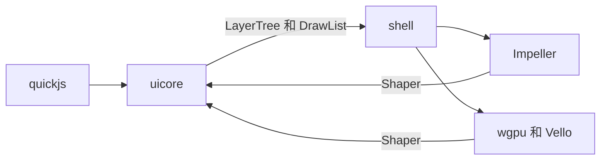

# 接入 Flutter 3.50.0 的 Impeller SDK 并分离桌面渲染后端

## 可行性

先把 Flutter 3.50.0 配套的 Impeller standalone SDK 接进现有 macOS 和 Android 的构建、CI 和安装包。Impeller 继续作为默认渲染实现。`protocol::LayerTree` 和 `DrawList` 已经可以作为桌面第二后端的输入。等 Impeller 发布链路上线并建立基准后，再用 `wgpu` + Vello 验证同一个 macOS 宿主能切换渲染实现。GPUI 的公开绘制入口绑定到它的窗口和绘制阶段，适合按独立宿主评估。两种路径的上线条件都包括文字布局与绘制一致、合成效果完整和帧调度回归。

## 当前接口

| 位置 | 当前行为 |
|---|---|
| `Cargo.toml`、`crates/quickjs/Cargo.toml` | `quickjs` 依赖发布的 `quickjs-jit`，由 Cargo 构建并随宿主链接。 |
| `crates/engine/engine.pin`、`crates/engine/fetch-impeller-sdk.sh` | 钉住 `77f043bc63196b9979cc09c5b97bb6d9b00be34d`，安装 darwin-arm64 和 Android 两个 ABI 的 SDK。已有 header 和动态库时跳过 zip 校验，zip 缓存名也只有平台，升级时可能复用旧文件。 |
| `crates/engine/build.rs` | 根据 Cargo `TARGET` 查找 header，用 `bindgen` 生成绑定并链接动态库。缺 header 时进入 `impeller_missing`。当前平台判断把其余非 Android 目标映射到 darwin。 |
| `justfile`、`.github/workflows/check.yml` | `just host` 直接运行 Cargo。Linux 与 macOS 的 PR 检查都跳过 SDK，CI 没有 Android Vulkan APK 构建。 |
| `crates/macos/build.rs`、`crates/cli/build.rs`、`crates/shell/build.rs` | 分别为相关产物加入 SDK 搜索路径。当前本地 `macos` 二进制带检出路径，`impasto` CLI 也有 Impeller 动态依赖。 |
| `crates/cli/src/build.rs`、`tools/distribute.mjs` | `impasto build macos` 把 darwin-arm64 动态库复制到 `.app/Contents/Frameworks` 并加入相对 rpath。`just cli-dist` 按目录是否存在决定带哪些 SDK。 |
| `crates/android/apk/app/build.gradle.kts::CargoImpasto` | 只为 `arm64-v8a` 构建和暂存 `libimpasto.so` 与 `libimpeller.so`。CLI 生成的 APK 工程复用这份模板。 |
| `session::FrameOutput`、`protocol::LayerTree`、`protocol::DrawList`、`uicore::Shaper` | 会话输出层树。层树携带 `PictureId` 与 generation，`uicore` 通过 `Shaper` 做测量和编辑几何。 |
| `shell::Boot`、`OpenSurface`、`Surface::present`、`shell::start` | `shell` 自行打开 Metal 或 Vulkan `Engine`。`OpenSurface` 和 `Surface::present` 均接收具体 `Engine`。 |
| `shell::ImpellerShaper`、`shell::ImageHandle`、`shell::ImageCache` | 排版持有 `engine::Typography`，图像解码链可携带 `engine::GpuImage` 与 `TextureFactory`。 |
| `engine::Engine::submit_layers`、`trim`、`draw_metal`、`create_swapchain`、`draw_vulkan` | 管理每个后端的显示列表、段落与纹理缓存，并完成绘制。`engine::Surface` 是真实实现与 `NotLinked` 路径共用的编译期接口，其中还有 `draw_metal`。 |

## 设计

### 以 Flutter stable 为版本来源

Flutter 3.50.0 是 2026 年 11 月 11 日发布的稳定版。发布标签指向 framework 提交 `ab2912035e160d9cad6306df307576da6128ebdb`，其 `bin/internal/engine.version` 指向 `371f77202a73e8dff57a8b3bff75bca55c090aee`。同一套 SDK URL 使用 framework 提交时返回 404，使用 engine 提交时可获取当前三个目标的产物。锁文件同时保存 stable 版本、framework 提交、engine 提交、各目标实际下载地址与 zip SHA-256。绑定和动态库从同一压缩包产生。 [Flutter 3.50 发布公告](https://docs.flutter.dev/release/whats-new#11-november-2026-release-350) · [3.50.0 标签](https://github.com/flutter/flutter/releases/tag/3.50.0) · [engine.version](https://raw.githubusercontent.com/flutter/flutter/3.50.0/bin/internal/engine.version)

| Flutter 3.50.0 SDK | 产物与接入范围 |
|---|---|
| `darwin-arm64` | [已有 SDK](https://storage.googleapis.com/flutter_infra_release/flutter/371f77202a73e8dff57a8b3bff75bca55c090aee/darwin-arm64/impeller_sdk.zip)。首批发布宿主。 |
| `android-arm64` | [已有 SDK](https://storage.googleapis.com/flutter_infra_release/flutter/371f77202a73e8dff57a8b3bff75bca55c090aee/android-arm64/impeller_sdk.zip)。首批发布 APK。 |
| `android-x64` | [已有 SDK](https://storage.googleapis.com/flutter_infra_release/flutter/371f77202a73e8dff57a8b3bff75bca55c090aee/android-x64/impeller_sdk.zip)。增加 x86_64 APK 构建，用于模拟器验证。 |
| `darwin-x64`、`linux-*`、`windows-*` | 常用 arm64/x64 产物可下载。Intel macOS 需要补架构打包验证，Linux 和 Windows 需要各自的窗口、表面、输入和发布链路。 |
| iOS 真机和模拟器 | 官方 standalone SDK 矩阵里没有 iOS，当前候选地址均返回 404。 |

每次 Flutter stable 发布触发一次候选升级检查。升级提交一起更新 `engine.pin`、绑定依赖的调用代码及必要的绘制基准。依次验证目标产物、API 版本、链接、首帧和交互。stable 补丁包含相关修复时走同一流程。候选失败时继续沿用上一份通过验证的锁文件。Flutter 上游将 standalone C API 版本传给 context 创建函数，`IMPELLER_VERSION` 相同也要测试二进制和运行行为。 [Flutter stable 发布说明](https://docs.flutter.dev/install/archive) · [Impeller standalone SDK 的版本契约](https://raw.githubusercontent.com/flutter/flutter/3.50.0/engine/src/flutter/impeller/toolkit/interop/README.md#versioning)

### 让 Impeller 随宿主交付

1. 延用 `engine` 的 Rust 封装和 standalone SDK 动态库。取包由 `just`、Gradle 和 CI 共用的脚本完成，Cargo 只读已准备的 SDK。开发者通过宿主入口自动准备当前目标，缓存命中可以离线构建。压缩包按提交和摘要缓存，暂存目录只保留匹配的头文件、动态库、许可证及校验记录，经校验后原子安装。每个目标独立准备。
2. 让宿主显式启用 `engine/impeller`。`build.rs` 按目标系统和架构严格映射，校验头文件与库来自同一个 pin，并为 `engine.pin`、库、头文件和 SDK 路径声明 Cargo 重跑条件。正式宿主缺少 SDK 时在构建阶段报错，错误给出目标和准备命令。无窗口测试可构建 `NotLinked` 路径，文字单测继续用 `MonoShaper`。
3. 原生发布物装入动态库及 `LICENSE.sdk.md`。macOS 发布 `.app` 用 `@executable_path/../Frameworks` 查库，暂存后检查 `LC_RPATH` 和安装名，再签名。CLI 分发内的预构建宿主用分发目录的相对 rpath，CLI 的 `bundle`、`analyze`、`test` 按无窗口配置单独构建。Android 按 ABI 打入两份 `.so`，校验 `DT_NEEDED`、SONAME、ELF 和包的页对齐。Cargo feature 会合并同一包的启用项，分发时分开调用 Cargo 构建 CLI 和带 Impeller 的宿主。 [Cargo feature 合并规则](https://doc.rust-lang.org/cargo/reference/features.html#feature-unification) · [Android 16 KB 页大小支持](https://developer.android.com/guide/practices/page-sizes)

上游 zip 含发布用动态库和大型调试或静态产物。常用构建路径只解出需要的文件。首次构建的下载成本可用按摘要复用的 CI 缓存解决，后续有离线或镜像分发需求时，可发布同一 pin 裁剪出的 SDK 包并校验来源。上游目标断供且仍有明确平台需求时，在独立的 engine 仓库从同一 stable 对应的 engine 提交构建 standalone SDK。 [Flutter standalone SDK 的构建与下载](https://raw.githubusercontent.com/flutter/flutter/3.50.0/engine/src/flutter/impeller/toolkit/interop/README.md#prebuilt-artifacts)

### 在 `LayerTree` 下替换绘制实现



`shell` 继续掌管输入、vsync、`Submit`、`PresentCached`、`Skip` 和 `Flush`。宿主传入 `Send` 工厂，在渲染线程创建一套后端及其 `Shaper`。后端持有显示列表、文字、纹理和当前表面的 GPU 资源。宿主持有窗口和原生表面句柄。原生表面销毁时，`shell` 在后端释放表面后才应答 `SurfaceDropped`。表面尺寸变化由后端重配交换链，设备丢失则重建设备资源并使当前提交失效。`TextureFactory` 的提前上传留在 Impeller 实现，通用 `ImageCache` 管理解码后的 RGBA 和资源版本。迁移时以 Gallery 滚动和图片上传的基准检查是否引入渲染线程阻塞。

`crates/shell/src/lib.rs` 的接口草案。`Boot` 使用 `OpenRenderer` 取代 `OpenSurface`。`SurfaceHost` 继续跟踪 ID、尺寸和重试。`Renderer` 实现拥有与渲染设备配对的表面，避免从通用调度传递具体 `Engine`。

```rust
pub type OpenRenderer =
    Box<dyn FnOnce() -> Result<Box<dyn Renderer>, engine::Status> + Send>;

pub trait Renderer {
    fn shaper(&self) -> Box<dyn uicore::Shaper>;
    fn register_font(&mut self, bytes: &[u8], family: &str) -> Result<(), engine::Status>;
    fn submit_layers<'pixels>(
        &mut self,
        tree: &protocol::LayerTree,
        point_scale: f32,
        resolve: &mut dyn FnMut(&str) -> Option<engine::ImagePixels<'pixels>>,
    ) -> Result<(), engine::Status>;
    fn open_surface(&mut self, target: SurfaceTarget) -> Result<(), engine::Status>;
    fn drop_surface(&mut self);
    fn present(&mut self, pixels: engine::PixelSize) -> Result<Presented, engine::Status>;
    fn trim(&mut self);
}
```

以启动时选择为第一版。`macos` 根据构建配置传入 Metal/Impeller 或 wgpu 工厂，`android` 传入 Vulkan/Impeller 工厂。同一个 QuickJS 应用 bundle 和输入服务可复用。会话启动前准备排版。wgpu 若需要依据窗口表面选择适配器，可在首次 `open_surface` 时创建设备，初始化只发生在打开或恢复阶段。设备重建用已注册的字体字节和图像缓存复原，已回收的图像从来源重新解码。`ParagraphId::NONE` 是 `uicore` 录制的默认值，后端以文字描述进行缓存，保留段落句柄仅在产生它的实现中使用。 [wgpu 的 surface 与 adapter 接口](https://docs.rs/wgpu/latest/wgpu/struct.Instance.html)

| 目标 | 接入方式与成本 |
|---|---|
| 桌面扩平台，维持 Impeller 画面 | 先验证 Flutter 3.50.0 的 Linux、Windows SDK 以及平台 surface API。该路线可以沿用目前的绘制命令和文字实现。宿主需要接入窗口、输入法、无障碍、vsync 与打包。 |
| 原生桌面替换 GPU 绘制，选 `wgpu` + Vello 验证 | `wgpu` 管设备、队列和 surface。Vello 将路径、合成层、图像和已定位字形编入 `Scene`。评估同一设备能否满足 Vello 要求，并用一套文字排版同时实现 `Shaper` 和字形绘制，可验证 Parley。检查 backdrop blur、混合模式、Canvas 清除与跨 picture 的合成顺序。Vello 的 `Scene::append` 会遍历子场景，缓存 picture 编码还需测重组开销。 [wgpu Surface](https://docs.rs/wgpu/latest/wgpu/struct.Surface.html) · [Vello Scene](https://docs.rs/vello/latest/vello/struct.Scene.html) · [Parley](https://github.com/linebender/parley) |
| 桌面采用 GPUI 的窗口与原生界面 | 另做 GPUI 宿主。通过一个自定义 `Element` 在 `paint` 阶段绘制 Impasto 区域，或验证同设备纹理合成。GPUI 持有窗口事件循环和 present，输入、焦点、IME 与无障碍需要桥接。若使用 GPUI 的绘制原语重放，仍须验证圆角裁剪、组透明度、滤镜和文字布局。 [GPUI Application](https://docs.rs/gpui/latest/gpui/struct.Application.html) · [GPUI Element](https://docs.rs/gpui/latest/gpui/trait.Element.html) · [GPUI Window](https://docs.rs/gpui/latest/gpui/struct.Window.html) |

不同后端都要维持场景点、变换顺序、裁剪和混合语义。同一后端的 `Shaper` 与绘制使用相同字体和排版参数，验收包含 CJK、RTL、UTF-16 选区、光标与 IME 矩形。文案换行、基线、光标和命中位置用几何断言比对。固定字体、DPI 和色彩空间后按后端维护截图基准，抗锯齿与像素容差单独评审。现有 Gallery 使用的命令没有映射时，原型应报告具体命令，正式支持前补齐。

## 第一阶段 锁定并准备 SDK

- `crates/engine/engine.pin` 和 `crates/engine/fetch-impeller-sdk.sh` 记录 Flutter 3.50.0 与 engine 提交，按目标取包，生成并校验各平台的 SHA-256。校验同包 header、动态库、许可证、目标架构和所需导出。
- `crates/engine/Cargo.toml` 和 `crates/engine/build.rs` 增加显式链接选项，把 `IMPELLER_VERSION` 与生成绑定取自同一 SDK。校验失败时提供可定位到目标和 pin 的诊断。
- `justfile`、`crates/macos/Cargo.toml`、`crates/android/Cargo.toml` 接上 SDK 准备和 Cargo feature，保持普通 workspace 检查可用。

## 第二阶段 接通安装包和 CI

- `crates/macos/build.rs` 与 `crates/cli/src/build.rs` 共用目标映射，验证 `.app` 从移走源码的临时目录启动。`tools/distribute.mjs` 显式声明每个发布包需要的 SDK 和许可证。清理 `crates/cli/build.rs` 和 `crates/shell/build.rs` 中上线后已无调用者的 SDK 路径处理。
- `crates/android/apk/app/build.gradle.kts` 按 ABI 选择 Cargo target 与 SDK，先准备 SDK 再链接。校验打包输出中同一 ABI 的两份动态库。首批可安装发布覆盖 `arm64-v8a`，模拟器作业验证 x86_64。
- `.github/workflows/check.yml` 保留 Linux 无窗口作业。增加 macOS arm64 真实链接的 `engine` 和宿主测试，以及 Android 两个 ABI 的编译和打包作业。对 `.app`、APK 和 CLI 分发物做产物检查。有 GPU 的 runner 跑首帧、resize、恢复和 Gallery 点击、滚动、文本输入。交叉编译与模拟器结果分别记录。

## 第三阶段 收拢后端接口

- `crates/shell/src/lib.rs`、`shell.rs` 和 `surface.rs` 由宿主注入后端，迁移表面所有权和 `SurfaceDropped` 顺序。以现有 Impeller 为第一个实现，测试替身覆盖调度、重试和缓存失效。
- `crates/shell/src/shaper.rs` 和 `images.rs` 把段落对象、纹理与提前上传归入具体实现。`crates/macos/src/{app,surface}.rs` 和 `crates/android/src/{app,surface}.rs` 迁移到后端工厂，仍走现有平台线程的输入、解码与窗口生命周期。
- `crates/engine/src/surface.rs` 核对 `engine::Surface` 的调用者，共用的 `PixelSize`、`ImagePixels` 与错误语义沿用现有类型。为需要的 recoverable surface 失败与设备丢失定义具体处理，保留原有 `AcquireMiss` 退避路径。

## 第四阶段 验证桌面第二后端

- `crates/engine` 内先以可选实现接入 Vello，在同一 macOS 宿主上绘制固定 `LayerTree`，再用 Gallery 验证。首个原型覆盖路径、图片、段落、变换、裁剪和组透明度。之后补画面依赖的模糊、混合及 Canvas 语义。验证不同大小的 surface、设备资源失效和缩放切换。
- 记录同一负载的提交、合成与 present 耗时、picture 重建次数和纹理上传量。通过语义与性能验收后，再按真实的 Linux 或 Windows 需求选择扩平台路线。GPUI 独立宿主只在需要使用 GPUI 窗口和控件时立项。

## 架构与验证

- `Boot`、`OpenSurface` 和 `shell::Surface` 的变动影响 Rust 宿主调用方。迁移顺序是把构造、绘制和表面操作组合成一个平台后端，实现 `Renderer`，再向 `Boot` 传入在渲染线程调用的工厂。调用方继续提供原来的 `Services`、`Vsync`、会话工厂和图像解码器。
- `Renderer` 的动态分发发生在帧、表面和字体边界，picture 和逐命令的循环由各实现管理。`Renderer` 和 `Shaper` 都由渲染线程所有，跨线程的是工厂、平台命令和解码产物。运行中切换设备或渲染器需要重新建立段落、纹理和 picture 缓存，第一版选择在启动时完成。
- 在已安装的旧 pin 上，`cargo test --locked -p engine` 为 37 通过、1 个基准用例忽略。旧 pin 的 macOS、Android 两份 ABI 使用相同 header。本地两份 Android `.so` 的 `PT_LOAD` 对齐为 `0x10000`。3.50.0 对应 engine 提交的源码 header 与本地 header 一致。新 zip 的摘要、动态库链接、首帧和目标设备运行属于升级验收项。 [3.50.0 对应 engine 的 Impeller C 头文件](https://raw.githubusercontent.com/flutter/flutter/371f77202a73e8dff57a8b3bff75bca55c090aee/engine/src/flutter/impeller/toolkit/interop/impeller.h)

## 文件变更范围

| 文件 | 计划变更 |
|---|---|
| `.github/workflows/check.yml`、`justfile` | 接入按目标准备 SDK、真实链接、安装包与绘制验收。 |
| `crates/android/Cargo.toml`、`crates/android/apk/app/build.gradle.kts` | 声明后端 feature，按 ABI 构建和装入 SDK。 |
| `crates/android/src/app.rs`、`crates/android/src/surface.rs` | 注入 Vulkan 后端并保留 `ANativeWindow` 释放应答。 |
| `crates/cli/build.rs`、`crates/cli/src/build.rs` | 分离无窗口 CLI 链接与应用打包，按目标暂存动态库及 `LICENSE.sdk.md`。 |
| `crates/engine/Cargo.toml`、`crates/engine/build.rs`、`crates/engine/engine.pin`、`crates/engine/fetch-impeller-sdk.sh` | 使 SDK 版本、目标、绑定和动态库配套。 |
| `crates/engine/src/surface.rs` | 收拢后端共用的表面与错误语义。 |
| `crates/macos/Cargo.toml`、`crates/macos/build.rs`、`crates/macos/src/app.rs`、`crates/macos/src/surface.rs` | 声明链接配置和发布 rpath，注入绘制后端。 |
| `crates/shell/build.rs`、`crates/shell/src/images.rs`、`crates/shell/src/lib.rs`、`crates/shell/src/shaper.rs`、`crates/shell/src/shell.rs`、`crates/shell/src/surface.rs` | 收拢宿主注入、资源和帧调度接口。 |
| `tools/distribute.mjs` | 从同一 pin 暂存声明必需的产物，分开构建 CLI 和宿主。 |
| `AGENTS.md`、`README.md`、`crates/engine/README.md`、`docs/architecture.md`、`docs/platform-hosts.md`、`third_party/README.md` | 各阶段落地后更新对应的实际构建路径与架构。 |
