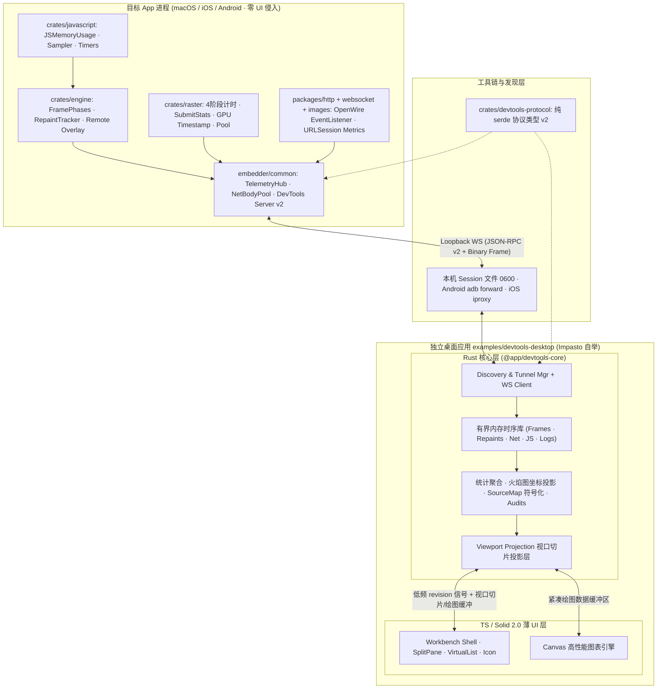

# 独立进程外 DevTools 产品、交互与技术实现规划

本文档定义 Impasto 独立进程外开发者工具（**Impasto DevTools**）的产品规划、基本交互与视觉规范、工具链改造以及桌面自举应用实现方案，覆盖帧处理流水线、JS Runtime、View 级重绘、全链路网络与资源性能等全维度可观测能力。

> **适用范围与前提**
> - **目标平台边界**：当前框架原生支持 `macos`、`ios`、`android`（尚未支持 Web/WASM 及 Windows/Linux 桌面端）。因此本期独立 DevTools 以 **macOS 原生独立桌面应用**（位于拟新建的 `examples/devtools-desktop/`，基于 Impasto 框架自身与 `@impasto/solid-ui` 自举实现）为唯一客户端载体；Web/跨平台桌面载体暂不纳入本期范围。
> - **架构兼容前提**：共享协议与 DevTools Rust Core 层均保持平台无关设计；当后续框架补齐 Web 或其他桌面端 `embedder` 时，可在不重写协议与核心逻辑的前提下直接复用。
> - **前置基线**：本规划建立在 [性能基线与遥测](telemetry-and-p1-plan.md)、[光栅管线与宿主调度](wgpu-rendering-pipeline.md) 与 [Rust 业务与原生插件](rust-plugins-and-native-modules.md) 的现有机制之上，并严格遵守仓库的依赖隔离（`just boundaries`）、单主力渲染路径与零 `unsafe`/`unwrap` 规则。

### 前置改造细化实现方案索引

针对第 1.2 节识别的 5 项核心缺口，各模块的详细数据结构、插桩点、边界护栏与验证清单已拆分为以下独立落地文档：

| 前置改造模块 | 详细实现方案文档 | 覆盖核心范围 |
|---|---|---|
| 1. 共享协议与零摩擦发现 | [devtools-protocol-and-discovery.md](devtools-protocol-and-discovery.md) | `crates/devtools-protocol` · JSON-RPC v2 + Binary Frame · UI 双向桥 · 本机/USB 自动发现与 CLI 联动 |
| 2. View 重绘追踪与远程 Overlay | [devtools-engine-repaint-and-overlay.md](devtools-engine-repaint-and-overlay.md) | `RepaintTracker`（4 种绘制路径与位图频次）· 单帧重绘 View 清单 · Highlight/Pick/Repaint Rainbow |
| 3. 全链路网络采集 | [devtools-network-full-tracing.md](devtools-network-full-tracing.md) | OpenWire `EventListener` · iOS `NSURLSession` Metrics · WebSocket 双向帧 · 远程图片 · `NetBodyPool` |
| 4. JS Runtime 可观测性 | [devtools-js-runtime-observability.md](devtools-js-runtime-observability.md) | QuickJS `JSMemoryUsage` 细分 · Timers/Promises · 主动 GC · 可调采样器 · 离线 SourceMap 符号化 |
| 5. macOS 桌面自举底座 | [devtools-macos-desktop-foundation.md](devtools-macos-desktop-foundation.md) | 窗口尺寸配置与记忆 · `"Monospace"` 字体注册 · `CursorStyle`→`NSCursor` · 文件面板补强 · `NSMenu` |

---

## 1. 现状基线与核心缺口

在推进独立 DevTools 前，代码库已具备一定遥测基础设施，但也存在制约深度诊断的明确缺口：

### 1.1 已有可复用底座

| 层次 | 现有实现 | 已有能力 |
|---|---|---|
| 进程内遥测总枢 | [hub.rs](../crates/embedder/common/src/diagnostics/hub.rs) | 4 类有界环形缓冲（Logs 400 / Errors 100 / Network 150 / Frames 240）、单调游标增量同步、`TelemetryProfile` 分档、`TimelineRecording`（5 泳道 + 8 MiB Span 缓冲）及 `.pftrace` 导出 |
| 回环传输与 CLI | [remote.rs](../crates/embedder/common/src/diagnostics/remote.rs) · [devtools.rs](../crates/cli/src/devtools.rs) | Loopback WebSocket JSON-RPC v1 服务（`/devtools` + 常量时间 Token 校验）、Android `adb forward` + `run-as` 凭据注入、iOS `iproxy` 转发、Release 符号表解析（[symbols.rs](../crates/cli/src/symbols.rs)） |
| 桌面窗口与 UI 原语 | [app.rs](../crates/embedder/macos/src/app.rs) · [solid-ui](../packages/solid-ui/src/index.tsx) | macOS AppKit/Metal 宿主已支持窗口缩放、Retina DPR、Hover/Leave、右键（`SecondaryClick`）、2D 滚轮、双指缩放（`magnifyWithEvent`）、组合快捷键、剪贴板与深浅外观监听；`@impasto/solid-ui` 已提供 `Canvas`、`Icon`（矢量资产）、`VirtualList`、`ScrollArea`、`Tabs`、`Menu`、`Tooltip`、`Field` |

### 1.2 本期必须补齐的 5 个核心缺口

1. **远端协议暴露严重不足**：[remote.rs](../crates/embedder/common/src/diagnostics/remote.rs) 目前仅返回精简帧字段、Trace 录屏与静态节点快照；而 [TelemetryHub](../crates/embedder/common/src/diagnostics/hub.rs) 内已存在的 `phases`、`FrameTrace`、`SubmitStats`、`RuntimeSample`、`logs`、`errors`、`network`、`layout_report` 均未向进程外开放。
2. **View 级重绘追踪为空白**：[retained.rs](../crates/engine/src/tree/record/retained.rs) 与 [layers.rs](../crates/engine/src/tree/record/layers.rs) 仅有整帧聚合计数（如 `picture_rebuilt`、`repaint_boundaries_dirtied`），缺少 **per-NodeId 累计重绘次数、每帧重绘 View 清单、重绘路径与触发原因**。
3. **网络全链路耗时与完整包体缺失**：[http/trace.rs](../packages/http/rust/src/trace.rs) 仅在请求结束后上报 `elapsed_ms` 与 2 KB 截断预览；不过底层传输库 `openwire 0.1.2`（[openwire_transport.rs](../packages/http/rust/src/wire/openwire_transport.rs)）已内置完整的 `openwire_core::EventListener` 回调，iOS 侧（[ios.rs](../packages/http/rust/src/ios.rs)）的 `NSURLSession` 原生支持 `NSURLSessionTaskTransactionMetrics`，只需接入即可。
4. **JS Runtime 指标过粗**：[vm.rs](../crates/javascript/src/runtime/quickjs/vm.rs) 的 `heap_bytes()` 只读取了 `memory_used_size` 单值，丢失了 QuickJS `JSMemoryUsage` 中的对象、字符串、Atom、Shape、字节码等细分项，也未暴露活跃 Timer/Promise 清单与主动 GC 控制；[sampling.rs](../crates/javascript/src/runtime/quickjs/sampling.rs) 在非命令行流程下能力较浅。
5. **macOS 桌面端自举底座尚未成型**：[app.rs](../crates/embedder/macos/src/app.rs) 窗口尺寸硬编码为 `360×640` 手机比例，缺少等宽字体注册、`NSCursor` 光标切换、原生文件打开/保存面板与标准 `NSMenu` 菜单栏；现有的 [devtools.html](../crates/cli/src/devtools.html) 为简陋单页静态页面，无法承载复杂可视化与交互。

---

## 2. 产品规划（Product Plan）

### 2.1 产品定位与四大铁律

**产品定位**：独立的原生桌面诊断、剖析与可观测性工作台，以独立进程形态连接 macOS / iOS / Android 目标应用，逐步取代现有浏览器单页 [devtools.html](../crates/cli/src/devtools.html)，并将进程内 [packages/devtools](../packages/devtools/rust/src/lib.rs) 定位降级为轻量内嵌调试入口或可选项。

1. **零观测污染（Zero Observer Effect）**：完整 DevTools UI 运行在独立桌面进程中，不与目标 App 争抢 UI/Raster 线程与显存；目标 App 仅运行轻量无 UI 的 `DiagnosticsAgent`，未连接时零额外分配，Release 构建默认编译剔除（除非显式开启 `embedder/devtools-server`），高成本采集按档位热切换。
2. **因果可穿透（Causal Drill-Down）**：任意异常指标均可跨模块一键溯源，拒绝信息孤岛：
   - `掉帧柱` → `单帧 4 阶段流水线` → `本帧重绘的 View 清单` → `触发重绘的 Solid/JS 火焰图` → `本地 IDE 源码行`；
   - `慢请求/失败请求` → `9 阶段网络链路瀑布` → `发起调用的 JS 堆栈与所属组件`。
3. **重逻辑在 Rust，TS 只做薄展示（Thick-Rust, Thin-TS）**：长连接管理、通道增量聚合、数千帧/请求的检索排序、火焰图矩形坐标计算、SourceMap 符号化、JSON 树索引与离线归档全部由 DevTools Rust Core（`@app/devtools-core`）承担；Solid 2.0 / TS 层只负责交互状态与视口切片绘制。
4. **零摩擦连接与多端统一**：消除手工配置环境变量与复制 64 位 Hex Token 的繁琐流程，自动发现本机进程、模拟器与 USB 真机并拉起转发隧道，支持断线后留存现场快照并自动重连。

### 2.2 六大功能模块规划

| 模块 | 解决的核心开发痛点 | 核心观测数据维度 | 关键可视化与操作能力 |
|---|---|---|---|
| **1. Overview（健康总览与智能诊断）** | 应用现在稳不稳？卡顿出在框架哪一层？ | 实时 FPS、帧时 P50/P95/P99、掉帧率、`compositor_only` 占比、JS Heap、活跃网络数、Error/Overflow 计数 | 顶部 KPI 指标卡 + **4 轨时间同步实时心电图**（Frame / CPU+GPU / Heap / Net）+ **Live Audits 智能告警流**（掉帧尖峰、合成器阻断、高频重绘、布局溢出、慢 TTFB，点击直达对应现场） |
| **2. Frames（帧处理流水线与时间轴）** | 这一帧为何突破 8.33ms / 16.67ms 预算？卡在 UI、排队、Raster 还是 GPU？ | `ScheduleTiming`（vsync → ui → queue → raster → submit → present）、线程拓扑（`ui-boot`/`platform`）、`FramePhases`（Motion/Dispatch/Timer/rAF/Callback/Flush/Layout/Record/Semantics）、Raster 4 阶段（Prepare/Collect/Encode/Present）与分类上传字节、GPU 逐 Pass 耗时与 `shader_id`/`view_id`、`compositor_block` 原因、5 泳道 Span | **帧条带堆叠柱状图**（含 60/120Hz 预算红线，区分 Compositor-Only 与全量帧）+ **单帧 5 泳道甘特瀑布图**（Platform / UI / Raster / IO / GPU，GPU 独立时间原点）+ **录制窗口火焰图** + 一键 Open in Perfetto / 导出 `.pftrace` |
| **3. Views（View 树、重绘剖析与布局）** | 哪些 View 在反复重绘？某一帧究竟重绘了哪些 View、为什么重绘？ | 实时渲染树（`NodeId` / `Kind` / `Rect` / `Component` / 源码位置）、**per-Node 累计重绘次数与近期重绘频率**、**单帧重绘 View 清单**（绘制路径：`FastLayerPatch` / `PicturePatch` / `FullPictureRebuild` / `CanvasRedraw` + 根因 + 是否触发布局 + 所属 Picture/Layer）、Layout Overflow 报告 | **可搜索/筛选 View 树**（节点带重绘热力徽章）+ **重绘排行榜** + **“按帧看重绘”联动面板** + **设备端无侵入 Overlay**（Pick 拾取、悬浮高亮、Repaint Rainbow 闪烁边框）+ 盒模型与源码一键跳转 IDE |
| **4. JS Runtime（引擎、内存与响应式）** | JS 主线程卡在哪个函数？有无内存或 Timer/Promise 泄漏？Solid 更新是否过密？ | QuickJS 完整 `JSMemoryUsage` 细分项（Objects / Strings / Atoms / Shapes / JS Functions / Bytecode / Binary / Arrays）、活跃 Timers（Timeout / Interval / rAF 及剩余到期时间）、Pending Promises、事件队列积压、`JobStop::Limit` 与脚本预算超时、Solid `updates` / `sets` / `nodes_created` / `ffi_batches` / `ffi_calls`、采样调用栈 | **Heap 分类堆叠面积图** + **手动触发 GC 与快照 Diff** + **JS CPU 火焰图 / Top-Down / Bottom-Up**（自动 SourceMap 还原）+ **资源监视表（Timers/Promises）** + **Console & Errors**（分源筛选 + 堆栈还原） |
| **5. Network（全链路网络与包体）** | 请求卡在 DNS、建连、TLS、服务端还是下载？连接复用了吗？回包内容是什么？ | 统一归集 `@impasto/http`（JS `fetch` & Rust `impasto_http`）、`@impasto/websocket`、引擎远程图片加载；9 阶段链路耗时（Queueing / Proxy / DNS / TCP / TLS / Request Sent / TTFB / Download / Redirect Hops）；连接复用标记、远端 IP、ALPN/HTTP 版本、TLS 协议与密码套件、脱敏可控 Headers、完整 Request/Response Body、Initiator 栈 | **虚拟滚动请求表**（支持 Pending 进行中实时态 + 内联微型瀑布条）+ **9 阶段精细耗时瀑布图**（支持展开 Redirect 每跳详情）+ **Body 多视图检查器**（JSON 折叠树 / Raw / 图片预览 / Hex / Copy as cURL）+ **WebSocket 双向帧流** |
| **6. Resources & Bundle（资源与产物）** | 纹理/图集缓存是否飙升？包体积被哪些模块撑大？ | Atlas 页数/条目/命中率/淘汰次数、`AttachmentPool` 离屏纹理峰值、图片缓存字节、进程 RSS、`bundle-size.json` 模块贡献 | **多维资源趋势图** + Canvas 原生绘制的**交互式 Bundle Treemap**（点击下钻）+ **`.impasto-session` 离线会话包导入/导出** |

### 2.3 分阶段路线图（Roadmap）

1. **Phase 1（MVP · 独立桌面跑通 + 帧与网络闭环）**
   - 补齐 `crates/embedder/macos` 桌面基础能力（宽屏尺寸、等宽字体、鼠标光标、文件对话框）。
   - 新增共享 crate `crates/devtools-protocol`（v2）及本机/USB 自动发现机制。
   - 搭建 `examples/devtools-desktop/` 自举桌面骨架，落地 **Frames 完整流水线** + **Network 9 阶段全链路瀑布与 Body 检查** + **Logs / Errors 基础面板**，正式替代 `devtools.html`。
2. **Phase 2（V1 · View 重绘与 JS Runtime 深度剖析）**
   - 在 `crates/engine` 落地零开销 opt-in **View 重绘追踪器** 与无侵入远程 Overlay（Pick / Highlight / Repaint Rainbow）。
   - 在 `crates/javascript` 补齐 `JSMemoryUsage` 细分、Timers/Promises 快照、主动 GC 与高精采样栈，由 DevTools Rust Core 自动符号化。
   - 交付 **Views 重绘排行榜/单帧重绘联动**、**JS Runtime 面板**、**Overview 4 轨实时心电图**、离线会话包导出与复盘。
3. **Phase 3（V2 · 智能诊断与高阶工具）**
   - 落地 Rust 端 **Live Audits 自动诊断规则引擎**、**JS Heap 快照 Diff**、**Debug REPL**、**Bundle Treemap 与多帧 A/B 对比**、网络请求重放与弱网模拟、可分离检查器窗口。

---

## 3. 基本交互与视觉规划（Interaction & Visual Plan）

### 3.1 视觉美学：精密工程仪器风（Engineering Precision）

- **高密度 × 低干扰双主题**：默认深色，支持跟随 macOS 系统外观。深色表面采用三阶中性冷碳灰：`Canvas #0D1014` → `Panel #14181F` → `Elevated #1C222C`，使用 `1px` 极细边框（`#262D3A`）划分区域，避免厚重阴影与多层卡片套娃，把视觉焦点全部留给数据和状态。
- **全局统一的语义色编码**：
  - **帧流水线**：`Script/JS` 琥珀黄 · `Layout` 靛蓝 · `Record/Paint` 青碧 · `Queue` 中性灰 · `Raster CPU` 钴蓝 · `GPU` 翠绿 · `Compositor-Only` 冰蓝 · `Over Budget / Jank` 珊瑚红。
  - **网络阶段**：`Queue/Proxy` 灰 · `DNS` 青 · `TCP` 橙 · `TLS` 紫 · `TTFB` 绿 · `Download` 蓝 · `4xx/5xx/Error` 红。
  - **View 重绘路径**：`FastLayerPatch` 蓝 · `PicturePatch` 琥珀 · `FullPictureRebuild` 橙红 · `CanvasRedraw` 紫红。
- **等宽数字与矢量图标**：
  - 所有耗时、帧号、字节、状态码、坐标强制使用等宽字体，确保 60Hz 刷新时数字不横向跳动。
  - 使用统一 `1.5px` 线性风格矢量图标集，通过 `@impasto/solid-ui` 的 `Icon` 走编译期矢量 Canvas 绘制，保证 Retina 屏下绝对锐利；所有功能图标附带紧凑状态点与计数徽章（Badge）。

### 3.2 桌面工作台空间布局（5 区域可调分栏）

```text
┌────────────────────────────────────────────────────────────────────────────────────────┐
│ [●] macOS · gallery-solid (120Hz · 2x) ▾ │ [● Rec 5s] [⏸ Live] [🗑] │ Profile: GPU ▾ │ 🎯 🌈 ⌘K ⚙ │
├──┬───────────────────────────────────────────────────────┬─────────────────────────────┤
│  │  全局实时条带 / 帧时间轴（Canvas 高频交互区）             │  右侧/下方上下文检查器         │
│📊│  ▁▂▃▂█▂▁▁▂▅▂▁▁▂▃▂▁▁ (预算红线 8.33ms · 双指缩放与框选)   │  (Inspector Drawer)         │
│  ├───────────────────────────────────────────────────────┤                             │
│🎞│  主工作区（随左侧导航切换）                              │  • 选中帧 → 5泳道瀑布 +      │
│  │  • Overview: 4轨心电图 + Live Audits 诊断列表           │    当帧重绘 View 清单        │
│🌳│  • Frames:   单帧 5 泳道甘特图 / 火焰图 + 阶段指标       │  • 选中 View → 盒模型 +      │
│  │  • Views:    渲染树 + 重绘热力排行榜                    │    重绘历史 + 跳转源码       │
│⚡│  • JS:       Heap 构成 + CPU 火焰图 + Timers/Promises  │  • 选中请求 → 9阶段瀑布 +    │
│  │  • Network:  虚拟滚动请求表 + 内联迷你瀑布条             │    Headers / JSON树 / 预览  │
│🌐│  • Bundle:   资源趋势 + 交互式模块 Treemap              │                             │
│  │                                                       │                             │
│📜│  底部可折叠 Drawer：实时 Logs / Script Errors（支持随时拉起）                           │
├──┴───────────────────────────────────────────────────────┴─────────────────────────────┤
│ Connected · 127.0.0.1:8765 (0.4ms) │ FPS 119.4 · P95 4.2ms │ Frames 240/240 · Net 86   │
└────────────────────────────────────────────────────────────────────────────────────────┘
```

### 3.3 核心交互流

1. **三秒定位一次掉帧（Frames ↔ Views ↔ JS 因果联动）**：
   - 在顶部帧带 Canvas 中点击一根越过 `8.33ms` 预算红线的红色柱子（支持双指捏合放大或鼠标拖拽框选多帧对比均值）。
   - 主区展开 **5 泳道甘特图（Platform / UI / Raster / IO / GPU）**；右侧检查器默认提供三个联动页签：`Breakdown`（阶段耗时与 Raster 上传字节）、`Repainted Views (N)`（该帧重绘 View 清单，按重绘路径/耗时排序）、`JS & Reactive`（`updates`/`sets`/`ffi_calls` 与采样栈）。
   - 点击清单中标红的 `FullPictureRebuild` 节点 → 目标设备端同步高亮该 View 边框，点击源码位置直接通过 `vscode://` / `cursor://` / `zed://` 唤起本地编辑器定位对应行。
2. **一屏看清 View 重绘热区（Views 专项交互）**：
   - 支持 **Tree 模式**（节点右侧附带累计重绘计数与最近 60 帧微型热力胶囊）与 **Leaderboard 模式**（按重绘次数或近 60 帧频率倒序排列，支持过滤仅看 `FullPictureRebuild`）。
   - 工具栏点击 `🎯 Pick` → 目标端进入无副作用拾取态（复用 `Tree::set_pointer_trace(true, true)` 抑制业务点击），点击设备屏幕上的元素后桌面端树自动展开定位；开启 `🌈 Repaint Rainbow` 后，设备端对每次实际重绘区域绘制随时间淡出的彩色边界框。
3. **流畅分析高并发网络与完整回包（Network 专项交互）**：
   - 请求发出瞬间即写入表格（显示 `Pending` 脉冲态），响应头到达更新状态码与 TTFB，完成后补全 9 阶段迷你瀑布条。
   - 支持全文检索（URL / Header / Body）与状态/类型快捷过滤；选中后右侧展示 **9 阶段毫秒级瀑布图**（可展开 Redirect 每一跳）、**Headers 对比**（敏感凭证默认掩码，支持二次确认查看明文）以及 **Payload/Response 查看器**（大 JSON 由 Rust 建索引后虚拟化折叠展开，支持图片预览、Hex 视图与一键 `Copy as cURL`）。
4. **桌面效率快捷键与断线现场保留**：
   - 快捷键：`⌘K` 全局命令与会话切换、`⌘1~6` 模块切换、`Space` 暂停/恢复实时采样、`←/→` 逐帧单步步进、`⌘F` 面板内聚焦搜索。
   - 容错机制：当目标 App 重编或热重启断开连接时，工作台保留断线前的全量现场数据，顶部状态栏切换为琥珀色 `Reconnecting… (Viewing Last Snapshot)`，避免关键异常现场瞬间丢失；新实例上线后提示一键续接或新建会话。

---

## 4. 工具链与独立桌面端技术实现方案

### 4.1 端到端系统拓扑



### 4.2 共享协议 crate 与传输协议升级（Protocol v2）

1. **新增 `crates/devtools-protocol`**
   - 仅依赖 `serde`（及极简基础类型），作为纯数据契约 crate，供 `embedder/common`、`crates/cli` 与 `examples/devtools-desktop/rust` 共同引用，确保前后端类型单一事实源且完全遵守 `just boundaries`。
2. **双通道传输升级（Protocol v2，保留 v1 能力降级兼容）**
   - **Text Frame（JSON-RPC 2.0）**：用于握手鉴权、控制命令、增量通道推送与轻量结构查询。
   - **Binary Frame（固定帧头：Magic + Version + MsgType + RequestId + Flags + Payload）**：用于大体积传输（`.pftrace` 归档、完整 HTTP/WS Body、全量 View 树快照），直接替换 [remote.rs](../crates/embedder/common/src/diagnostics/remote.rs) 中现有的 Base64 JSON 编码，消除 33% 膨胀与 JSON 主线程反序列化卡顿。
3. **100ms 窗口合并推送与核心 RPC 契约**
   - 升级 `subscribe` 支持多通道订阅（`frames`、`repaints`、`network`、`logs`、`errors`、`runtime`、`resources`），由服务端按 `100ms` 节拍合并成批推送增量，避免 120Hz 下高频小包拥塞 WebSocket。
   - 新增/扩展核心 RPC 方法：
     - `session.info`：平台、OS 版本、窗口逻辑尺寸/DPR/刷新率、拓扑模式、引擎/wgpu/QuickJS 版本、已开放能力集。
     - `telemetry.set_profile`：运行时切换 `off | counters | gpu_timeline | deep_inspect`。
     - `frame.detail(frame_id)` / `frame.repaints(frame_id)` / `frame.layer_tree(frame_id)`。
     - `view.snapshot` / `view.repaint_leaderboard` / `view.probe(x, y)` / `view.set_overlay({ highlight_node, rainbow, pick_mode, layout_scan })`。
     - `js.memory_detail` / `js.resources` / `js.run_gc`。
     - `net.get_body(token, side)` / `net.get_ws_frames(token, since)`。
     - `trace.start` / `trace.stop` / `trace.get_frame_spans` / `trace.export_pftrace`。

### 4.3 零摩擦设备发现与工具链打通（`crates/cli`）

1. **Debug 默认自动监听与本机会话注册**：
   - Debug 构建下（或设置 `IMPASTO_DEVTOOLS=1` 时），`embedder/common` 启动阶段自动绑定 `127.0.0.1:0`（系统分配空闲回环端口）并生成 32-byte 随机 hex token。
   - 本机 macOS 与 iOS Simulator 进程将连接元信息原子写入受限目录 `$TMPDIR/impasto-devtools/sessions/<pid>.json`（权限 `0600`，包含 `pid, app_name, bundle_id, platform, port, token, project_root, source_map_path, started_at`），正常退出时清理（DevTools 客户端也会探测 PID 存活以剔除僵尸文件）。
2. **Android / iOS USB 自动隧道管理**：
   - `impasto run -d android` / `-d ios:<UDID>` 自动生成会话 token 并写入目标端（复用 [devtools.rs](../crates/cli/src/devtools.rs) 中的 `configure_android` 逻辑），同时向本地注册目录写入设备标识与目标端口。
   - `examples/devtools-desktop` 的 Rust `discovery` 模块直接监听本机会话目录，并周期调用 `adb devices` / `idevice_id` 发现真机；点击设备时由 DevTools Rust Core 自动拉起和管理 `adb forward` / `iproxy` 子进程，断开时统一回收。
3. **CLI 入口升级**：
   - `impasto devtools [--attach <pid|device>]` 直接拉起或激活原生 **Impasto DevTools** 桌面窗口（后续纳入 `impasto sdk-dist` 一并打包）；`impasto run --devtools` 支持在运行应用时一键联动唤起并自动 Attach。

### 4.4 目标 App 侧四层精细插桩方案

#### 1) 帧处理流水线与光栅层（`crates/embedder/common` + `crates/raster`）
- 补全 [remote.rs](../crates/embedder/common/src/diagnostics/remote.rs) 中的帧序列化，完整透出 [FrameSample](../crates/embedder/common/src/diagnostics/hub.rs)、`PhaseSample`、`FrameTrace` 与 `raster::SubmitStats`。
- 在 `crates/raster` 的固定 4 阶段（Prepare / Collect / Encode / Present）中仅增加标量 `Instant` 耗时与已有计数器透出（字形 Prepare 耗时与 Rayon 异步溢出标记、DrawList 原始命令数与合批后 Draw 数、`AttachmentPool` 瞬态纹理借用数与峰值字节、Atlas 页数/占用率/淘汰数），**严禁引入任何竞争渲染路径或新增缓存层**。
- 在 [ui_frame.rs](../crates/embedder/common/src/host/ui_frame.rs) 中把 `skipped_frame` 原因与 `in_flight` 队列深度接入帧事件流，还原背压丢帧现场。

#### 2) View 重绘次数与每帧重绘 View 追踪（`crates/engine`）
- 在 [Tree::debug](../crates/engine/src/tree/debug.rs) 下增加 `repaint_tracker: Option<RepaintTracker>`（关闭状态下仅一次 `Option` 判空，零堆分配）。
- 在引擎唯一录制主干的 4 个关键切入点记录事件：
  - [retained.rs](../crates/engine/src/tree/record/retained.rs) 的 `update_rect_slot` / `update_transform_slot` / `update_opacity_slot` / `update_clip_radius` → `PaintPath::FastLayerPatch`；
  - `apply_layer_patches` 的 `picture_patches` 局部重录 → `PaintPath::PicturePatch`；
  - [layers.rs](../crates/engine/src/tree/record/layers.rs) 的 `emit_picture_owner` / `record_owner` 全量重录 → `PaintPath::FullPictureRebuild`；
  - Canvas 回调重绘处 → `PaintPath::CanvasRedraw`。
- 分两层维护数据：
  - **节点累计表**：`HashMap<NodeId, NodeRepaintStats>`（记录 `total_repaints`、`total_layouts`、各绘制路径计数、最近重绘帧号、60 帧滑动热度位图）；
  - **单帧重绘清单**：每帧结束后收集前 `256` 个重绘节点条目（`node_id`、`kind`、`component`、`source`、`rect`、`path`、`reason`、`caused_layout`、`picture_id`）及截断溢出计数 `overflow_count`，随当帧进入 `TelemetryHub`。
- **无侵入设备端 Overlay**：在 `engine` 录制阶段末尾，当开启 `highlight_node` 或 `rainbow` 时，直接向 `LayerTree` 尾部追加少量瞬时矩形描边/半透明遮罩命令，目标 App 无需挂载任何 DevTools JSX 组件即可呈现高亮与重绘彩虹。

#### 3) JS Runtime 细节采集（`crates/javascript` + `crates/engine/src/js`）
- 严守 `crates/javascript` 独立边界（只返回纯 `std` 值类型）：
  - 在 [vm.rs](../crates/javascript/src/runtime/quickjs/vm.rs) 扩展 `memory_usage_detail(&self) -> JsMemoryStats`，完整映射 `qjs::JSMemoryUsage` 的 `malloc_size/count`、`memory_used_size/count`、`atom_size/count`、`str_size/count`、`obj_size/count`、`prop_size/count`、`shape_size/count`、`js_func_size/count/code_size`、`binary_object_size/count`、`array_count`。
  - 暴露 `timers_snapshot()`（枚举活跃 `Timer` 的 `id` / `kind` / `due_in_ms` / `interval_ms`）、`trigger_gc()`（调用 `runtime.run_gc()` 并返回回收前后对比）、`promise_peak / rejection_overflows / job_limit_hits`。
  - 扩展 [sampling.rs](../crates/javascript/src/runtime/quickjs/sampling.rs)：Detailed 录屏时支持动态下调采样间隔（如 `500µs`）并提升栈深至 `32` 层；采集原始栈由 DevTools Rust Core 离线符号化，避免目标进程在采集期做重计算。

#### 4) 全链路网络采集（`packages/http` + `packages/websocket` + `embedder/common/images`）
- **非 iOS（`openwire 0.1.2`）**：在 [openwire_transport.rs](../packages/http/rust/src/wire/openwire_transport.rs) 中实现 `openwire_core::EventListener`，为每次请求绑定专属 `TimingRecorder`：
  - 利用已有回调精准记录：`dispatcher_queue_start/end`（Queue）、`proxy_select_start/end`（Proxy）、`dns_start/end`（DNS + IP）、`pool_lookup` + `connection_acquired(id, reused)`（连接复用）、`connect_start/end`（TCP + `SocketAddr`）、`tls_start/end` + `tls_handshake`（TLS 版本 / ALPN / Cipher）、`request_headers/body_start/end`（Request Sent）、`response_headers_start/end`（TTFB）、`response_body_start/end`（Download）。
  - 在 `open_head` 重定向循环中逐跳记录 `RedirectHop { url, status, location, timing }`。
- **iOS（`NSURLSession`）**：在 [ios.rs](../packages/http/rust/src/ios.rs) 的 `Receiver` 实现 `URLSession:task:didFinishCollectingMetrics:`，将 `NSURLSessionTaskTransactionMetrics` 映射为同构的 `NetworkTiming` 阶段结构。
- **三段流式上报 + 分离式 Body 缓存**：
  - 将 [http/trace.rs](../packages/http/rust/src/trace.rs) 从仅在请求完成时上报升级为 `net.start` → `net.head` → `net.finish` 三段流式事件。
  - 在 `TelemetryHub` 中增加有界 LRU `NetBodyPool`（默认总量上限 `16 MiB`，单条上限 `1 MiB`）；列表实时流只推送元信息与 `512 B` 预览，点选详情时再按需通过 `net.get_body` 走 Binary Frame 拉取完整请求/响应体。
- **全网络来源统一**：升级 [websocket/trace.rs](../packages/websocket/rust/src/trace.rs) 补充上行 `WS SEND` 与 Opcode/方向字段；为 [images/remote.rs](../crates/embedder/common/src/images/remote.rs) 远程图片加载接入同源 `TelemetryHub` 网络记录（标记 `initiator: "image"`）。

---

### 4.5 独立自举桌面端架构：`examples/devtools-desktop/`

独立桌面端采用与 [examples/native-order/app.toml](../examples/native-order/app.toml) 一致的 Impasto 应用工程结构（参考 [Rust 业务与原生插件](rust-plugins-and-native-modules.md)）：

```text
examples/devtools-desktop/
├── app.toml                    # targets = ["macos"]，声明 @impasto/solid-ui 等内置依赖
├── package.json
├── tsconfig.json
├── macos/                      # 可编辑 macOS Runner 工程（Info.plist / 图标 / 窗口配置）
├── rust/
│   ├── Cargo.toml              # 依赖 impasto (registry = "impasto") 与 devtools-protocol；
│   │                           # 参照 examples/native-order/rust 列入根 Cargo.toml 的 exclude，
│   │                           # 通过 `impasto sync` 生成 .impasto/cargo/ 独立工作区构建
│   └── src/
│       ├── lib.rs              # #[impasto::module(name = "DevtoolsCore", specifier = "@app/devtools-core")]
│       ├── discovery.rs        # 本机会话发现 + adb forward / iproxy 隧道托管
│       ├── client.rs           # WS v2 客户端 + 断线重连 + Binary Frame 编解码
│       ├── store/              # FrameStore / RepaintIndex / NetStore / JsStore / LogStore
│       ├── analyzer/           # Flamegraph 布局 · SourceMap 符号化 · Audit 规则 · Bundle Treemap
│       ├── projection.rs       # 视口切片与 Canvas 紧凑绘图缓冲区投影 API
│       └── archive.rs          # .impasto-session / .pftrace / cURL 导出与 Perfetto 打开
└── src/
    ├── main.tsx                # 应用入口
    ├── state/                  # 极薄信号状态：连接态、当前 Tab、选中 ID、筛选文本、各通道 revision
    ├── shell/                  # Workbench 主壳、Titlebar、Rail、SplitPane、StatusBar、⌘K 面板
    ├── charts/                 # Canvas 2D 渲染胶水（帧带 / 5泳道甘特 / 火焰图 / 9段瀑布 / 折线 / Treemap）
    ├── pages/                  # Overview / Frames / Views / JsRuntime / Network / Resources
    └── assets/icons/           # 编译期矢量图标定义
```

#### 关键性能设计：Viewport Projection（视口切片投影）
为避免把数千帧数据、数万条 Span 或完整 JSON Body 跨 FFI 塞入 QuickJS 堆：
1. **低频粗粒度通知**：Rust Core 后台线程持续接收增量并更新内存索引，仅以最多 `100ms` 节拍向 JS 推送轻量 `TickSummary`（各通道最新 `revision`、KPI 数值、告警计数）。
2. **列表按需视口切片**：`VirtualList` 滚动时只向 Rust 请求可视区域窗口，例如 `query_network_slice(filter, sort, offset, limit)`，每次只返回 30～50 行轻量视图模型。
3. **图表布局全由 Rust 预计算**：`project_frame_bars(...)`、`project_flamegraph(...)`、`project_treemap(...)` 由 Rust 完成时间区间裁剪、Lod 合并与矩形坐标计算，返回扁平紧凑矩形缓冲区；TS 侧 `Canvas` 绘制回调只做一次顺序 `fillRect / fillText` 遍历，确保 120Hz 缩放拖拽丝滑且 JS 帧耗 `< 0.5ms`。

#### 与进程内 `packages/devtools` 的演进关系
- **共存过渡**：Phase 1～2 期间保留 [packages/devtools](../packages/devtools/rust/src/lib.rs) 及其在示例中的应用集成，不破坏现有端到端测试。
- **职责收敛**：待独立桌面端完备后，进程内 `packages/devtools` 收敛为「极简悬浮 FPS/状态条 + 快捷唤醒独立 DevTools 按钮」，不再在目标 App 内维护重型诊断页面。

---

### 4.6 自举前置：`crates/embedder/macos` 必须补齐的 5 项桌面底座能力

用 Impasto 开发 `examples/devtools-desktop` 是桌面能力的最佳试金石，以下 5 项改造同时惠及框架所有 macOS 桌面应用：

1. **窗口配置化与尺寸记忆**：解除 [app.rs](../crates/embedder/macos/src/app.rs) 中 `CONTENT_WIDTH = 360.0` / `CONTENT_HEIGHT = 640.0` 的硬编码，支持通过 `app.toml`（`[macos]`）或运行参数配置初始宽高（如 `1360×860`）、最小窗口尺寸（如 `960×640`）、窗口尺寸记忆与标题栏样式。
2. **等宽字体族注册**：在 [app.rs](../crates/embedder/macos/src/app.rs) 的 `MacServices::extra_fonts` 中注册系统等宽字体（如 `SF Mono` / `Menlo` 注册为 `"Mono"` 字体族），确保数字、时间戳、JSON 与堆栈严格对齐。
3. **鼠标光标切换（`NSCursor`）**：打通 `engine` 节点样式与 `embedder/macos` 视图层，支持标准桌面光标（`default` / `pointer` / `text` / `col-resize` / `row-resize` / `grab` / `grabbing`），支撑分栏拖拽、时间轴平移与交互链接手感。
4. **原生文件打开/保存面板**：在 macOS 插件侧提供 `NSOpenPanel` / `NSSavePanel` 封装，支持保存 `.pftrace`、`.impasto-session` 与打开 `bundle-size.json`。
5. **标准 macOS 菜单栏（`NSMenu`）**：补充基础应用菜单与 Edit 菜单（`⌘Q` / `⌘W` / `⌘M` / 复制粘贴全选），完善原生桌面体验。

---

## 5. 实施顺序与工程约束

### 5.1 建议执行路径

1. **Step 1（底座与协议）**：建立 `crates/devtools-protocol`，补齐 `crates/embedder/macos` 的 5 项桌面底座能力；升级 `embedder/common` 的 `remote.rs` 为 v2 双通道协议并落地 `$TMPDIR/impasto-devtools/sessions/` 自动发现。
2. **Step 2（桌面自举骨架 + Frames/Logs 闭环）**：初始化 `examples/devtools-desktop/`，跑通 `@app/devtools-core` 自动发现与连接、`Workbench` 主壳以及 **Frames 流水线 + Logs** 端到端闭环，替换 `devtools.html`。
3. **Step 3（两大核心深水区）**：并行推进 **Network 全链路采集**（接入 `openwire_core::EventListener`、iOS `NSURLSessionTaskTransactionMetrics` 与 `NetBodyPool`）与 **Engine View 重绘追踪**（`RepaintTracker` + 远程无侵入 Overlay）。
4. **Step 4（JS 深度剖析与智能化）**：补齐 QuickJS 详细内存/Timers/Promises/高频采样栈，完成 **JS Runtime 面板**、**Overview 心电图与 Live Audits**、离线会话包与 **Bundle Treemap**。

### 5.2 硬性工程护栏

- **依赖边界（`just boundaries`）**：`crates/devtools-protocol` 保持纯数据模型；`crates/javascript` 不得反向引入 `engine`/`raster`/`embedder`；`examples/devtools-desktop/rust` 仅通过 `impasto` SDK、插件包及自有依赖编写业务，不得直接耦合目标框架私有运行时内部。
- **渲染管线铁律**：所有新增桌面端图表（帧带、甘特图、火焰图、瀑布图、Treemap）全部走 `@impasto/solid-ui` 的 `Canvas` 单一主力光栅路径；目标 App 侧遥测插桩绝不引入互斥渲染开关或额外帧间离屏缓存。
- **代码质量与静态检查**：严守 `unsafe_code = "deny"` 与 `unwrap_used` / `expect_used = "deny"`；每次阶段性提交前通过 `just check`、`just boundaries`、`cargo fmt --all -- --check` 及 `cargo clippy -p embedder-macos --all-targets -- -D warnings`。
