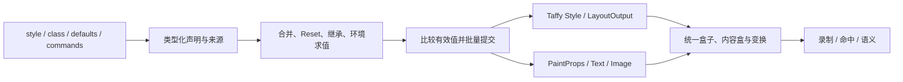

# 基于 Taffy 0.15.1 重构样式对象与工具类

本文定义样式体系的完整目标与验收合同。已实现的行为以源码和 `docs/architecture.md` 为准，剩余工作列在 `docs/refactor-plan.md`；本文的阶段列表不代表全部已完成。布局基线为 Taffy 0.15.1，工具类采用明确的原生支持范围。

## 破坏性变更与迁移

样式字段、默认布局、文字继承和效果作用域一起改变，需要配套升级框架包、QuickJS 会话和应用 bundle。

1. JSX 的 `w/h/grow/shrink/basis/fill/cross/justify/edges/radius/alpha` 等展示属性移入 `style`；工具类只生成相同的属性声明。事件、ref、内容、图片资源、滚动控制和可访问行为继续保留独立属性。
2. `setGrow/setPadding/setColor/setAlpha/…` 迁为 `setStyle/patchStyle/clearStyle`；文本内容、滚动、编辑器、焦点、动画和语义命令保留。`setColor` 按目标明确迁成 `color` 或 `backgroundColor`。
3. 普通节点使用 min 0、grow 0、shrink 0、basis auto、无隐式 max；宽高仍为 auto。应用显式声明根、视口、overlay 的填充及卡片的尺寸约束。
4. `Text` 未声明的可继承字段从父节点取得；`null` 表示回到节点初始值并阻断继承；省略字段表示撤销当前来源的声明。文字内容与富文本 runs 不进入样式。
5. 合并等价的 pointer/decorated/padding 等包装，保持 NodeId 的代数句柄语义。ref、焦点、语义树和列表行 owner 随节点合并同批迁移。
6. 新 transform 默认围绕节点中心；旧 transform 构造器在迁移阶段保留其原有原点。迁移旋转、缩放时必须显式核对原点，不能只改字段名。
7. 旧 `stroke` 迁成不参与布局的 `outlineWidth/outlineColor`；新的 `borderWidth` 会占用内盒空间。图片旧 w/h 迁成样式尺寸；已有资源尺寸信息保留为独立的 `intrinsicSize`，换图不能重置样式。
8. Row 的 locale 反转改为显式的布局方向继承；删除重复的语言侧 reverse。RTL 横向滚动增加从 inline-start 起算的约定，物理输入只在滚动核心转换一次。

开发分支允许分阶段共存，每个阶段保持可构建。最终删除旧样式 setter、旧变更字段及失去用途的标签和测试替身；仍有布局或效果作用域的 Rust 构造简写委托统一实现。

## 可行性评估

已有 `Style/Property/Declaration/Key/Patch`、TaffyTree、变更缓冲、独立绘制失效和 LayerTree，可以复用。Taffy 0.15.1 已提供所需的尺寸类型、Flexbox/Grid/Block、基线输出、内容溢出、方向和属性解析。独立 API 验证已通过：基线可由 Taffy 直接对齐；嵌套绝对定位溢出的最大滚动偏移为 90；Grid 解析接受 repeat/minmax 并拒绝非法最小轨道和 rem 输入。SDK 头文件与 darwin 动态库均有固有宽度查询符号。主要限制是这些能力尚未贯通声明、文字测量、绘制、命中和脚本边界。**有条件可行：以真实文字固有尺寸、效果组合和原生交互验收为交付门槛。**

## 当前接口与消费点

### 仓库实现

- `crates/uicore/src/style/`：类型化声明、Reset/Inherit、来源合并、环境求值、Taffy 适配、工具类与 LRU 缓存。
- `crates/uicore/src/tree/style.rs`：节点来源所有权、候选校验、展示属性恢复、样式冲刷与状态依赖。环境刷新尚未建立节点依赖索引。
- `crates/uicore/src/style/defaults.rs`：普通 View 使用 column、min 0、shrink 0、无隐式 max；Scroll 保留视口预设。
- `crates/uicore/src/tree/{layout,scroll,hit}.rs`：Taffy 测量与几何、内容溢出、命中。真实固有文字度量和 RTL 滚动仍需后续验收。
- `crates/uicore/src/tree/record/`：同节点背景、内容与组合效果，扁平 DrawList 和 LayerTree 共用作用域。
- `crates/quickjs/{abi.yml,build.rs}`、`src/linked/{rt/bindings,mutation}.rs`：生成类型记录，复制 JS 输入后借用 Tree，一次提交完整来源。同步读强制冲刷样式和所需布局。
- `packages/solid-renderer/runtime/{style,text}.ts`：响应式独立样式来源与清理，文字样式统一输入；Image 的资源尺寸接口仍待拆分。
- `packages/solid-ui/src/Button.tsx`：单 View 承载布局、手势、焦点与语义，组件默认来源允许 class/inline 覆盖。
- `packages/solid-ui`、`packages/solid-router`、`packages/devtools`、`apps/gallery-solid`：产品 TSX 使用 view/stack/scroll/image，文本展示字段位于 style。
- `crates/uicore/src/style_contract_test.rs`、`crates/quickjs/tests/fixtures/style.tsx`：来源隔离、原子失败、clear/reset、环境/交互依赖、同步读与真实组件回归。
- `crates/uicore/src/bin/style-types.rs`、`justfile`：生成类型、属性表和能力清单，并提供一致性检查。

### 上游依据

API 以已发布的 0.15.1 源码为准，外部 latest 页面只用于确认版本。

- [Taffy 0.15.1 发布](https://github.com/DioxusLabs/taffy/releases/tag/v0.15.1)。
- [Style 字段与默认值](https://github.com/DioxusLabs/taffy/blob/v0.15.1/src/style/mod.rs)：尺寸领域、方向、overflow、contain、布局类型。
- [尺寸类型](https://github.com/DioxusLabs/taffy/blob/v0.15.1/src/style/dimension.rs)、[对齐类型](https://github.com/DioxusLabs/taffy/blob/v0.15.1/src/style/alignment.rs)。
- [Grid 类型与解析](https://github.com/DioxusLabs/taffy/blob/v0.15.1/src/style/grid.rs)：repeat、命名行、区域和轨道限制。
- [LayoutInput/LayoutOutput/Layout](https://github.com/DioxusLabs/taffy/blob/v0.15.1/src/tree/layout.rs)：基线、边框/内边距与滚动偏移辅助方法。
- [TaffyTree](https://github.com/DioxusLabs/taffy/blob/v0.15.1/src/tree/taffy_tree.rs)：测量回调、缓存、mark_dirty 和 calc 求值边界。
- [Tailwind 工具类及冲突规则](https://tailwindcss.com/docs/styling-with-utility-classes#conflicting-utility-classes)：Web 端按样式表顺序覆盖，并非 class 字符串后写必胜。
- 本地 `../Whisker` 的 Css/声明分层、`../nsh` 的原生工具类/默认值作为接口对照；只借鉴接口和行为，不复制或链接其产品代码。

## 设计

### 1. 关键决策

1. **以统一声明驱动树。** style、class、组件默认值、命令式更新和动画都进入 Property，按来源合并。逐个调用旧 setter 无法提供批量比较、撤销和原子校验，因此只作迁移桥接。
2. **继续使用 TaffyTree。** Taffy 管布局算法与布局缓存；uicore 管声明、绘制和交互。当前需求无需重写 LayoutPartialTree/CacheTree；低层适配只在高层 API 的可复现限制阻塞交付时另立设计。
3. **普通 View 默认 column/min 0/shrink 0。** 与原生界面的内容组合一致；auto 的尺寸继续受父约束、stretch 和内容共同决定，不承诺所有容器按 min-content 排列。
4. **工具类采用原生支持范围。** 类名遵循 Tailwind 常用词汇和属性映射，默认值、冲突顺序、单位和不支持项明确记录；不宣称与 Web 样式表全量等价。
5. **展示能力可组合。** 背景、边框、内边距、裁剪、透明度、变换和事件可以由同一节点承载。单纯减少标签数不能代替录制、命中、语义和 owner 的等价验证。
6. **文字测量接入完整 LayoutOutput。** 从 Impeller 度量提供固有尺寸和第一基线，交给 Taffy 进行父布局；删除布局后的基线修正，避免两套几何结果。
7. **样式层保留来源与 Reset。** 从最终 Taffy Style 反推声明会丢掉撤销与继承信息；已提交样式只作结果缓存。
8. **高频更新不转 CSS 文本。** 普通 style 走生成的类型化批量记录；Grid 任意值的有限字符串语法复用 Taffy parse。文本解码不重复承担对象、数组和复杂绘制值的协议职责。
9. **使用发布的缓存实现。** 类规则缓存采用 `lru` 0.18.5（MIT，default-features=false），补充字节预算。
10. **默认值与应用迁移同批完成。** 新 View 可以先采用目标预设，旧构造器保持当前预设至迁移完成；不能根据“是否写了 style”隐式切换布局语义。

### 2. Taffy 能力矩阵

| 能力/API | 重构中的使用 | 边界 |
|---|---|---|
| `Style.size: Size<Dimension>` | width/height 的 auto、点、百分比、min/max-content、fit-content、stretch | `content` 仅对 flexBasis 开放 |
| `min_size/max_size: Size<LengthPercentageAuto>` | 点、百分比、auto；max 的 none 规范化为 auto | 不把 min-w-max、max-w-fit 硬塞进此类型；明确报不支持 |
| `flex_basis: Dimension` | auto、content、长度和尺寸关键字 | 0 点与 0% 保持区分 |
| Flexbox | row/column/reverse、nowrap/wrap/wrap-reverse、grow/shrink、gap | balance 及 flex_line_count 暂不启用 |
| `AlignItems/AlignContent` | normal、start/end、flex-start/end、center/stretch、分布对齐和安全位置对齐 | 各字段生成各自合法枚举；baseline/safe 不能任意组合 |
| `LayoutOutput.baselines.first` | Shaper 度量回传第一基线，Taffy 完成对齐 | last baseline 等 SDK 度量完整后再开放；不使用 box height 冒充文字基线 |
| Grid | 模板/自动轨道、auto-flow/dense、placement、repeat、命名行/区域 | repeat 不嵌套；minmax 的 min 禁止 fr；校验 auto-repeat 限制 |
| `GridTemplateTracks::from_str` | `grid-cols-[…]` 等有限任意值 | 启用 parse；只接上游支持且通过配置白名单的单位/函数 |
| Block/FlowRoot | display:block/flow-root | 不产生 HTML inline formatting，也不把 block 当 column 别名 |
| `Position::Relative/Absolute` | 维持直接父节点定位，inset 支持百分比与负值 | 保持所有框架盒子为 positioned ancestor |
| Static/Fixed/Sticky | 暂缓开放 | static/fixed 牵涉 hoisted 坐标与 containing block；sticky 的滚动偏移仍由调用方实现 |
| `direction` | 显式 ltr/rtl 和继承，统一布局与滚动的方向转换 | 段落 writingDirection 单独配置；不实现纵向 writing-mode |
| margin/padding/gap | 对应长度领域，保留百分比给 Taffy | margin 可负可 auto；padding/gap 非负；百分比 padding 不按高随意换算 |
| border/box_sizing | border-box/content-box，统一宽度实线边框进入布局 | 不开放四边不同宽/色与四角独立圆角；现有绘制协议不能完整表达 |
| Overflow Visible/Clip/Hidden | 分别写 Taffy 的布局语义，并驱动实际裁剪 | Hidden 会改变 auto 最小尺寸语义；Clip 不等同 Hidden |
| Scroll + content_size | `Layout.scroll_width/scroll_height` 给出最大偏移 | 方法结果已经扣除视口；不能再减 width/height |
| `Layout.border/padding/content_box_*` | 文字、图片和编辑光标使用同一内容盒 | 不在 TS 再算一份内盒 |
| mark_dirty/dirty/内置 Cache | 等值提交跳过 set_style；文字度量改变调用 mark_dirty | 固定宽高不自动成为可截断的布局边界 |
| rounding/unrounded_layout | 保持现有取整；诊断可查看未取整值 | 不与样式迁移同时改变全树像素对齐策略 |
| contain | 暂不公开 | Taffy 的 layout/paint containment 不覆盖完整绘制、尺寸隔离和命中合同 |
| calc | 暂不启用 | 当前 TaffyTree 的 resolver 固定返回 0；仅启用 feature 无法正确求值 |
| float、table、subgrid、order | 不进入本次公开属性 | float feature 未启用；其余不能因存在部分标记或 Layout.order 就宣称已实现 |
| detailed_layout_info | 仅调试构建按需启用 | 不作为布局或缓存正确性的依赖 |

计划依赖配置：

```toml
taffy = { version = "0.15.1", default-features = false, features = ["std", "taffy_tree", "flexbox", "grid", "block_layout", "content_size", "parse"] }
lru = { version = "0.18.5", default-features = false }
```

Taffy features 目标保留现有六项并增加 `parse`。calc、float_layout、flexbox_balance 保持关闭。`parse` 引入的是发布的 cssparser 解析依赖，不改变布局与光栅边界。

### 3. 属性注册表与领域类型

**目标文件：`crates/uicore/src/style/property.rs`、`values.rs`、`taffy.rs`（新增）。**

注册表是属性身份、公开名称、值领域、合法范围、继承、影响和生成元数据的唯一来源。扩展现有 Key/Property，不在 QuickJS、TypeScript 或工具类里重定义另一套属性编号与布局规则。Taffy 类型保持在适配器内部。用一份声明式注册表生成 Key、Property、name/parse、校验分发与 FieldMeta，替换目前手工维护的多份枚举/数组；复杂值校验仍为明确的 Rust 函数。

```rust
// 目标领域定义，省略构造校验和已有枚举。
#[derive(Clone, Debug, PartialEq)]
pub enum Length {
    Points(f32),
    Fraction(f32),
    Rem(f32),
    ViewportWidth(f32),
    ViewportHeight(f32),
    Token(LengthToken),
}

#[derive(Clone, Debug, PartialEq)]
pub enum SizeValue {
    Auto,
    Length(Length),
    MinContent,
    MaxContent,
    FitContent,
    FitContentLimit(Length),
    Stretch,
}

#[derive(Clone, Debug, PartialEq)]
pub enum LimitValue {
    Auto,
    Length(Length),
}

#[derive(Clone, Debug, PartialEq)]
pub enum Declaration {
    Set(Property),
    Reset(Key),
    Inherit(Key),
}

#[derive(Clone, Debug, PartialEq)]
pub enum WinningDeclaration {
    Value(Property),
    Initial,
    Inherit,
}
```

- SizeValue、LimitValue、MarginValue、InsetValue、非负 LengthPercentage 分开。flexBasis 在 SizeValue 之外另支持 Content；不能把一个宽泛枚举转换失败后默默变成 auto。
- 浮点统一校验 finite，归一化 -0；长度和百分比保留场景单位。不存在有效 NaN，也不依赖 CompactLength 的内部 tag 值。
- class 的 px 表示一个场景点。rem、viewport 和主题长度在环境解析阶段换成点；父百分比保留到 Taffy，transform 的百分比保留到本节点布局完成后。
- `minWidth:"auto"` 恢复 Taffy 的自动最小值；`maxWidth:"none"` 表示取消额外上限；它们都不同于 `null` 的初始值语义。
- 移除用于隐式方向的 Weak 声明。`flex` 只设置 display；`flex-row/flex-col` 明确设置方向。View 的默认 column 是框架预设，不给 display 属性附带一个隐藏方向写入。
- 生成的影响至少包括 Layout、Measure、Paint、Layer、Hit、Semantics；继承和 token 依赖另保留准确字段集合。

**属性映射：**

| 属性组 | 字段 | 目标 |
|---|---|---|
| 尺寸 | width/height、min/maxWidth/Height、aspectRatio、boxSizing | size/min_size/max_size/aspect_ratio/box_sizing |
| Flex | flex、flexGrow/Shrink/Basis、flexDirection/Wrap | 简写先展开；分别写对应字段 |
| 对齐 | alignItems/Self/Content、justifyItems/Self/Content | 字段级合法的 Taffy alignment |
| 物理边距 | padding/Top/Right/Bottom/Left、margin 各边、rowGap/columnGap | padding/margin/gap；gap.width 对应 columnGap |
| 逻辑边距 | paddingInlineStart/End、marginInlineStart/End、insetInlineStart/End | 继承 layoutDirection 后映射，物理长属性在同一片段中优先 |
| 定位 | position、top/right/bottom/left | Relative/Absolute 与 inset |
| Grid | gridTemplateColumns/Rows、gridAutoColumns/Rows、gridAutoFlow、四条 placement、行名与区域 | 对应 Grid 字段；区域必须为合法矩形 |
| 溢出 | overflow、overflowX/Y | Visible/Clip/Hidden；Scroll 的声明轴由节点策略负责 |
| 装饰 | backgroundColor/Gradient、borderWidth/Color/Radius、outlineWidth/Color、shadow/boxShadow | Taffy 仅接 border 占位，其余写 PaintProps |
| 合成 | opacity、translateX/Y、rotate、scaleX/Y、transformOrigin、blur/backdrop/blend | PaintProps、TransformProps 与 LayerTree |
| 层序 | zIndex | uicore 同父节点绘制/命中排序，不写 Taffy |
| 文字 | color、fontFamily/Size/Weight、lineHeight、textAlign、writingDirection、maxLines、ellipsis、softWrap、textOverflow、underline/lineThrough | 段落有效样式、MetricsKey/PaintKey |
| 图片 | objectFit | 现有 ContentMode；source/required/intrinsicSize 不属于样式 |

统一边框、outline、半径和效果沿用 protocol 已有绘制值。并非每个 Taffy 布局字段都必须成为作者可写属性；item_is_replaced 等由 Image 节点语义写入。

### 4. 作者接口与调用方式

**目标文件：`packages/solid-renderer/src/style.gen.ts`、`style.ts`（新增），`src/jsx.ts`、`runtime/style.ts`（新增）。**

以下是关键类型；完整字段与枚举由注册表生成。

```typescript
export type AbsoluteLength = number | { rem: number } |
  { vw: number } | { vh: number } | { token: string };
export type Length = AbsoluteLength | `${number}%`;
export type SizeValue = Length | "auto" | "min-content" | "max-content" |
  "fit-content" | "stretch" | { fitContent: Length };
export type MinSize = Length | "auto";
export type MaxSize = Length | "none";
export type Color = `#${string}` | readonly [number, number, number, number] |
  { token: string; opacity?: number };
export type Inherited<T> = T | { inherit: true };

export interface ViewStyle {
  width?: SizeValue | null;
  height?: SizeValue | null;
  minWidth?: MinSize | null;
  minHeight?: MinSize | null;
  maxWidth?: MaxSize | null;
  maxHeight?: MaxSize | null;
  flexGrow?: number | null;
  flexShrink?: number | null;
  flexBasis?: SizeValue | "content" | null;
  padding?: Length | null;
  margin?: Length | "auto" | null;
  gap?: Length | null;
  color?: Inherited<Color> | null;
  fontSize?: Inherited<AbsoluteLength> | null;
  lineHeight?: Inherited<number | "normal" | { points: number }> | null;
  layoutDirection?: Inherited<"ltr" | "rtl"> | null;
  writingDirection?: Inherited<"ltr" | "rtl"> | null;
  // 其余布局、绘制、文字与 Grid 字段由同一元数据生成。
}

export type StyleInput = ViewStyle |
  readonly (ViewStyle | false | null | undefined)[] | null | undefined;
export interface StyleProps {
  style?: StyleInput;
  class?: string;
  classList?: Readonly<Record<string, boolean | undefined>>;
}
```

- number 是场景点；fontSize 的百分比在第一版拒绝，防止与父盒子百分比混淆。
- 同一原始对象的 shorthand 先展开，长属性后覆盖；对象枚举顺序不影响结果。style 数组按片段顺序覆盖。
- 字段 undefined/省略表示当前快照不提供该声明；null 是 Reset。整个 style 为 null/undefined 表示清空 inline 来源，不为每个属性生成 Reset。
- lineHeight 的 number 仍为倍率，`{points:n}` 是未乘文字缩放的指定行高，解析成 protocol 倍率；`leading-6` 使用主题间距，不能直接当倍率 6。
- `textScale` 只在文字测量/绘制入口应用一次；point_scale 只由引擎将场景点换成像素。密度和 rem 已解析的长度不重复缩放。
- 新 View、Text、Image 均接受公共盒子与装饰样式。Text/Image 仍为叶；Scroll/Stack 保留专用布局策略，不接受会破坏其轨道约定的 display/template 声明，display:none 例外。

```tsx
<view class="flex-row items-center gap-3 rounded-lg bg-surface p-4"
      style={{ borderWidth: 1, borderColor: { token: "outline" } }}>
  <Text class="flex-1 text-base text-foreground"
        style={{ maxLines: 1 }}>{instrument().name}</Text>
  <Text class="shrink-0 font-semibold"
        style={{ color: changeColor() }}>{price()}</Text>
</view>;

<Column style={{ width: "100%", height: "100%", minHeight: 0 }}>
  <NavigationBar />
  <ScrollArea class="flex-1 w-full" contentProps={{ class: "gap-2 p-4" }}>
    {rows()}
  </ScrollArea>
  <TabBar />
</Column>;

<Button label="提交" class="rounded-xl px-6" style={{ minHeight: 48 }} onClick={submit} />;

scene.setStyle(node, { opacity: 0.8 });        // 替换命令式来源
scene.patchStyle(node, { backgroundColor: flashColor });
scene.clearStyle(node, ["backgroundColor"]); // 撤销覆盖，露出下层值
```

作者组件、公共 Props 与子目标样式见 [统一对外组件与属性接口](components-design.md)。应用从 `@impasto/solid-ui` 导入这些组件。

组件默认样式必须进入单独的低优先级来源，不能简单塞进 author inline 数组，否则默认背景会阻止调用者 class 覆盖。bindStyle 负责把 defaults、class/classList 和 inline 分开提交；事件不进入这个绑定。

### 5. 来源、继承与批量提交

**目标文件：`style/resolve.rs`、`tree/style.rs`（新增）、`tree/node.rs`、`tree/mod.rs`。**

优先级由低到高：节点初始预设 → 组件默认来源 → 作者 class/classList → 作者 inline → 命令式来源 → 动画来源。继承不是覆盖所有属性的一层；只有最终没有显式声明的可继承属性才查询父节点，随后才回落到预设。

```rust
// 接口签名草案，省略方法体。StyleSourceId 是带 generation 的来源句柄，生命周期归绑定者。
pub enum StyleOrigin { Component, Classes, Inline, Imperative, Animation }

#[derive(Clone, Copy, Debug, PartialEq, Eq, Hash)]
pub struct StyleSourceId { slot: u32, generation: u32 }

impl Tree {
    pub fn create_style_source(&mut self, id: NodeId, origin: StyleOrigin)
        -> Result<StyleSourceId, StyleError>;
    pub fn replace_style_source(&mut self, source: StyleSourceId, style: Style)
        -> Result<(), StyleError>;
    pub fn remove_style_source(&mut self, source: StyleSourceId) -> Result<(), StyleError>;
    pub fn set_style(&mut self, id: NodeId, style: Style) -> Result<(), StyleError>;
    pub fn patch_style(&mut self, id: NodeId, patch: Patch) -> Result<(), StyleError>;
    pub fn clear_style(&mut self, id: NodeId, keys: Option<&[Key]>) -> Result<(), StyleError>;
    pub fn set_class(&mut self, id: NodeId, text: &str) -> Result<(), StyleError>;
    pub fn flush_styles(&mut self) -> Result<StyleStats, StyleError>;
}
```

- Resolved 保留 Value/Initial/Inherit，不再用删除 key 表示 Reset。Reset 永远遮住低来源和自动继承；clear 才会恢复低来源。
- 属性快照整体替换该来源；patch 只改列出的 key，patch 中的 undefined 不改变旧值，null 写 Reset，撤销使用 clear。片段校验先完成，失败不改该节点的来源、有效值和依赖集合。
- 相同优先级的附加来源按明确 source order 排序；focus ring、overlay 和动画各有来源句柄。cleanup 只释放自己持有的来源，不能清空其他绑定的覆盖。
- 节点只在需要时分配 StyleState。类规则为共享不可变 Arc；已提交的 Taffy Style 保留现有存储，不再增加第三份常驻布局样式。
- 先从变更 key 确定影响，只有布局字段确实改变才构造候选 Taffy Style；颜色和层值路径不 clone 整份布局样式。
- discard 使来源句柄失效并移除待提交项、规则引用和依赖索引；队列中的旧 generation 不得作用到复用槽位的新节点。
- dirty queue 用 generation 和去重标记，每个冲刷区间同一节点至多提交一次 Taffy set_style；结构插入、丢弃、同步查询是明确的顺序屏障。
- flush_styles 在 layout、measure_panel 和脚本的同步查询适配层执行；布局回调后沿用现有有限重入流程。Rust 的 `Tree::rect(&self)` 保持读取上一次已完成布局，调用方显式调用 layout 后才取得新几何；QuickJS 的 rect/caret 查询经 flush_for_read 得到最新结果。
- Session 保证 record 前样式与布局已经完成。Rust 的 record 可冲刷纯绘制变更，若发现仍需布局则返回明确的 LayoutRequired 错误，不把新展示属性和旧盒子混合录制，也不暗中改变只读查询的借用权限。
- 帧本身不是一个全局事务。较早已成功的树操作不会因后来另一节点无效样式回滚；单次样式写入具有原子校验语义。
- setter 相等值、浮点 -0、等价颜色、shorthand 展开后的等价结果都不增加 Taffy 写入或 layer epoch。
- 动画逐帧写 Animation 来源。正常完成或 reduceMotion 的 forwards 行为将终值提交到其命令式来源并释放 Animation；取消并恢复时只释放动画来源。

文字继承字段为 color、fontFamily/Size/Weight、lineHeight、textAlign、writingDirection；layoutDirection 另外继承。maxLines、ellipsis、overflow、opacity、transform 不继承。传播在显式值/Reset 处停止；reparent 重新取得父环境。Text 默认参数不能被生成为每个节点的显式字体声明，否则继承会被永久挡住。runs 已明确的 family/weight/paint 保持优先，未覆盖部分使用段落有效样式。



#### 有效值变化与失效

| 变化 | 必须更新 | 不应触发 |
|---|---|---|
| 宽高、padding、borderWidth、gap、Grid、布局方向 | Taffy、几何、绘制、命中和语义边界 | 无关来源的重新解析 |
| 字体、字号、字重、行高及其他度量字段 | 测量键、Taffy dirty、文字几何和绘制 | 类名语法重解析 |
| 文字/背景/边框颜色、渐变颜色 | 对应 picture/paint；继承色传播到相关 Text | Taffy 与度量失效 |
| opacity 数值 | 层值；跨 0/1/中间态时更新开层与 picture 归属 | Taffy；opacity 不当作 hidden |
| transform/origin | 层矩阵、命中逆变换、语义的场景边界 | Taffy 与文字测量 |
| overflow | Taffy overflow、裁剪、命中与语义 | 新增滚动手势对象 |
| zIndex | 父节点绘制/命中顺序和层树 | 结构 parent、Taffy children 和焦点顺序 |
| display:none/恢复 | 布局、绘制、命中、语义、焦点与手势清理 | 销毁 owner 与内容状态 |

### 6. 测量、基线、溢出与布局缓存

**目标文件：`tree/layout.rs`、`tree/text.rs`、`tree/scroll.rs`、`shaper.rs`，`shell/src/shaper.rs`，`engine/src/typography/`。**

#### 6.1 叶测量

TaffyTree 的回调使用 `(LayoutInput, NodeId, context, &Style) -> LayoutOutput`。保留完整输入，交 `compute_leaf_layout` 处理盒模型、known dimensions、parent_size、available_space 和运行模式，不把 LayoutOutput 简化后再自行补一份布局。

- 叶 context 改为包含代数句柄的 NodeId，避免只靠 slot 索引解释测量目标。
- Text 的 MinContent、MaxContent、Definite 三种查询分别处理；保留字体、字重、spans、换行与行数语义。0 宽度必须作为 0，不能当无限宽。
- `Shaper::intrinsic_sizes(&MetricsKey)` 返回不含颜色的固有宽度；字体注册 revision 参与缓存失效。MonoShaper 保持可预测实现。
- ImpellerShaper 复用 engine 的段落度量查询，不再按空白拆词和使用默认字体建立第二份 word cache。CJK、长单词、emoji、多 family/weight/runs 均为验收样例。
- 固有度量缓存不包含颜色与布局宽度，包含字体 revision、family/weight、完整文本与 runs、断行策略；最终排版的 MetricsKey 继续包含实际内容宽度。两者不能因同一字段名混成一份缓存。
- SDK 的 GetMinIntrinsicWidth 头文件注释与名称存在语义不清处；先用真实段落验证。符号存在只证明可调用，不证明 CSS min-content 一定正确；不满足时提交最小 SDK 回归并保留该能力的交付门槛。
- 字号、padding、border 改变时文字的实际 max_width 使用内容盒宽度；录制、选区、光标与 caret 查询共用同一内容起点。
- Image 标记 item_is_replaced；从已提供的 intrinsicSize 与 aspectRatio 参加测量。此处不新增图片解码、异步取尺寸或第二套资源管线。

#### 6.2 基线

在 compute_leaf_layout 的结果上填入真实 `baselines.first`：值为段落首基线加已解析的上边框/上内边距。使用同一布局约束下的度量，不能用上一次不同宽度的基线。度量命中复用既有段落，不能为了基线强制第二次排版。Taffy Cache 会保存该 LayoutOutput；最终布局需要基线而 size 计算早退时也要保证度量可用。

alignItems/alignSelf 的 baseline 写 Taffy BASELINE，Taffy 负责父容器高度、包裹容器和多行 flex。删除 BASELINE_CROSS、shift_baseline、node_baseline 的布局后修正。不同字号、多行文字、包一层 padding、Grid 与 wrap 行全部测试。

#### 6.3 溢出与滚动

- 将 Taffy `Layout` 中的 border、padding、content box 和 `scrollable_overflow_rect` 进入几何同步结果。
- Scroll limits 优先取 `scroll_width()/scroll_height()`；其结果已经是最大偏移。再与 ListDriver/刷新头提供的显式 content_min 合并，最后按 ScrollAxis 屏蔽跨轴值。
- 不再使用直接孩子 max(w/h) 作为通用内容范围；负坐标、padding、absolute 后代及被裁剪后代依上游溢出语义验收。
- Taffy 的 scrollable rect 不计 paint transform；本框架滚动范围也不因纯绘制旋转/缩放扩大。该边界写入 API 文档。
- 单轴拖动、fling、overscroll、scroll_into_view 和刷新阈值保持同一轴过滤；更换布局不能丢掉既有滚动状态。
- RTL 横向 offset=0 表示 inline-start，正数向 inline-end；物理 drag/wheel 增量只在 uicore 转换一次。录制与命中使用相反的同一偏移矩阵，语言控制器不重复翻转。方向变化时按旧可见锚点换算 offset 和惯性速度，再按新范围夹紧，避免简单翻转后内容跳到另一端。

#### 6.4 缓存和边界

TaffyTree set_style 会标脏并向祖先传播；本次通过最终值比较减少调用，不新增布局缓存。固定宽高只说明 border-box 确定，不能证明基线、overflow、Grid 贡献和父布局都不受影响。

现有“固定尺寸即 boundary”的几何同步截断需重新审查：尺寸或子树布局发生改变时保守同步受影响后代；稳定 panel 保留已有明确测量入口。没有完整输入/输出等价证据，不新增自动局部边界。

保留现有 Taffy rounding。将来切换设备像素取整应独立比较分数轨道、1/2/3 倍缩放和相邻边界，避免与本次 API/defaults 的变化混为一组。

### 7. 节点预设、绘制和交互

**目标文件：`style/defaults.rs`、`tree/node.rs`、`store.rs`、`geometry.rs`（新增）、`hit.rs`、`record/`、`semantics.rs`。**

| 目标预设 | 默认布局 |
|---|---|
| View / column | flex column，alignItems stretch，justifyContent flex-start |
| row | 同 View，flexDirection 为 row |
| grid | display grid；轨道由显式模板/auto tracks 决定 |
| Stack | 一格 Grid，孩子重叠；模板由节点策略持有 |
| Scroll | 一格 Grid，声明轴 max-content，交叉轴 minmax(0,1fr)，grow 1/shrink 1/min 0 |
| Text / Image | measure 叶，普通 grow 0/shrink 0/min 0 |

普通节点统一 position relative、border-box、width/height auto、min 0、max 无上限、basis auto、grow 0/shrink 0。`flex:0` 是显式的 `0 1 0%`，不作为默认。删除 fit_parent_cap、PARENT_WIDTH_CAP/PARENT_HEIGHT_CAP，显式百分比不再随重挂修改。

同节点外到内的保存层顺序固定为 Transform → Opacity → Blend → BackdropBlur → Blur；随后录制自身阴影/背景/边框/outline，再进入内容 Clip → 子内容 Scroll Offset → 文字/图片/孩子。缺省阶段省略，按逆序关闭；扁平列表与 LayerTree 必须采用相同顺序。不同效果作用范围通过显式嵌套表达。

- 自身背景、边框与子树一起受 opacity/transform 作用，不再先画自己的矩形再仅包裹孩子。
- 背景铺 border box，内容使用 content box；overflow 裁 padding box 并考虑边框内侧半径。outline 与外阴影不被本节点的内容裁剪截掉。
- borderWidth 第一版统一四边，写入 Taffy border，并通过现有 Rect 的内缩描边绘制；outline 不进布局。颜色不从未知的 currentColor 隐式取得，默认值在预设中明确。
- radius 只改变背景/边框轮廓与自身区域形状；后代裁剪必须显式 overflow hidden/clip。四角独立半径、虚线与非统一边框不开放。
- transformOrigin 默认节点中心，可用百分比或点；translate 百分比相对自身盒子。将 pivot 折算成现有平移/旋转/非等比缩放命令，保留相同的逆变换用于命中。
- RecordFrame 和 LayerTree 从相同几何/效果状态构造，改为独立组合而非 else-if。一个 NodeId 可以串联多个层；不新增 protocol opcode。
- alpha=1、单位 transform 保留合并路径；alpha=0 跳过绘制但保留布局与交互资格。隐藏输入应使用 display:none 或显式行为设置。
- overflowX/Y 采用原生的独立轴语义，不隐式创建滚动器；只裁一个轴时采用该轴硬边，两轴都裁剪时使用圆角。开放轴用 ClipAxes 表达，提交时依当前表面/祖先有效范围得到有限矩形，不能用无限大 f32 充当边界。
- overflow:visible 的祖先允许命中其盒外可见后代；仅自身目标要求点在自己的轮廓内。裁剪祖先才截断后代命中。
- zIndex 仅排序同一父节点下的绘制和逆序命中，稳定同值顺序；不改 Taffy children、focus/tab 顺序或结构 parent。默认全为 0 时不分配额外排序表。
- PointerRegion 降为能力；监听器可附到 View/Row。role、disabled 和 focusable 仍由行为声明，不能通过背景或点击监听器推断成 Button。

`display:none` 同时让 Taffy 隐藏布局、record/hit/semantics/focus 跳过子树；取消已按下区域、拖动和失效焦点并发出相应通知。保留 NodeId、owner、声明、编辑器内容和滚动状态；恢复前重新解析依赖环境并夹紧 offset。单纯零尺寸不替代 hidden 状态。隐藏所产生的 Blur/Release/Cancel 等通知由 Tree 收集，Session 结束树借用后再分发；flush_styles 内不调用 JS，新增写入沿现有有限冲刷流程处理。

### 8. Tailwind 风格工具类

**目标文件：将 `style/classes.rs` 拆为 `style/classes/{mod,parse,rules,variants,cache}.rs`，并扩展 environment.rs。**

#### 8.1 支持范围

| 类族 | 交付范围与规范化目标 |
|---|---|
| display | flex/grid/block/flow-root/hidden；flex 只写 display |
| 尺寸 | w/h/size、min/max-w/h 的数值/分数/full/auto/none，w/h-min/max/fit，w/h-screen |
| Flex | flex-N/none/auto/initial、grow/shrink/basis、方向与三种 wrap |
| 对齐 | items/self/justify/content/place 及各自合法值，有限的 safe 位置对齐 |
| 间距 | p/px/py/各边、m/mx/my/各边、gap/x/y、逻辑 start/end，margin-auto 与负 margin |
| 定位 | relative/absolute、inset/x/y/各边、负值和百分比 |
| Grid | grid-cols/rows-N、auto tracks/flow/dense、col/row-span/start/end、有限模板任意值 |
| 颜色 | bg/text/border/outline 的主题 token、受支持 hex 和 `/透明度` |
| 文字 | text 尺度、font 字重/family token、leading、text-align、truncate、line-clamp、underline/line-through |
| 装饰 | rounded、统一 border、outline、shadow、受支持的 blur/backdrop/blend |
| 变换/层序 | opacity、translate、rotate、scale、origin、z-N；用规范化属性组成 |
| 图片 | object-fill/contain/cover |
| 变体 | sm/md/lg/xl/2xl、dark、hover/focus/active/disabled，允许条件组合 |

以下输入明确报不支持：min/max 的 intrinsic 关键字、calc/var、任意属性、选择器、group/peer/has、container queries、important、CSS animation/transition、Web 渐变组合类、fixed/sticky、subgrid、float、order、独立边框/圆角、未在注册表中的文字与滤镜属性。不能静默忽略拼写错误或退回错误的 auto。

初始样式采用 View 的 column/min 0/shrink 0，公开说明它与浏览器默认值的差异。`class="flex"` 不自动变成 row；需要横排时使用 flex-row。`items-start`、`justify-start` 映射 flex-start，不能错误地映射逻辑 START；显式 style 的 start 与 flex-start 均可表达。

#### 8.2 词法与冲突

- 类名先形成不依赖主题的规则 AST。lexer 跟踪方括号、函数括号与引号，冒号、斜杠、下划线只在所属语法层解释，不能用若干 split 把嵌套表达式拆坏。
- 数字间距 `p-4` = 4 × spacing unit，默认 unit 为 4 点；`p-[4px]` = 4 点；非零裸任意长度 `p-[4]` 拒绝。rem 保留为环境引用，不能固定乘 16。
- 任意值只走属性白名单。Grid 的 px/%/fr/minmax/repeat 等语法复用 Taffy parse；其不支持的 rem/主题长度通过类型化 style 表达。0.15.1 的轨道解析还拒绝 CSS 合法的裸 0：增加经过测试的词法归一化，把长度位置的 0 转成 0px，计数和行号不改；repeat/minmax 的语法仍由上游解析，不重新实现一套。
- style 中的 width/min/max、margin/inset、颜色与 Grid 轨道最终使用同一领域校验；工具类不能绕过“minmax 的 min 不允许 fr”等限制。
- 同一 class 来源先匹配变体，再按固定优先级 base < 响应式 < dark < hover < focus < active < disabled 合并；响应式按断点从小到大，组合条件全部满足才生效。
- 使用显式比较键：`(state_rank, dark_rank, breakpoint_rank, condition_count, token_order)`，避免把位掩码数值偶然当作语义优先级。重复的等价前缀规范化，矛盾前缀拒绝。
- 同等条件下按类名顺序展开到最终长属性，后声明的同一 key 胜出；`p-4 pl-2` 只覆盖 left。classList 的 true 项按输入快照的稳定键顺序追加，false/undefined 不产生规则。
- 这是本框架的原生冲突约定。Tailwind Web 按生成样式表顺序决定冲突；兼容测试应比较每个受支持规则的属性结果，不拿冲突类的文本顺序充当 Web 等价证据。
- Component defaults 与 author classes 的覆盖由来源层完成；不靠拼接两组冲突 class 猜测优先级。inline 与 imperative 仍高于整个 class 来源。

#### 8.3 主题与依赖

Tree 持有类型化环境。Session 将 metrics/settings 的变化转发给 Tree；solid-ui 将自己的主题、密度、排版和色板转换成 token 更新，uicore 不依赖 solid-ui 类型。

- 颜色、间距、radius、字体、字号、lineHeight 和 shadow 规则均保留 TokenRef；不只跟踪颜色。
- 默认环境包含 viewport width/height、rootRem、breakpoints、色板和排版 token。viewport 单位取会话内容区域的场景点；dvh/svh/lvh 与键盘自动重定义视口不在范围内。
- 可选主题作用域由 ThemeId 标识并绑定现有节点，子节点继承；不为主题增加 Taffy 包装节点。reparent 更新主题、文字和方向继承，scope 释放随 owner 生命周期处理。
- 断点使用未乘 point_scale 的场景宽度，默认 640/768/1024/1280/1536，可配置。只有跨越条件结果时才因断点重解析；vw/vh 的值变化则按其精确依赖失效。
- 依赖索引按类别和实际 token 记录 NodeId；active、focus、hover、disabled 使用树已计算的状态。主题切换不扫描所有节点，也不重新解析未改变的类名字符串。
- Token 解析后比较实际结果：色板修改只重绘相关节点；字号/间距变更才进入测量/布局；删除类名或来源同时解除旧依赖。

#### 8.4 缓存

解析缓存键为 `(syntax_version, class_text)`，值为共享规则与依赖描述；主题值、节点大小和坐标不进入解析缓存。使用发布的 lru::LruCache，get 必须提升命中项。

默认沿用 256 项/256KiB 的缓存预算，但字节成本包含类名、规则、声明及引用文本的容量估算；单条 class 上限沿用 8KiB。缓存淘汰仅释放缓存引用，活节点持有的规则另计内存，不能把缓存预算声称成全树总内存上限。

环境求值优先依靠节点上的上次结果与依赖 revision。只有性能证据表明需要时才增加共享求值缓存，键必须含全部相关 token revision、状态及 viewport/rem 输入；不再造一份布局结果缓存。

### 9. QuickJS、生成与冲刷

**目标文件：`crates/quickjs/abi.yml`、`build.rs`、`src/linked/rt/bindings.rs`、`linked/{scene,mutation,mod,frame}.rs`，生成器与 renderer。**

- Rust 绑定读取 JS 值并产生拥有型 codec 值，不做长度求值、工具类展开或布局；进入 Tree 借用前完成值复制，不让 JS getter/回调发生在树的可变借用内。
- 增加来源快照、patch、clear、class 快照及环境更新等批量操作，操作编号由 abi.yml 生成 Rust、JavaScript 与 TypeScript 常量；不新增产品 C 头文件。
- Key/值领域由 Rust 注册表提供，TS 类型由同一注册表生成；ABI 操作编号与属性身份是不同命名空间。
- StyleError 保留 node、source、field、类名 token/跨度和结构化原因。语法、类型、未知字段及当前环境求值错误在接受来源前返回；后续主题更新先校验受影响 token 的可解析性，失败保留该作用域的上一份有效快照。
- 批量载荷区分片段边界、Set/Reset/Inherit/Remove、数字、长度、枚举、字符串和复杂数组/对象；长度带 tag。字符串使用显式长度，不依赖换行分隔。rquickjs 绑定先完整遍历嵌套对象，再把拥有型 `style::codec::Value` 交给现有 mutation 路径。
- grid/gradient/shadow/runs 等复杂值复用现有领域类型和已有转换，不让 TS 先计算坐标。未使用的换行 decode.rs 随新边界测试落地删除，不保留备用协议。
- `setProp("style")` 替换 inline 来源；setStyle/patchStyle 作用于命令式来源。class、classList 交由一个绑定合成一个快照，避免单个 prop 更新清空另一个。
- 引入 bindStyle 聚合组件默认值和作者输入，一次 effect 提交来源快照；稳定对象不会每帧重新读取全部 key。不得再为每条样式建一个 setter effect。
- 同步查询在排空 mutation 后冲刷样式，再按需要 layout；采用现有 flush_for_read 路径。driver 和布局回调之后的样式也在现有的下一次有限布局前提交。
- 结构、行为与样式操作的先后保持明确；跨 insert/discard/query 不做全帧无条件“最后写入胜出”合并。
- just gen 生成 `packages/solid-renderer/src/style.gen.ts` 属性描述表和 `docs/style-utilities.gen.md` 语法能力清单；增加 check 模式，不在普通 Cargo build 修改源码。CI 明确编译新 fixture 并运行真实 QuickJS，测试始终运行 Cargo 构建的 quickjs-jit 0.14.2。

### 10. 迁移与性能合同

- Button 的布局/点击/装饰外盒合并成一个 View，Text/Icon 保留。最小触控尺寸、disabled、焦点环和明确 Button 语义保留。
- ScrollArea 分开 viewport style 和 contentStyle；VirtualList/Recycler 保留视口、内容、行 owner 和 createSlot 生命周期，不能为减少节点合并这些身份。
- Field/TextArea 的外盒样式与文本编辑样式分别归属，caret/selection/composing 使用统一内容坐标；动画与 owner 清理不能取消仍在退出的页面。
- RouterView、Dialog/Menu/Sheet/Tooltip 保留显式效果作用域与 panel 测量边界；普通 padding/background 迁入同一节点。
- Quotes 的 binder 和 flash 更新用 patchStyle 写所需 key，不重建 class 字符串；图表用 Canvas 录制。
- Devtools 用现有 View/文字渲染；展示指定声明、来源、有效值、Taffy 盒子和样式计数，不能在 engine 添加调试绘制命令。
- 迁移前固定 dirty 工作树的可重放基线、SDK/font/toolchain、数据种子和采样场景。不能用 HEAD 的另一套架构作对照。
- 当前 5000 节点录制基准 p95 约 2.40ms，未达原有 2ms 门槛；该测试布局已命中缓存，不是 Taffy 布局性能证明。重构分别报告冷布局、增量布局、脚本、样式提交、录制和上屏。

## 分阶段实施

## 阶段 0：固定可验证基线

**文件：`tools/style-benchmark.mjs`、`docs/style-baseline.md`（实施时新增），`crates/uicore/src/tree/record/mod.rs`、`crates/quickjs/tests/fixtures/style.tsx`（新增）。**

- 建立同一 release workload 的冷启动、1000 行列表、行情文字、纯颜色、纯层值动画、主题与 resize 采样；先运行现有路径。
- 增加原生 API 合同样例：基线、内容溢出、百分比、Grid parse；将隔离验证转为正式回归。
- 记录当前全仓 lint 与已忽略测试的例外清单，不将既存失败隐藏成通过。

交付条件：基线可重放，计数和真实原生截图可核对，后续比较使用同一负载。

## 阶段 1：补齐声明内核与元数据

**文件：`crates/uicore/src/style/{mod,property,values,resolve,environment,tests}.rs`、`src/bin/style-types.rs`，`docs/style-utilities.gen.md`（新增）。**

- 保留已有类型化设计，补齐尺寸领域、长度/主题引用、Reset/Inherit、逻辑方向和目标属性。
- 收敛注册表、影响标记与合法值集合；生成 TS 与 C 属性描述的 check 模式。
- 删除 Weak 方向副作用；改为固定默认值和明确的 flexDirection。
- 来源合并保持为纯函数，先证明 Set/Reset/clear、片段与 token 行为。

交付条件：新领域类型不能构造错误的 min/max 或 Grid 边界；旧树路径仍可构建。

## 阶段 2：接入 Taffy 的测量与几何能力

**文件：`crates/uicore/Cargo.toml`、`Cargo.lock`、`style/taffy.rs`（新增）、`tree/{layout,text,scroll}.rs`、`shaper.rs`。**

- 增加 parse；实现领域到 Taffy 的单向映射及只在边界使用的 Grid 解析。
- 回传 LayoutOutput 基线，统一 content box；用 scroll_width/height 代替直接孩子扫描。
- 核对当前 boundary 的后代同步与方向换算，保留 rounding。

**文件：`crates/engine/src/player/ffi.rs`、`typography/{mod,key,shape}.rs`、`crates/shell/src/shaper.rs`。**

- 绑定 SDK 已有固有宽度查询并放入度量缓存；扩展 Shaper 的完整测量键。
- 验证真实 CJK/runs/字体度量，删除默认字体 word cache。

交付条件：文字与图片的尺寸、基线、padding/border、滚动范围均从统一结果取得；不遗留布局后 y 修正。

## 阶段 3：把统一样式接到树与合成层

**文件：`crates/uicore/src/error.rs`、`crates/uicore/src/tree/style.rs`、`geometry.rs`（新增），`tree/{mod,node,store,layout,text,hit,gesture,semantics,debug,scroll}.rs`、`tree/record/{mod,pass}.rs`、`list/driver.rs`、`motion.rs`。**

- 增加按需 StyleState、来源句柄、去重队列、原子提交与精准失效。
- 新增 View；旧构造器通过统一提交应用预设，迁移期保留其已存在的布局默认值。
- 组合背景、裁剪、opacity、transform 与 effects，统一自身和孩子的效果作用域。
- 接入继承、display:none、方向、zIndex；同步 hit/semantics/focus/drag 与 owner 生命周期。
- 动画、列表、panel 和同步查询都冲刷同一队列。

交付条件：纯 Rust 可以用一个节点实现 Button 外盒；扁平 DrawList 与 LayerTree 的几何、裁剪、透明度和作用顺序等价。

## 阶段 4：完成原生工具类、主题和缓存

**文件：`crates/uicore/Cargo.toml`、`Cargo.lock`、`style/classes.rs`（拆分删除）、`style/classes/{mod,parse,rules,variants,cache}.rs`（新增）、`style/environment.rs`、`tree/{style,gesture,semantics}.rs`。**

- 引入已发布 lru 0.18.5，记录许可证与用途；实现含规则成本的容量预算。
- 实现支持矩阵、严格词法、显式变体排序与 token 延迟求值。
- 依赖索引接到真实状态和主题作用域，类名移除、重挂与 discard 解除依赖。

交付条件：同一 class 与等价 style 得到相同规范属性；主题/状态变更只影响依赖节点；稳态零解析。

## 阶段 5：贯通 QuickJS 与 TypeScript

**文件：`crates/quickjs/{abi.yml,build.rs,README.md}`、`src/linked/rt/bindings.rs`、`src/scene.js`、`src/linked/{scene,mutation,mod,frame}.rs`、`src/lib.rs`、`tests/fixtures/style.tsx`。**

- 生成类型化批量记录，加入来源/class/environment 命令与 View 创建。
- 接入 flush_for_read 和帧内冲刷；移除未被消费的换行样式 codec。
- 验证 getter 异常、无效字段、清空、字节码和 cleanup 的真实会话行为。

**文件：`packages/solid-renderer/src/{style.gen,style,style.test}.ts`（新增）、`src/{jsx,scene,tree,guard,defaults,layout-values}.ts`、`runtime/{style,text,image,motion,scene,index}.ts`、`testing/{scene,native}.ts`、`packages/reactive/src/modules.d.ts`、`packages/solid-renderer/package.json`、`justfile`、`.github/workflows/check.yml`。**

- 生成 StyleProps；所有作者输入使用同一属性词汇，新增 bindStyle 和组件默认来源。
- 将新测试登记到 pnpm runner；真实 QuickJS fixture 与 Node 替身分开验证。
- 只用 View 新预设构建代表性样例，既有页面仍可运行。

交付条件：一个真实 Button 和一行 Quotes 可用新接口运行，原子校验/撤销/reset/继承均通过原生测试。

## 阶段 6：迁移消费者、切换默认值并删除旧路径

**文件：`packages/solid-ui/src/`、`packages/solid-router/src/view.tsx`、`packages/devtools/src/`、`apps/gallery-solid/src/`，逐文件清单见文末。**

- 按 Button/WatchRow/滚动页 → Field/overlay/router → 其余页面与命令式消费点迁移。
- 把主题变更合并同步到原生环境，删除每个控件对同一颜色的重复绑定和 Row 的手动 locale 反转。
- 明确 viewport/content/row/editor 的样式归属，保留动态列表与退出动画的 owner。

**文件：`style/defaults.rs`、`tree/{node,store,layout}.rs`、`crates/quickjs/abi.yml`、`src/scene.js`、`linked/{scene,mutation}.rs`、renderer 的旧属性与 setter 文件。**

- 普通构造器切换 min 0/shrink 0/无隐式 max，页面填充改为显式声明。
- 删除 fit_parent_cap、隐式 cap 标记、独立 setter 实现及失去消费者的 ABI 字段。
- 清理 renderer/控件/应用的旧顶层展示属性和无用途包装，代码与示例一起迁移。

交付条件：旧调用搜索为空或仅保留有独立领域意义的命令；没有“带 style 和不带 style”的两套默认布局。

## 阶段 7：验证、诊断与性能验收

**文件：`crates/uicore/src/style/tests.rs`、`layout_test/{flex,grid,tree,picture,pointer,scroll,debug}.rs`、`scroll_test.rs`、`barrier_test.rs`、`list/tests.rs`、`refactor_test.rs`、`shaper.rs`，`crates/quickjs/src/lib.rs` 与新 fixture。**

- 类型化行为、基线、intrinsic、分数布局、overflow、RTL、边框、文字内盒、display:none、reparent、无效值原子性。
- reverse/RTL 下 flex-start 与 start 区别；0 点 basis 与 0%；min auto 与 0；minmax 非法域。
- 混合节点的 transform/opacity/clip/blur 自身与子树作用、开层切换、零尺寸括号配对、offset 与 hit 逆矩阵。
- 纯色变更零布局/度量失效；等值 style 零 epoch；滚动不重建行 picture；缓存命中提升、预算与释放正确。

**文件：renderer 的 `style.test.ts`、`tree.test.ts`、`runtime/slot.test.ts`，solid-ui 的 `boundary.test.ts`、`theme.test.ts`、`field/` 测试，router.test.ts、gallery 的 quotes.esm.test.ts。**

- class/inline/default 来源覆盖、移除和 cleanup；主题/密度/大字号；焦点、IME、下拉刷新、路由退出和列表行回收。
- 完成已忽略且与本迁移有关的交互测试重钉；保留例外必须说明原因，不能算为通过。

**文件：`crates/session/src/lib.rs`、`crates/shell/src/{timing.rs,diagnostics/hub.rs,diagnostics/inspect.rs,diagnostics/module.rs}`、`packages/devtools/src/pages/{performance,inspector,layout}.tsx`、`tools/style-benchmark.mjs`、`docs/style-baseline.md`。**

- 复用现有 trace，补充 class parse/cache、resolve nodes、source updates、有效值无变化、Taffy set_style 次数及来源/规则内存。
- 分别记录纯解析/规范化、冷布局、增量布局、文字测量、record 与真实应用帧的 p50/p95；同环境至少多轮比较。
- 硬条件：稳态零 class 解析、零样式提交；纯色零 Taffy 写入；纯层值动画不重建无关 picture；列表滚动保持现有缓存行为。
- API 简化、节点数量和性能分别报告。不预先承诺百分比；若出现可重复退步，先定位再决定优化，不放宽原有 2ms 录制门槛掩盖结果。

按依赖顺序运行，Cargo 构建不并发：

```sh
just gen
# 使用生成器 check 模式核对 TS 类型与能力清单
just gallery-dist
cargo fmt --all -- --check
cargo clippy -p uicore --all-targets --all-features -- -D warnings
cargo test --locked --workspace
cargo check --locked -p uicore --target aarch64-linux-android
pnpm --filter @impasto/solid-renderer test
pnpm --filter @impasto/solid-ui test
just solid-app
RUSTDOCFLAGS="-D warnings" cargo doc -p uicore --no-deps
```

再运行完整 just check、真实 QuickJS、CLI analyze/分发/字节码，以及 macOS/Android 原生截图和交互。全仓既存 lint、SDK 未链接和忽略测试单独列出，不折算为样式验收通过。PNG 沿用 IMPASTO_DUMP，金样容差沿仓库约定；界面应等价时不重钉来掩盖变化。

## 架构说明

- 这是一组公开 API 与默认值的破坏性变更，按配套工具链版本交付；不新增旧 bundle 的长期适配层。
- uicore 持有声明、环境、几何与交互；Taffy 只布局；engine 继续只处理绘制和真实文字度量。扩展固有宽度查询不把布局搬进 engine。
- Style 与规则使用具体类型和共享不可变 Arc；Shaper 保持已有可替换、非 Send 的边界。没有新增组织代码用的 trait 层或 async 运行时。
- 新分配集中在按需来源存储、规则与 token 依赖；默认节点不分配完整属性图，存在节点的规则内存与缓存内存分别统计。
- 计划新增 lru 0.18.5（MIT）并开启 Taffy parse；不链接 Whisker/nsh/Tailwind 运行时，也不拷贝上游布局代码。
- SDK 查询按现有 Rust FFI 接入；标量查询不获得新资源引用。句柄创建/释放、typography 生命周期和渲染线程约束沿当前实现。
- protocol::DrawList/LayerTree 的 opcode 不变；现有矩形、裁剪和合成层负责统一边框与效果。四边不同描边等不完整能力明确排除。
- 审核 tools/pack.mjs、analyze.mjs、distribute.mjs 的入口、exports 和复制规则；仅在分发验证发现遗漏时修改，不扩展为新的样式编译工具链。
- calc、static/fixed/sticky、完整 contain、float、复杂选择器和任意 CSS 不以近似行为加入支持表。对应需求出现时，以最小回归和边界设计另行扩展。
- 样式领域类型与宿主平台解耦。iOS 与图片增强见 `docs/refactor-plan.md`。
- 本文为设计交付，未切换产品默认值、接入新绑定或引入计划依赖；隔离 API 验证不替代完整产品验收。

## 文件变更汇总

以下为实施范围，不表示本次设计已经修改这些文件。新增路径在对应阶段创建；classes.rs 拆分为目录模块，decode.rs 在新载荷落地后删除。

- `.github/workflows/check.yml` -- 检查类型生成结果及样式测试入口
- `AGENTS.md` -- 实施后替换旧节点、样式接口与布局默认值约定
- `Cargo.lock` -- 引入 lru 与 Taffy parse 的发布依赖，保持其他版本稳定
- `README.md` -- 实施后更新作者接口和运行示例
- `apps/gallery-solid/quotes.esm.test.ts` -- 验证新样式下的应用 ESM 行为
- `apps/gallery-solid/src/app.tsx` -- 迁移 TSX/命令式样式，显式声明尺寸与覆盖归属
- `apps/gallery-solid/src/pages/market.tsx` -- 迁移 TSX/命令式样式，显式声明尺寸与覆盖归属
- `apps/gallery-solid/src/pages/order.tsx` -- 迁移 TSX/命令式样式，显式声明尺寸与覆盖归属
- `apps/gallery-solid/src/pages/profile.tsx` -- 迁移 TSX/命令式样式，显式声明尺寸与覆盖归属
- `apps/gallery-solid/src/pages/search.tsx` -- 迁移 TSX/命令式样式，显式声明尺寸与覆盖归属
- `apps/gallery-solid/src/pages/stock.tsx` -- 迁移 TSX/命令式样式，显式声明尺寸与覆盖归属
- `apps/gallery-solid/src/pages/trade.tsx` -- 迁移 TSX/命令式样式，显式声明尺寸与覆盖归属
- `apps/gallery-solid/src/pages/watchlist.tsx` -- 迁移 TSX/命令式样式，显式声明尺寸与覆盖归属
- `apps/gallery-solid/src/state/binder.ts` -- 迁移 TSX/命令式样式，显式声明尺寸与覆盖归属
- `apps/gallery-solid/src/state/flash.ts` -- 迁移 TSX/命令式样式，显式声明尺寸与覆盖归属
- `apps/gallery-solid/src/widgets/index-strip.tsx` -- 迁移 TSX/命令式样式，显式声明尺寸与覆盖归属
- `apps/gallery-solid/src/widgets/monogram.tsx` -- 迁移 TSX/命令式样式，显式声明尺寸与覆盖归属
- `apps/gallery-solid/src/widgets/palette.ts` -- 迁移 TSX/命令式样式，显式声明尺寸与覆盖归属
- `apps/gallery-solid/src/widgets/pull-label.tsx` -- 迁移 TSX/命令式样式，显式声明尺寸与覆盖归属
- `apps/gallery-solid/src/widgets/quote-text.tsx` -- 迁移 TSX/命令式样式，显式声明尺寸与覆盖归属
- `apps/gallery-solid/src/widgets/sparkline.tsx` -- 迁移 TSX/命令式样式，显式声明尺寸与覆盖归属
- `apps/gallery-solid/src/widgets/tab-bar.tsx` -- 迁移 TSX/命令式样式，显式声明尺寸与覆盖归属
- `apps/gallery-solid/src/widgets/watch-row.tsx` -- 迁移 TSX/命令式样式，显式声明尺寸与覆盖归属
- `crates/engine/src/player/ffi.rs` -- 绑定 SDK 已有的固有宽度标量查询
- `crates/engine/src/typography/key.rs` -- 固有度量与字体 revision 的缓存身份
- `crates/engine/src/typography/mod.rs` -- 公开完整固有度量的 Rust 接口并保留渲染线程约束
- `crates/engine/src/typography/shape.rs` -- 读取真实段落固有宽度并验证 CJK/runs
- `crates/quickjs/README.md` -- 说明批量 style/class 的语言边界
- `crates/quickjs/abi.yml` -- 增加批量样式操作并删除已无消费者的旧字段
- `crates/quickjs/build.rs` -- 生成配套样式记录及原生入口所需定义
- `crates/quickjs/src/linked/rt/bindings.rs` -- 统一解码静态和动态 style/class，不添加逐属性 C API
- `crates/quickjs/src/lib.rs` -- 真实 QuickJS、生命周期和字节码回归
- `crates/quickjs/src/linked/frame.rs` -- 把待解析样式接入现有冲刷顺序和计数
- `crates/quickjs/src/linked/mod.rs` -- 转发环境变化、衔接帧内冲刷与诊断
- `crates/quickjs/src/linked/mutation.rs` -- 应用类型化批量声明和原子提交
- `crates/quickjs/src/linked/nodes.rs` -- 轨道类型化后移除无引用的字符串解析
- `crates/quickjs/src/linked/scene.rs` -- 新增 style/class 属性分发与错误转换
- `crates/quickjs/src/scene.js` -- 统一命令式样式操作，清理旧包装
- `crates/quickjs/tests/fixtures/style.tsx` -- 新增静态和动态 TSX 样式原生 fixture
- `crates/session/src/lib.rs` -- 按需扩展 FrameTrace 的样式诊断字段
- `crates/shell/src/diagnostics/hub.rs` -- 接收新增样式性能计数
- `crates/shell/src/diagnostics/inspect.rs` -- 沿用诊断输出格式暴露计数
- `crates/shell/src/diagnostics/module.rs` -- 向应用内 devtools 提供相同计数
- `crates/shell/src/shaper.rs` -- 提供完整 MetricsKey 的固有度量，删除默认字体 word cache
- `crates/shell/src/timing.rs` -- 传递会话新增样式计数
- `crates/uicore/Cargo.toml` -- 开启 Taffy parse 并引入发布的 lru
- `crates/uicore/src/barrier_test.rs` -- 验证新的样式与节点边界行为
- `crates/uicore/src/bin/style-types.rs` -- 生成 TS、C 属性描述与能力清单，支持一致性检查
- `crates/uicore/src/error.rs` -- 携带样式错误来源并区分待布局的录制请求
- `crates/uicore/src/layout_test/debug.rs` -- 当前来源、有效值与几何诊断
- `crates/uicore/src/layout_test/flex.rs` -- 默认值、显式收缩与百分比 basis 回归
- `crates/uicore/src/layout_test/grid.rs` -- repeat、命名行、自动轨道与非法值回归
- `crates/uicore/src/layout_test/mod.rs` -- 迁移共同 fixture，登记样式测试
- `crates/uicore/src/layout_test/picture.rs` -- 效果组合、层切换和复用等价性
- `crates/uicore/src/layout_test/pointer.rs` -- 盒外可见后代、圆角与混合变换命中
- `crates/uicore/src/layout_test/scroll.rs` -- 视口、内容、切轴与层位移回归
- `crates/uicore/src/layout_test/tree.rs` -- 节点结构与显式尺寸迁移回归
- `crates/uicore/src/lib.rs` -- 公开 style 模块并登记测试
- `crates/uicore/src/list/driver.rs` -- 使用统一样式写入，保留行 owner 与回收边界
- `crates/uicore/src/list/tests.rs` -- 验证统一样式下的行测量和窗口更新
- `crates/uicore/src/motion.rs` -- 动画来源的完成、取消与 reduceMotion 语义
- `crates/uicore/src/refactor_test.rs` -- 迁移旧样式入口并保持行为覆盖
- `crates/uicore/src/scroll_test.rs` -- 验证滚动轴、默认值与显式尺寸约束
- `crates/uicore/src/shaper.rs` -- 完整固有度量接口、基线和文字测量合同
- `crates/uicore/src/style/classes.rs` -- 删除单文件实现，迁入 classes 目录模块
- `crates/uicore/src/style/classes/cache.rs` -- 使用 lru、准确预算与共享规则生命周期
- `crates/uicore/src/style/classes/mod.rs` -- 规则 AST、公共入口与模块组织
- `crates/uicore/src/style/classes/parse.rs` -- 嵌套词法与受支持任意值解析
- `crates/uicore/src/style/classes/rules.rs` -- 工具类族到统一声明的映射与支持矩阵
- `crates/uicore/src/style/classes/variants.rs` -- 明确变体条件、比较键和状态依赖
- `crates/uicore/src/style/decode.rs` -- 新批量载荷接入后删除换行文本协议
- `crates/uicore/src/style/defaults.rs` -- 集中目标预设并在消费者迁移时切换默认值
- `crates/uicore/src/style/environment.rs` -- 类型化 token、作用域、viewport/rem 与准确依赖
- `crates/uicore/src/style/mod.rs` -- 统一声明接口与来源命令，移除 Weak 隐式方向
- `crates/uicore/src/style/property.rs` -- 唯一属性注册表、合法值、继承与影响元数据
- `crates/uicore/src/style/resolve.rs` -- 保留 Reset/Inherit、来源优先级与环境求值
- `crates/uicore/src/style/taffy.rs` -- 领域值到 Taffy 的唯一适配与上游 Grid parse
- `crates/uicore/src/style/tests.rs` -- 新增可观察的样式和工具类合同测试
- `crates/uicore/src/style/values.rs` -- 完整尺寸/长度/轨道/方向领域类型
- `crates/uicore/src/tree/debug.rs` -- 按实际布局模式诊断，不依赖旧 Kind
- `crates/uicore/src/tree/geometry.rs` -- 统一内容盒、裁剪和变换几何供录制与命中使用
- `crates/uicore/src/tree/gesture.rs` -- 交互能力与 class 状态共用现有手势结果
- `crates/uicore/src/tree/hit.rs` -- 按同一裁剪、变换和滚动顺序命中
- `crates/uicore/src/tree/layout.rs` -- 批量 Taffy 更新、集中默认值、分离绘制失效
- `crates/uicore/src/tree/mod.rs` -- 持有样式队列与按需环境状态
- `crates/uicore/src/tree/node.rs` -- 收敛 Kind，拆开可组合的节点能力
- `crates/uicore/src/tree/record/mod.rs` -- 统一多个效果的开层、owner 与缓存失效
- `crates/uicore/src/tree/record/pass.rs` -- 保证扁平命令的效果顺序和 Push/Pop
- `crates/uicore/src/tree/semantics.rs` -- 由行为而非旧容器 Kind 决定可访问动作
- `crates/uicore/src/tree/store.rs` -- 构造预设、保留 NodeId、删除父级隐式 cap
- `crates/uicore/src/tree/style.rs` -- 来源存储、继承、原子提交、队列和依赖索引
- `crates/uicore/src/tree/text.rs` -- 文字继承、测量与纯绘制更新分开
- `docs/architecture.md` -- 落地后替换当前节点与样式行为说明
- `docs/refactor-plan.md` -- 登记设计入口，完成后移除待实施事项
- `docs/style-baseline.md` -- 实施时记录固定负载与多轮性能结果
- `docs/style-design.md` -- 维护本设计中的合同、范围与验收条件
- `docs/style-utilities.gen.md` -- 生成原生工具类支持范围、字段和单位说明
- `docs/toolchain-design.md` -- 核对并替换涉及旧作者接口的段落
- `justfile` -- 增加样式类型生成与检查命令
- `packages/devtools/src/highlight.tsx` -- 使用统一样式和现有布局原语渲染面板
- `packages/devtools/src/layer.tsx` -- 使用统一样式和现有布局原语渲染面板
- `packages/devtools/src/pages/console.tsx` -- 使用统一样式和现有布局原语渲染面板
- `packages/devtools/src/pages/errors.tsx` -- 使用统一样式和现有布局原语渲染面板
- `packages/devtools/src/pages/info.tsx` -- 使用统一样式和现有布局原语渲染面板
- `packages/devtools/src/pages/inspector.tsx` -- 使用统一样式和现有布局原语渲染面板
- `packages/devtools/src/pages/layout.tsx` -- 使用统一样式和现有布局原语渲染面板
- `packages/devtools/src/pages/network.tsx` -- 使用统一样式和现有布局原语渲染面板
- `packages/devtools/src/pages/performance.tsx` -- 使用统一样式和现有布局原语渲染面板
- `packages/reactive/src/modules.d.ts` -- 具名 scene 模块的新样式接口类型
- `packages/solid-renderer/README.md` -- 新 style/class 与命令式覆盖的作者说明
- `packages/solid-renderer/package.json` -- 登记样式测试与类型导出
- `packages/solid-renderer/runtime/image.ts` -- 图片尺寸迁入 style，资源更新只更新资源
- `packages/solid-renderer/runtime/index.ts` -- 导出统一样式类型和绑定，清理旧包装
- `packages/solid-renderer/runtime/motion.ts` -- 动画使用独立来源并明确完成/取消语义
- `packages/solid-renderer/runtime/scene.ts` -- 更新原生 scene 接口类型
- `packages/solid-renderer/runtime/slot.test.ts` -- 回收节点的声明和命令式覆盖清理
- `packages/solid-renderer/runtime/style.ts` -- 新增控件默认值、class、inline 的响应式绑定
- `packages/solid-renderer/runtime/text.ts` -- 统一 Text 样式与清理，保留文本和 runs
- `packages/solid-renderer/src/defaults.ts` -- 移除语言侧的旧布局默认补丁
- `packages/solid-renderer/src/guard.ts` -- 移除旧样式 setter 包装，保留领域命令
- `packages/solid-renderer/src/jsx.ts` -- 共享 StyleProps 和 view，删除顶层旧样式 prop
- `packages/solid-renderer/src/layout-values.ts` -- 复用生成的领域类型并保留非样式领域命令类型
- `packages/solid-renderer/src/scene.ts` -- 定义 setStyle/patchStyle/clearStyle 及新的资源更新
- `packages/solid-renderer/src/style.gen.ts` -- 新增从 Rust 元数据生成的属性类型
- `packages/solid-renderer/src/style.test.ts` -- 新增样式输入、绑定和清理测试
- `packages/solid-renderer/src/style.ts` -- 新增类型组合与作者样式接口
- `packages/solid-renderer/src/tree.test.ts` -- 迁移 mock 断言并增加真实接口合同覆盖
- `packages/solid-renderer/src/tree.ts` -- 更新叶组件接入的 SceneOptions
- `packages/solid-renderer/testing/native.ts` -- Node 原生模块替身支持统一样式入口
- `packages/solid-renderer/testing/scene.ts` -- 删除逐旧属性分发，支持新场景接口
- `packages/solid-router/src/router.test.ts` -- 保留转场与样式更新时的 owner 生命周期
- `packages/solid-router/src/view.tsx` -- 迁移转场样式，保留页面 owner 到动画结束
- `packages/solid-ui/src/Button.tsx` -- 迁移控件的统一样式和包装节点，保留行为边界
- `packages/solid-ui/src/Dialog.tsx` -- 迁移控件的统一样式和包装节点，保留行为边界
- `packages/solid-ui/src/Field.tsx` -- 向编辑外盒与文字层传递统一样式
- `packages/solid-ui/src/Icon.tsx` -- 迁移控件的统一样式和包装节点，保留行为边界
- `packages/solid-ui/src/KeyboardAvoidingView.tsx` -- 迁移控件的统一样式和包装节点，保留行为边界
- `packages/solid-ui/src/Menu.tsx` -- 迁移控件的统一样式和包装节点，保留行为边界
- `packages/solid-ui/src/NavigationBar.tsx` -- 迁移控件的统一样式和包装节点，保留行为边界
- `packages/solid-ui/src/Recycler.tsx` -- 迁移控件的统一样式和包装节点，保留行为边界
- `packages/solid-ui/src/RefreshControl.tsx` -- 迁移控件的统一样式和包装节点，保留行为边界
- `packages/solid-ui/src/Row.tsx` -- 使用统一布局方向，移除重复的 locale reverse
- `packages/solid-ui/src/ScrollArea.tsx` -- 迁移控件的统一样式和包装节点，保留行为边界
- `packages/solid-ui/src/ScrollController.ts` -- 移除重复样式 setter，核对 RTL 输入转换归属
- `packages/solid-ui/src/Sheet.tsx` -- 迁移控件的统一样式和包装节点，保留行为边界
- `packages/solid-ui/src/Switch.tsx` -- 迁移控件的统一样式和包装节点，保留行为边界
- `packages/solid-ui/src/Tabs.tsx` -- 迁移控件的统一样式和包装节点，保留行为边界
- `packages/solid-ui/src/TextArea.tsx` -- 分开外盒与编辑文字样式并保留 IME 状态
- `packages/solid-ui/src/Toast.tsx` -- 迁移控件的统一样式和包装节点，保留行为边界
- `packages/solid-ui/src/Tooltip.tsx` -- 迁移控件的统一样式和包装节点，保留行为边界
- `packages/solid-ui/src/VirtualList.tsx` -- 迁移控件的统一样式和包装节点，保留行为边界
- `packages/solid-ui/src/boundary.test.ts` -- 控件边界、ref、样式覆盖与清理回归
- `packages/solid-ui/src/errors.tsx` -- 迁移控件的统一样式和包装节点，保留行为边界
- `packages/solid-ui/src/field/caret.tsx` -- 迁移控件的统一样式和包装节点，保留行为边界
- `packages/solid-ui/src/field/controller.ts` -- 迁移控件的统一样式和包装节点，保留行为边界
- `packages/solid-ui/src/field/shell.tsx` -- 迁移控件的统一样式和包装节点，保留行为边界
- `packages/solid-ui/src/focus.test.ts` -- 焦点轮廓从旧 stroke 改为 outline
- `packages/solid-ui/src/focus.ts` -- 焦点轮廓使用统一样式并清理自有覆盖
- `packages/solid-ui/src/index.tsx` -- 导出控件新增的样式属性类型
- `packages/solid-ui/src/layout.ts` -- 迁移仍被消费的语言侧布局属性解析
- `packages/solid-ui/src/overlay/OverlayRoot.tsx` -- 迁移控件的统一样式和包装节点，保留行为边界
- `packages/solid-ui/src/scene-ext.ts` -- 移除旧 setReverse/setScaleXY 扩展
- `packages/solid-ui/src/theme-bind.ts` -- 向渲染线程统一同步样式环境
- `packages/solid-ui/src/theme.test.ts` -- token、密度、文字缩放及作用域覆盖回归
- `packages/solid-ui/src/theme.ts` -- 生成统一 token 更新与作用域输入
- `packages/solid-ui/src/use-theme.ts` -- 主题生命周期与原生作用域同步
- `tools/style-benchmark.mjs` -- 在改造前建立并在最终复用同一性能负载
