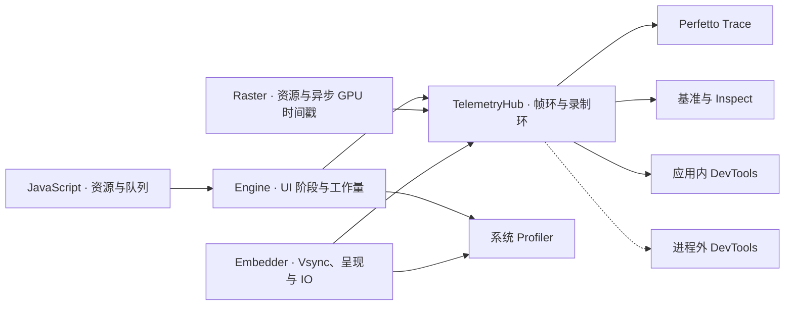

# 性能基线、遥测与 P1 渲染计划

以 Impasto 的 P0 渲染流水线（`4462fb3`）为起点。Stage 0 提供测量能力，Stage 1–6 分别交付和验证。性能结论应附场景、视口、DPR、字体、能力档、设备与采样设置。

## 三层性能基线

| 层 | 指标 | 决策方式 |
| --- | --- | --- |
| L1 结构性工作量 | Draw、Pass、Buffer/BindGroup 创建、分类上传字节、复制/模糊像素、布局与 shaping | 固定场景、字体、能力路径和缓存状态后，在普通测试与 PR CI 中断言。按后端能力分开预期值。 |
| L2 同机配对 A/B | 编码、提交和 GPU Pass 的 p50/p95、内存峰值 | 同设备、同驱动和同校验/采样设置交替跑 base/head，报告成对差值、样本数与分位数。先预编译，控制温度和后台负载。 |
| L3 参考设备时间序列 | 冷启动、绝对耗时、120 Hz 帧预算与移动设备功耗 | 固定一台 Apple Silicon Mac 和一台 Android 设备，存档里程碑数据，随固定 runner 引入变点检测。普通 PR CI 使用 L1 门禁。 |

## 遥测架构

`javascript` 提供纯值运行时计数，`engine` 提供帧阶段与场景计数，`raster` 提供编码/资源计数和异步 GPU 样本，平台及 IO 提供调度与服务时间。各层保有自己的数据所有权，由 `embedder/common` 关联，依赖方向遵守 `just boundaries`。

以进程内单调帧号和设备代次关联 GPU 样本。宿主时钟统一为单调纳秒，记录平台收到 vsync、UI 开始/完成、Raster 开始、提交完成、present 返回与帧预算。UI 和 Raster 的时间表示各自线程上的墙钟区间，包含其同步等待。端到端时间与 UI→Raster 排队单独呈现。平台提供的 vsync 时间戳属于平台时钟，平台回调到达时间使用宿主时钟。Present 返回表示宿主完成调用，UIKit 可另记事务确认。

帧记录和五条泳道（Platform、UI、Raster、IO、GPU）采用有界缓冲。首次提交后 GPU 状态为 Pending，按帧号与设备代次回填并递增订阅 revision。设备重建、读回失败、槽位已满、能力缺失和关闭分别有显式状态。GPU 样本保存 Pass 类型、切片号、Draw 数、GPU 相对偏移与时长，分别报告包围区间与 Pass 耗时和。GPU 和 CPU 时钟没有校准时，Trace 中 GPU 使用独立相对时间轴；首尾 Pass 之间的 Copy 与调度空档可进入包围区间。仅启用 `TIMESTAMP_QUERY` 时，独立 Copy 命令没有单独时间戳。

| 档位 | 采集 |
| --- | --- |
| Off | 预算边缘日志。热路径避开遥测环和 GPU 查询资源。 |
| Counters | 有界帧环，存调度、UI、Raster 与 Atlas 计数。 |
| GpuAndTimeline | 开启设备时间戳能力并采样，支持有界录制与 Trace 导出。 |
| DeepInspect | 目标为按需抓取 LayerTree、CompiledPicture、纹理池、QuickJS 堆或截图。 |

系统 Profiler、Perfetto、基准报告、应用内 HUD 与进程外 DevTools 各自消费采集值。应用内面板录制期间暂停采样轮询，宿主 Trace 可在关闭面板时收集。Chrome Trace 使用微秒和具名泳道，支持 Perfetto 导入。系统 span 在 Android 走 ATrace，在 Apple 走 signpost。

## Stage 0 使用方式

- `just bench` 串行执行四组 Release Raster 微基准，每组输出一行 `IMPASTO_BENCH_JSON`。JSON 保留首帧、暖帧、GPU 采样状态及 p50/p95。GPU 等待和读回在 CPU 计时区间外，保持同一提交深度。用 `IMPASTO_BENCH_GPU=0 just bench` 运行纯 CPU 对照。
- `python3 tools/bench-compare.py /path/to/base /path/to/head --rounds 5 --out /tmp/impasto-ab.json` 预编译两个 checkout，交替执行 A/B 和 B/A。两个版本都需包含 Stage 0 的基准格式，且使用独立的 Cargo 目标目录。报告保留每轮原始样本、样本数及各分位的配对差值。直接执行 A/A 可以测当前主机的噪声水平。
- `IMPASTO_TRACE=/tmp/impasto-trace.json just host` 从启动后录制约 5 秒。打开应用进行待测操作，日志出现 `trace exported` 后将文件导入 [Perfetto](https://ui.perfetto.dev)。调度泳道使用同一个宿主单调时钟，GPU 泳道使用设备相对时钟；用 `frame_id` 对齐记录。
- `IMPASTO_TELEMETRY=off|counters|gpu` 选择常驻档位。Debug DevTools 默认记录 Counters，并预先协商时间戳 feature 供进程内录制使用。Release 默认 Off，运行时录制需要在创建设备前用 `gpu` 或 `IMPASTO_TRACE` 协商 GPU 能力。GPU 查询槽在首次采样时创建。
- 应用内性能页可以查看帧的 GPU 状态和逐 Pass 时间，也能隐藏 Overlay 并录制约 5 秒。导出文件写入应用临时目录。尚未完成读回的样本显示 Pending，超过 256 个 Pass 的样本显示 DroppedPassLimit。IO 泳道在录制窗口有图片工作时显示 fetch、decode 或 upload。

`missed_vsync` 表示从宿主接到 vsync 到 present 返回超过预算。真实 scanout、UIKit 事务确认与 GC 周期事件需要额外的平台或运行时测量。当前 QuickJS 内存统计是低频堆快照，DeepInspect 的单次抓取留在后续扩展。

## 交付阶段

### Stage 0 · 测量基座

- 区分适配器支持与设备启用的 feature。GPU 计时按需请求 `TIMESTAMP_QUERY`，失败时以基础设备回退。热帧校验支持 Auto、Strict、AsyncOnly。
- 拆分顶点、Uniform、渐变 Stop、Mesh、Atlas 实际上传字节。记录纹理分配、峰值、保留、复制和模糊像素。分别记录准备、编码、flush 和提交。
- 固定数量 GPU 读回槽。UIKit 将多个 drawable 切片合并到同一个逻辑帧，保留 Metal 调度尾命令。其他支持后端在渲染编码末尾 resolve。Metal 实测发现提前 resolve 会读到上一帧的 fragment 时间戳，改为在整个帧提交完成后异步 resolve，对 UIKit 同样适用。读回非阻塞，校验设备代次。
- 宿主记录调度阶段并接入结构计数，迟到 GPU 样本用同一帧号回填。导出带计数轨和 Pass 的 Perfetto Trace，原生 DevTools 类型由 `just gen` 生成。
- 四组现有 Release 微基准输出结构化 JSON 与环境指纹，提供同机交替比较。普通测试锁定暖帧分配与代表场景的结构性工作量。

验收包括暖帧 Buffer 创建为零、无查询设备呈现正常、Trace 可导入、迟到样本准确归帧。

### 实施顺序与验收

`4462fb3` 是 P0 提交。首次比较 P1 时，以引入遥测和基准脚本的 Stage 0 提交作为可重复构建的基线。已有 macOS Trace 和 A/A 样本验证了采集链路。Android 当前有构建验证，移动 GPU 的默认策略需要 Android 真机数据。

| 顺序 | 交付 | 依赖与并行范围 |
| --- | --- | --- |
| 首批 | 1.1 共用渐变 → 1.2 Glyph → 1.3 Rect | 1.2 定义帧内 PaintExtra 及分页契约，1.3 复用。2.1 可以同期开发。 |
| 第二批 | 2.1 GPU 预乘 → 2.2 Mipmap → 2.3 Compute 对照 | 2.1/2.2 共用图片资源契约和测试。3.1 可同期验证，3.2 依赖 1.1。 |
| 实机实验 | 3.1 Compute 模糊、4.1 瞬态附件、4.2 Stencil、4.3 Early-Z | 4.1 先验证现有 Canvas MSAA。4.2 复用附件生命周期，4.3 复用单 Pass 深度附件，按 1.3 的最终 Rect 布局实施。 |
| 画质与运行期 | 5.1 四角几何、5.2 阴影、5.3 文本、5.4 抖动、6.1–6.3 | 5.1 为阴影、裁剪提供几何契约，5.3 使用 1.2 后的文本路径。6.1 可先加冷启动测量，待管线变体稳定后再决定预热集合。 |
| 独立工具里程碑 | 6.4 进程外 DevTools | 依赖 Stage 0 的帧身份和异步回填。从只读帧流与 Trace 开始，与 P1 渲染合入互不阻塞。 |

性能 PR 保留基准场景的视口、DPR、字体和缓存状态。固定像素和结构计数走普通测试。增设专题基准时，先给基准入口与比较脚本增加可显式选择的场景，让 base/head 都能运行同一份场景，同时保留现有四组报告口径。每项实验可强制选旧/新路径，输出所选路径、样本状态、结构计数和同机 p50/p95。默认启用依据覆盖质量和兼容性、目标设备重复获益、关键场景 p95 处于 A/A 波动范围。结果重叠时保留现有默认，记录设备与采样设置。软件 Vulkan 或 GLES 用于校验路径，Metal 与 Android Vulkan 实机分别决定性能阈值。

| 验收范围 | 验证入口 |
| --- | --- |
| Raster、WGSL 与资源生命周期 | `IMPASTO_TEST_GPU=1 cargo test -p raster`、`just check`、`cargo fmt --all -- --check`。涉及依赖时同时核对 `just boundaries`。 |
| 像素与画质 | 固定图源和字体的离屏参考测试，加上 `just host` 的 Gallery 画面。纯重构和画序优化使用精确像素对照，画质改动使用事先定义的参考图和误差口径。 |
| 移动端、回退和合成 | `just android-build-check`、`just android-device-test` 覆盖 Vulkan 与 GLES 路径，iOS 使用 `just ios-build-check`、`just ios-sim-test`。涉及 UIKit 切片的改动补 `just ios-composition-test`。构建与模拟器用于兼容性验证，设备性能决策使用真机。 |
| 运行期与资料 | 提交阶段记录计数、像素结果和受影响设备。性能开关随配对报告和设备指纹评审，普通 PR CI 以结构计数为门禁。 |

### Stage 1 · 着色器复用与实例压缩

**1.1 共用渐变 WGSL。** 在 shader 拼装入口引入共享渐变模块，抽取 Stop 插值、线性／径向／锥形坐标计算。两个入口各自把 `VertexOut` 转成相同的显式参数，保留现有 binding 和逐 Stop 表布局。复用现有 shader 拼装及缓存路径。验收要求 Rect、渐变文字、Mesh 的参考像素一致，锥形无有效解、硬停靠点、重复 Stop 和透明边缘有覆盖，Draw/Pass 和上传计数一致。 [管线拼装](../crates/raster/src/pipelines/mod.rs) · [UI shader](../crates/raster/src/pipelines/ui.wgsl) · [文本 shader](../crates/raster/src/pipelines/text.wgsl)

**1.2 压缩 Glyph。** 从当前 96 B 的 `GlyphVertex` 开始，把页号和 flags 搬到整数字段，验证打包的 atlas texel 坐标和颜色格式，再把渐变几何移到可复用的帧内 `PaintExtra`。保留纯色、彩色字形、渐变文字和装饰线的合批，纯色及 Emoji 走零额外记录。共享一份实例布局，支持 Storage 的设备使用 Storage 表，GLES3 使用定长 Uniform 窗口。把页号纳入批次兼容条件，保留画序、动态偏移对齐和长 Stop 列表。共享记录跨 UIKit 切片保留到该帧统一 flush。40 B 左右是候选目标，像素精度要求决定最终格式。验收固定字体和字形样本，覆盖低 Alpha、图集边缘、跨页、多切片和暖帧复用。新增 `extra_bytes`，与 `vertex_bytes + uniform_bytes + stop_bytes` 一起报告净变化，避免按字节来源重复计数。 [实例布局](../crates/raster/src/batch.rs) · [帧内缓冲](../crates/raster/src/arena.rs) · [UIKit 切片](../crates/raster/src/metal.rs)

**1.3 压缩 Rect。** 复用 PaintExtra，先优化普通纯色和圆角，把描边颜色、渐变几何、阴影参数移到冷表。核对 Canvas Mesh 对现有 `RectVertex` 的复用，单独迁移其顶点输入与测试。验收以约 64 B 的热布局为候选目标，对比卡片滚动、混合圆角和透明描边的总上传量。要求原有像素、画序、直接呈现及暖帧分配契约通过，在报告中给出复杂绘制的额外开销。

**1.4 实测管线特化。** 依赖 1.2/1.3 的最终数据布局。先试纯色和简单裁剪两个有业务频率的组合，把选择项纳入现有管线键。测暖帧 GPU 时间、首次使用的编译时间、暖帧 BindGroup 以及变体数量。每个变体独立决定是否默认开启。 [wgpu 管线编译常量](https://docs.rs/wgpu/30.0.2/wgpu/struct.PipelineCompilationOptions.html)

### Stage 2 · 线性预乘与 Mipmap

**2.1 GPU 线性预乘。** 保持 `GpuImage` 和 `TextureFactory` 的公开上传入口，统一同步解析和后台上传。将直通 RGBA8 写入 sRGB 源纹理，用逐 texel 读取的 RenderPass 解码并线性预乘到 Level 0。保证转换提交排在首次采样前，提交失败与设备代次不匹配沿用可重试回退。后台只在取得上传工厂时持锁，上传数据和设备资源在所在线程持有到提交。保留 CPU 预乘路径用于 A/B 与能力回退。验收覆盖全透明带颜色的像素、低 Alpha、全不透明图、设备重建、同源重载和 iOS 外部 BGRA 纹理。单列上传字节、暂存纹理峰值、转换 Pass 与 CPU 时间。 [图片上传和外部纹理](../crates/raster/src/textures.rs) · [图像采样](../crates/raster/src/pipelines/image.wgsl) · [WebGPU sRGB 格式](https://gpuweb.github.io/gpuweb/#texture-formats)

**2.2 Mipmap 与采样。** 延续 2.1 的线性预乘约定，为普通图片建 mip 链，读写视图限定在各自 mip 子资源。奇数尺寸按有效像素下采样，缩小采用专用三线性采样器。nearest、NineSlice 源子区和外部纹理先固定 Level 0，保证九宫格切片边缘与 Canvas 子区语义。首版不生成无需 mip 的资源链。验收包含奇数尺寸、高对比细纹连续缩放、透明边缘、九宫格和 Canvas 局部裁剪。记录冷上传、稳态缩略图、纹理驻留和临时分配峰值。

**2.3 Compute 对照。** 单独验证线性 storage 中间纹理。测完整链路，包括 sRGB 转换、临时纹理、提交及 mip 生成，按格式和设备协商。3.1 可复用格式能力检查，无需等待该实验有结论。 [WGSL storage 纹理格式](https://gpuweb.github.io/gpuweb/wgsl/#texel-formats)

### Stage 3 · 局部 Compute 模糊与渐变 LUT

**3.1 Compute 模糊。** 先为现有 RenderPass 路径建立面积 × 物理像素 σ 的基准和固定画质参考。复用 compositor 的紧边界、采样有效区和回贴次序，实现两次 workgroup 共享内存分离高斯，分开声明输入与输出资源，适配边缘 workgroup 和不同色彩格式。GPU profiler 复用帧号与设备代次，为 Compute 增加起止采样并计入 `compute_passes`。A/B 对齐质量，比较完整模糊子链的 GPU 包围时间、临时内存和 p95，包含降采样、边界扩张、复制与回贴。先用 Metal 和 Android Vulkan 分别测交叉点，再按能力、格式、面积与 σ 选择。小区域、GLES3 和未验证的组合维持 RenderPass。 [现有模糊核](../crates/raster/src/pipelines/blur.wgsl) · [目标池与效果回贴](../crates/raster/src/compositor.rs)

**3.2 渐变 LUT。** 依赖 1.1 的共同求值语义。先用逐 Stop 渲染与 CPU 参考确定误差口径，按有序 Stops 和插值颜色约定缓存从 256 点起的预乘颜色表。按设备代次和容量管理驻留，记录上传、缓存命中和淘汰。渐变几何仍由共享函数求参数；硬停靠点、相邻 Stop 低于采样分辨率和超误差预算的输入继续逐 Stop 求值。验收覆盖线性、径向、锥形、低 Alpha 和硬停靠点，以多 Stop 渐变的纹理分配、绑定开销及同机 GPU 时间决定启用条件。

### Stage 4 · 瞬态附件、Stencil 与 Early-Z

**4.1 瞬态附件。** 先改路径批次的单 Pass MSAA 颜色附件，已有的单采样 resolve 目标继续可读。把用途纳入池化键，确保 transient 纹理只创建为渲染附件，用 Clear／Discard，并从资源计数分别观察申请大小和后端显存测量。检查 Metal、Android Vulkan 与 GLES 能力回退，并做单采样和 MSAA 的像素对照。 [wgpu 附件用途约束](https://docs.rs/wgpu/30.0.2/wgpu/struct.TextureUsages.html#associatedconstant.TRANSIENT_ATTACHMENT) · [Canvas MSAA 编码](../crates/raster/src/compositor.rs)

**4.2 Canvas Stencil。** 先限定单 Pass 内、已有覆盖率规则可以用 stencil 保持的路径裁剪。分别验证 `NonZero`、`EvenOdd` 和 save/restore 的嵌套范围；遇到 stencil 可表达的嵌套深度或 winding 范围上限、需要跨 Pass 保留或需平滑遮罩的裁剪，就按现有路径分组回退 R8。覆盖互相重叠的路径、旋转、浅栈与深栈、恢复后的后续绘制。报告减少的 R8 临时资源、离屏 Pass 和真机 GPU 时间。 [当前遮罩构建](../crates/raster/src/compositor.rs) · [Canvas 命令与编译](../crates/raster/src/compiler.rs)

**4.3 精选 Early-Z。** 只分析同一目标内连续的像素对齐不透明实心 SrcOver 矩形，首版排除圆角 AA、阴影、遮罩、离屏和混合切换。先验证深度值的画序单调性和可分辨范围，再在段内倒序重放；跨段保持 painter 顺序。增加高遮挡与低遮挡对照，在真机同时量 GPU 时间和深度附件成本，软绘或可用硬件计数辅助解释过绘。固定安全样本像素逐字节一致，40%–60% 过绘降幅作为实验目标。低遮挡段或设备收益不足时维持现有路径。

### Stage 5 · 画质与场景契约

**5.1 独立四角及连续曲率。** 先定义 CSS 四角顺序、半径缩放、零值、标量简写兼容和曲率范围。贯通 style 解析、场景命令、边界与绘制／解析裁剪的共享几何，现有单半径版本可以按同值扩展。保持跨 crate 依赖方向，执行 `just gen` 和 `just style-check`。用四角不对称、嵌套、旋转、高 DPR、极窄元素和 Gallery 检查绘制与裁剪边界。 [场景绘制命令](../crates/engine/src/scene/command.rs) · [样式源定义](../crates/engine/src/style)

**5.2 二维圆角阴影。** 依赖 5.1 的角几何约定，单独替换单距离近似。以独立的过采样 CPU 卷积作为参考，用小矩形、尖角、负 spread、大 σ 和透明背景对照边缘与扩张边界。实现覆盖等半径的二维积分再扩展到独立角；逐一核对画序、阴影边界和 shader 成本。 [二维近似参考](https://madebyevan.com/shaders/fast-rounded-rectangle-shadows/)

**5.3 文字。** 先在 1.2 的文本路径上评估灰阶 Gamma 校正和 Stem-Darkening，用同字体、12–14 px、不同 DPR 与深浅背景的参考样本确定锐度和覆盖率误差。LCD 作为独立实验，要求设备实际启用 `DUAL_SOURCE_BLENDING`、目标不透明、RGB 排列明确、字形对齐且无旋转，其他场景保持灰阶。验证彩色 Emoji 和图集格式兼容，比较新增管线、图集缓存和 GPU 开销。 [wgpu 双源混合能力](https://docs.rs/wgpu/30.0.2/wgpu/struct.Features.html#associatedconstant.DUAL_SOURCE_BLENDING)

**5.4 最终输出抖动。** 优先接入已有的最终拷贝／输出转换，按输出空间对 RGB 量化，Alpha 维持现有语义。直绘仅在能证明写入就是该像素最终合成结果的范围启用。普通直绘帧继续保持零根 Copy、零新增 Pass，无法证明的情况沿用原输出。分别验收暗部渐变、低 Alpha 混合、固定相位下的参考图和连续帧稳定性。

### Stage 6 · 冷启动、表面步调和进程外工具

**6.1 冷启动与内存管线缓存。** 先把设备建立、shader 模块、首次 pipeline 编译、首帧提交和首次可见区间拆开量。复用 `PipelineCache`，基于实际首屏场景验证有限预热及设备代次失效。报告预热占用、首帧 p50/p95 和首次交互，避免通过转移编译时间制造首帧收益。 [现有管线缓存](../crates/raster/src/pipelines/mod.rs)

**6.2 Vulkan 磁盘缓存。** 仅在 6.1 表明跨进程仍重复付出显著编译成本时实验。以应用自身生成的缓存为来源，把 wgpu 缓存键、驱动、版本、着色器及编译变体纳入匹配，采用有界存储和原子替换。按仓库规则审查 API 的来源不变式和局部 `unsafe` 豁免。缓存缺失或失效时走现有创建路径。若无法满足来源不变式，则保留内存缓存。对比冷缓存、热缓存、驱动升级和损坏文件。 [wgpu 缓存键](https://docs.rs/wgpu/30.0.2/wgpu/util/fn.pipeline_cache_key.html) · [创建管线缓存的安全契约](https://docs.rs/wgpu/30.0.2/wgpu/struct.Device.html#method.create_pipeline_cache)

**6.3 Surface 步调。** 先报告当前后端取得的实际配置与 `FramePipeline::DEPTH`，再测试显式 latency 2 与目前配置的差异。桌面按 surface 能力对照 FIFO/Mailbox，移动设备在支持时对照 FIFO/FifoRelaxed，透明窗口另测 alpha mode 与合成结果。测试 60/120 Hz、resize、遮挡、前后台、丢设备恢复。报告回调至 acquire、acquire 等待、提交和 present 返回；要评价上屏延迟或掉帧时，先补平台可见／事务确认信号。iOS 普通 Surface 与 UIKit 多切片各自验证。 [Surface 配置](../crates/raster/src/surface.rs) · [iOS Surface](../crates/embedder/ios/src/surface.rs)

**6.4 远程 DevTools。** 先定义只读且版本化的 JSON-RPC 帧订阅和 Trace 抓取。以稳定帧号与 revision 传送初始快照、增量和 GPU 回填，为慢客户端设有界队列与重同步入口。随后在 debug/profile 构建提供显式开启的本地监听和短期连接凭证，由 CLI 连接桌面、转发 Android，再针对 iOS 验证可用的设备连接方案。最后实现独立客户端的帧列表、逐 Pass 与导出。验收覆盖断连重连、慢客户端、版本不匹配、环覆盖、设备重建、Release 无监听，以及 Overlay 关闭场景。UIKit 事务确认、GC 周期和单次 DeepInspect 按各自信号成熟度独立接入。 [TelemetryHub](../crates/embedder/common/src/diagnostics/hub.rs) · [现有 DevTools](../packages/devtools/src/pages/performance.tsx)

### 首个可独立合入的改动

执行 **1.1 共用渐变 WGSL**。把公共函数接进现有 shader 拼装，冻结 Rust 实例布局、binding 和 Stop 编码。通过 Rect、文本、Canvas 渐变及现有 GPU 像素测试，并对固定场景核对 Draw/Pass、顶点和 Stop 上传量。先复跑 `mixed_rectangles_use_one_draw_and_reuse_warm_resources`、`resident_mask_pages_color_gradients_and_decorations_share_a_draw`，补足锥形渐变与硬停靠点的覆盖。独立验收后，再开始 **1.2 Glyph 实例压缩**。 [现有 Raster 用例](../crates/raster/src/tests/p0.rs)
