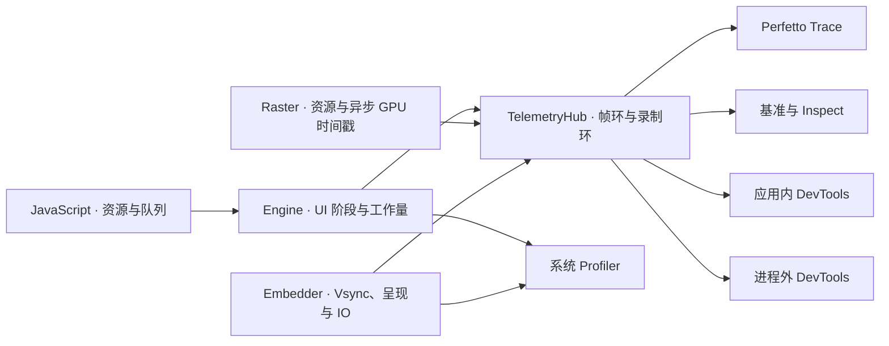

# 性能基线与遥测

当前管线与回归测量口径见 [光栅管线与宿主调度](wgpu-rendering-pipeline.md)。

性能结论应附场景、视口、DPR、字体、能力档、设备与采样设置。

## 三层性能基线

| 层 | 指标 | 决策方式 |
| --- | --- | --- |
| L1 结构性工作量 | Draw、Pass、Buffer/BindGroup 创建、分类上传字节、复制/模糊像素、布局与 shaping | 固定场景、字体、能力路径和缓存状态后，在普通测试与 PR CI 中断言。按后端能力分开预期值。 |
| L2 同机配对 A/B | 编码、提交和 GPU Pass 的 p50/p95、内存峰值 | 同设备、同驱动和同校验/采样设置交替跑 base/head，报告成对差值、样本数与分位数。先预编译，控制温度和后台负载。 |
| L3 参考设备时间序列 | 冷启动、绝对耗时、120 Hz 帧预算与移动设备功耗 | 在固定的 Apple Silicon Mac 和 Android 设备上本地采样，供平台验收和调优。PR CI 使用 L1 结构断言。 |

## 遥测架构

`javascript` 提供纯值运行时计数，`engine` 提供帧阶段与场景计数，`raster` 提供编码/资源计数和异步 GPU 样本，平台及 IO 提供调度与服务时间。各层保有自己的数据所有权，由 `embedder/common` 关联，依赖方向遵守 `just boundaries`。



以进程内单调帧号和设备代次关联 GPU 样本。宿主时钟统一为单调纳秒，记录平台收到 vsync、UI 开始/完成、Raster 开始、提交完成、present 返回与帧预算。UI 和 Raster 的时间表示各自线程上的墙钟区间，包含其同步等待。端到端时间与 UI→Raster 排队单独呈现。平台提供的 vsync 时间戳属于平台时钟，平台回调到达时间使用宿主时钟。Present 返回表示宿主完成调用，UIKit 可另记事务确认。

帧记录和五条泳道（Platform、UI、Raster、IO、GPU）采用有界缓冲。首次提交后 GPU 状态为 Pending，按帧号与设备代次回填并递增订阅 revision。设备重建、读回失败、槽位已满、能力缺失和关闭分别有显式状态。GPU 样本保存 Pass 类型、切片号、Draw 数、GPU 相对偏移与时长，分别报告包围区间与 Pass 耗时和。GPU 和 CPU 时钟未校准。Perfetto 在 GPU measurements 轨上记录带帧号、设备代次、帧内偏移及耗时的测量事件。DevTools 按首个 GPU Pass 为原点绘制独立的帧内时间轴。首尾 Pass 之间的 Copy 与调度空档可进入包围区间。仅启用 `TIMESTAMP_QUERY` 时，独立 Copy 命令没有单独时间戳。

| 档位 | 采集 |
| --- | --- |
| Off | 预算边缘日志。热路径避开遥测环和 GPU 查询资源。 |
| Counters | 有界帧环，存调度、UI、Raster 与 Atlas 计数。 |
| GpuAndTimeline | 开启设备时间戳能力并常驻采样。CPU 切片由录制会话开启。 |
| DeepInspect | 目标为按需抓取 LayerTree、CompiledPicture、纹理池、QuickJS 堆或截图。 |

日志、系统 Profiler 和 Timeline 通过 `tracing_subscriber::Registry` 分发。Timeline 录制分为 Stages 和 Detailed，后者增加 TRACE 级切片及 QuickJS 模块栈样本。每条 CPU 切片保存父实例、逻辑队列、线程和关联帧。调度端点及图片 IO、UIKit 交接使用独立的 Flow ID。

一个进程同一时刻只接受一个录制。停止时冻结 CPU 时间范围，汇总各线程已完成的批次，并最多等待 80 毫秒接收已进入流水线的帧摘要与 GPU 回填。归档保存最多 1,024 个帧摘要，切片存储预算为 8 MiB，各生产线程另有有界批次。导出带有覆盖、截断、未完成帧和 GPU Pending 计数。CPU 时间相对于录制起点。

应用可以用 `performance.mark` 和 `performance.measure` 给时间轴加标记。详细录制会记录 Solid 组件创建与响应式 flush，还会以约 1 毫秒的限频在 QuickJS 中断检查点收集最多八层模块栈。样本覆盖到达检查点且保留文件名的 JS 字节码，函数名和行号需要运行时提供额外的栈 API。用户标记和模块标签有长度上限，常规日志消息、图片 URL 和请求正文不进入 Timeline。

## 采集方式

- `just bench` 串行执行四组 Release Raster 微基准，每组输出一行 `IMPASTO_BENCH_JSON`。JSON 保留首帧、暖帧、GPU 采样状态及 p50/p95。GPU 等待和读回在 CPU 计时区间外，保持同一提交深度。用 `IMPASTO_BENCH_GPU=0 just bench` 运行纯 CPU 对照。
- `python3 tools/bench-compare.py /path/to/base /path/to/head --rounds 5 --out /tmp/impasto-ab.json` 预编译两个 checkout，交替执行 A/B 和 B/A。两个版本都需包含 Stage 0 的基准格式，且使用独立的 Cargo 目标目录。报告保留每轮原始样本、样本数及各分位的配对差值。直接执行 A/A 可以测当前主机的噪声水平。
- `IMPASTO_TRACE=/tmp/impasto-trace.pftrace just host` 在宿主初始化前开始，并在初始化后约 5 秒收尾。日志出现 `trace exported` 后可以把文件导入 [Perfetto](https://ui.perfetto.dev)。加上 `IMPASTO_TRACE_DETAIL=detailed` 可采集详细切片。`IMPASTO_TRACE_GPU=0` 关闭由录制请求的 GPU 查询。文件使用 `.pftrace` 后缀，`.json` 目的地会返回格式错误。
- `IMPASTO_TELEMETRY=off|counters|gpu` 选择常驻档位。Debug DevTools 默认记录 Counters，并预先协商时间戳 feature 供进程内录制使用。Release 默认 Off，运行时录制需要在创建设备前用 `gpu` 或 `IMPASTO_TRACE` 协商 GPU 能力。GPU 查询槽在首次采样时创建。
- 应用内性能页可以查看帧的 GPU 状态和逐 Pass 时间，也能隐藏 Overlay 并录制约 5 秒。导出文件写入应用临时目录。尚未完成读回的样本显示 Pending，超过 256 个 Pass 的样本显示 DroppedPassLimit。IO 泳道在录制窗口有图片工作时显示 fetch、decode 或 upload。

`missed_vsync` 表示从宿主接到 vsync 到 present 返回超过预算。UIKit 混排的事务确认有独立事件与 Flow。真实 scanout 与 GC 周期事件需要额外的平台或运行时测量。当前 QuickJS 内存统计是低频堆快照，DeepInspect 的单次抓取留在后续扩展。

## 运行配置

渲染诊断开关与当前 Surface 配置见 [光栅管线与宿主调度](wgpu-rendering-pipeline.md)。启动日志或系统 Trace 分列 adapter、device、shader、pipeline 和首帧呈现。UIKit 混排用事务确认作为独立标记。

## 进程外 DevTools

启动调试应用时设置同一个端口和会话凭证。客户端可经本机回环、Android USB 或 iOS USB 接收版本化帧流并下载 Perfetto Trace。Release 只有构建时显式启用 `embedder/devtools-server` 才包含监听器。

```sh
export IMPASTO_DEVTOOLS_PORT=8765
export IMPASTO_DEVTOOLS_TOKEN="$(openssl rand -hex 32)"
impasto run -d macos
```

在另一个终端运行 `impasto devtools --port 8765`，用浏览器打开命令给出的本地 HTML，填入当前会话的凭证。Android 在 `impasto run -d android` 安装调试 APK 时通过应用私有缓存配置该会话，再运行 `impasto devtools -d android --port 8765`。对特定 Android 设备可传入 adb serial。iOS Simulator 可直接连接本机端口，USB 真机用 `impasto devtools -d ios:<UDID> --port 8765`，转发需要系统可调用的 libusbmuxd `iproxy`。USB 命令按 Enter 关闭转发。可设置 `IMPASTO_TELEMETRY=gpu` 打开常驻 GPU 统计，录制也会在采集窗口请求 GPU 时间戳。 [Android adb 转发](https://developer.android.com/tools/adb#forwardports) · [iOS iproxy](https://github.com/libimobiledevice/libusbmuxd/blob/master/docs/iproxy.1)

进程外面板可以选择 Stages 或 Detailed，并切换本次录制是否请求 GPU 查询。录制完成后从 Capture 视图查看单帧 CPU 调用树和相对 GPU Pass。**Open in Perfetto** 直接传递内存里的文件，**Download** 单独保存文件。JSON-RPC v1 的认证返回可用能力，`capture_status` 查询当前状态和最近一次归档，`get_frame_spans` 使用 `capture_id`、`frame_id` 查询单帧。录制或导出时帧订阅继续更新，重连可以访问宿主仍保留的最近归档。

CI 使用固定版本的官方 Trace Processor 断言切片父子关系、跨队列 Flow、计数轨和导入状态。本地可运行 `IMPASTO_TRACE_PROCESSOR=/path/to/trace_processor tools/check-trace-export.sh`。

## 专题基准

报告保留基准场景、原始样本、运行配置、Rasterizer 初始化、首帧与暖帧数据。大图用例的 `scene_install_us` 包含 CPU 上传和场景安装，`output_ready_us` 包含等待渲染及上传工作完成。

```sh
python3 tools/bench-compare.py /path/to/base /path/to/head --backend metal --rounds 5 \
  --filter bench_backdrop_blur_overlays \
  --out /tmp/impasto-blur-ab.json
```
