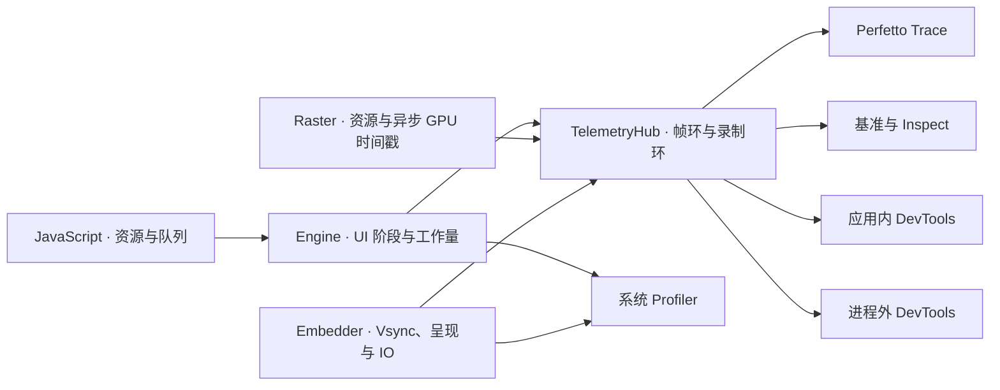

# 性能基线、遥测与 P1 渲染计划

后续 P4–P6 的实现范围和 Gallery 配对测量见 [渲染优化与实测](wgpu-p4-p6-validation.md)。

以 Impasto 的 P0 渲染流水线（`4462fb3`）为起点。Stage 0 提供测量能力，Stage 1–6 分别交付和验证。性能结论应附场景、视口、DPR、字体、能力档、设备与采样设置。

## 三层性能基线

| 层 | 指标 | 决策方式 |
| --- | --- | --- |
| L1 结构性工作量 | Draw、Pass、Buffer/BindGroup 创建、分类上传字节、复制/模糊像素、布局与 shaping | 固定场景、字体、能力路径和缓存状态后，在普通测试与 PR CI 中断言。按后端能力分开预期值。 |
| L2 同机配对 A/B | 编码、提交和 GPU Pass 的 p50/p95、内存峰值 | 同设备、同驱动和同校验/采样设置交替跑 base/head，报告成对差值、样本数与分位数。先预编译，控制温度和后台负载。 |
| L3 参考设备时间序列 | 冷启动、绝对耗时、120 Hz 帧预算与移动设备功耗 | 固定一台 Apple Silicon Mac 和一台 Android 设备，存档里程碑数据，随固定 runner 引入变点检测。普通 PR CI 使用 L1 门禁。 |

## 遥测架构

`javascript` 提供纯值运行时计数，`engine` 提供帧阶段与场景计数，`raster` 提供编码/资源计数和异步 GPU 样本，平台及 IO 提供调度与服务时间。各层保有自己的数据所有权，由 `embedder/common` 关联，依赖方向遵守 `just boundaries`。



以进程内单调帧号和设备代次关联 GPU 样本。宿主时钟统一为单调纳秒，记录平台收到 vsync、UI 开始/完成、Raster 开始、提交完成、present 返回与帧预算。UI 和 Raster 的时间表示各自线程上的墙钟区间，包含其同步等待。端到端时间与 UI→Raster 排队单独呈现。平台提供的 vsync 时间戳属于平台时钟，平台回调到达时间使用宿主时钟。Present 返回表示宿主完成调用，UIKit 可另记事务确认。

帧记录和五条泳道（Platform、UI、Raster、IO、GPU）采用有界缓冲。首次提交后 GPU 状态为 Pending，按帧号与设备代次回填并递增订阅 revision。设备重建、读回失败、槽位已满、能力缺失和关闭分别有显式状态。GPU 样本保存 Pass 类型、切片号、Draw 数、GPU 相对偏移与时长，分别报告包围区间与 Pass 耗时和。GPU 和 CPU 时钟未校准。Perfetto 在 GPU measurements 轨上记录带帧号、设备代次、帧内偏移及耗时的测量事件。DevTools 按首个 GPU Pass 为原点绘制独立的帧内时间轴。首尾 Pass 之间的 Copy 与调度空档可进入包围区间。仅启用 `TIMESTAMP_QUERY` 时，独立 Copy 命令没有单独时间戳。

| 档位 | 采集 |
| --- | --- |
| Off | 预算边缘日志。热路径避开遥测环和 GPU 查询资源。 |
| Counters | 有界帧环，存调度、UI、Raster 与 Atlas 计数。 |
| GpuAndTimeline | 开启设备时间戳能力并常驻采样。CPU 切片由录制会话开启。 |
| DeepInspect | 目标为按需抓取 LayerTree、CompiledPicture、纹理池、QuickJS 堆或截图。 |

日志、系统 Profiler 和 Timeline 通过 `tracing_subscriber::Registry` 分发。Timeline 录制分为 Stages 和 Detailed，后者增加 TRACE 级切片及 QuickJS 模块栈样本。每条 CPU 切片保存父实例、逻辑队列、线程和关联帧。调度端点及图片 IO、UIKit 交接使用独立的 Flow ID。

一个进程同一时刻只接受一个录制。停止时冻结 CPU 时间范围，汇总各线程已完成的批次，并最多等待 80 毫秒接收已进入流水线的帧摘要与 GPU 回填。归档保存最多 1,024 个帧摘要，切片存储预算为 8 MiB，各生产线程另有有界批次。导出带有覆盖、截断、未完成帧和 GPU Pending 计数。CPU 时间相对于录制起点。

应用可以用 `performance.mark` 和 `performance.measure` 给时间轴加标记。详细录制会记录 Solid 组件创建与响应式 flush，还会以约 1 毫秒的限频在 QuickJS 中断检查点收集最多八层模块栈。样本覆盖到达检查点且保留文件名的 JS 字节码，函数名和行号需要运行时提供额外的栈 API。用户标记和模块标签有长度上限，常规日志消息、图片 URL 和请求正文不进入 Timeline。

## Stage 0 使用方式

- `just bench` 串行执行四组 Release Raster 微基准，每组输出一行 `IMPASTO_BENCH_JSON`。JSON 保留首帧、暖帧、GPU 采样状态及 p50/p95。GPU 等待和读回在 CPU 计时区间外，保持同一提交深度。用 `IMPASTO_BENCH_GPU=0 just bench` 运行纯 CPU 对照。
- `python3 tools/bench-compare.py /path/to/base /path/to/head --rounds 5 --out /tmp/impasto-ab.json` 预编译两个 checkout，交替执行 A/B 和 B/A。两个版本都需包含 Stage 0 的基准格式，且使用独立的 Cargo 目标目录。报告保留每轮原始样本、样本数及各分位的配对差值。直接执行 A/A 可以测当前主机的噪声水平。
- `IMPASTO_TRACE=/tmp/impasto-trace.pftrace just host` 在宿主初始化前开始，并在初始化后约 5 秒收尾。日志出现 `trace exported` 后可以把文件导入 [Perfetto](https://ui.perfetto.dev)。加上 `IMPASTO_TRACE_DETAIL=detailed` 可采集详细切片。`IMPASTO_TRACE_GPU=0` 关闭由录制请求的 GPU 查询。文件使用 `.pftrace` 后缀，`.json` 目的地会返回格式错误。
- `IMPASTO_TELEMETRY=off|counters|gpu` 选择常驻档位。Debug DevTools 默认记录 Counters，并预先协商时间戳 feature 供进程内录制使用。Release 默认 Off，运行时录制需要在创建设备前用 `gpu` 或 `IMPASTO_TRACE` 协商 GPU 能力。GPU 查询槽在首次采样时创建。
- 应用内性能页可以查看帧的 GPU 状态和逐 Pass 时间，也能隐藏 Overlay 并录制约 5 秒。导出文件写入应用临时目录。尚未完成读回的样本显示 Pending，超过 256 个 Pass 的样本显示 DroppedPassLimit。IO 泳道在录制窗口有图片工作时显示 fetch、decode 或 upload。

`missed_vsync` 表示从宿主接到 vsync 到 present 返回超过预算。UIKit 混排的事务确认有独立事件与 Flow。真实 scanout 与 GC 周期事件需要额外的平台或运行时测量。当前 QuickJS 内存统计是低频堆快照，DeepInspect 的单次抓取留在后续扩展。

## 交付阶段

### Stage 0 · 测量基座

- 区分适配器支持与设备启用的 feature。GPU 计时按需请求 `TIMESTAMP_QUERY`，失败时以基础设备回退。热帧校验支持 Auto、Strict、AsyncOnly。
- 拆分顶点、Uniform、渐变 Stop、Mesh、Atlas 实际上传字节。记录纹理分配、峰值、保留、复制和模糊像素。分别记录准备、编码、flush 和提交。
- 固定数量 GPU 读回槽。UIKit 将多个 drawable 切片合并到同一个逻辑帧，保留 Metal 调度尾命令。其他支持后端在渲染编码末尾 resolve。Metal 实测发现提前 resolve 会读到上一帧的 fragment 时间戳，改为在整个帧提交完成后异步 resolve，对 UIKit 同样适用。读回非阻塞，校验设备代次。
- 宿主记录调度阶段并接入结构计数，迟到 GPU 样本用同一帧号回填。导出带计数轨和 Pass 的 Perfetto Trace，原生 DevTools 类型由 `just gen` 生成。
- 四组现有 Release 微基准输出结构化 JSON 与环境指纹，提供同机交替比较。普通测试锁定暖帧分配与代表场景的结构性工作量。

验收包括暖帧 Buffer 创建为零、无查询设备呈现正常、Trace 可导入、迟到样本准确归帧。

### 实施顺序与验收

`4462fb3` 是 P0 提交。比较 P1 时，以引入遥测和基准脚本的 Stage 0 提交作为可重复构建的基线。macOS Trace 和 A/A 样本验证了采集链路。Android 已有构建与 GLES 模拟器验证，移动 GPU 的默认策略以 Android Vulkan 真机数据为准。

| 顺序 | 交付 | 依赖与并行范围 |
| --- | --- | --- |
| 首批 | 1.1 共用渐变 → 1.2 Glyph → 1.3 Rect | 1.2 定义帧内 PaintExtra 及分页契约，1.3 复用。2.1 可以同期开发。 |
| 第二批 | 2.1 GPU 预乘 → 2.2 Mipmap → 2.3 Compute 对照 | 2.1/2.2 共用图片资源契约和测试。3.1 可同期验证，3.2 依赖 1.1。 |
| 实机实验 | 3.1 Compute 模糊、4.1 瞬态附件、4.2 Stencil、4.3 Early-Z | 4.1 先验证现有 Canvas MSAA。4.2 复用附件生命周期，4.3 复用单 Pass 深度附件，按 1.3 的最终 Rect 布局实施。 |
| 画质与运行期 | 5.1 四角几何、5.2 阴影、5.3 文本、5.4 抖动、6.1–6.3 | 5.1 为阴影、裁剪提供几何契约，5.3 使用 1.2 后的文本路径。6.1 可先加冷启动测量，待管线变体稳定后再决定预热集合。 |
| 独立工具里程碑 | 6.4 进程外 DevTools | 依赖 Stage 0 的帧身份和异步回填。从只读帧流与 Trace 开始，与 P1 渲染合入互不阻塞。 |

性能 PR 保留基准场景的视口、DPR、字体和缓存状态。固定像素和结构计数走普通测试。增设专题基准时，先给基准入口与比较脚本增加可显式选择的场景，让 base/head 都能运行同一份场景，同时保留现有四组报告口径。每项实验可强制选旧/新路径，输出所选路径、样本状态、结构计数和同机 p50/p95。默认启用依据覆盖质量和兼容性、目标设备重复获益、关键场景 p95 处于 A/A 波动范围。结果重叠时保留现有默认，记录设备与采样设置。软件 Vulkan 或 GLES 用于校验路径，Metal 与 Android Vulkan 实机分别决定性能阈值。

| 验收范围 | 验证入口 |
| --- | --- |
| Raster、WGSL 与资源生命周期 | `IMPASTO_TEST_GPU=1 cargo test -p raster`、`just check`、`cargo fmt --all -- --check`。涉及依赖时同时核对 `just boundaries`。 |
| 像素与画质 | 固定图源和字体的离屏参考测试，加上 `just host` 的 Gallery 画面。纯重构和画序优化使用精确像素对照，画质改动使用事先定义的参考图和误差口径。 |
| 移动端、回退和合成 | `just android-build-check`、`just android-device-test` 覆盖 Vulkan 与 GLES 路径，iOS 使用 `just ios-build-check`、`just ios-sim-test`。涉及 UIKit 切片的改动补 `just ios-composition-test`。构建与模拟器用于兼容性验证，设备性能决策使用真机。 |
| 运行期与资料 | 提交阶段记录计数、像素结果和受影响设备。性能开关随配对报告和设备指纹评审，普通 PR CI 以结构计数为门禁。 |


### Stage 1 · 着色器复用与实例压缩

**1.1 共用渐变 WGSL。** 在 shader 拼装入口引入共享渐变模块，抽取 Stop 插值、线性／径向／锥形坐标计算。两个入口各自把 `VertexOut` 转成相同的显式参数，保留现有 binding 和逐 Stop 表布局。复用现有 shader 拼装及缓存路径。验收要求 Rect、渐变文字、Mesh 的参考像素一致，锥形无有效解、硬停靠点、重复 Stop 和透明边缘有覆盖，Draw/Pass 和上传计数一致。 [管线拼装](../crates/raster/src/pipelines/mod.rs) · [UI shader](../crates/raster/src/pipelines/ui.wgsl) · [文本 shader](../crates/raster/src/pipelines/text.wgsl)

**1.2 压缩 Glyph。** 从当前 96 B 的 `GlyphVertex` 开始，把页号和 flags 搬到整数字段，验证打包的 atlas texel 坐标和颜色格式，再把渐变几何移到可复用的帧内 `PaintExtra`。保留纯色、彩色字形、渐变文字和装饰线的合批，纯色及 Emoji 走零额外记录。共享一份实例布局，支持 Storage 的设备使用 Storage 表，GLES3 使用定长 Uniform 窗口。把页号纳入批次兼容条件，保留画序、动态偏移对齐和长 Stop 列表。共享记录跨 UIKit 切片保留到该帧统一 flush。40 B 左右是候选目标，像素精度要求决定最终格式。验收固定字体和字形样本，覆盖低 Alpha、图集边缘、跨页、多切片和暖帧复用。新增 `extra_bytes`，与 `vertex_bytes + uniform_bytes + stop_bytes` 一起报告净变化，避免按字节来源重复计数。 [实例布局](../crates/raster/src/batch.rs) · [帧内缓冲](../crates/raster/src/arena.rs) · [UIKit 切片](../crates/raster/src/metal.rs)

**1.3 压缩 Rect。** 复用 PaintExtra，先优化普通纯色和圆角，把描边颜色、渐变几何、阴影参数移到冷表。核对 Canvas Mesh 对现有 `RectVertex` 的复用，单独迁移其顶点输入与测试。验收以约 64 B 的热布局为候选目标，对比卡片滚动、混合圆角和透明描边的总上传量。要求原有像素、画序、直接呈现及暖帧分配契约通过，在报告中给出复杂绘制的额外开销。

**1.4 实测管线特化。** 依赖 1.2/1.3 的最终数据布局。先试纯色和简单裁剪两个有业务频率的组合，把选择项纳入现有管线键。测暖帧 GPU 时间、首次使用的编译时间、暖帧 BindGroup 以及变体数量。每个变体独立决定是否默认开启。 [wgpu 管线编译常量](https://docs.rs/wgpu/30.0.2/wgpu/struct.PipelineCompilationOptions.html)

### Stage 2 · 线性预乘与 Mipmap

**2.1 GPU 线性预乘。** 保持 `GpuImage` 和 `TextureFactory` 的公开上传入口，统一同步解析和后台上传。将直通 RGBA8 写入 sRGB 源纹理，用逐 texel 读取的 RenderPass 解码并线性预乘到 Level 0。保证转换提交排在首次采样前，提交失败与设备代次不匹配沿用可重试回退。后台只在取得上传工厂时持锁，上传数据和设备资源在所在线程持有到提交。保留 CPU 预乘路径用于 A/B 与能力回退。验收覆盖全透明带颜色的像素、低 Alpha、全不透明图、设备重建、同源重载和 iOS 外部 BGRA 纹理。单列上传字节、暂存纹理峰值、转换 Pass 与 CPU 时间。 [图片上传和外部纹理](../crates/raster/src/textures.rs) · [图像采样](../crates/raster/src/pipelines/image.wgsl) · [WebGPU sRGB 格式](https://gpuweb.github.io/gpuweb/#texture-formats)

**2.2 Mipmap 与采样。** 延续 2.1 的线性预乘约定，长边达到 128 px 的普通图片生成预乘 mip 链，奇数尺寸按有效像素下采样。缩小时按最近 mip 层做双线性过滤。nearest、NineSlice 源子区和 Canvas 子区固定采样 Level 0。场景内集中提交同步解析得到的 mip 转换。验收包含奇数尺寸、高对比细纹连续缩放、透明边缘、九宫格和 Canvas 局部裁剪。记录冷上传、稳态缩略图、纹理驻留和临时分配峰值。

**2.3 Compute 对照。** 单独验证线性 storage 中间纹理。测完整链路，包括 sRGB 转换、临时纹理、提交及 mip 生成，按格式和设备协商。3.1 可复用格式能力检查，无需等待该实验有结论。 [WGSL storage 纹理格式](https://gpuweb.github.io/gpuweb/wgsl/#texel-formats)

### Stage 3 · 局部 Compute 模糊与渐变 LUT

**3.1 Compute 模糊。** 先为现有 RenderPass 路径建立面积 × 物理像素 σ 的基准和固定画质参考。复用 compositor 的紧边界、采样有效区和回贴次序，实现两次 workgroup 共享内存分离高斯，分开声明输入与输出资源，适配边缘 workgroup 和不同色彩格式。GPU profiler 复用帧号与设备代次，为 Compute 增加起止采样并计入 `compute_passes`。A/B 对齐质量，比较完整模糊子链的 GPU 包围时间、临时内存和 p95，包含降采样、边界扩张、复制与回贴。先用 Metal 和 Android Vulkan 分别测交叉点，再按能力、格式、面积与 σ 选择。小区域、GLES3 和未验证的组合维持 RenderPass。 [现有模糊核](../crates/raster/src/pipelines/blur.wgsl) · [目标池与效果回贴](../crates/raster/src/compositor.rs)

**3.2 渐变 LUT。** 依赖 1.1 的共同求值语义。先用逐 Stop 渲染与 CPU 参考确定误差口径，按有序 Stops 和插值颜色约定缓存从 256 点起的预乘颜色表。按设备代次和容量管理驻留，记录上传、缓存命中和淘汰。渐变几何仍由共享函数求参数；硬停靠点、相邻 Stop 低于采样分辨率和超误差预算的输入继续逐 Stop 求值。验收覆盖线性、径向、锥形、低 Alpha 和硬停靠点，以多 Stop 渐变的纹理分配、绑定开销及同机 GPU 时间决定启用条件。

### Stage 4 · 瞬态附件、Stencil 与 Early-Z

**4.1 瞬态附件。** 先改路径批次的单 Pass MSAA 颜色附件，已有的单采样 resolve 目标继续可读。把用途纳入池化键，确保 transient 纹理只创建为渲染附件，用 Clear／Discard，并从资源计数分别观察申请大小和后端显存测量。检查 Metal、Android Vulkan 与 GLES 能力回退，并做单采样和 MSAA 的像素对照。 [wgpu 附件用途约束](https://docs.rs/wgpu/30.0.2/wgpu/struct.TextureUsages.html#associatedconstant.TRANSIENT_ATTACHMENT) · [Canvas MSAA 编码](../crates/raster/src/compositor.rs)

**4.2 Canvas Stencil。** 先限定单 Pass 内、已有覆盖率规则可以用 stencil 保持的路径裁剪。分别验证 `NonZero`、`EvenOdd` 和 save/restore 的嵌套范围；遇到 stencil 可表达的嵌套深度或 winding 范围上限、需要跨 Pass 保留或需平滑遮罩的裁剪，就按现有路径分组回退 R8。覆盖互相重叠的路径、旋转、浅栈与深栈、恢复后的后续绘制。报告减少的 R8 临时资源、离屏 Pass 和真机 GPU 时间。 [当前遮罩构建](../crates/raster/src/compositor.rs) · [Canvas 命令与编译](../crates/raster/src/compiler.rs)

**4.3 精选 Early-Z。** 只分析同一目标内连续的像素对齐不透明实心 SrcOver 矩形，首版排除圆角 AA、阴影、遮罩、离屏和混合切换。先验证深度值的画序单调性和可分辨范围，再在段内倒序重放；跨段保持 painter 顺序。增加高遮挡与低遮挡对照，在真机同时量 GPU 时间和深度附件成本，软绘或可用硬件计数辅助解释过绘。固定安全样本像素逐字节一致，40%–60% 过绘降幅作为实验目标。低遮挡段或设备收益不足时维持现有路径。

### Stage 5 · 画质与场景契约

**5.1 独立四角及连续曲率。** 先定义 CSS 四角顺序、半径缩放、零值、标量简写兼容和曲率范围。贯通 style 解析、场景命令、边界与绘制／解析裁剪的共享几何，现有单半径版本可以按同值扩展。保持跨 crate 依赖方向，执行 `just gen` 和 `just style-check`。用四角不对称、嵌套、旋转、高 DPR、极窄元素和 Gallery 检查绘制与裁剪边界。 [场景绘制命令](../crates/engine/src/scene/command.rs) · [样式源定义](../crates/engine/src/style)

**5.2 二维圆角阴影。** 依赖 5.1 的角几何约定，单独替换单距离近似。以独立的过采样 CPU 卷积作为参考，用小矩形、尖角、负 spread、大 σ 和透明背景对照边缘与扩张边界。实现覆盖等半径的二维积分再扩展到独立角；逐一核对画序、阴影边界和 shader 成本。 [二维近似参考](https://madebyevan.com/shaders/fast-rounded-rectangle-shadows/)

**5.3 文字。** 先在 1.2 的文本路径上评估灰阶 Gamma 校正和 Stem-Darkening，用同字体、12–14 px、不同 DPR 与深浅背景的参考样本确定锐度和覆盖率误差。LCD 作为独立实验，要求设备实际启用 `DUAL_SOURCE_BLENDING`、目标不透明、RGB 排列明确、字形对齐且无旋转，其他场景保持灰阶。验证彩色 Emoji 和图集格式兼容，比较新增管线、图集缓存和 GPU 开销。 [wgpu 双源混合能力](https://docs.rs/wgpu/30.0.2/wgpu/struct.Features.html#associatedconstant.DUAL_SOURCE_BLENDING)

**5.4 最终输出抖动。** 优先接入已有的最终拷贝／输出转换，按输出空间对 RGB 量化，Alpha 维持现有语义。直绘仅在能证明写入就是该像素最终合成结果的范围启用。普通直绘帧继续保持零根 Copy、零新增 Pass，无法证明的情况沿用原输出。分别验收暗部渐变、低 Alpha 混合、固定相位下的参考图和连续帧稳定性。

### Stage 6 · 冷启动、表面步调和进程外工具

**6.1 冷启动与内存管线缓存。** 先把设备建立、shader 模块、首次 pipeline 编译、首帧提交和首次可见区间拆开量。复用 `PipelineCache`，基于实际首屏场景验证有限预热及设备代次失效。报告预热占用、首帧 p50/p95 和首次交互，避免通过转移编译时间制造首帧收益。 [现有管线缓存](../crates/raster/src/pipelines/mod.rs)

**6.2 Vulkan 磁盘缓存。** 仅在 6.1 表明跨进程仍重复付出显著编译成本时实验。以应用自身生成的缓存为来源，把 wgpu 缓存键、驱动、版本、着色器及编译变体纳入匹配，采用有界存储和原子替换。按仓库规则审查 API 的来源不变式和局部 `unsafe` 豁免。缓存缺失或失效时走现有创建路径。若无法满足来源不变式，则保留内存缓存。对比冷缓存、热缓存、驱动升级和损坏文件。 [wgpu 缓存键](https://docs.rs/wgpu/30.0.2/wgpu/util/fn.pipeline_cache_key.html) · [创建管线缓存的安全契约](https://docs.rs/wgpu/30.0.2/wgpu/struct.Device.html#method.create_pipeline_cache)

**6.3 Surface 步调。** 先报告当前后端取得的实际配置与 `FramePipeline::DEPTH`，再测试显式 latency 2 与目前配置的差异。桌面按 surface 能力对照 FIFO/Mailbox，移动设备在支持时对照 FIFO/FifoRelaxed，透明窗口另测 alpha mode 与合成结果。测试 60/120 Hz、resize、遮挡、前后台、丢设备恢复。报告回调至 acquire、acquire 等待、提交和 present 返回；要评价上屏延迟或掉帧时，先补平台可见／事务确认信号。iOS 普通 Surface 与 UIKit 多切片各自验证。 [Surface 配置](../crates/raster/src/surface.rs) · [iOS Surface](../crates/embedder/ios/src/surface.rs)

**6.4 远程 DevTools。** 先定义只读且版本化的 JSON-RPC 帧订阅和 Trace 抓取。以稳定帧号与 revision 传送初始快照、增量和 GPU 回填，为慢客户端设有界队列与重同步入口。随后在 debug/profile 构建提供显式开启的本地监听和短期连接凭证，由 CLI 连接桌面、转发 Android，再针对 iOS 验证可用的设备连接方案。最后实现独立客户端的帧列表、逐 Pass 与导出。验收覆盖断连重连、慢客户端、版本不匹配、环覆盖、设备重建、Release 无监听，以及 Overlay 关闭场景。UIKit 事务确认、GC 周期和单次 DeepInspect 按各自信号成熟度独立接入。 [TelemetryHub](../crates/embedder/common/src/diagnostics/hub.rs) · [现有 DevTools](../packages/devtools/src/pages/performance.tsx)

## P1–P2 运行配置

默认使用共享渐变 WGSL、40 B Glyph 和 64 B Rect、图片 GPU 线性预乘和逐级 mip、独立四角和连续曲率，以及 latency 2 的 FIFO 表面。纯色 Glyph 和 Rect 无需冷字段上传。Tier 0 使用有界 Uniform PaintExtra 分页。普通直绘帧保持零根 Copy。

| 配置 | 路径 |
| --- | --- |
| `IMPASTO_PAINT_UNIFORM=1`、`IMPASTO_SPECIALIZE_PAINT=0` | 分别强制 Uniform 分页或关闭默认的纯色矩形、灰阶文字管线特化。 |
| `IMPASTO_IMAGE_UPLOAD=cpu\|render\|compute` | 选择 CPU 基线、默认 RenderPass 或支持设备的 Compute 对照。Nearest、九宫格与 Canvas 子区域保持自己的采样约束。 |
| `IMPASTO_COMPUTE_BLUR=1`、`IMPASTO_GRADIENT_LUT=1` | 在设备能力与像素误差允许时启用共享内存模糊与渐变纹理。 |
| `IMPASTO_TRANSIENT_ATTACHMENTS=0\|1` | 强制关闭或开启瞬态附件。自动档使用适配器的内存节省提示。 |
| `IMPASTO_CANVAS_STENCIL=1`、`IMPASTO_EARLY_Z=1` | 对齐且具有二值覆盖的 Canvas 路径可用 Stencil。连续不透明、轴对齐的实心段可用 Early-Z。 |
| `IMPASTO_SHADOW_2D=0` | 用距离近似对照默认的二维阴影积分。 |
| `IMPASTO_TEXT_GAMMA=1`、`IMPASTO_DARKEN_STEMS=1`、`IMPASTO_LCD_RGB=1` | 对照小字号灰阶。LCD 使用 Swash RGB 三通道覆盖率，要求双源混合、轴对齐且字形落在可证明不透明的 SDR 区域。 |
| `IMPASTO_RESIDENT_PICTURES=0`、`IMPASTO_IMAGE_ARRAY=0` | 分别关闭设备支持的 Picture RenderBundle 或 32 纹理数组合批。 |
| `IMPASTO_SURFACE_COLOR=p3\|hdr` | 请求 Display P3 或 Extended Linear sRGB。HDR 优先选 Rgba16Float，按表面能力回退到 P3 或 SDR。 |
| `IMPASTO_DITHER=1` | 在已有合成输出处量化 8-bit RGB。可证明完全覆盖的直绘不透明渐变在原 Pass 中抖动。 |
| `IMPASTO_PREWARM=0\|1` | 延迟创建基础变体，或在已有基础变体外预热实际 surface 的常用变体。 |
| `IMPASTO_SURFACE_LATENCY=1\|2\|3`、`IMPASTO_PRESENT_MODE=fifo\|mailbox\|fifo-relaxed`、`IMPASTO_SURFACE_ALPHA=opaque\|premultiplied\|postmultiplied` | 选择表面队列预算和能力协商选项。每次配置记录实际选项。 |

启动日志或系统 Trace 分列 adapter、device、shader、pipeline、首个 surface present 返回，以及 UIKit 混排时的 ack。具备 `SHADER_F16` 的设备在 SDR 渐变插值、描边颜色混合和 Dual-Kawase 滤波中使用半精度颜色运算，Compute 模糊用半精度工作组缓存和单精度累积。Android Vulkan 管线缓存以驱动和 shader 版本为键，保存在应用私有缓存目录。 [着色器精度](../crates/raster/src/pipelines/color_precision.wgsl) · [Vulkan 磁盘缓存](../crates/raster/src/pipeline_disk_cache.rs)

## 进程外 DevTools

启动调试应用时设置同一个端口和会话凭证。客户端可经本机回环、Android USB 或 iOS USB 接收版本化帧流并下载 Perfetto Trace。Release 只有构建时显式启用 `embedder/devtools-server` 才包含监听器。

```sh
export IMPASTO_DEVTOOLS_PORT=8765
export IMPASTO_DEVTOOLS_TOKEN="$(openssl rand -hex 32)"
impasto run -d macos
```

在另一个终端运行 `impasto devtools --port 8765`，用浏览器打开命令给出的本地 HTML，填入当前会话的凭证。Android 在 `impasto run -d android` 安装调试 APK 时通过应用私有缓存配置该会话，再运行 `impasto devtools -d android --port 8765`。对特定 Android 设备可传入 adb serial。iOS Simulator 可直接连接本机端口，USB 真机用 `impasto devtools -d ios:<UDID> --port 8765`，转发需要系统可调用的 libusbmuxd `iproxy`。USB 命令按 Enter 关闭转发。可设置 `IMPASTO_TELEMETRY=gpu` 打开常驻 GPU 统计，录制也会在采集窗口请求 GPU 时间戳。 [Android adb 转发](https://developer.android.com/tools/adb#forwardports) · [iOS iproxy](https://github.com/libimobiledevice/libusbmuxd/blob/master/docs/iproxy.1)

进程外面板可以选择 Stages 或 Detailed，并切换本次录制是否请求 GPU 查询。录制完成后从 Capture 视图查看单帧 CPU 调用树和相对 GPU Pass。**Open in Perfetto** 直接传递内存里的文件，**Download** 单独保存文件。JSON-RPC v1 的认证返回可用能力，`capture_status` 查询当前状态和最近一次归档，`get_frame_spans` 使用 `capture_id`、`frame_id` 查询单帧。录制或导出时帧订阅继续更新，重连可以访问宿主仍保留的最近归档。

CI 使用固定版本的官方 Trace Processor 断言切片父子关系、跨队列 Flow、计数轨和导入状态。本地可运行 `IMPASTO_TRACE_PROCESSOR=/path/to/trace_processor tools/check-trace-export.sh`。

## 专题基准

同一份 checkout 可以按路径开关做配对对照。报告保留基准场景、原始样本、每侧的实验开关、CPU 创建 Rasterizer 耗时、首帧与暖帧数据。大图用例的 `scene_install_us` 包含 CPU 上传和场景安装，`output_ready_us` 包含等待渲染及上传工作完成。

```sh
python3 tools/bench-compare.py . . --backend metal --rounds 5 \
  --filter tests::p0::p1::blur_matrix \
  --base-env IMPASTO_COMPUTE_BLUR=0 --head-env IMPASTO_COMPUTE_BLUR=1 \
  --out /tmp/impasto-blur-ab.json
```

同一入口下的 `opaque_overlap` 比较 Early-Z，`gradient_wall` 比较长 Stop LUT，`upload_image` 比较不同图片上传模式。用 `bench_scroll_1000_cards` 和 `IMPASTO_PREWARM=0\|1` 对照冷启动 Rasterizer 创建与首帧总时间。GPU 分位的显示指标为本机同配置实验。

### Apple M2 Max · Metal 实测

Release、`AsyncOnly`、DPR 1。以 Stage 0 的 `cb0e7c5` 与 P1 渲染提交 `954c888` 交替跑五轮。百分比取配对变化的中位数，上传量取固定暖帧的 `vertex_bytes + extra_bytes`。四组的 Draw 和 Pass 数一致。

| 场景 | 顶点与冷字段，B | 编码 p50 / p95 | GPU 帧包围时间 p50 / p95 |
| --- | ---: | ---: | ---: |
| 1,000 卡片滚动 | 35,840 → 26,880 | +10.7% / +8.6% | +6.6% / +3.5% |
| 密集渐变文字 | 52,896 → 25,080 | +10.6% / +0.9% | +8.1% / +5.1% |
| 背景模糊叠层 | 2,944 → 1,472 | −5.6% / −15.3% | +0.2% / −3.8% |
| Canvas 500 路径 | 65,152 → 33,024 | +11.5% / +24.4% | +1.1% / −0.4% |

- 三轮大图对照中，2,049 × 1,537 透明图的 RenderPass 上传把 CPU 场景安装 p50 降低 98.7%，安装至 GPU 完成 p50 降低 97.2%。生成 mip 后单独测到的后续帧 GPU 包围时间增加 225.9%。Compute 版本的安装至 GPU 完成 p50 高于 RenderPass 25.2%。
- 64 层不透明重叠触发 64 个 Early-Z 实例，GPU 帧包围时间 p50 降低 96.8%。32 Stop 的平滑 LUT 令 GPU p50 降低 45.7%，编码 p50 增加 79.9%。这两条路径保留为显式实验开关。
- Compute 模糊的 9 组面积 × σ 对照没有在此设备上测到稳定交叉点。Metal 默认使用 RenderPass。Android 真机的交叉点需要在目标 SoC 上测量。
- Headless 基础预热对照中，Rasterizer 初始化中位数从 11.3 ms 到 11.7 ms，首帧场景安装至 GPU 完成从 10.4 ms 到 9.8 ms。两段耗时均保留在报告中。当前配置沿用基础预热，实际表面格式的附加预热显式开启。

### Apple M4 Pro · P1.5 和 P2

Release、Metal、`AsyncOnly`、DPR 1。当前实现与 `4ee12a4` 交替执行三轮，百分比取配对变化的中位数。图片上传用例每帧换一张 2,049 × 1,537 RGBA 图，两侧均生成 mip。 [列表、文字、模糊和 Canvas 基准](../crates/raster/src/tests/p0.rs) · [图片上传基准](../crates/raster/src/tests/p0/p1.rs)

| 场景 | 编码 p50 / p95 | GPU 帧包围时间 p50 / p95 |
| --- | ---: | ---: |
| 1,000 卡片滚动 | −18.3% / +5.7% | +53.0% / +55.5% |
| 密集渐变文字 | +12.2% / +1.4% | +1.5% / −1.3% |
| 背景模糊叠层 | −25.3% / −24.0% | −26.1% / −24.3% |
| Canvas 500 路径 | −35.0% / −26.6% | −9.1% / −5.6% |
| 大图逐帧上传 | +143.8% / +131.7% | −6.4% / −1.4% |

1,000 卡片的固定暖帧顶点和冷字段上传由 26,880 B 降为 0 B，GPU 时间仍高于基线。10,000 卡片用例的编码 p95 三轮为 0.305、0.325、0.354 ms，达到本机 0.5 ms 目标。背景模糊由 29 个 Pass 降至 20 个。大图额外编码约 23 μs（各侧编码 p50 的中位数之差），等待输出的 p95 下降 6.1%。

Pixel 9 的 Vulkan 宿主确认了 RGBA HardwareBuffer 直接导入与磁盘管线缓存写入。测试中的 YUV 生产者返回厂商不透明格式 `external_format=238`，通过 Vulkan YCbCr 采样转换后通过像素检查，画面数据全程留在 GPU。macOS Gallery 已分别呈现 Display P3 和 Rgba16Float 扩展线性 sRGB 表面，HDR 亮度仍需在具备 EDR 的显示器上实测。

### 二维阴影与驻留修复复测

Apple M4 Pro · Metal · Release · AsyncOnly。沿用同一轨迹、DPR 1、单帧在途，交替运行修复前的 P2 二进制和修复后的构建，排除首帧。百分比为配对变化中位数，密集文字单独复测十一轮，其余场景五轮。

| 场景 | 编码 p50 / p95 | GPU 帧包围时间 p50 / p95 |
| --- | ---: | ---: |
| 1,000 卡片滚动 | −4.8% / −18.4% | −28.4% / −28.2% |
| 10,000 卡片滚动 | −20.2% / −19.2% | −28.8% / −28.3% |
| 密集渐变文字 | +0.4% / +0.7% | +2.0% / −0.2% |
| 2,049 × 1,537 图片逐帧上传 | −54.7% / −47.8% | −0.7% / +0.9% |

千卡片滚动的 Uniform 上传 p95 从 76 KiB 降到 39 KiB，GPU 时间 p50/p95 从 155.5/716.8 μs 降到 111.0/518.3 μs。另与使用一维阴影的旧 P1 构建配对，新版默认二维阴影的 GPU 时间 p50/p95 仍高 9.6% / 12.6%。密集文字的 Picture 准备 p50 下降 9.4%。

## P3.1 合成线程验收

Split 和 PlatformUi 拓扑可以把下一次 vsync 交给 Raster。可托管的滚动包括普通惯性、回弹、分页吸附和处于已挂载窗口内的虚拟列表。工况与 API 见 [滚动与合成线程](scroll-compositor.md)。存在原生 PlatformView 时由 UI 驱动动画。完成、触边、输入和到期的应用工作会交还 UI，并同步最后已呈现的采样值。使用 `IMPASTO_COMPOSITOR=0` 可在同一宿主切回逐帧 UI 驱动。 [调度实现](../crates/embedder/common/src/host/compositor_animation.rs) · [图层准入](../crates/engine/src/tree/compositor_motion.rs)

Pixel 9 · Mali-G715 Vulkan · Release · Split。用 Gallery 的 `impasto://compositor-lab/transform` 和 `impasto://compositor-lab/scroll` 启动自运行场景，用 `tools/android-frame-trace.sh` 抓取系统 Perfetto。耗时是 `compositor_frame` 的 Raster 墙钟时间，帧间隔取相邻合成帧起点。

| 场景 | 合成帧 | Raster p95 | 帧间隔 p50 / p95 | 超 8.33 ms | UI 未运行的最长连续区间 |
|---|---:|---:|---:|---:|---:|
| 变换和透明度 | 194 | 4.17 ms | 8.30 / 9.08 ms | 0 | 143 帧 |
| 普通惯性滚动 | 252 | 4.33 ms | 8.31 / 8.98 ms | 3 | 252 帧 |

变换的三个合成区间分别为 143、39、12 帧，每个区间内的 UI 线程调度记录均为空。中间的两个 UI 帧处理动画所有权交接。相邻合成帧间隔超过 12.5 ms 的次数分别为 3 和 6，包含跨区间的间隔。单次场景抓取验证了设备上的 120 Hz 帧节奏，无法据此估计长时掉帧率。

同一台 Pixel 9 使用 PlatformUi 拓扑复测普通惯性滚动。258 个合成帧期间，应用的 UI 帧数为 0。Raster p95 为 4.19 ms，帧间隔中位数为 8.32 ms，2 帧的 Raster 墙钟时间超过 8.33 ms。Split 拓扑另外通过真实触摸中断回到 UI，处理输入后重新开始合成动画。

## P3.2 Raster 队列的吞吐优化

一帧需要重编译至少四张 Picture，或待重建内容合计至少 64 条 Canvas 路径时，Raster 使用最多六个复用线程准备几何、矩形画笔参数和缺失的 Swash 字形。尚未解析纹理尺寸的 Picture 由 Raster 完成图片解析。Raster 按录制顺序安装网格和字形图集。用 `IMPASTO_PARALLEL_PREPARE=0` 运行串行对照，`impasto::compile` 记录工作线程数、准备耗时和字形数量。 [Picture 准备](../crates/raster/src/prepare.rs) · [字形预处理](../crates/raster/src/compositor/glyph_prepare.rs)

高成本 Picture 连续三帧可见后可以缓存。候选包括至少 32 条 Canvas 路径、多层阴影和可隔离的模糊、透明度或混合组。普通 Picture 缓存要求内容代次、色彩格式和亚像素对齐一致。对于标准差至少 2 个物理像素的无裁切模糊组，Raster 可按小数位移线性采样已缓存的纹理，并实时绘制同一 Picture 中的清晰内容。缓存以独立 24 MiB LRU 控制，裁剪截断滤镜、背景读取、字形、动态图片和 Shader Effect 时沿用正常合成。用 `IMPASTO_SUBTREE_CACHE=0` 运行对照，`impasto::cache` 记录命中、淘汰、占用和损伤面积。 [缓存实现](../crates/raster/src/compositor/subtree_cache.rs)

损伤比较使用新旧 LayerTree、Picture 包围盒和图片修订号。宿主在已显示的表面上跳过无损伤的新场景，系统要求重绘时重新呈现。用 `IMPASTO_RETAIN_OFFSCREEN=1` 为已需要最终色彩转换的场景开启局部重绘。该路径接受少于 15% 的损伤面积，并要求前一帧工作纹理可复用、各绘制均可安全裁剪。 [损伤计算](../crates/raster/src/damage.rs) · [离屏局部重绘](../crates/raster/src/compositor/retained.rs)

Apple M4 Pro，Metal，Release，AsyncOnly，DPR 1，单帧在途。每个对照交替运行五对，排除第一帧。下表耗时为各轮分位数的中位数，百分比为配对变化的中位数。

| 场景 | 指标 | 关闭 | 开启 | 配对变化 |
|---|---|---:|---:|---:|
| 4 张 Picture、每张 224 条路径的 Canvas 切页 | Picture 准备 p50 | 1,679 µs | 644 µs | −60.8% |
| 同上 | Picture 准备 p95 | 1,850 µs | 1,055 µs | −42.5% |
| 同上 | GPU 帧跨度 p95 | 699.38 µs | 700.25 µs | −0.2% |
| 双层模糊卡片滚动 | 编码 p95 | 91.50 µs | 22.04 µs | −75.9% |
| 同上 | GPU 帧跨度 p95 | 210.46 µs | 25.38 µs | −87.3% |
| Bgra8Unorm 离屏光标，损伤面积中位数 0.048% | 编码 p95 | 231.46 µs | 44.50 µs | −80.4% |
| 同上 | GPU 帧跨度 p95 | 253.29 µs | 81.08 µs | −67.5% |

双层模糊用例采用整数步长，400 帧中命中 385 帧，每轮前三帧完成晋升，峰值缓存 21,120 B。小数滚动另由 Metal 像素回归覆盖，检查命中、边缘采样和实际绘制 Pass 数。Canvas 用例每帧更新 Picture 代次，使用六个准备线程。离屏用例 400 帧中 395 帧走局部重绘，每帧仍转码并输出 485,100 个像素。表中结果来自同一 P3 构建的开关对照。

```sh
IMPASTO_PARALLEL_PREPARE=0 IMPASTO_SUBTREE_CACHE=0 \
  cargo test --locked -p raster --lib --release -- bench_p3 --ignored --nocapture --test-threads=1
IMPASTO_PARALLEL_PREPARE=1 IMPASTO_SUBTREE_CACHE=1 \
  cargo test --locked -p raster --lib --release -- bench_p3 --ignored --nocapture --test-threads=1
IMPASTO_RETAIN_OFFSCREEN=1 \
  cargo test --locked -p raster --lib --release -- bench_p3_retained_offscreen_cursor --ignored --nocapture --test-threads=1
```

### P2 基线回归对照

同一台 M4 Pro 交替运行基线 `a63e825` 与 P3 的 Release 二进制，各取五轮。单位为 µs，数值分别为基线和 P3 各轮 p95 的中位数。原有五个场景可通过 `python3 tools/bench-compare.py <baseline-checkout> . --backend metal --rounds 5 --out /tmp/impasto-p3.json` 复测。

| 场景 | Picture 准备 p95 | 编码 p95 | GPU 帧跨度 p95 |
|---|---:|---:|---:|
| 1,000 卡片滚动 | 0.75 → 0.83 | 182.62 → 166.62 | 514.00 → 513.17 |
| 10,000 卡片滚动 | 1.00 → 1.75 | 268.17 → 252.04 | 514.46 → 516.79 |
| 密集文字 | 10.29 → 9.33 | 2,996.50 → 2,962.71 | 226.83 → 225.29 |
| 500 路径 Canvas | 1,116.58 → 838.50 | 346.29 → 346.58 | 936.29 → 937.00 |
| 背景模糊叠层 | 7.42 → 7.17 | 244.38 → 214.88 | 700.17 → 703.29 |

## P3.3 GPU 实验室

在 Apple M4 Pro 的 60 Hz 显示器上，以 Metal Debug 版运行 Gallery「GPU 实验室」并抓取 Perfetto。排除启动的两个 UI 帧，205 个合成帧之间的平均间隔为 16.65 ms，Raster 墙钟 p95 为 5.61 ms。该区间的 UI 泳道没有运行记录。相同采样窗口内的 GPU Pass 时间如下。

| Pass | GPU p50 | GPU p95 |
|---|---:|---:|
| `ShaderEffect` | 185.96 µs | 193.84 µs |
| `GpuView` | 45.75 µs | 118.15 µs |

合并暖帧提交前的 Pixel 9 Vulkan Release 基线在有效 WGSL 场景中连续合成 665 帧，其间 UI 线程没有运行记录。Raster p95 为 6.16 ms，其中 `gpu_view_render` 的 CPU 墙钟 p95 为 1.18 ms。首次 shader 编译耗时 18.86 ms。无效 WGSL 用例在记录诊断后继续呈现 GpuView。Metal 像素测试覆盖暖帧同批采样与计时、缩放时重建、圆角、透明度、背景模糊、延迟到达的输入图像，以及模拟设备丢失后的生产者回调和新代次纹理。 [Gallery 页面](../apps/gallery-solid/src/pages/gpu-lab.tsx) · [GPU 扩展像素测试](../crates/raster/src/tests/gpu_extensions.rs)
