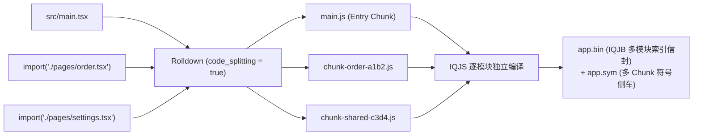

# 方向二设计方案：编译期主题 Token、路由级多 Chunk 分包与产物体积透视

本文档是 [`docs/native-toolchain-v2-roadmap.md`](native-toolchain-v2-roadmap.md) **方向二**的完整工程落地设计方案，涵盖三个紧密衔接的能力：**编译期强类型主题 Token 与零 JS Effect 换肤**、**动态 `import()` 多模块 IQJS 字节码按需加载**，以及**构建产物体积归因分析器（`--analyze-size`）**。

适用模块：[`crates/engine/src/style/`](../crates/engine/src/style/mod.rs)、[`crates/bundler/src/`](../crates/bundler/src/lib.rs)、[`crates/javascript/src/`](../crates/javascript/src/lib.rs)、[`crates/cli/src/`](../crates/cli/src/main.rs)、[`packages/solid-ui/src/theme.ts`](../packages/solid-ui/src/theme.ts) 与 [`packages/solid-router/src/`](../packages/solid-router/src/stack.ts)。

---

## 1. 子方案 A：编译期强类型主题 Token 与零 JS Effect 原生换肤

### 1.1 现状断层分析

1. **引擎已具备部分底层原语但链路未闭环**：
   - [`crates/engine/src/style/values.rs`](../crates/engine/src/style/values.rs) 已定义 `Length::Token(LengthToken)`、`AbsoluteLength::Token(LengthToken)` 与 `PaintColor::Token`，且支持 `style-binary` 序列化；
   - [`crates/engine/src/style/environment.rs`](../crates/engine/src/style/environment.rs) 中的 `Environment` 已持有 `colors: HashMap<Arc<str>, [u8; 4]>`、`radii`、`font_sizes`、`roles` 与 `DepMask::THEME`，但**尚未提供通用的命名长度表 `lengths: HashMap<Arc<str>, f32>`**，且 [`packages/solid-ui/src/theme-bind.ts`](../packages/solid-ui/src/theme-bind.ts) 仅同步了 `colors`/`radii`/`fontSizes`/`roles`，未写入 `space.*` / `shape.*` 长度 Token。
2. **TypeScript 侧弱类型且写法迫使样式动态化**：
   - [`packages/solid-renderer/src/style.gen.ts`](../packages/solid-renderer/src/style.gen.ts) 中 Token 类型为宽泛的 `{ token: string }`，无拼写检查与补全；
   - 业务与组件库普遍写 `style={{ backgroundColor: theme().color.surface, padding: theme().space.m, borderRadius: theme().shape.l }}`。因包含 `theme()` 调用，编译器将其全部视为动态属性，为每个节点创建多个 `bindInlineStyle` `RenderEffect`；切换深浅色或密度时，QuickJS 被迫重跑全树成百上千个 JS 闭包。

### 1.2 全链路打通设计

#### (1) 补齐 `engine::style::Environment` 命名长度 Token 解析
1. 在 [`environment.rs`](../crates/engine/src/style/environment.rs) 的 `Environment` 中新增 `lengths: HashMap<Arc<str>, f32>`（纳入 `same_theme` 相等性比较与 `validate` 非负有限数校验）。
2. 当样式解析遇到 `Length::Token(name)` 或 `AbsoluteLength::Token(name)` 时：
   - 从 `env.lengths`（或内置映射的 `space.s`、`space.m`、`space.l`、`radius.s`、`radius.m`、`shape.none`～`shape.full`、`font.body`、`font.title`）读取对应点值，并为该节点标记 `DepMask::THEME`；
   - 当 `scene.setStyleEnvironment(...)` 更新主题（如深浅色切换、高对比度切换、`setDensity` 密度切换）时，`Tree` 直接根据 `DepMask::THEME` 在 Rust 侧批量重算受影响节点的样式与必要的布局，**全程零 JS 回调、零 FFI 往返**。
3. 更新 [`packages/solid-ui/src/theme-bind.ts`](../packages/solid-ui/src/theme-bind.ts)，在 `setStyleEnvironment` 中完整同步标准长度与圆角 Token 表，并允许应用通过 `extendThemeTokens` 注册自定义业务 Token。

#### (2) 强类型声明生成（`.impasto/types/tokens.d.ts`）与 `style-types` 对接
1. 修改 `crates/engine/src/bin/style-types.rs` 生成的 [`style.gen.ts`](../packages/solid-renderer/src/style.gen.ts)：
   ```ts
   export interface ImpastoColorTokens {}
   export interface ImpastoLengthTokens {}
   export type ColorTokenName = keyof ImpastoColorTokens extends never ? string : keyof ImpastoColorTokens;
   export type LengthTokenName = keyof ImpastoLengthTokens extends never ? string : keyof ImpastoLengthTokens;
   export type AbsoluteLength = number | { rem: number } | { vw: number } | { vh: number } | { token: LengthTokenName };
   export type Color = string | readonly [number, number, number, number] | { token: ColorTokenName; opacity?: number };
   ```
2. `impasto sync` 生成 `.impasto/types/tokens.d.ts`：默认注入 `@impasto/solid-ui` 标准调色板键（`surface`、`background`、`text`、`textMuted`、`accent`、`danger`、`border` 等）与标准尺寸键（`"space.s"`、`"space.m"`、`"space.l"`、`"shape.xs"`～`"shape.full"`、`"fontSize.body"`、`"fontSize.title"`）；若应用在 `app.toml` 或 `src/theme.ts` 声明扩展 Token，一并合并进接口声明。拼错 Token 名在 `impasto analyze` 直接触发 TS 类型错误，在 `bundler` 静态池编码阶段也会被校验拦截。

#### (3) 编译器自动将 `useTheme()` 纯读取折叠为静态 Token（`crates/bundler/src/styles.rs`）
为了让现有符合直觉的 `const theme = useTheme(); <View style={{ backgroundColor: theme().color.surface, gap: theme().space.m }} />` 写法**无需手改成 `{ token: "surface" }`** 就能享受零开销池化：
1. 在 `styles::Constants::analyze` 中利用 `oxc_semantic::Scoping` 追踪由 `@impasto/solid-ui` 的 `useTheme()` 初始化的只读绑定 `theme`；
2. 在 JSX `style` 属性求值时，识别纯静态成员链 `theme().color.<key>`、`theme().space.<key>`、`theme().radius.<key>`、`theme().shape.<key>`、`theme().fontSize.<key>`：
   - 直接在编译期重写折叠为对应的静态 JSON 描述 `{"token": "<canonical_token_name>"}`！
   - 折叠后整张 `style` 对象自动进入 `StaticStyle` 全局常量池，不再生成任何动态 `StylePatch` 或 `RenderEffect`。

---

## 2. 子方案 B：路由级异步分包（Dynamic `import()` 多 Chunk IQJS 字节码）

### 2.1 目标与约束

大型跨端应用包含数十个业务页面与低频模块（如复杂图表页、设置中心、协议页、相机扫码页）。开启按需分包必须同时满足四项硬约束：
1. **保持 `javascript` 纯净边界**：`crates/javascript` 仅提供多模块字节码注册与加载机制，不感知文件系统或平台资产路径；
2. **Release 模式全量 AOT 字节码化**：懒加载子包同样在构建期预编译为 `IQJS` 字节码，禁止在生产端下发源码做运行期 JIT/Parse；
3. **符号反解完整覆盖**：`app.sym` 必须能反解任意懒加载子包的崩溃栈与 Perfetto 采样帧；
4. **OTA 原生契约安全**：`plugins-manifest.json` 校验覆盖主包及所有懒加载子包的 `NativeUse`。

### 2.2 编译与打包产物格式：IQJS Bundle Archive（`IQJB`）

为避免在 Android APK `assets/`、iOS Bundle 和 OTA 下发管道中管理几十个碎文件并产生版本错配，采用**单文件索引式多模块字节码容器**（同时支持目录展开调试）：



1. **Rolldown 分块配置（[`crates/bundler/src/bundle.rs`](../crates/bundler/src/bundle.rs)）**：
   - 在非 `hot` 构建中开启 `code_splitting`（当应用无动态 `import()` 时自动产出单 Chunk，100% 兼容现有行为）；
   - `Bundle` 结构体扩展字段 `pub chunks: BTreeMap<String, ChunkOutput>`（记录每个非入口 Chunk 的模块名 `./chunk-xxx.js`、JS 代码、SourceMap 及该 Chunk 自身的 `native_use`），`Bundle.native_use` 为入口与全部 Chunk 的并集。
2. **IQJS 多模块容器格式（扩展 [`crates/javascript/src/compiler/bytecode.rs`](../crates/javascript/src/compiler/bytecode.rs)）**：
   - 保留单模块 `IQJS` 魔数完全兼容；新增多模块信封 `Kind::Archive`（tag = `2`）：
     - 头部：版本指纹 + 入口模块名 + 模块目录表（`[(specifier, byte_offset, byte_len)]`，按字典序排列支持二分查找，偏移 8 字节对齐）；
     - 数据区：紧密排列各 Chunk 独立的 QuickJS 编译后模块字节码载荷。
   - **冷启动内存与耗时优势**：宿主打开 `app.bin` 时（mmap 或只读缓冲），**仅反序列化并求值 `entry` 模块字节码**（`JS_ReadObject` + `JS_EvalFunction`）；其余懒加载 Chunk 仅在目录表中登记偏移区间，零对象分配、零提前求值！
3. **运行时按需加载（扩展 [`crates/javascript/src/runtime/modules.rs`](../crates/javascript/src/runtime/modules.rs)）**：
   - 在 `ModuleTable` 中增加延迟字节码表 `lazy_bytecode: HashMap<String, Arc<[u8]>>`（Debug 模式则存入 `sources`）；
   - 当业务触发 `await import("./chunk-order.js")` 时，QuickJS 回调 `MemoryResolver` → `MemoryLoader::load`：命中 `lazy_bytecode` 后，现场调用 `Module::load(ctx, payload)`（底层 `JS_ReadObject`）返回 `Module<Declared>`，首次加载耗时仅数百微秒，后续再次导入直接命中 QuickJS 模块缓存。
4. **多 Chunk 符号反解（扩展 [`crates/cli/src/symbols.rs`](../crates/cli/src/symbols.rs)）**：
   - `IMPSYM\x02` 格式按模块名（`"app.js"`、`"chunk-order.js"`）存储各自的压缩 SourceMap 与 `x_impasto_functions` 表；`impasto symbolicate` 根据异常栈帧中的模块名定位对应子表再按行列反解。

### 2.3 `@impasto/solid-router` 懒加载路由 API

在 [`packages/solid-router/src/stack.ts`](../packages/solid-router/src/stack.ts) 与 [`view.tsx`](../packages/solid-router/src/view.tsx) 中原生支持异步路由定义：

```ts
export type LazyRouteLoader = () => Promise<{
  default: (props: { params: RouteParams; phase: RoutePhase }) => NodeHandle;
}>;

export type RouteDef = {
  path: string;
  component?: (props: { params: RouteParams; phase: RoutePhase }) => NodeHandle;
  lazy?: LazyRouteLoader;
  fallback?: () => NodeHandle;
  keepAlive?: boolean;
};
```

- 路由匹配进入 `lazy` 条目时：若模块已加载完成，直接同步走零闪烁转场动画；若首次加载，先挂载 `fallback`（或路由级骨架屏），Promise 微任务在同一帧或下一帧 resolve 后无缝替换为目标页面组件，并完整兼容手势右滑返回（`backPreview`）与状态恢复（`restoreRoutes`）。

---

## 3. 子方案 C：产物体积透视分析器（`impasto build bundle --analyze-size`）

### 3.1 采集维度与归因模型

由于 Impasto 拥有共享常量池 `impasto:pool/{style,class,template}/*`、内联 SVG 与 WGSL，传统前端打包分析器无法看清“静态池字节是谁贡献的”。`crates/bundler` 在链接阶段直接产出精确的结构化归因报告 `SizeReport`：

1. **四维分类统计**：
   - `app_sources`：应用 `src/` 各 `.tsx`/`.ts` 模块在压缩后 JS 与对应 IQJS 字节码中的字节占比；
   - `framework_packages`：`@impasto/solid-ui`、`solid-renderer`、`solid-router` 等内置包存活模块的字节占比（直观验证组件 Tree-Shaking 效果）；
   - `third_party`：通过 `node_modules` 或 `impasto.lock` 引入的外部包体积；
   - `compiled_pools_and_assets`：
     - `static_styles` / `static_classes` / `templates` 的总字节数及去重节省率（`dedup_saved_bytes` = 去重前引用总和 − 实际入池字节）；
     - 若某个池条目仅被唯一源模块引用记为该模块的**独占开销（Retained Size）**，被 $K$ 个模块共享则按 $1/K$ 记入**分摊开销（Amortized Size）**；
     - 内联 `svg` 路径代码、`wgsl` 着色器源码与 `assets/` 外部拷贝资源的明细表。

### 3.2 CLI 接口与可视化输出

在 [`crates/cli/src/main.rs`](../crates/cli/src/main.rs) 的 `Build` 命令新增：
- `--analyze-size`：在终端打印按 Chunk 与前 20 大模块排序的对齐表格（含 ESM 字节、IQJS 字节、独占池开销、资产体积与去重率）；
- `--size-json <path>`：输出机器可读 JSON，供 CI 设定包体积预算门禁（如主 Chunk IQJS 不超过 250 KB），并可直接拖入 DevTools 的 **Bundle Size** 标签页渲染交互式矩形树图（Treemap）。

---

## 4. 实施步骤与验证门禁

| 步骤 | 改动范围 | 验证用例与门禁 |
|---|---|---|
| **Step 1：Engine 长度 Token + `tokens.d.ts` + `useTheme()` 编译折叠** | `environment.rs`、`values.rs`、`style-types.rs`、`theme-bind.ts`、`sync.rs`、`styles.rs` | 单测验证切换 `brightness` 与 `setDensity("compact")` 时，使用 `theme().color.*` / `theme().space.*` 的组件 **JS Effect 触发次数为 0** 且布局/像素正确更新；拼错 Token 名被 `impasto analyze` 拦截。 |
| **Step 2：IQJS 多模块容器与动态 `import()` 按需加载** | `bytecode.rs`、`modules.rs`、`bundle.rs`、`symbols.rs`、`solid-router` | 构建含 3 个懒加载路由的应用：验证首帧仅求值入口模块，导航至懒路由后正确加载子模块字节码，子模块抛错可通过 `impasto symbolicate` 精确反解到原 `.tsx` 行列；子模块引用未安装原生插件时被 `--installed-manifest` 准确拦截。 |
| **Step 3：`--analyze-size` 体积归因与报告** | `bundle.rs`、`build.rs`、`devtools.html` | 验证报告中各模块字节求和与实际产物误差 < 1%，池去重统计与独占/分摊归因准确。 |
