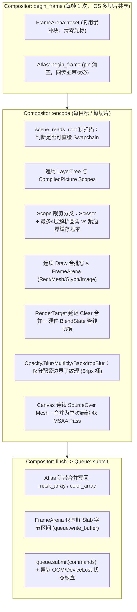

# Impasto `wgpu` P0 性能与管线能力释放落地设计方案

> 本文以 P0 之前的实现为基线，记录已随 `4462fb3` 落地的方案。后续交付和指标口径见 [性能基线、遥测与 P1 渲染计划](telemetry-and-p1-plan.md)。

## 1. 适用范围、目标与硬性约束

### 1.1 定位与背景

本方案承接 [Impasto `wgpu` 核心渲染与排版管线架构方案](wgpu-rendering-pipeline.md) 已完成的首次架构迁移（脱离 Impeller C API，统一至 `wgpu 30.0.2` + `Parley 0.13.0`）。当前实现已经完成了跨端正确性闭环（First Make it Work），但在 GPU 资源生命周期、RenderPass 调度、图元合批及片上带宽控制上仍处于“每批次新建 UBO 与 BindGroup、逐帧全屏离屏拷贝、逐个路径独立 MSAA Pass”的基线状态。

本文档聚焦 **P0 阶段** 的详细工程落地设计，在不引入破坏性上层契约变更、不牺牲 Android GLES3 / iOS UIKit 事务合成兼容性与渲染像素一致性的前提下，完成 **Then Make it Right** 的核心渲染吞吐重构。

### 1.2 适用模块与接口稳定承诺

P0 改动严格收敛在 [`crates/raster`](../crates/raster/Cargo.toml) 与极少量的诊断埋点对接：

- **上游场景与排版契约保持不变**：不修改 [`crates/engine`](../crates/engine/Cargo.toml) 的公开数据结构（`LayerTree`、`LayerKind`、`Command`、`CanvasOp`、`ShapedParagraph`、`Shaper`）以及 JS / Solid 应用层协议。
- **Raster 对外主入口保持签名稳定**：[`Rasterizer`](../crates/raster/src/lib.rs#L89) 的 `create`、`headless`、`create_surface`、`recover_surface`、`submit_layers`、`present`、`render_rgba`、`texture_factory`、`install_uploaded`、`forget_texture`、`invalidate_textures`、`invalidate_pictures`、`trim`，以及 iOS 的 `begin_metal_slices` / `encode_metal_slice` / `wait_for_metal_schedule` / `import_metal_texture` 保持现有签名与语义不变。
- **诊断指标向后兼容扩展**：[`RenderStats`](../crates/raster/src/compositor.rs#L33-L37) 与 [`AtlasStats`](../crates/raster/src/atlas.rs#L105-L114) 仅做“只增不减”的字段扩展，并在 [`crates/embedder/common/src/host/raster_host.rs`](../crates/embedder/common/src/host/raster_host.rs#L342-L353) 中同步输出 trace 字段。

### 1.3 必须遵守的仓库硬性约束

1. **依赖隔离（`just boundaries`）**：[`tools/check-javascript-boundaries.py`](../tools/check-javascript-boundaries.py) 门禁保持通过，`engine` 不得触及 `raster`/`wgpu`/`parley`/`lyon`，`raster` 不得触及 `rquickjs`/`quickjs-jit`，`javascript` 保持隔离。
2. **Rust Lint 与安全规范**：遵守根目录 [`Cargo.toml`](../Cargo.toml#L38-L51) 的 `unsafe_code = "deny"`、`unwrap_used = "deny"`、`expect_used = "deny"`、`unused_qualifications = "deny"`、`cast_possible_truncation = "warn"`。**整个 P0 阶段不引入任何新的 `unsafe` 块**；所有帧级竞技场、动态偏移、图集阵列与硬件混合均以纯安全 Rust 实现。
3. **跨端图形后端与线程拓扑覆盖**：
   - 覆盖 macOS Metal、iOS Metal（含单表面与 `PlatformView` 多切片 UIKit 事务合成）、Android Vulkan 与 Android GLES3（`IMPASTO_TEST_VULKAN=false` 降级路径）、Linux Headless 软件 Vulkan（CI）。
   - 完整兼容 `SharedRender`、`Split`、`PlatformUi` 三种 [`ThreadTopology`](../crates/embedder/common/src/lib.rs#L187) 及双帧流水线（[`FramePipeline::DEPTH = 2`](../crates/embedder/common/src/host.rs#L848)）。

### 1.4 现状瓶颈与 P0 量化目标

| 观测维度 | 当前实现（基线） | P0 目标 | 对应改造项 |
|---|---|---|---|
| **暖帧 Buffer 新建数** (`buffers_created`) | 每个 64 实例批次新建 3 个 UBO（含空 8 KiB Stops UBO）；每个 Mesh 新建 VB + IB + UBO | **`0`**（稳态滚动画/重绘帧） | `FrameArena` 环形板池 + `CompiledPicture` GPU Mesh 驻留 |
| **暖帧 BindGroup 新建数** (`bind_groups_created`) | 每个 DrawCall 新建 1–2 个 `BindGroup` | **`0`**（稳态帧，仅新增外部图片/遮罩首次建 1 次） | 三层 BindGroup 分频缓存 |
| **每帧同步 Error Scope 阻塞** | 每帧 3 层 `push_error_scope` + 3 次 `pollster::block_on(pop())` | **仅初始化/冷路径/显式校验开启**；热路径异步标志检查 | `GpuCaps` + 异步 OOM/Uncaptured 标志 |
| **UI 原语单帧 DrawCall** | `INSTANCES = 64` 硬切分；渐变矩形不与纯色合批；字体跨页断批 | **同 Scope 同状态 1 次 DrawCall**（预期下降 **70%–90%**） | `VertexStepMode::Instance` + 全局 Stops 偏移 + `texture_2d_array` |
| **普通场景 RenderPass 数** | 至少 2 Pass（全屏离屏 `main` + `FullPass::Copy`）；圆角裁剪每 Scope 再加 Clear + Mask Pass | **1 Pass**（无根级 `BackdropBlur`/`Multiply` 时直绘 Swapchain；Clear 合并） | 直绘 Swapchain 快路径 + 解析圆角裁剪 + 合并 `LoadOp::Clear` |
| **局部 `BackdropBlur` 显存/像素吞吐** | 全屏纹理拷贝 + 全屏 Dual-Kawase 模糊 | **紧边界子区域拷贝与模糊**（如 240×120 浮层像素量降 **10×–50×**） | 紧边界离屏纹理池 + 局部 `BackdropBlur` |
| **Canvas 矢量路径（500 路径）** | 每路径 1 次 MSAA Pass + 1 次贴图回贴（~1000 Pass）+ 每帧重复建 VB/IB | **连续 `SourceOver` 合并为 1 次局部 MSAA Pass**，稳态帧 VB/IB 上传为 `0` | GPU Mesh 驻留 + Canvas MSAA 批合并 + 硬件 `BlendState` |
| **Glyph Atlas 上传开销** | 每 miss 字形发 1 次 `queue.write_texture`；页回收未清纹理存在残影隐患 | **同页连续脏带合并上传**，页回收同步清零（杜绝 1px gutter 残影） | `texture_2d_array` + 脏带合并上传 |

---

## 2. 前置架构决策与已核验的 `wgpu 30.0.2` 跨端约束

在进入具体模块设计之前，先固化 5 项经 `wgpu 30.0.2`（`wgpu-types` / `wgpu-core` / `wgpu-hal`）与仓库源码交叉核验后的硬性架构决策，避免在 Android GLES3、iOS 事务或复杂布局边缘踩坑。

### 2.1 实例传递方式：为何 P0 选择 `VertexStepMode::Instance` 而非 `var<storage, read>`

直觉上可以用 Storage Buffer 替代 Uniform Buffer 来突破 `INSTANCES = 64` 限制，但在 `wgpu-hal-30.0.2/src/gles/adapter.rs` 中核验发现：
- Android GLES3 驱动上 `DownlevelFlags::VERTEX_STORAGE` 依赖 `GL_MAX_VERTEX_SHADER_STORAGE_BLOCKS`（不少移动 GLES3.0 驱动该值为 `0`），直接把实例数组放进 Vertex Shader 的 `var<storage, read>` 会导致 GLES3 回退路径创建设备或管线校验失败。
- 相反，**`VertexStepMode::Instance` 顶点缓冲** 在 `downlevel_defaults()`（甚至 `downlevel_webgl2_defaults()`）下全后端 100% 原生支持，且：
  - 将每批实例数从 `64` 彻底放开到任意数量，通过 `pass.set_vertex_buffer(0, slab.slice(byte_offset..byte_end))` + `pass.draw(0..6, 0..instance_count)` 完成绘制；
  - 每次绘制显式把顶点缓冲切片绑定到当前批次起始偏移，`first_instance` 恒为 `0`，完全规避部分 GLES3 驱动不支持非零 `first_instance`（需要模拟 uniform）的额外开销与兼容问题；
  - 严格控制顶点属性数 `<= 16`、Vertex→Fragment 插值变量数 `<= 15`（对齐 `wgpu::Limits::downlevel_defaults()`）。

> Storage Buffer 与 Compute Shader 属于 P1（Tier 1 能力分层）的扩展优化路径；P0 通过 `VertexStepMode::Instance` 即可用单套 WGSL 代码在全后端消除 64 实例上限与 per-draw Buffer 分配。

### 2.2 网格索引基准：预偏移 `u32` 索引保证 `base_vertex == 0`

`wgpu-types-30.0.2/src/limits.rs` 明确标注 OpenGL ES 3.0 设备不保证支持 `DownlevelFlags::BASE_VERTEX`。因此当 [`compiler.rs`](../crates/raster/src/compiler.rs) 将一个 `Picture` 内多个 `Draw::Mesh` 与路径裁剪网格打包合并到一对 GPU Buffer（`mesh_vertices` + `mesh_indices`）时，在 CPU 编译期向每个网格的索引值预加其 `base_vertex: u32` 偏移。绘制时统一调用 `pass.draw_indexed(start..end, 0, 0..1)`，确保 `base_vertex` 恒为 `0`。

### 2.3 iOS UIKit 多切片事务的 `FrameArena` 生命周期契约

查阅 [`crates/raster/src/metal.rs`](../crates/raster/src/metal.rs#L29-L156) 可知，iOS 在存在 `PlatformView` 交错合成时，单帧编码调用顺序为：

```text
begin_metal_slices()              ──▶ compositor.begin_frame()
  ├── encode_metal_slice(0)       ──▶ compositor.encode(...)   [产出 CommandBuffer 0]
  ├── encode_metal_slice(1)       ──▶ compositor.encode(...)   [产出 CommandBuffer 1]
  └── ...
wait_for_metal_schedule(batch)    ──▶ compositor.flush(gpu) -> queue.submit([cmd0, cmd1, ..., tail])
```

由此得出两条不可违反的帧竞技场不变量：

1. **`FrameArena` 只能在 `Compositor::begin_frame()` 中重置，严禁在 `Compositor::encode()` 中重置**。否则 Slice 1 会覆盖 Slice 0 已写入的环形缓冲偏移区间。
2. **必须使用“只追加不迁移”的 Chunked Slab 池，严禁单块重新分配替换**。如果在 Slice 1 编码时触发扩容并替换掉旧 `wgpu::Buffer`，Slice 0 已经录制完成的 `wgpu::CommandBuffer` 仍引用旧缓冲地址而 Slice 0 数据未被写入旧缓冲（或丢失）。采用 Chunked Slab 后：当前 Slab 写满仅追加新 Slab；已写入的旧 Slab 及其 `Buffer` / `BindGroup` 句柄在当帧内**地址与索引永不失效**，并在 `Compositor::flush(gpu)` 时将所有脏 Slab 一次性 `queue.write_buffer` 提交，全部在 `queue.submit(commands)` 之前生效。

### 2.4 未裁剪子树与阴影的溢出安全边界

核验 [`crates/engine/src/tree/record/pass.rs`](../crates/engine/src/tree/record/pass.rs#L186-L265) 与 [`crates/engine/src/tree/record/mod.rs`](../crates/engine/src/tree/record/mod.rs#L1202-L1241) 可知：

- `LayerKind::Opacity { x, y, w, h, .. }`、`Blur`、`Blend` 以及 `Command::PushOpacity` / `PushBlur` / `PushBlend` 上携带的 `x, y, w, h` 仅仅是**该节点自身的布局盒**，**不包含**未裁剪的溢出子节点、外扩描边（`emit_outline`）、以及向四周延伸 `spread + 3 * blur_sigma` 的 `box_shadows` / `material_shadow`。
- 只有两类节点语义上严格受限于自身矩形盒：
  - `BackdropBlur`（`LayerKind::BackdropBlur` / `Command::PushBackdropBlur`）：源码 [`compositor.rs:949-951`](../crates/raster/src/compositor.rs#L949-L951) 显式将 `group.bounds` 作为裁剪域；
  - `CanvasIsolation::Isolated`（`Command::Canvas`）：[`compiler.rs:654`](../crates/raster/src/compiler.rs#L654) 在其外层强制压入 `[x, y, width, height]` 矩形裁剪。
- **P0 紧边界原则**：对 `Opacity`、`Blur`、`Blend` 等效果组，**严禁直接信任节点上的 `x, y, w, h`**；必须根据 `CompiledPicture` 编译期计算的保守绘制包围盒（`PictureBounds`，已包含阴影与描边外扩）与子树边界求并集，再与祖先 `clip.scissor` 和目标画布求交。若组内含无界操作（如 `Draw::Fill`），标记为 `Unbounded` 并自动回退到 `ancestor_scissor ∩ target`。

### 2.5 线性预乘空间下硬件 `BlendState` 与裁剪覆盖率的数学等价性

当前实现为了支持 `CanvasComposite` 中的 `DestinationOut`（含 `CanvasOp::Clear`）、`DestinationOver`、`Lighter`、`Xor`、`Screen` 等模式，强制触发 [`snapshot(target)`](../crates/raster/src/compositor.rs#L991) 全屏拷贝 + `fs_composite` 全屏重绘。

管线内部所有颜色均采用**线性预乘 RGBA**，且带有片元裁剪覆盖率 $c \in [0, 1]$（即着色器输出 $S' = c \cdot S$，原 `fs_composite` 算法是 `mix(D, Blend(S, D), c) = (1 - c) D + c \cdot Blend(S, D)`）。逐一验证固定管线硬件混合公式 $F_{\text{src}} \cdot S' + F_{\text{dst}} \cdot D$（按通道独立计算）：

| 混合模式 | 原 `fs_composite` 目标结果（含覆盖率 $c$） | 硬件 `BlendState`（`src_factor` / `dst_factor` / `Add`） | 展开等价性验证 | 是否可在主 Pass 直接硬件混合 |
|---|---|---|---|---|
| **`SourceOver`** | $S' + (1 - c S_a) D$ | `One` / `OneMinusSrcAlpha` | 严格相等 | **是** |
| **`DestinationOver`** | $(1 - D_a) S' + D$ | `OneMinusDstAlpha` / `One` | $(1-c)D + c(D + (1-D_a)S) = D + c(1-D_a)S = D + (1-D_a)S'$，严格相等 | **是** |
| **`DestinationOut` / `Clear`** | $(1 - c S_a) D$ | `Zero` / `OneMinusSrcAlpha` | $(1-c)D + c(1-S_a)D = (1 - c S_a)D$，严格相等 | **是** |
| **`Lighter`** | $\min(S' + D, 1)$ | `One` / `One`（UNORM 写回自动 Clamp $[0, 1]$） | $(1-c)D + c(S+D) = c S + D = S' + D$，UNORM 目标上硬件饱和等价 | **是**（sRGB/UNORM8） |
| **`Xor`** | $(1 - D_a) S' + (1 - c S_a) D$ | `OneMinusDstAlpha` / `OneMinusSrcAlpha` | $(1-c)D + c((1-D_a)S + (1-S_a)D) = (1-D_a)c S + (1-c S_a)D$，严格相等 | **是** |
| **`Screen`** | Color: $S' + (1 - S') D$<br>Alpha: $S'_a + (1 - S'_a) D_a$ | Color: `One` / `OneMinusSrc`<br>Alpha: `One` / `OneMinusSrcAlpha` | $(1-c)D + c(S + D - S D) = c S + (1 - c S) D = S' + (1 - S') D$，严格相等 | **是** |
| **`Multiply`** | Color: $S_{\text{rgb}} D_{\text{rgb}} c + S' (1 - D_a) + D (1 - S'_a)$ | 单源固定管线无法同时依赖 $D_{\text{rgb}}$ 与 $(1 - D_a)$ | 不满足线性可分离条件 | **否**（保留紧边界快照 + `fs_composite`） |

> 关键发现：`Screen` 混合使用 `color: (One, OneMinusSrc, Add)` + `alpha: (One, OneMinusSrcAlpha, Add)` 在带裁剪覆盖率 $c$ 时与 `mix(dst, blend, c)` **恒等**。因此 P0 中除 `Multiply` 外，其余 6 种 Porter-Duff / 可分离混合全部可零拷贝硬件完成。

---

## 3. 核心模块详细设计

### 3.1 总体帧编码数据流



---

### 3.2 `GpuCaps` 能力探测与热路径 Validation 收敛

涉及文件：[`crates/raster/src/gpu.rs`](../crates/raster/src/gpu.rs)、[`crates/raster/src/lib.rs`](../crates/raster/src/lib.rs)、[`crates/raster/src/metal.rs`](../crates/raster/src/metal.rs)。

#### 3.2.1 `GpuTier` 与 `GpuCaps` 定义

在 `gpu.rs` 中新增设备能力快照，创建设备时一次探明并缓存在 `Gpu` 上：

```rust
#[derive(Clone, Copy, Debug, PartialEq, Eq, PartialOrd, Ord)]
pub(crate) enum GpuTier {
    /// GLES3 / 软件回退：VertexStepMode::Instance + Dynamic Uniform Offset + 2D Array
    Tier0Baseline,
    /// 标准现代 GPU：支持 Compute、Vertex/Fragment Storage、RODS
    Tier1Standard,
    /// 原生增强特性：Immediates / PipelineCache / Timestamp / DualSource / F16 等
    Tier2Native,
}

#[derive(Clone, Copy, Debug)]
pub(crate) struct GpuCaps {
    pub tier: GpuTier,
    pub downlevel_flags: wgpu::DownlevelFlags,
    pub min_uniform_align: u32,
    pub max_texture_2d: u32,
    pub max_array_layers: u32,
    pub max_buffer_size: u64,
    pub msaa4_srgb: bool,
    pub has_vertex_storage: bool,
    pub has_fragment_storage: bool,
    pub has_compute: bool,
    pub has_immediates: bool,
    pub has_pipeline_cache: bool,
    pub has_timestamp_query: bool,
    pub has_dual_source_blending: bool,
    pub has_shader_f16: bool,
    pub has_texture_binding_array: bool,
}
```

#### 3.2.2 Limits 与 Features 协商策略

在 [`Gpu::request`](../crates/raster/src/gpu.rs#L30-L85) 中：

1. 先读取 `adapter_limits = adapter.limits()`、`adapter_features = adapter.features()` 与 `downlevel = adapter.get_downlevel_capabilities()`。
2. 构建 `required_limits`：以 `wgpu::Limits::downlevel_defaults().using_resolution(adapter_limits)` 为基线，同时将与大场景/缓冲池直接相关的上限尽量向 `adapter_limits` 对齐（`max_buffer_size`、`max_texture_array_layers`、`max_uniform_buffer_binding_size`），确保 `downlevel_defaults`（如 Android GLES3）永不越界，而桌面/旗舰移动端获得更大的缓冲与图集上限。
3. P0 默认不强制要求 `Tier2` 专属 `Features`（保证测试环境与低端设备兼容），仅将 `adapter_features` 中探测到的能力记录入 `GpuCaps`；若 P1/P2 按 `Tier2` 开启特性，只需在 `required_features` 中按 `adapter_features.contains(...)` 择机请求。
4. 在 `tracing::info!` 启动日志中打印 `tier`、`backend`、`min_uniform_align`、`max_texture_2d`、`msaa4_srgb`，方便 CI 与真机排障。

#### 3.2.3 热路径同步 Error Scope 移除

当前 [`encode_and_submit`](../crates/raster/src/lib.rs#L357) 和 [`encode_metal_slice` / `wait_for_metal_schedule`](../crates/raster/src/metal.rs#L88-L142) 每帧都会执行 `gpu.validation(...)`，每次展开 3 层 `push_error_scope` 并执行 3 次 `pollster::block_on(pop())`，造成不必要的主线程驱动轮询与同步毛刺。

改造方式：

1. 在 `Gpu` 内增加原子状态：`oom: Arc<AtomicBool>` 与 `uncaptured_error: Arc<AtomicBool>`。
2. 在 `device.on_uncaptured_error` 回调中：
   - 遇到 `wgpu::Error::OutOfMemory { .. }` 时置位 `oom` 并打印 `warn`；
   - 遇到 `Validation` / `Internal` 时置位 `uncaptured_error` 并打印 `error`。
3. 新增轻量化 `Gpu::check_async_health(&self) -> Result<(), Status>`（不推入 error scope、不阻塞 wait）：
   - 先检查 `self.is_lost()` → 返回 `Status::DeviceLost`；
   - 检查 `self.oom.swap(false, Ordering::AcqRel)` → 返回 `Status::OutOfMemory`；
   - 检查 `self.uncaptured_error.swap(false, Ordering::AcqRel)` → 返回 `Status::PresentFailed`；
   - 若调用方明确调用了 `device.destroy()` 后进入渲染（如 [`tests.rs:348`](../crates/raster/src/tests.rs#L348)），`is_lost()` 在编码/提交后通过一次非阻塞 `self.device.poll(wgpu::PollType::Poll)`（仅在 `cfg!(test)` 或出错前触发，或在 `render_rgba` / `present` 返回后轮询）仍可立即捕获 `Status::DeviceLost`。
4. **保留严格 `gpu.validation(...)` 的位置**：
   - 冷路径：`create_surface`、`resize`、`PipelineCache::get`、`render_rgba` 创建临时截图纹理时继续保留；
   - 调试开关：当 `cfg!(debug_assertions)`、`cfg!(test)` 或环境变量 `IMPASTO_GPU_VALIDATE=1` 启用时，热路径依然可通过 `gpu.hot_validation(...)` 走同步检查，开发期和 CI 测试零盲区，Release 生产帧零同步等待。

---

### 3.3 持久化 `FrameArena` 与三层 BindGroup 分频架构

涉及文件：新增 `crates/raster/src/arena.rs`，修改 [`batch.rs`](../crates/raster/src/batch.rs)、[`pipelines/mod.rs`](../crates/raster/src/pipelines/mod.rs)、[`textures.rs`](../crates/raster/src/textures.rs)、[`compositor.rs`](../crates/raster/src/compositor.rs) 及 4 个 WGSL 文件。

#### 3.3.1 `FrameArena` 内部结构（Chunked Slab 池）

```rust
/// 单帧共享上传与 GPU 缓冲竞技场。在 Compositor::begin_frame() 重置，
/// flush() 统一执行 queue.write_buffer，保证多 Slice 编码下旧块引用不失效。
pub(crate) struct FrameArena {
    vertices: SlabPool,  // BufferUsages::VERTEX | COPY_DST，默认块 256 KiB
    uniforms: UniformSlabPool, // BufferUsages::UNIFORM | COPY_DST，默认块 64 KiB，按 min_uniform_align 对齐
    stops: StopsSlabPool,      // BufferUsages::UNIFORM | COPY_DST，每块固定 8 KiB (512 * vec4)
    view_layout: wgpu::BindGroupLayout,       // 用于 UniformSlabPool 建缓存 BindGroup（如有独立需要）
    frame_globals_layout: wgpu::BindGroupLayout, // (View dynamic, Stops dynamic)
    blur_globals_layout: wgpu::BindGroupLayout,  // (View dynamic, Params dynamic)
    last_peak_vertices: usize,
    last_peak_uniforms: usize,
}
```

关键行为约束：

- **写指针与脏区间**：每个 `Slab` 维护 `data: Vec<u8>`（CPU 常驻内存复用，零帧间堆重分配）和 `cursor: usize`。`begin_frame()` 时仅将所有 Slab 的 `cursor` 归零（若上帧使用了多个 Slab，则合并重建为 1 个更大容量的 Slab，单块上限 `16 MiB`），`trim()` 时释放除初始大小外的额外 Slab。
- **动态偏移统一（`UniformSlabPool`）**：
  - 所有 `ViewUniform`（192B → 对齐到 `max(min_uniform_align, 256)` = 256B）和 `ParamsUniform`（32B → 对齐到 `256B`）均写入 `UniformSlabPool`；
  - 若每次 `set_bind_group(0, &bind_group, &[view_off, extra_off])` 都要同时绑定 `view` 和 `stops`（或 `params`），要求两者属于 `FrameGlobals` BindGroup 的两个 binding（`binding(0): View`, `binding(1): Stops` 或 `Params`）：
    - 注意 `Stops` 的数组长度在 WGSL 中固定为 `array<vec4<f32>, 512>`（8 KiB），一个 `UniformSlabPool` 若既放 View 又放 Stops（各按 256B 对齐，一个 Slab 容量设为 `64 KiB`），则：
      - `BindGroup` 为 `(buffer = slab.buffer, offset = 0, size = 256)`（binding 0，dynamic）和 `(buffer = slab.buffer, offset = 0, size = 8192)`（binding 1，dynamic）！
      - Wait：校验 `wgpu` 规则：同一 `BindGroup` 中两个 dynamic uniform binding 绑定同一个 `slab.buffer` 的前提是两个动态偏移加各自 `min_binding_size / binding size` 不能越界 `slab.size`，且写入 `slab.data` 时始终保证末尾保留至少 `8192` 字节可被 `Stops` 绑定窗口读取！
      - 更简洁零越界方案：`ViewSlab` 与 `StopsSlab` 各自独立 `UniformSlab`（`64 KiB` 一块），当某个需要扩块时仅把两者组合 `(view_slab_idx, stops_slab_idx)` 对应的 `BindGroup` 缓存在小型 `HashMap<(usize, usize), wgpu::BindGroup>` 中——通常 99.9% 的帧两个都只有 `slab 0`，整个生命周期只存在 **1 个** `@group(0)` `BindGroup`！
- **跨批次全局 `Stops` 偏移**：
  - [`ui.wgsl`](../crates/raster/src/pipelines/ui.wgsl#L47) 与 [`text.wgsl`](../crates/raster/src/pipelines/text.wgsl#L46) 中的 `stops` 本身就有 `first: u32` 和 `count: u32` 字段（此前硬编码传 `0.0`）！
  - P0 真正启用 `first`：每次遇到新渐变，向 `StopsSlab` 追加 `2 * stop_count` 个 `[f32; 4]`（16 字节步进），返回 `(slab_id, first_stop_vec4_index)`；只有当当前 `StopsSlab` 剩余 `vec4` 不足 `2 * stop_count`（即接近 512 个 `vec4` = 256 个 color stops 时），才切换到下一块 `StopsSlab`（并仅在该块切分处断开 DrawCall 批次）。
  - 对纯色矩形、阴影、纯色文字等无渐变图元：**完全不占用任何 `StopsSlab` 空间**，复用当前活动的 `StopsSlab` 即可。结果：同一个 `Scope` 内穿插纯色矩形、圆角描边、多种不同线性/径向/扫描渐变矩形、解析阴影，全部自动合并成 **1 个 Instanced DrawCall**。
- **`flush(gpu)` 提交**：遍历本帧写过数据的 Slab，仅调用 `gpu.queue.write_buffer(&slab.buffer, 0, &slab.data[..aligned_cursor])`。稳态帧通常仅 2–3 次连续大块 `write_buffer`，无任何 `create_buffer`。

#### 3.3.2 三层 BindGroup 分频布局规约

所有管线的 `@group` 数不超过 3（低于 `downlevel_defaults` 的 `max_bind_groups = 4` 上限）：

| 管线 | `@group(0)` Frame Dynamic（`dynamic_offsets` 切换） | `@group(1)` Material / Source（资源级永久缓存） | `@group(2)` ClipMask / Backdrop（共享或池化缓存） |
|---|---|---|---|
| **`ui`（`rect` / `mesh`）** | `0`: `ViewUniform` (dyn)<br>`1`: `stops: array<vec4<f32>, 512>` (dyn) | `0`: `clip_mask_tex`<br>`1`: `clip_mask_sampler` | *无需 `@group(2)`* |
| **`text`** | `0`: `ViewUniform` (dyn)<br>`1`: `stops: array<vec4<f32>, 512>` (dyn) | `0`: `mask_atlas: texture_2d_array<f32>`<br>`1`: `color_atlas: texture_2d_array<f32>`<br>`2`: `atlas_sampler` | `0`: `clip_mask_tex`<br>`1`: `clip_mask_sampler` |
| **`image`** | `0`: `ViewUniform` (dyn) | `0`: `image_tex: texture_2d<f32>`<br>`1`: `image_sampler` | `0`: `clip_mask_tex`<br>`1`: `clip_mask_sampler` |
| **`blur`（`blur` / `copy` / `copy_srgb`）** | `0`: `ViewUniform` (dyn)<br>`1`: `ParamsUniform` (dyn) | `0`: `source_tex: texture_2d<f32>`<br>`1`: `linear_sampler` | *无需 `@group(2)`* |
| **`composite`（`over` / `composite` / `backdrop`）** | `0`: `ViewUniform` (dyn)<br>`1`: `ParamsUniform` (dyn) | `0`: `source_tex: texture_2d<f32>`<br>`1`: `linear_sampler` | `0`: `backdrop_tex: texture_2d<f32>`<br>`1`: `linear_sampler`<br>`2`: `clip_mask_tex` |

缓存归属：

- **`white_mask_group`**：`Compositor` 初始化时针对 `clip_mask` 布局（`clip_mask_tex = white` + `linear_sampler`）预建 1 个永久 `BindGroup`。无复杂遮罩时直接绑定它。
- **`GpuImage` 内置双槽 BindGroup 缓存**：在 [`crates/raster/src/textures.rs`](../crates/raster/src/textures.rs#L17-L27) 的 `GpuImage` 中增加 `bind_linear: Arc<OnceLock<wgpu::BindGroup>>` 与 `bind_nearest: Arc<OnceLock<wgpu::BindGroup>>`（由于布局 `layouts.image_material` 仅由当前设备的 `Gpu` 固定持有，`GpuImage` 已绑定 `device: u64` 代次，首次绑定时 `get_or_init` 一次后整张图片生命周期跨帧复用，0 次重建）。
- **离屏池化 `Image` 内置缓存**：池化 `Image` 结构体直接携带其作为 `source` 时的 `blur_material_group: wgpu::BindGroup` 与作为 `clip_mask` 时的 `clip_mask_group: wgpu::BindGroup`，从池中租出时即刻可用。
- **`Atlas` 内置缓存**：`Atlas` 持有 `material_group: Option<wgpu::BindGroup>`，仅在初始化、数组层扩容或 `trim()` 时重建。

#### 3.3.3 紧凑 Pod 顶点实例结构（消灭 `words()` 临时堆分配）

所有实例结构直接派生 `bytemuck::Pod + bytemuck::Zeroable`，移除原有 [`RectInstance::words`](../crates/raster/src/batch.rs#L31-L56) / `GlyphInstance::words` / `ImageInstance::words` 以及 `clip_rect`/`clip_mask`/`pad` 冗余字段：

```rust
/// 128 字节（8 个 vec4<f32>），作为 VertexStepMode::Instance 绑在 @location(1..=8)。
/// rect 管线仅绑 slot 0；mesh 管线 slot 0 放 vec3<f32> 顶点(@location(0))，slot 1 放 1 个 RectVertex。
#[repr(C)]
#[derive(Clone, Copy, Debug, PartialEq, bytemuck::Pod, bytemuck::Zeroable)]
pub struct RectVertex {
    pub rect: [f32; 4],         // @location(1): x, y, w, h (scene points)
    pub shape: [f32; 4],        // @location(2): radius, stroke_width, kind, flags
    pub color: [f32; 4],        // @location(3): linear premultiplied fill color
    pub stroke_color: [f32; 4], // @location(4): linear premultiplied stroke color
    pub gradient_a: [f32; 4],   // @location(5): linear/radial/conic/sweep coords
    pub gradient_b: [f32; 4],   // @location(6): grad_kind, first_stop, stop_count, opacity
    pub shadow: [f32; 4],       // @location(7): offset.x / r0, offset.y / r1, spread, sigma
    pub extra: [f32; 4],        // @location(8): expand_margin (1.0 or 0.0), reserved[3]
}

/// 96 字节（6 个 vec4<f32>），作为 VertexStepMode::Instance 绑在 @location(0..=5)。
#[repr(C)]
#[derive(Clone, Copy, Debug, PartialEq, bytemuck::Pod, bytemuck::Zeroable)]
pub struct GlyphVertex {
    pub rect: [f32; 4],       // @location(0): x, y, w, h (scene points)
    pub uv: [f32; 4],         // @location(1): u0, v0, u1, v1
    pub color: [f32; 4],      // @location(2): linear premultiplied solid color
    pub meta: [f32; 4],       // @location(3): flags, array_layer, grad_kind, opacity
    pub gradient_a: [f32; 4], // @location(4): gradient geometry
    pub gradient_b: [f32; 4], // @location(5): first_stop, stop_count, radial_r0, radial_r1
}

/// 64 字节（4 个 vec4<f32>），作为 VertexStepMode::Instance 绑在 @location(0..=3)。
#[repr(C)]
#[derive(Clone, Copy, Debug, PartialEq, bytemuck::Pod, bytemuck::Zeroable)]
pub struct ImageVertex {
    pub rect: [f32; 4],  // @location(0): x, y, w, h
    pub uv: [f32; 4],    // @location(1): u0, v0, u1, v1
    pub color: [f32; 4], // @location(2): tint / alpha
    pub meta: [f32; 4],  // @location(3): flags, 0, 0, 0
}
```

- **Downlevel 上限核验**：
  - 最多顶点属性：`mesh` 管线 `1 (pos_cov) + 8 (RectVertex) = 9 <= 16`；
  - 最多 Vertex→Fragment 插值变量：`ui.wgsl` 为 `8 <= 15`（30 个 float 分量 <= 60），`text.wgsl` 为 `6 <= 15`，`image.wgsl` 为 `3 <= 15`。

---

### 3.4 `ViewUniform` 扩展与解析式圆角裁剪

涉及文件：[`pipelines/mod.rs`](../crates/raster/src/pipelines/mod.rs)、[`compositor.rs`](../crates/raster/src/compositor.rs)、[`compiler.rs`](../crates/raster/src/compiler.rs)、[`ui.wgsl`](../crates/raster/src/pipelines/ui.wgsl)、[`text.wgsl`](../crates/raster/src/pipelines/text.wgsl)、[`image.wgsl`](../crates/raster/src/pipelines/image.wgsl)。

#### 3.4.1 192 字节 `ViewUniform` 布局

把原存于每个实例内的 `clip_mask` 移除，将通用裁剪与目标坐标信息收敛至每 Scope 一份的 `ViewUniform`（192 字节，稳妥装入 1 个 256B 动态槽）：

```rust
#[repr(C)]
#[derive(Clone, Copy, bytemuck::Pod, bytemuck::Zeroable)]
pub struct ViewUniform {
    pub transform: [[f32; 4]; 4],   // 64B: 场景点 -> 当前目标 NDC
    pub meta: [f32; 4],             // 16B: [scale, analytic_clip_count, has_mask, 0.0]
    pub target_info: [f32; 4],      // 16B: [origin_x_px, origin_y_px, target_w_px, target_h_px]
    pub mask_rect: [f32; 4],        // 16B: [mask_x_px, mask_y_px, inv_mask_w_px, inv_mask_h_px]
    pub clip_boxes: [[f32; 4]; 4],  // 64B: 最多 4 层轴对齐圆角裁剪在根物理像素中的 [cx, cy, hx, hy]
    pub clip_radii: [f32; 4],       // 16B: 对应 4 层的圆角半径 [r0_px, r1_px, r2_px, r3_px]
}
```

#### 3.4.2 统一裁剪分类逻辑（消除 `R8Unorm` 全屏遮罩）

1. **编译期（[`compiler.rs`](../crates/raster/src/compiler.rs#L554-L577)）**：
   - `push_clip` 当遇到 `is_axis_aligned(state.transform)` 且 `radius > 0.0` 时，**同步把外包矩形并入 `state.clip.scissor`**（修复当前仅当 `radius <= 0.0` 才缩紧 scissor 的缺失），同时仍将圆角形状推入 `state.clip.shapes` 留待合成期做全局变换判定。
   - `compositor::add_rect_clip` 同样先对轴对齐矩形缩紧 `clip.scissor`，仅将圆角部分推入 `clip.shapes`。
2. **合成期（`compositor::coverage`）**：
   遍历 `clip.shapes`，结合最终累积到根目标的 `shape.transform`：
   - **解析快速路径**：若 `shape.mesh.is_none()` 且满足轴对齐等比正缩放（`t[1].abs() < 1e-4 && t[2].abs() < 1e-4 && t[0] > 0.0 && (t[0] - t[3]).abs() < 1e-4`）且解析圆角数 `< 4`：
     - 将该圆角矩形换算为根物理像素下的 `[cx, cy, hx, hy]` 与 `r_px = shape.radius * scale * t[0]`，写入 `Coverage::analytic`；
     - **0 次离屏纹理申请、0 次 Clear Pass、0 次 RenderPass 打断**。硬件 `set_scissor_rect` 预先剔除圆角框 AABB 外所有像素，Fragment Shader 内仅对包围盒内像素执行最多 4 次轻量求交：

```wgsl
fn analytic_clip_coverage(window_px: vec2<f32>) -> f32 {
    let count = u32(view.meta.y + 0.5);
    var cov = 1.0;
    for (var i = 0u; i < 4u; i = i + 1u) {
        if (i >= count) { break; }
        let b = view.clip_boxes[i];
        let d = sd_rounded_box(window_px - b.xy, b.zw, view.clip_radii[i]);
        cov = cov * clamp(0.5 - d, 0.0, 1.0);
    }
    return cov;
}
```

   - **复杂回退路径**（存在旋转/斜切/非等比缩放、`shape.mesh.is_some()`、或解析圆角嵌套超过 4 层）：
     - 首先计算 `mask_bounds_px = intersect(union_or_intersect_bounds_px, coverage.scissor, target_rect_px)`（为空则直接剪除，整组跳过绘制）；
     - 仅申请 `mask_bounds_px.size` 大小的**紧边界** `R8Unorm` 遮罩纹理（按 64px 分桶），不再申请全屏 `R8Unorm`；
     - 在当前 `Frame` 内维护 `mask_cache: HashMap<ClipMaskKey, Rc<Image>>`（键含复杂的剩余 `ClipShape` 列表及其像素偏移与目标尺寸哈希）。同一帧中共享相同复杂父级裁剪（例如一个旋转卡片内的 30 个文本/图片子 Scope）**只光栅化 1 次遮罩纹理并跨 Scope 复用**，帧结束时统一归还纹理池；
     - 若连续嵌套了多张非解析 `ClipShape`（例如先旋转圆角裁剪 A，再路径裁剪 B），采用与后文 3.6 节相同的**硬件 `Multiply`/`DstIn` 交集遮罩合成**（将 B 绘入同一张 `R8Unorm` 纹理时使用 `BlendFactor::Dst / BlendFactor::Zero` 即直接将新覆盖率乘入旧遮罩！），避免每次循环丢弃前面形状的遮罩（同时顺带修复当前 [`compositor.rs:466-480`](../crates/raster/src/compositor.rs#L466-L480) 仅保留最后一个 `shape` 而覆盖前面遮罩的逻辑缺陷）。

> 注：检查当前 [`compositor.rs:466-480`](../crates/raster/src/compositor.rs#L466-L480)，原代码在循环多个 `shape in &clip.shapes` 时每次都清屏 `next` 并 `coverage.mask.replace(next)`，实际上多层非轴对齐裁剪时只保留了最后一层。改成“首个形状清屏写入，后续形状在该紧边界 `R8Unorm` 上用硬件 `BlendState`（`src = Dst, dst = Zero, op = Add`）相乘交集”，既性能更优又修复嵌套交集精度。

---

### 3.5 直绘 Swapchain 快路径、Clear 合并与硬件 `BlendState`

涉及文件：[`compositor.rs`](../crates/raster/src/compositor.rs)、[`compiler.rs`](../crates/raster/src/compiler.rs)、[`pipelines/mod.rs`](../crates/raster/src/pipelines/mod.rs)。

#### 3.5.1 直绘 Swapchain 快路径（`scene_reads_root`）

取消 [`Compositor::encode`](../crates/raster/src/compositor.rs#L159-L180) 中无条件分配全屏 `main` 目标再 `FullPass::Copy` 的做法：

1. 在 `encode` 入口调用轻量预扫描 `scene_reads_root(scene, output_format)`：
   - 若 `!output_format.is_srgb()`（例如个别平台拿到非 sRGB 表面需要着色器手动 gamma 编码），返回 `true`（走离屏线性 `main` + `copy_srgb`）；
   - 否则遍历 `LayerTree`（跳过不在 `scene.slice` 内的分支）：
     - 若遇到 `LayerKind::Opacity` / `LayerKind::Blur` / `LayerKind::Blend(Screen)`：因为它们自身必定/可能开离屏或硬件直混，但不会读取根背景，唯有遇到 **`LayerKind::BackdropBlur`** 或 **`LayerKind::Blend(Multiply)`** 时直接返回 `true`（需要可读的根纹理做 `copy_texture_to_texture` 快照）；注意遇到会开启独立离屏子目标的层（如 `Opacity` / `Blur` / `Isolated Canvas`）时，其子树的 `BackdropBlur` 读取的是该离屏子目标而非根，不向上污染根；
     - 遍历同层 `LayerKind::Picture` 的 `groups`（无需遍历所有 draws，仅扫数量极少的 `picture.groups` 元数据）：若最外层 group 中存在 `Effect::BackdropBlur` 或 `Effect::Blend(Multiply)` / `Effect::Canvas(Multiply)` 且该 group 不在已隔离的外层 `Opacity`/`Blur` 内，返回 `true`。
2. 当 `scene_reads_root == false` 时：
   - **直接以传入的 `output: &wgpu::TextureView` 作为根 `RenderTarget`** 进行绘制！
   - `Draw::Fill` 亦无须全屏覆盖（甚至当首个非透明 `Draw::Fill` 覆盖全屏且无裁剪时，可直接转换为该目标的初始清屏色 `LoadOp::Clear(color)`，再省一次全屏 Quad Fill！）。
   - 普通页面整帧退化为 **1 次 RenderPass** 直出屏幕，彻底砍掉全屏离屏内存分配与每帧 1× 全屏写 + 1× 全屏读拷贝带宽。

#### 3.5.2 延迟 `LoadOp::Clear` 合并

当前 [`Frame::clear`](../crates/raster/src/compositor.rs#L271-L279) 每次新建全屏/局部离屏纹理都会立刻开启并结束一个空 RenderPass（`passes += 1`）。在 TBDR 架构上，空 Clear Pass 会产生多余的 Pass 起止开销。

引入 `TargetState`：

```rust
struct TargetAttachment {
    view: wgpu::TextureView,
    origin_px: [u32; 2], // 根屏幕像素坐标系下的左上角偏移
    size_px: [u32; 2],
    format: wgpu::TextureFormat,
    needs_clear: bool,
    clear_color: wgpu::Color,
}
```

- 新建目标（Swapchain 直绘目标或从池中取出的离屏 `Image`）时仅设置 `needs_clear = true, clear_color = TRANSPARENT`，**不立即开启 RenderPass**；
- 若在首次绘制前遇到覆满全目标且无裁剪的非透明 `Draw::Fill(c)`，直接覆盖 `clear_color = c` 并跳过该 Quad 绘制（注：如果后续有 `BackdropBlur`/`DestinationOut` 依赖精确色值，该颜色已真实写入目标）；
- 当 `flush_draws` 真正开启该目标的 RenderPass 时，读取并消费 `needs_clear`：若为 `true` 则用 `LoadOp::Clear(clear_color)`，之后变为 `false`，后续重入同一目标使用 `LoadOp::Load`；
- 仅当一帧/一个离屏目标结束时 `needs_clear` 仍为 `true`（例如空屏幕或无任何图元的 iOS `UNINITIALIZED` 切片），补发一次空 Clear Pass 确保表面内容确定。

#### 3.5.3 硬件 `BlendState` 与惰性管线缓存

定义混合模式键：

```rust
#[derive(Clone, Copy, Debug, PartialEq, Eq, Hash, Default)]
pub enum BlendKey {
    #[default]
    SrcOver,
    DstOver,
    DstOut,
    Lighter,
    Xor,
    Screen,
}
```

1. **按需惰性构建**：在 `PipelineCache` 中以 `(Target, BlendKey)` 作为绘制管线的缓存键（`SrcOver` 随常用 `Target` 预建，其余 5 种仅在场景实际遇到时首次构建），避免对从不使用 `Xor`/`DstOver` 的应用造成启动管线编译膨胀。
2. **编译器直通降级**：
   - [`compiler.rs`](../crates/raster/src/compiler.rs#L623-L795) 在处理 `CanvasOp::Clear` 时不再压入 `Effect::Canvas(DestinationOut)` 组，直接发射带 `BlendKey::DstOut` 的 `Draw::Rects`；
   - `CanvasOp::Fill` 与 `CanvasOp::Image` 若其 `composite` 属于上述 6 种硬件混合模式之一，直接标记在对应 `Draw` 上，**不再推入离屏 `Group`**；
   - `CanvasOp::Text` 若含非 `SrcOver` 的硬件混合：由于一个文本 Run 中相邻字符（如斜体/连字）的外框 quad 可能略微交叠，为严格保持与原组语义完全一致（整段文字作为一个整体做一次 `Xor`/`DstOut`），`CanvasOp::Text` 在非 `SrcOver` 时仍走组合成；
   - `LayerKind::Blend(BlendMode::Screen)` / `Command::PushBlend(Screen)` 仍将子节点绘入紧边界子纹理 `source`，但回贴到 `target` 时直接用 `FullPass::Over` + `BlendKey::Screen`（**免去 `snapshot(target)` 拷贝**）。
3. **单一图元 `Opacity` 透传折叠**：
   - 在 `compositor.rs` 中遇到 `Effect::Opacity` 时，若内部仅含 1 个未带相互重叠元素的简单绘制（例如单个纯色/渐变无描边 `RectInstance`、或单个 `ImageInstance` 集合中仅 1 个切片且无嵌套组），直接将 `group.opacity` 乘进实例透明度后绘制到 `target`，免去开离屏子纹理。

---

### 3.6 紧边界（Tight-Bounds）离屏纹理池与局部 `BackdropBlur`

涉及文件：[`compiler.rs`](../crates/raster/src/compiler.rs)、[`compositor.rs`](../crates/raster/src/compositor.rs)、[`blur.wgsl`](../crates/raster/src/pipelines/blur.wgsl)。

#### 3.6.1 编译期 `PictureBounds` 保守包围盒

为安全缩紧 `Opacity` / `Blur` / `Blend` 组及 Canvas 合批的离屏目标尺寸，在 `compiler.rs` 中定义：

```rust
#[derive(Clone, Copy, Debug, Default, PartialEq)]
pub enum Bounds {
    #[default]
    Empty,
    Rect([f32; 4]), // [x, y, w, h] in local space
    Unbounded,      // 如 Draw::Fill
}
```

在 `compiler::compile` 时按实际几何扩展精确计算：

- **`Command::Rect`**：fill/stroke 本体扩张 `stroke_width * 0.5 + 1.0`；`box_shadows` 每个条目扩张 `[x + offset.x - spread - 3*sigma, y + offset.y - spread - 3*sigma, w + 2*(spread + 3*sigma), h + 2*(spread + 3*sigma)]`；`shadow`（Material shadow）按 `margin = 1.5 * elevation` 扩展；
- **`Command::Text`**：覆盖每个 glyph quad 外框与装饰线矩形（保守界可使用段落起止 + `shaped.size` 并对斜体/合成粗体略加 pad）；
- **`Command::Image`**：`[x, y, w, h]`；
- **`CanvasOp::Fill`**：`lyon` 顶点 AABB；
- **裁剪收紧**：每当一个 `Scope` 处于 `state.clip.scissor` 下，先将其内容包围盒与 `state.clip.scissor` 求交再向上并入父 `Group` 和 `CompiledPicture::bounds`。

#### 3.6.2 紧边界离屏子目标与 64px 桶边防渗色机制

1. **离屏矩形计算**：
   - 对于 `Effect::Opacity` / `Effect::Blend`：计算组内所有子节点变换至根目标后的实际并集包围盒 `content_px`，与当前目标画布及祖先裁剪矩形求交得到 `tight_px`；
   - 对于 `Effect::Blur`：先按组内内容算出 `content_px`，外扩滤波边距 `halo_px = (3.0 * radius_px).ceil()`，与 `target_rect_px` 求交得到待模糊子目标 `source_px`（注意：外侧紧贴元素阴影/内容如果被祖先 `clip` 截断，需先按 `clip` 裁剪再作为 `Blur` 的组外裁剪，或先算完模糊再按 `group_clip` 裁回）；
   - 若 `tight_px` 为空，直接整组跳过（0 Pass）。
2. **64px 分桶与物理上限保护**：
   - 池化纹理按 `bucket = dim.next_multiple_of(64).min(max_target_dim)`（且至少 `1`）分桶分配，避免动画微小尺寸变化导致纹理池频繁错配重建；
   - **关键防渗色不变量（Clamped UV）**：因为池中租到的纹理尺寸 `tex_size` 可能大于逻辑像素尺寸 `logical_size`（最多多出 63px 未清零旧内容），任何在 `blur.wgsl` 中采样池化纹理的 Pass 均禁止使用未限幅的 `[0, 1]` UV，必须由 `ViewUniform` / `ParamsUniform` 传入精确源域范围：
     - 在 `ParamsUniform`（扩展为 2 个 `vec4<f32>` 或利用独立 `uv_bounds` 字段）中提供 `uv_max = [(logical_w - 0.5) / tex_w, (logical_h - 0.5) / tex_h]`（或者针对子区域提取传入 `[uv_min_x, uv_min_y, uv_max_x, uv_max_y]`）；
     - `blur.wgsl` 内对所有采样坐标执行 `clamp(sample_uv, uv_min, uv_max)`，确保 `linear_sampler` 永远不会越过有效逻辑像素中心采样到 64px 对齐填充区的脏像素！
     - 当对子区域 `source` 做渲染与回贴时，使用 `transform_in(transform, image.size, origin_in_scene_pts)`：注意此处投影矩阵中的分母**必须使用物理纹理全尺寸 `image.size`（含 64px 桶余量），而 `viewport` / `scissor` 仅设置在 `[0, 0, logical_w, logical_h]`**！
     - 验证这个坐标变换关系：假设逻辑区是 `200×100`，池租到的纹理是 `256×128`，我们设置 `scissor(0, 0, 200, 100)`，而 `transform_in` 按 `256×128` 建立投影使得场景坐标 `(origin_x, origin_y)` 映射到 `(0, 0)` 像素，`(origin_x + 200/scale, origin_y + 100/scale)` 精确映射到 `(200, 100)` 像素（即 NDC 对应 `200/256` 处）——这样场景点到像素的映射比例 100% 不畸变，且只写前 `200×100` 像素！

#### 3.6.3 局部 `BackdropBlur` 算法

```text
dst_px = intersect(bounds_px, ancestor_scissor_px, target_rect_px)
if dst_px.is_empty() { return; }

halo_px = (3.0 * radius_px).ceil()
src_px = intersect(expand(dst_px, halo_px), target_rect_px)
```

1. 先 `flush_draws()`，从池中申请紧边界 `snapshot`（大小桶基于 `src_px.size`），执行一次局部 `copy_texture_to_texture`（仅拷贝 `src_px` 区域到 `snapshot` 的 `(0, 0)` 起）。
2. 在紧边界 `snapshot` 上运行 Dual-Kawase 降采样 + 升采样金字塔（每层均按 `src_px` 的逐级折半逻辑尺寸 + `uv_max` 钳位采样）。
   - 同时将 [`blur.wgsl`](../crates/raster/src/pipelines/blur.wgsl#L39-L59) 拆分为标准 Dual-Kawase 双核：下采样 `fs_blur_down`（5-tap：`0.5 * center + 0.125 * 4 对角`）与上采样 `fs_blur_up`（8-tap 加权滤波），保持半径效果同时再降 30%–40% 纹理采样数。
3. 将 `blurred` 回贴到 `target` 的 `dst_px` 局部区域：
   - Vertex Quad 仅覆盖 `dst_px`（不再全屏）；
   - `uv` 从 `src_px` 内的相对偏移映射进 `blurred` 的 `[0..logical_src]` 子区间；
   - 若无额外圆角/遮罩（即 `coverage.mask.is_none()` 且解析圆角为 0），直接用 `FullPass::Copy`（`REPLACE`）覆写局部区域；若有圆角或复杂遮罩，则在 `fs_backdrop` 中同时结合 `analytic_clip_coverage` 与可选 `clip_mask` 执行 `mix(dst, blurred, cov)`（保持与当前含透光 iOS 切片及圆角毛玻璃测试 100% 像素兼容）。

---

### 3.7 `CompiledPicture` GPU Mesh 驻留与 Canvas 连续 Mesh 合批 MSAA Pass

涉及文件：[`compiler.rs`](../crates/raster/src/compiler.rs)、[`compositor.rs`](../crates/raster/src/compositor.rs)、[`lib.rs`](../crates/raster/src/lib.rs)。

#### 3.7.1 `CompiledPicture` 驻留模型

```rust
pub struct GpuMeshBuffer {
    pub device: u64,
    pub vertices: wgpu::Buffer, // [f32; 3] packed
    pub indices: wgpu::Buffer,  // u32 pre-offset indices (base_vertex == 0)
}

pub struct MeshRef {
    pub index_start: u32,
    pub index_count: u32,
    pub bounds: [f32; 4],
    pub brush: Brush,
    pub blend: BlendKey,
    pub multiply: bool,
}
```

- 在 `compiler::compile` 期间，`CompileContext` 携带 `device_generation: u64`，将所有 `Draw::Mesh` 与 `ClipShape` 中的 `lyon` 网格逐个追加到同一对连续的 `Vec<[f32; 3]>` 和 `Vec<u32>`（索引预先加上当前顶点基址），在 `compile` 结束时一次性上传到 `CompiledPicture::mesh_buffer: Option<Arc<GpuMeshBuffer>>`。
- [`Rasterizer::submit_layers`](../crates/raster/src/lib.rs#L243-L267) 缓存命中校验增加 `cached.device == device.generation`（当前设备代次），复用时直接 `Arc::clone`，稳态帧 0 次顶点/索引缓冲上传与 `lyon` 剖分。

#### 3.7.2 Canvas 连续 `SourceOver` Mesh 合批 MSAA Pass

当前 [`Frame::mesh`](../crates/raster/src/compositor.rs#L591-L723) 每个多边形都会执行 1 次 MSAA Pass + 1 次 `images()` 回贴 + `flush_draws()`，绘制 500 条图表折线就会导致 ~1000 个 RenderPass！

P0 改造规则：

1. 在 `Frame::draws` 中遇到连续的 `Draw::Mesh(mesh_ref)` 且 `mesh_ref.blend == BlendKey::SrcOver && !mesh_ref.multiply` 时，先聚合为一个切片序列 `mesh_run`；
2. 计算整个 `mesh_run` 变换到目标后的总外包矩形并集，并与 `clip.scissor` 和 `target` 求交得到单个紧边界 `area_px`；
3. 仅租借 **1 组** `resolved`（单采样）+ 可选 `multisample`（4× MSAA，`StoreOp::Discard`）覆盖 `area_px`，开启 **1 次** `RenderPass`（`label: "canvas path batch"`）：
   - 绑定槽 0：`mesh_buffer.vertices`、`index_buffer`：`mesh_buffer.indices`；
   - 计算好对应 `area_px` 的 `ViewUniform`（`origin` 对齐 `area_px` 左上角，带入该 `Scope` 的 `transform`，并保留全局解析裁剪状态或直接在回贴阶段应用裁剪）；
   - 对 `mesh_run` 中的每个 `MeshRef`：将它的 1 个 `RectVertex` 追加进 `FrameArena::vertices`（仅 128B）并在 `StopsSlab` 追加其渐变停止点（如有），绑定槽 1 为该 `RectVertex` 切片，绑定 `@group(0)` 动态偏移，调用 `pass.draw_indexed(m.index_start .. m.index_start + m.index_count, 0, 0..1)`；
4. 整个 `mesh_run` 绘制并由硬件片上 MSAA Resolve 至 `resolved` 后，仅用 **1 次** `ImageVertex` 实例（带 `clip.scissor` / `analytic_clips` / `clip.mask`）合批贴回 `target`！
5. **非结合律混合边界**：遇到 `multiply == true` 或 `blend != BlendKey::SrcOver`（如 `Xor`、`DstOut`）的单个 `Draw::Mesh` 时，先打断合批并 flush 前序 `mesh_run`；对该非 `SrcOver` Mesh 走独立的 MSAA 解析，回贴到 `target` 时使用其自身 `BlendKey`（或 `Multiply` 的紧边界快照 + `fs_composite`），确保复杂矢量混合语义 100% 精确。

> 注意：对于同一 `Canvas` 内先后交叠的多条 `SourceOver` 路径，连续在同一个 `4x MSAA` RenderPass 内按画序混合再一次性 Resolve，在边缘抗锯齿上甚至**优于**逐个路径独立 MSAA Resolve 再 `SrcOver` 叠放（消除了同边界相邻三角形拼接处的“半透明接缝/Conflation Artifact”）！

---

### 3.8 `texture_2d_array<f32>` Glyph Atlas 与脏带合并上传

涉及文件：[`crates/raster/src/atlas.rs`](../crates/raster/src/atlas.rs)、[`crates/raster/src/pipelines/text.wgsl`](../crates/raster/src/pipelines/text.wgsl)、[`crates/raster/src/compositor.rs`](../crates/raster/src/compositor.rs)。

#### 3.8.1 数组纹理与惰性扩容

将 `Atlas::pages`（`R8Unorm`）与 `Atlas::color_pages`（`Rgba8UnormSrgb`）分别收敛为一对 `AtlasArray`：

- **`mask_array`**：初始创建 `1` 层 `1024×1024×1`（`R8Unorm`，Usage 为 `TEXTURE_BINDING | COPY_DST | COPY_SRC`）；随页数需求按 `1 → 2 → 4 → 6`（上限 `PAGE_LIMIT = 6`）懒扩容。
- **`color_array`**：无彩色字形时仅绑定一个 `1×1×1`（`Rgba8UnormSrgb`）透明哑 `D2Array` 视图，**零额外显存占用**；首次出现彩色 Emoji/COLR 字形时再按 `1 → 2 → 4 → 6` 懒扩容。
- **超大字形 / 溢出临时页**：当单个字形尺寸 `w.max(h) + 2*GUTTER > page_size` 或当帧 `PAGE_LIMIT` 全部常驻页均已 pin 满时，继续走独立的 `temporary_pages`（每张独立创建为 `depth_or_array_layers = 1` 的 `D2Array` TextureView），复用完全相同的 `text.wgsl` 管线与 `@group(1)` 布局，仅在编码时拆成单独批次。
- **`text.wgsl` 采样**：同时绑定 `mask_atlas: texture_2d_array<f32>` 与 `color_atlas: texture_2d_array<f32>`，根据 `meta.x`（`GLYPH_COLOR`）与 `meta.y`（`array_layer: i32`）直接在单次 DrawCall 内按实例采不同图集页和不同类型图集，**彻底消除跨页与文本/Emoji 混合断批**。

#### 3.8.2 脏带（Dirty Band）合并上传与回收清零

1. **R8 Mask 常驻层**：
   - 每层持有一份 CPU 阴影缓冲 `shadow: Vec<u8>`（`1024 × 1024 = 1 MiB`，全零初始化）与一个 `dirty_bands: u16` 位图（每带 `64` 行，共 `16` 个带，`1024` 字节/行天然满足 256B 对齐，无需额外 row padding）；
   - 新字形光栅化后直接写入带 1px 零边距（`GUTTER = 1`）的 `shadow` 区域并置位覆盖到的 `dirty_bands` 位，**彻底取消逐字 `data.to_vec()` 小堆分配**；
   - **`recycle(layer)` 同步清零修复**：旧实现 [`atlas.rs:478`](../crates/raster/src/atlas.rs#L478) 仅调用 `page.alloc.clear()` 而未清除 GPU 纹理像素，被淘汰的旧字形边缘可能残留于新分配字形的 1px gutter 采样带内。P0 在 `recycle` 时直接 `shadow.fill(0)` 并把 `dirty_bands = u16::MAX`（全脏），下次 `flush` 自动整页清零写回，消除残影隐患；
   - **`flush()` 合并上传**：扫描每一层的 `dirty_bands`，将连续置位的比特合并成 `[y_start .. y_end]` 区间，每层通常只触发 **1 次** `gpu.queue.write_texture`。
2. **RGBA Color 常驻层**：
   - 为避免空常驻大量 RGBA 阴影内存（6 层 = 24 MiB），彩色层不常驻整页阴影缓冲，而是复用一块预分配的 `scratch: Vec<u8>` 写入带 1px 零边距字形块；`recycle` 时向该层发射一次全零行清零。
3. **iOS 多切片并发扩层保护**：
   - 若单帧中 Slice 0 已编码绑定了扩容前的 `old_texture`（`old_layers`），随后 Slice 1 触发扩容：
     1. 扩容当下立即用一条临时 `CommandEncoder` 执行 `copy_texture_to_texture` 把 `old_texture[0..old_layers]` 拷贝到 `new_texture[0..old_layers]` 并 `queue.submit`；
     2. 把 `old_texture` 暂存到 `retired_this_frame`；
     3. 到帧尾 `Atlas::flush(gpu)` 时，先写回新纹理；若 `retired_this_frame` 非空，再将 `layer < old_layers` 的当帧脏带同步写一份给 `old_texture` 后销毁暂存引用，保证先编码的 Slice 0 与后编码的 Slice 1 在同一 GPU 队列上均读取正确字形。

---

## 4. 可观测性与 `RenderStats` 扩展设计

为了在 P0 每个 PR 阶段都能通过自动化测试与真实应用 trace 定量校验效果，扩展以下统计结构：

1. **[`RenderStats`](../crates/raster/src/compositor.rs#L33-L37) 新增字段**：
   ```rust
   #[derive(Clone, Copy, Debug, Default, PartialEq, Eq)]
   pub struct RenderStats {
       pub draws: u32,
       pub passes: u32,
       pub pooled_texture_bytes: u64,
       pub buffers_created: u32,       // 本帧编码新建的 GPU Buffer 数（暖帧目标 0）
       pub bind_groups_created: u32,   // 本帧编码新建的 BindGroup 数（暖帧目标 0）
       pub instance_bytes: u64,        // 本帧写入 FrameArena 的总字节数
       pub offscreen_passes: u32,      // 离屏 Pass 数（遮罩、模糊、离屏合成、MSAA）
       pub direct_present: bool,       // 本帧是否走了直绘 Swapchain 快路径
   }
   ```
2. **[`AtlasStats`](../crates/raster/src/atlas.rs#L105-L114) 新增字段**：
   - `pub upload_calls: u32`：记录 `flush()` 实际调用 `queue.write_texture` 的次数（与原先语义为“新光栅化上屏字形数”的 `uploads` 字段并存，测试可直观对比 `uploads = 120` 合并为 `upload_calls = 1`）。
3. **[`raster_host.rs`](../crates/embedder/common/src/host/raster_host.rs#L343-L353) trace 同步**：
   - 在 `impasto::render::gpu` 的 `tracing::trace!` 中追加打印 `buffers_created`、`bind_groups_created`、`instance_bytes`、`offscreen_passes`、`direct_present` 与 `atlas_upload_calls`。

---

## 5. PR 拆分与分步实施清单

为确保每一步改动风险可控、可独立评审与全量回归，P0 拆分为 3 个顺序递进、均可独立合并的 PR：

### PR 1：基建与零分配帧数据流

- **核心目标**：建立 `GpuCaps` 分级能力框架，移除热路径同步 Error Scope，落地 `FrameArena`、`VertexStepMode::Instance`、全局 `StopsSlab` 与三层 BindGroup 分频缓存，使暖帧 `buffers_created == 0 && bind_groups_created == 0`。
- **改动文件**：
  - 新增 `crates/raster/src/arena.rs`
  - 修改 `crates/raster/src/gpu.rs`、`lib.rs`、`metal.rs`、`batch.rs`、`textures.rs`、`compositor.rs`、`pipelines/{mod.rs, ui.wgsl, text.wgsl, image.wgsl, blur.wgsl}`、`tests.rs`
  - 修改 `crates/embedder/common/src/host/raster_host.rs`（trace 字段）
- **关键约束**：此 PR **保持原有 RenderPass 拓扑、离屏拷贝与像素输出与当前主线 100% 逐像素等价**，纯换底层数据流与绑定模型。
- **验收标准**：
  - 新增单测：`300` 个混排渐变/阴影/纯色矩形在 1 次 DrawCall 内完成；
  - 新增单测：连续两帧提交后第 2 帧 `buffers_created == 0 && bind_groups_created == 0`；
  - 模拟 iOS 多切片场景（`begin_frame` → 多次 `encode` 触发 `FrameArena` 扩块 → `flush`）像素正确且无校验错误；
  - 现有 `tests.rs` 全部像素及 `DeviceLost` 测试 100% 通过。

### PR 2：TBDR 减 Pass、解析裁剪、硬件混合与紧边界合成

- **核心目标**：落地直绘 Swapchain 快路径、延迟 Clear 合并、4 层解析圆角裁剪 + 同级复杂遮罩缓存、6 种硬件 `BlendState`、`PictureBounds` 紧边界纹理池（含 64px 桶 UV 钳位）及局部 `BackdropBlur`（含真 5/8-tap Dual-Kawase 核）。
- **改动文件**：
  - 修改 `crates/raster/src/compiler.rs`、`compositor.rs`、`pipelines/{mod.rs, ui.wgsl, text.wgsl, image.wgsl, blur.wgsl}`、`surface.rs`、`metal.rs`、`tests.rs`
- **关键约束**：严格落实 2.4 节溢出安全边界（`Opacity` / `Blur` / `Blend` 按实际内容外扩阴影包围盒而非布局框）与 2.5 节线性预乘混合等价公式。
- **验收标准**：
  - 纯 UI 场景（无根级 `BackdropBlur`/`Multiply`）：断言 `direct_present == true && passes == 1`；
  - `4` 层嵌套旋转/非旋转圆角裁剪 + 第 `5` 层圆角回退 + 同父裁剪多 Scope 遮罩缓存复用像素测试；
  - 带有大外扩 `box_shadows` 的 `Opacity` / `Blur` 组像素测试（验证阴影不被布局盒裁切）；
  - 屏幕中心与贴边 `BackdropBlur` 像素对比与 `pooled_texture_bytes` 下降验证（以及不同逻辑大小复用同一 64px 桶纹理时无桶边渗色测试）；
  - 6 种硬件 `BlendState`（含 `CanvasOp::Clear` / `Screen` / `Xor` / `Lighter` / `DstOver`）+ `Multiply` 像素测试；
  - 非 sRGB 表面（如 `Bgra8Unorm`）自动回退到离屏 `main` + `copy_srgb` 正确性测试。

### PR 3：`texture_2d_array` 图集阵列化与 Canvas GPU Mesh 驻留合批

- **核心目标**：落地 Mask/Color `texture_2d_array`、脏带合并上传与回收清零、混合文本单 Draw 合批、`CompiledPicture` GPU Mesh 打包驻留与 Canvas 连续 `SourceOver` Mesh 局部 4× MSAA 合批，并补齐 4 组微基准测试。
- **改动文件**：
  - 修改 `crates/raster/src/atlas.rs`、`pipelines/text.wgsl`、`compiler.rs`、`compositor.rs`、`lib.rs`、`tests.rs`
- **验收标准**：
  - 跨页 / 普通文本 + 彩色 Glyph（模拟或 Emoji）+ 渐变 + 装饰线同 Scope 合并为 1 次 DrawCall；
  - 多字形冷帧上传 `uploads >= 50` 时 `upload_calls <= 2`，图集页满触发 `recycle` 后重绘新字形边缘无旧字形 gutter 残影；
  - `500` 路径 `Canvas` 折线图：断言 `offscreen_passes == 1`（1 次局部 MSAA Pass），且第 2 帧 `buffers_created == 0`、`picture_reused == 1`；
  - 多 `Picture` / 多 `CanvasOp::Clip` 嵌套路径裁剪在 `base_vertex == 0` 约束下像素通过。

---

## 6. 完整验证矩阵与基准测试方案

### 6.1 标准化微基准场景（接入 `just bench`）

在 [`crates/raster/src/tests.rs`](../crates/raster/src/tests.rs)（或 `crates/raster/benches/`）添加 `#[ignore]` 基准测试，统一在 Headless Metal 与 Linux 软件 Vulkan 上采集 `RenderStats`、`AtlasStats` 及 CPU `compose` / `picture_prepare` 耗时：

1. **高频千卡列表滚动（`bench_scroll_1000_cards`）**：1,000 个带圆角、边框/阴影、线性渐变、头像图片与文本的卡片连续平移 120 帧；
   - 核验指标：`buffers_created`、`bind_groups_created`、`draws`、`passes`、`direct_present`、`compose` P50/P99。
2. **密集 CJK + 彩色 Emoji + 渐变文本墙（`bench_dense_text_wall`）**：冷启动 500 个不同汉字/ASCII/装饰线/渐变 Span 混合段落 + 字号变化 30 帧；
   - 核验指标：`atlas.uploads`、`atlas.upload_calls`、`draws`、`atlas.evictions`。
3. **局部毛玻璃浮层（`bench_backdrop_blur_overlays`）**：动态背景上叠加 3 个 `240×120` 局部圆角 `BackdropBlur` 浮层运行 60 帧；
   - 核验指标：`pooled_texture_bytes`、`offscreen_passes`、`draws`。
4. **重度 Canvas 动态图表（`bench_canvas_500_paths`）**：含 500 条贝塞尔折线/填充面积、`clearRect`、非零奇偶路径裁剪与 `Screen`/`Lighter` 混合的 `Command::Canvas` 连续重绘；
   - 核验指标：`offscreen_passes`、`passes`、`buffers_created`、静态复用帧 `picture_reused`。

### 6.2 仓库与三端门禁检查清单

每个 PR 合并前须按影响范围执行以下验证（命令定义见 [`justfile`](../justfile) 与 [`.github/workflows/check.yml`](../.github/workflows/check.yml)）：

| 检查项 | 执行命令 | 覆盖范围 |
|---|---|---|
| **代码格式与零告警** | `cargo fmt --all -- --check` 与 `RUSTFLAGS="-D warnings" cargo check --workspace --exclude embedder-macos` | 全 workspace（含 lint `unwrap_used` / `unsafe_code`） |
| **边界与常规门禁** | `just check`（含 `style-check`、`boundaries`、`clippy`、`test`、`solid`、`standard-check`） | Rust/JS 边界与核心测试 |
| **生成声明校验** | `impasto analyze --platform macos`、`cargo test -p cli` | Devtools/原生模块声明一致性 |
| **GPU 离屏像素全集** | `IMPASTO_TEST_GPU=1 cargo test -p raster` | Metal / Linux Vulkan 像素级回归 |
| **macOS 宿主与首帧对比** | `cargo clippy -p embedder-macos --all-targets -- -D warnings`、`cargo test -p embedder-macos`、`IMPASTO_DUMP=/tmp/p0.png just host` | macOS Metal 渲染与首帧像素对比（改造前后 diff 验证） |
| **iOS 模拟器与多切片事务** | `just ios-build-check`、`just ios-sim-test --debug --udid <UDID>`、`just ios-composition-test <UDID>` | `MetalSliceBatch`、UIKit 交错切片与外部纹理 |
| **Android Vulkan & GLES3** | `just android-build-check`、`just android-device-test`、`IMPASTO_TEST_VULKAN=false just android-device-test` | Android Vulkan 及 GLES3 `Downlevel` 路径双验证 |

---

## 7. 风险清单与后续 P1 衔接说明

### 7.1 核心风险与缓解措施

| 风险点 | 触发场景 | 缓解措施 |
|---|---|---|
| **Android GLES3 属性/插值越界或非零偏移兼容问题** | WGSL 顶点属性超 16 个、inter-stage 超 15 个、或调用非零 `first_instance`/`base_vertex` | P0 严格限制最多 9 个属性、8 个插值变量；分片 `set_vertex_buffer` 使 `first_instance == 0`；Mesh 预加索引偏移使 `base_vertex == 0`，并通过 `IMPASTO_TEST_VULKAN=false` 实测 |
| **64px 分桶离屏纹理引发边缘垃圾像素渗色** | 复用池中曾被更大图层写过的内容落在当前逻辑区之外，被 `linear_sampler` 采入 | 所有 `blur.wgsl` 采样均强制带入精确 `uv_min/uv_max`（内缩半 texel）进行硬件坐标钳位；子目标严格按逻辑大小设置 `set_scissor_rect` |
| **iOS 多切片编码时 Slab 或图集扩层导致前切片引用断裂** | 同一帧 Slice 0 完成后，Slice 1 触发 `FrameArena` 或 `AtlasArray` 扩容 | `FrameArena` 采用只追加 Chunked Slab 且仅在 `begin_frame` 重置；`AtlasArray` 扩层时立刻拷贝旧层并保留 `retired_this_frame` 到 `flush` 双写 |
| **`Opacity`/`Blur`/`Blend` 错用布局框裁掉溢出内容** | 带 `box_shadows`、负 `margin` 子元素或 `outline` 的组件开启透明度/模糊 | 严禁信任节点布局 `x, y, w, h`；统一由 `CompiledPicture` 编译期计算的保守绘制边界 `PictureBounds` 驱动紧边界分配 |
| **移除热路径 `push_error_scope` 后测试难以及时感知设备丢失/OOM** | `device.destroy()` 紧跟 `render_rgba` 或持续内存溢出 | `on_uncaptured_error` 设置原子标志 + `poll(Poll)` 按需推进状态，并在 `cfg!(test)` / `debug_assertions` / `IMPASTO_GPU_VALIDATE=1` 保留严格逐帧作用域校验 |
| **图集回收后 `1px` gutter 残影渗色** | 长期滚动或字体切换导致页满触发 `recycle` | `recycle` 时强制 `shadow.fill(0)` 并标记 `dirty_bands = u16::MAX` 整页写回清零 GPU 纹理 |

### 7.2 与 P1 阶段的平滑衔接

P0 落地后，[`crates/raster`](../crates/raster/Cargo.toml) 将具备零分配数据流、最小 RenderPass 拓扑、全局图集阵列与完整观测数据。在此基础上，后续 P1 可直接沿用 P0 的 `GpuCaps` 分层无缝解锁更高阶能力：

1. **瞬态片上深度/模板（`Depth24PlusStencil8` + `StoreOp::Discard`）**：依托 P0 的直绘主 Pass，为不透明实心矩形开启 Front-to-Back Early-Z 消除过绘，并将任意贝塞尔 `CanvasOp::Clip` 迁至零主存带宽的片上 Stencil。
2. **Tier 1 Compute Shader 管线**：在 `GpuCaps::has_compute == true` 设备上用 `var<workgroup>` 共享内存模糊加速高 σ 毛玻璃、用 Compute 自动生成上传图片线性预乘与 Mipmap 链（配合各向异性过滤）、并将多停靠点渐变烘焙进 2D LUT 纹理。
3. **WGSL 共享模块化与 `override` 特化常量 + `SHADER_F16`**：消除 4 个 WGSL 文件间的梯度/裁剪重复代码，通过 `PipelineCompilationOptions` 生成无分支专有管线，并在移动端开启 `f16` 降低寄存器压力。
4. **Tier 2 原生工具链闭环**：启用 `PIPELINE_CACHE` 磁盘缓存消除冷启动编译抖动，启用 `TIMESTAMP_QUERY` 把逐 Pass GPU 真实 μs 耗时接入 `@impasto/devtools` 性能面板，并在桌面端按 `DUAL_SOURCE_BLENDING` 启用 LCD Subpixel 文字。

> **文档维护约定**：待 P0 的三个 PR 全部验收合并后，应将本方案中已落地的最终结构回写更新至 [wgpu-rendering-pipeline.md](wgpu-rendering-pipeline.md) 对应章节，保持仓库内架构文档为单一事实源。
