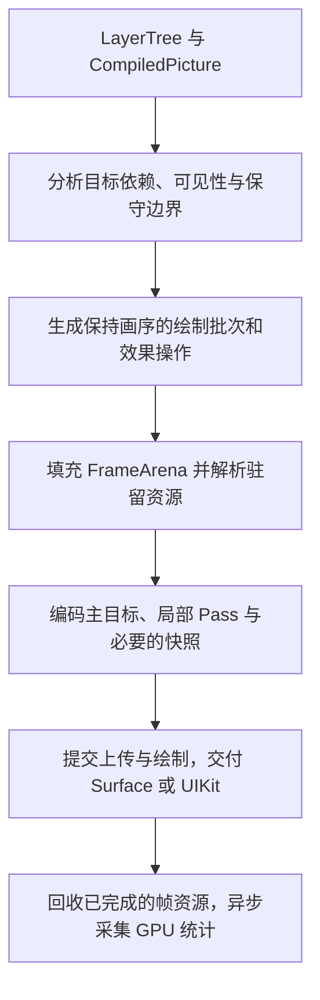

# Impasto `wgpu` 渲染管线演进设计

## 1. 范围与架构约束

本文以 `refactor/wgpu-rendering-pipeline` 的 `74fd743` 为实现基线，承接脱离 Impeller C API 后的性能、画质与能力演进。依赖基线为 `wgpu 30.0.2` 和 `parley 0.13.0`。继续采用方案三，普通 UI 由专用 Instanced RenderPass 绘制，文字使用 Glyph Atlas，Canvas 和大字号文字使用缓存的矢量网格。本文的阶段交付和性能数字均为待验证目标，基线以第 5 节的测量为准。P0 实现见 [P0 落地设计](wgpu-p0-optimization.md)，P1 的交付拆分与当前遥测口径见 [Telemetry 和 P1 计划](telemetry-and-p1-plan.md)。 [渲染管线架构](wgpu-rendering-pipeline.md) · [依赖锁文件](../Cargo.lock)

- `engine` 持有纯数据 `LayerTree`、`Picture` 和排版结果，`raster` 持有设备、资源、帧分析和编码，`embedder` 持有原生表面、调度和平台事务。跨队列传递自有数据，沿用 `SharedRender`、`Split`、`PlatformUi` 三种拓扑。P0–P2 的性能快路径保持现有渲染入口及场景语义，P2 色彩和 P3 功能的契约扩展随各自功能验收。 [仓库约束](../AGENTS.md) · [Raster 入口](../crates/raster/src/lib.rs#L89) · [宿主帧流水线](../crates/embedder/common/src/host.rs#L842)
- 保持 `just boundaries` 通过。`engine` 默认构建保持图形库和 JS 运行时隔离，`raster` 保持与 QuickJS 隔离，`javascript` 的宿主契约保持纯 `std`。渲染器主体使用安全 Rust。原生互操作若必须使用局部 `unsafe`，按仓库要求限定在互操作边界，写明豁免理由及安全不变量。P0 可由安全 Rust 实现。 [依赖与 Rust lint 约束](../AGENTS.md)
- 各后端共享绘制顺序、裁剪、Canvas 隔离、线性预乘合成及 SDR 输出语义。兼容路径使用同一组像素用例，在固定字体和输入下比较跨后端误差。新画质算法单独建立参考图和容差。Apple Metal、Android Vulkan/GLES、Linux Vulkan 作为主要验证路径，DX12 按功能验证目标设备。 [现有像素测试](../crates/raster/src/tests.rs) · [后端选择](../crates/raster/src/status.rs#L52)

## 2. 基线实现与成本

| 瓶颈 | 分支实现与可观测代价 |
|---|---|
| 每批次分配与 64 实例上限 | Rect、Glyph 和 Image 通过固定大小的实例 UBO 绘制。满尺寸 Rect/Glyph 实例区各为 10 KiB，带 Stop 绑定的管线即使绘制纯色也准备 8 KiB 的 Stop UBO。批次还会构建 View UBO 和绑定组。纯色批次遇到渐变时断开，Canvas Mesh 回放会重新上传顶点和索引。 [批次与绑定](../crates/raster/src/compositor.rs#L484) · [UBO 分配](../crates/raster/src/compositor.rs#L1167) · [实例布局](../crates/raster/src/batch.rs) |
| 全屏中间目标和 Pass 切分 | 根目标无条件经全屏 `main` 回贴。复杂裁剪逐 Scope 建全屏 `R8Unorm` 遮罩。效果组使用与当前目标等大的离屏纹理，`BackdropBlur` 已用节点边界限制回贴，但复制和滤波仍覆盖全目标。可硬件混合的 Canvas 操作沿用快照合成，每个 Mesh 单独绘制再回贴。 [根目标](../crates/raster/src/compositor.rs#L138) · [裁剪](../crates/raster/src/compositor.rs#L457) · [效果](../crates/raster/src/compositor.rs#L932) · [Canvas 编译](../crates/raster/src/compiler.rs#L623) |
| 设备能力只使用基线 | 设备请求沿用 `downlevel_defaults()` 和默认的空 feature 集合，图形管线未按已启用 feature、格式能力及 downlevel 标志选择实现。 [设备请求](../crates/raster/src/gpu.rs#L30) · [管线](../crates/raster/src/pipelines/mod.rs) |
| 同步检查与零碎上传 | 普通帧和 UIKit 切片路径同步弹出三个 error scope。图集按 miss 字形逐块提交 `write_texture`，常规 RGBA 图片在 CPU 上转换为预乘并只上传一层。 [提交](../crates/raster/src/lib.rs#L344) · [切片](../crates/raster/src/metal.rs#L29) · [错误检查](../crates/raster/src/gpu.rs#L95) · [图集上传](../crates/raster/src/atlas.rs#L503) · [图片上传](../crates/raster/src/textures.rs#L43) |
| 深度与模板未参与绘制 | 管线的 `depth_stencil` 为空。实心遮挡仍依赖画家顺序，Canvas 路径裁剪走纹理覆盖率。 [管线状态](../crates/raster/src/pipelines/mod.rs#L215) · [路径裁剪](../crates/raster/src/compiler.rs#L674) |
| 画质与输出能力受限 | 阴影使用 SDF 距离近似，上下采样共用同一个九采样核，缩图缺少 mipmap。内部 SDR 根目标是 `Rgba8UnormSrgb`，窗口优先使用适配器提供的 sRGB 格式与色彩空间。 [阴影](../crates/raster/src/pipelines/ui.wgsl#L166) · [模糊](../crates/raster/src/pipelines/blur.wgsl#L39) · [Surface 配置](../crates/raster/src/surface.rs#L320) |

## 3. 目标设计

### 3.1 能力分层与回退

`GpuCaps` 属于设备代次。设备请求前读取 `AdapterInfo`、`features()`、`limits()` 和 `get_downlevel_capabilities()`，查询实际所需的格式用途、过滤、混合和采样数。设备创建后分别记录探测到与实际启用的能力，Surface 格式和色彩空间在配置时另行协商。Tier 用于描述可用路径和采集数据，具体快路径依据自己的能力条件。 [设备请求 API](https://docs.rs/wgpu/30.0.2/wgpu/struct.Adapter.html) · [DownlevelFlags](https://docs.rs/wgpu/30.0.2/wgpu/struct.DownlevelFlags.html)

| 层级 | 启用条件与用途 | 回退 |
|---|---|---|
| Tier 0 基线 | 以 `downlevel_defaults()` 为起点，核验运行所需的缓冲尺寸、对齐、顶点属性和图集层数。实例顶点缓冲、动态 Uniform Offset、`texture_2d_array` 支持基线渲染，典型目标为 Android GLES 和软件适配器。 | 按缓冲或 Stop 页预算分批。单层或临时页使用同类图集布局。格式不支持目标 MSAA 时走单采样兼容路径。 |
| Tier 1 Storage 与 Compute | 按着色器所用阶段探测 `VERTEX_STORAGE`、`FRAGMENT_STORAGE` 和对应绑定上限，按 Compute 用途探测 `COMPUTE_SHADERS`、workgroup 上限及存储纹理格式。按需请求上限，匹配适配器的最小偏移对齐。模板及瞬态附件另按格式和生命周期选择。 | 实例顶点缓冲、动态 UBO、RenderPass 滤波和覆盖遮罩。 |
| Tier 2 原生扩展 | 按功能请求 `IMMEDIATES` 与 `max_immediate_size`、时间戳、`DUAL_SOURCE_BLENDING`、`SHADER_F16`、`SUBGROUP`、`TEXTURE_BINDING_ARRAY` 和采样纹理非一致索引。`PIPELINE_CACHE`、`MULTI_DRAW_INDIRECT_COUNT`、`FLOAT32_FILTERABLE` 分别按使用场景探测。 | 动态偏移、逐材质绑定、FP32、灰阶文本、普通提交和内存管线缓存。 |

设备请求只启用已实现路径所需的可用 feature 和 limits。若可选配置无法创建，重试该适配器的基线配置，随后沿用宿主的后端选择与设备恢复。Android 已知故障的模拟 Vulkan 适配器继续按现有规则处理。`texture_2d_array` 是一个纹理的多层视图。P2 的多纹理绑定数组是独立能力，按实例索引同时要求 `SAMPLED_TEXTURE_AND_STORAGE_BUFFER_ARRAY_NON_UNIFORM_INDEXING`。资源数组放入独立材质绑定组，Uniform Buffer 和动态偏移留在帧绑定组。`RenderBundle` 依据录制 Pass 的兼容性使用。 [现有后端防护](../crates/raster/src/gpu.rs#L44) · [wgpu Features](https://docs.rs/wgpu/30.0.2/wgpu/struct.Features.html) · [绑定布局限制](https://docs.rs/wgpu/30.0.2/wgpu/struct.BindGroupLayoutEntry.html) · [RenderBundleEncoder](https://docs.rs/wgpu/30.0.2/wgpu/struct.RenderBundleEncoder.html)

### 3.2 帧数据、合批与资源驻留



1. **上传与生命周期**。Raster 队列管理持久 `FrameArena` 和可复用 CPU staging，按逻辑帧追加实例、变换、裁剪、效果参数和渐变 Stop。初始按宿主双帧容量设计环形槽，GPU 完成信号决定槽和 staging 的安全回收，环满时使用预算内空闲块或按宿主既有节奏延后。扩容时追加缓冲块，已经编码的偏移和资源句柄持续有效。所有 UIKit 切片共用一次 begin、append 和 flush，上传必须先于整批绘制提交。失效或放弃提交时释放未提交租约，已提交资源按队列完成回收。 [帧深度](../crates/embedder/common/src/host.rs#L842) · [UIKit 切片提交](../crates/raster/src/metal.rs#L29) · [提交完成 API](https://docs.rs/wgpu/30.0.2/wgpu/struct.Queue.html#method.on_submitted_work_done)
2. **绑定布局**。`@group(0)` 按缓冲块复用，持有变换、裁剪和 Stop 表或它们的动态 UBO 窗口。`@group(1)` 绑定长期资源及 Sampler，图集数组和 `GpuImage` 按设备代次、视图、采样方式和布局缓存。复杂遮罩或背景纹理使用池化视图和按需的额外绑定组。数组或缓冲换代时保留旧绑定至使用它们的提交完成。Tier 0 用实例顶点缓冲切片和动态偏移，实例绘制可从 0 起始，Tier 1 可用表索引，具备 `IMMEDIATES` 时用 `set_immediates` 传递少量 per-draw 参数。 [当前绑定布局](../crates/raster/src/pipelines/mod.rs#L33) · [图片代次](../crates/raster/src/textures.rs#L17) · [set_immediates](https://docs.rs/wgpu/30.0.2/wgpu/struct.RenderPass.html#method.set_immediates)
3. **批次与数据布局**。P0 移除固定 64 实例切块，按相邻画序、目标、管线、裁剪、混合和资源兼容性合批。纯色、描边、阴影与渐变 Rect 在兼容状态下共享实例批，渐变持有帧内 Stop 偏移和个数。Tier 0 的 Stop 池按合法 Uniform 窗口分页，超页时分批，保留每条渐变的 Stop 列表与顺序。P1 再拆冷热字段，Glyph 热字段目标 32–40 B，Rect 热字段约 64 B，复杂绘制参数进入 `PaintExtra` 表。UV、颜色编码精度和布局预算由像素用例与上传统计验证，渐变文字和彩色字形覆盖在内。 [当前实例与 Stop 编码](../crates/raster/src/batch.rs) · [渐变采样](../crates/raster/src/pipelines/ui.wgsl#L81)
4. **Picture 资源驻留**。CPU 剖分几何仍由 `CompiledPicture` 缓存，GPU 顶点和索引在编译结果首次驻留时上传到设备代次内的 `MeshBufferPool`。对不支持 `BASE_VERTEX` 的路径使用预偏移索引或按网格绑定切片。Picture 淘汰、缩放导致的重新剖分以及设备恢复各自更新驻留，旧范围在使用它的提交结束后回收。P2 对稳定绘制录制 RenderBundle，并按几何版本、目标格式、采样数、深度模板状态及资源代次失效。只有绑定指向稳定地址时，滚动才能只更新变换数据并复用 Bundle。并行编译先限于 CPU 任务，由 Raster 队列安装结果。 [编译结果](../crates/raster/src/compiler.rs#L132) · [编译缓存入口](../crates/raster/src/lib.rs#L220) · [RenderBundle 兼容条件](https://docs.rs/wgpu/30.0.2/wgpu/struct.RenderBundleEncoderDescriptor.html)

### 3.3 主目标、离屏效果与硬件合成

- **评估目标是否需要读回**。按 Layer 和 Picture Scope 识别 `BackdropBlur`、`Multiply` 等读目标操作，归属到实际被读取的目标。只从子目标读背景的效果留在子目标。对可直接写入的 sRGB Surface、headless 或 UIKit 切片，直接清屏并绘制，首次绘制合并 `LoadOp::Clear`。根目标需要读取且 Surface 用途不足，或输出需要显式编码时，经可读中间目标回贴。保持效果读取的是其绘制位置之前的内容，UIKit 切片只读取该切片契约允许的背景。 [当前回贴](../crates/raster/src/compositor.rs#L138) · [Surface 用途](../crates/raster/src/surface.rs#L320) · [UIKit 事务](../crates/embedder/ios/src/compositor.rs)
- **裁剪**。像素对齐的轴对齐矩形使用 scissor，圆角、旋转矩形和分数像素边缘进入有界解析栈，以逆变换求各级覆盖率并保持嵌套边缘语义。共享等价的裁剪状态，深栈、不可逆变换或路径裁剪走兼容路径，已有语义允许时复用局部遮罩。P1 为适合的 Canvas 路径引入 stencil 写入与测试，验证 `NonZero`、`EvenOdd`、嵌套恢复及抗锯齿，无法以 stencil 保持覆盖率的路径继续用遮罩。 [现有裁剪状态](../crates/raster/src/compiler.rs#L34) · [现有遮罩生成](../crates/raster/src/compositor.rs#L457)
- **效果边界与纹理池**。对 `Opacity`、`Blur`、`Blend` 从编译后的图元和子树求保守绘制边界，包含变换、未裁剪溢出、描边、阴影和抗锯齿外扩。指令上的布局盒用于提供已知的语义约束，遇到无界 Fill 或无法可靠求界的绘制时沿用现有裁剪和目标范围。将场景坐标转换为物理像素并向外取整，区分纹理分桶尺寸、内容有效区和目标内偏移。以 64 px 桶按格式、用途及采样数复用，采样限制在有效区，池预算纳入分桶浪费。 [图层字段](../crates/engine/src/scene/layer.rs#L64) · [指令字段](../crates/engine/src/scene/command.rs#L57) · [现有效果实现](../crates/raster/src/compositor.rs#L932)
- **局部 `BackdropBlur`**。先算受裁剪影响的回写域，再按设备像素中的 `3σ` 和实际滤波足迹外扩独立的取样域，限制在源目标有效区。拷贝局部矩形，经该子区的模糊链后仅回贴到回写域。背景取样可跨过回写裁剪边界，不能跨到未定义的桶内像素。嵌套模糊及被视口裁切的区域保留现有边缘行为。 [现有复制与模糊链](../crates/raster/src/compositor.rs#L1026)
- **Canvas MSAA**。兼容的连续 Mesh 共用局部 MSAA 目标，一次 resolve，随后合成回父目标。保持画序，遇到读目标、状态不兼容或需要保留逐路径覆盖的重叠边缘时切段。对可验证的简单路径评估解析边缘覆盖，P2 再评估 Stencil-then-Cover 或 Compute Sparse Strips。 [现有 Mesh 绘制与回贴](../crates/raster/src/compositor.rs#L591)
- **深度、模板与瞬态附件**。P1 对经证明全覆盖的实心区域写入按画序编码的深度，允许兼容原语在同一段内前到后绘制。半透明、圆角抗锯齿边、破坏性混合及效果边界维持既有次序。`Depth24PlusStencil8` 或 MSAA 纹理满足单 Pass 生命周期时使用 `TRANSIENT_ATTACHMENT`，采用 clear 和 `StoreOp::Discard`，跨 Pass 需保留的附件另行处理。TBDR 的片上驻留和 Early-Z 收益用实机测量。 [附件用途](https://docs.rs/wgpu/30.0.2/wgpu/struct.TextureUsages.html#associatedconstant.TRANSIENT_ATTACHMENT)

硬件混合按目标格式、采样数、覆盖率和操作的合成单位选择。下表中的颜色为线性预乘值。`Clear` 绘制时以几何覆盖率作源 Alpha，只有清空整个当前目标的语义才使用 attachment clear。 [现有混合公式](../crates/raster/src/pipelines/blur.wgsl#L60) · [Porter–Duff 与 Screen](https://www.w3.org/TR/compositing-1/)

| 操作 | 候选 `BlendState` 的源 / 目标因子 |
|---|---|
| `SourceOver` | `One` / `OneMinusSrcAlpha` |
| `Clear`、`DestinationOut` | `Zero` / `OneMinusSrcAlpha` |
| `DestinationOver` | `OneMinusDstAlpha` / `One` |
| `Xor` | `OneMinusDstAlpha` / `OneMinusSrcAlpha` |
| `Screen` | RGB 用 `One` / `OneMinusSrc`，Alpha 用 `One` / `OneMinusSrcAlpha` |
| `Lighter` | `One` / `One`，限于饱和与裁剪顺序等价的目标和覆盖条件 |

`Lighter` 的分数覆盖率若施加在饱和计算之后，或浮点目标需要显式限幅，保留 shader 合成。隔离组、网格、九宫格或文字有多个重叠片元时，以原操作的合成单位应用混合。可先绘入局部源目标再硬件回贴，使 `Screen` 组仍能去掉目的快照。`Multiply` 保留局部目的快照。`Opacity` 只在单图元或可证明互不重叠时折叠到预乘颜色。 [现有效果组](../crates/raster/src/compositor.rs#L932) · [Canvas 合成单位](../crates/raster/src/compiler.rs#L623)

### 3.4 Compute、图集与画质

- **图集**。P0 将普通 Mask 和 Color 页迁移到各自的 `texture_2d_array<f32>`，实例携带页号和类型，跨普通页可在同一批中采样。按脏块或脏带合并为帧级 staging 上传，记录调用数与额外上传字节。`copy_buffer_to_texture` 路径遵守行对齐，确保被回收页的 gutter 清零。超大字形和预算溢出保留临时页，图集增长保障同帧已编码切片读到旧绑定对应的数据。P1 验证小字号 Gamma、Stem-Darkening 和输出条件允许时的双源 LCD 混合。LCD 限于已知 RGB 排列、对齐且背景适用的目标，其他场景继续用灰阶。大字号和较大缩放文字使用 Swash 轮廓与 Lyon 网格。彩色字形沿用图集。 [现有图集](../crates/raster/src/atlas.rs) · [纹理拷贝布局](https://docs.rs/wgpu/30.0.2/wgpu/struct.TexelCopyBufferLayout.html)
- **滤波**。P1 先以 RenderPass 实现区分的 5-tap 下采样和 8-tap 加权上采样作为 Dual-Kawase 基线。对大半径局部模糊比较 Compute 的 workgroup 共享内存分离高斯，以及 Compute 版 Dual-Kawase。按边界、半径、格式和设备测得的交叉点选择路径，`SUBGROUP` 作为有实测收益时的独立变体。 [现有模糊核](../crates/raster/src/pipelines/blur.wgsl#L39)
- **图片与渐变**。原始图片字节经 sRGB 采样解码后在线性空间预乘。Compute 写入支持 storage 用途的线性格式，或用 RenderPass 写 sRGB 渲染目标。长边至少 128 px 的普通图片生成预乘 mip，采用最近 mip 层上的双线性过滤。保留最近邻、九宫格边界和外部纹理的采样契约。多 Stop 渐变可缓存为 LUT，从 256 个采样点起验证色差、硬停靠点及重复 Stop，对精度不足的梯度保留逐 Stop 求值。大场景 GPU 剔除和 indirect draw 在 P2 独立基准验证，剔除后的合成顺序仍受第 3.3 节约束。 [图片上传](../crates/raster/src/textures.rs#L43) · [现有渐变求值](../crates/raster/src/pipelines/ui.wgsl#L81) · [适配器格式能力](https://docs.rs/wgpu/30.0.2/wgpu/struct.Adapter.html#method.get_texture_format_features)
- **WGSL 与阴影**。将 View、渐变与 SDF 的共享逻辑统一拼装，利用 `override` 评估纯色、无复杂遮罩和支持 FP16 的变体。FP16 仅用于满足误差预算的运算。用 Evan Wallace 的二维高斯积分近似替换阴影的单距离近似，以小矩形、尖角及大半径对比参考。四角半径和连续曲率由明确的几何契约共享于绘制和裁剪。 [现有阴影核](../crates/raster/src/pipelines/ui.wgsl#L166) · [Evan Wallace 算法](https://madebyevan.com/shaders/fast-rounded-rectangle-shadows/) · [编译特化](https://docs.rs/wgpu/30.0.2/wgpu/struct.PipelineCompilationOptions.html)
- **输出色彩**。P1 在可控制的最终 8-bit 输出阶段验证 IGN 抖动，只对 RGB 量化应用。测量抖动所需的额外 Pass 成本，P0 的普通直绘用例继续以零根 Copy 验收。P2 从 `SurfaceCapabilities::format_capabilities` 枚举显式宽色域格式，通过 `color_spaces(format)`、适配器格式能力和系统显示能力协商 Display P3 或 `Rgba16Float` / `ExtendedSrgbLinear`。为场景颜色补充原色、传递函数和参考范围契约，在线性工作空间做预乘与合成，明确色域转换、SDR 回退及 HDR 映射。`FLOAT32_FILTERABLE` 只影响使用 32 位浮点分量的过滤路径。 [现有颜色定义](../crates/engine/src/scene/paint.rs#L3) · [SurfaceCapabilities](https://docs.rs/wgpu-types/30.0.2/wgpu_types/struct.SurfaceCapabilities.html) · [SurfaceColorSpace](https://docs.rs/wgpu-types/30.0.2/wgpu_types/enum.SurfaceColorSpace.html)

### 3.5 可观测性、表面与应用扩展

- **错误处理**。P0 将同步 scope 移出普通帧和 UIKit 切片的编码、提交路径，初始化、管线构建、冷路径分配和显式校验仍可使用严格 scope。由现有设备丢失回调与 uncaptured error 回调维护设备代次的状态，在帧边界处理 `DeviceLost`、`OutOfMemory`、`PresentFailed`，覆盖宿主 trim/recovery。异步错误可能晚于提交返回，记录其设备代次和可用的提交上下文。保留截图读回和 UIKit `waitUntilScheduled` 本身要求的同步。 [当前 scope](../crates/raster/src/gpu.rs#L95) · [宿主恢复入口](../crates/embedder/common/src/host/raster_host.rs#L399)
- **管线缓存**。Android Vulkan 在应用私有目录保存本进程由 `PipelineCache::get_data` 生成的数据。文件名结合适配器、驱动、版本和 shader 哈希，写入经后台原子替换，内容校验失败时从空缓存开始。 [wgpu PIPELINE_CACHE](https://docs.rs/wgpu/30.0.2/wgpu/struct.Features.html#associatedconstant.PIPELINE_CACHE) · [磁盘缓存安全契约](https://docs.rs/wgpu/30.0.2/wgpu/struct.Device.html#method.create_pipeline_cache)
- **GPU 计时**。P1 用 `TIMESTAMP_QUERY` 在 Pass descriptor 配置起止时间戳，只有 Pass 内额外采样才请求 `TIMESTAMP_QUERY_INSIDE_PASSES`。Resolve 后异步 map 专用读回槽，按队列时间戳周期转换为 μs，关联帧号、设备代次和切片。通过宿主诊断数据送到 DevTools，显示 CPU 编码、GPU 包围耗时和逐 Pass 耗时。未采样、不支持及帧号过期的数据有明确的缺省状态，避免错配成当前帧的 0 μs。 [时间戳 API](https://docs.rs/wgpu/30.0.2/wgpu/struct.RenderPassTimestampWrites.html) · [诊断类型源](../crates/embedder/common/src/diagnostics/module.rs#L72) · [DevTools 性能面板](../packages/devtools/src/pages/performance.tsx)
- **表面步调**。显式把 Surface `desired_maximum_frame_latency` 设为宿主双帧深度 2，这也是 `wgpu` 当前的默认提示值。桌面按支持情况评估 `Mailbox`，移动端默认 `Fifo` 并按实测评估 `FifoRelaxed`。透明窗口按支持的 `CompositeAlphaMode` 协商，验收预乘输出、实际排队延迟和掉帧。Surface 参数是后端提示，实际交换链队列深度由后端决定。 [SurfaceConfiguration](https://docs.rs/wgpu-types/30.0.2/wgpu_types/struct.SurfaceConfiguration.html) · [现有 Surface 配置](../crates/raster/src/surface.rs#L320)
- **Android 外部纹理**。Android 13 起使用 ImageReader 帧租约和生产者 fence。Vulkan 可直接采样整帧 RGBA 和支持双平面绑定的 NV12。厂商不透明 YUV 通过 `VkExternalFormatANDROID` 和不可变 YCbCr 采样器在同一条 GPU 队列中转换为 sRGB 纹理，转换使用驱动建议的模型、范围和色度位置。Vulkan 显式获取和归还外部队列所有权，转换或最后一次直接采样结束后释放 Image 租约。裁剪帧和不支持的格式保留 CPU 上传。 [Android 宿主导入](../crates/embedder/android/src/app/hardware_frame.rs) · [Vulkan 互操作](../crates/raster/src/android_vulkan.rs)
- **应用层能力与合成调度**。Runtime Effect 由 `engine::scene` 表达效果标识、参数及受控输入，Raster 在管线编译前校验 WGSL 入口和执行预算。`<GpuView>` 的生产者向同设备纹理提交命令，Raster 把该纹理作为普通场景内容合成。Split 和 PlatformUi 拓扑中的 Raster 可以直接处理满足准入条件的二维变换、透明度、滚动惯性和着色器标量。4×4 透视单独安排，涉及投影裁剪、命中反投影与 UIKit 层合成。 [图层契约](../crates/engine/src/scene/layer.rs) · [合成线程验收](telemetry-and-p1-plan.md#p31-合成线程验收)

### Runtime Effect 与 GPU View

应用从 `@impasto/solid-ui` 调用 `createShaderProgram(source, { animated: true })` 并把句柄交给 `<ShaderEffect program={program} />`。同一 Session 内相同源码和时钟选项共享句柄。组件的布局内容盒决定 WGSL 参数 `local_pos` 和 `size`，单位为逻辑点。程序返回线性 sRGB 非预乘颜色，Raster 负责裁剪覆盖、预乘和最终输出色彩转换。 [场景契约](../crates/engine/src/scene/shader.rs) · [应用组件](../packages/solid-ui/src/ShaderEffect.tsx)

WGSL 定义 `fn effect_main(local_pos: vec2<f32>, size: vec2<f32>) -> vec4<f32>`，通过 `effect_uniform(index)` 读取打包的小端 f32 参数，通过 `effect_sample(index, uv)` 读取最多四个纹理。普通输入使用 Image 地址，`shaderBackdropTexture` 读取当前目标中在效果之前绘制的像素。`uv` 使用 0–1 归一化坐标，输入暂缺时返回透明。`animated: true` 按预测呈现时间更新 `effect_time()`，单位为秒，静态程序的时钟值为 0。源码编译失败时保留底下的正常 UI，并记录 shader 标识和诊断。 [WGSL 包装](../crates/raster/src/pipelines/runtime_effect.wgsl) · [校验](../crates/raster/src/runtime_effect.rs)

通过 `<ShaderEffect controller={setController} />` 获取控制器后，可以调用 `animateUniform(index, target, durationMs, easing?)`。动画从当前参数值开始，以 `CompositorTrack` 写入目标 Picture 的 Uniform。结束或交接时，UI 同步最后呈现的值，同一动画在 UI 回退时使用相同曲线。 [控制器接口](../packages/solid-ui/src/ShaderEffect.tsx) · [动画写回](../crates/engine/src/tree/shader.rs)

`<GpuView producer="my-id" />` 的内容来自宿主通过 `boot.with_gpu_view(GpuViewId::new("my-id")?, producer)` 注册的同设备生产者。生产者使用 `GpuContext` 的设备和队列上传资源，从 `prepare_or_render` 返回绘图命令缓冲，输出线性预乘颜色。Raster 使用物理像素尺寸分配目标纹理。纹理首次绘制和重建时单独提交并同步验证，暖帧将生产者命令放在主帧命令之前，同批提交。GPU 计时使用 1×1 临时附件。设备代次改变后，生产者通过 `on_device_lost` 释放上一代资源，并在下一次绘制中建立新资源。 [生产者接口](../crates/raster/src/gpu_view.rs) · [应用组件](../packages/solid-ui/src/GpuView.tsx)

Gallery 的「GPU 实验室」可从「我的」页进入，也可直接启动。直接启动只挂载验收页，宿主仍可采集独立的 Perfetto trace。默认画面包含基于合成时钟的 WGSL 衍射条纹与叠加背景模糊的同设备生产者。用 `--url impasto://gpu-lab/invalid` 直接进入无效 WGSL 用例，预览保留应用背景。省略 `IMPASTO_DUMP` 可在窗口中切换着色器、暂停条纹、调整条纹强度、关闭背景模糊或调整窗口尺寸。

```sh
just gallery-dist
IMPASTO_DUMP=/tmp/impasto-gpu-lab.png cargo run --locked -p embedder-macos -- \
  --js apps/gallery-solid/dist/quotes.js --url impasto://gpu-lab
```

## 4. 四阶段交付

先落第 5 节的基准场景与计数，再按同一设备、后端和场景比较改动。功能通过像素与恢复用例后启用，性能数字用于判断是否开启相应快路径。

| 阶段 | 交付与依赖 | 验收目标 |
|---|---|---|
| **Phase 1 / P0** | 先交付 `GpuCaps`、异步错误状态、帧计数和 `FrameArena`。再做分频绑定、Stop 池与 Rect 合批，直绘、解析裁剪、硬件混合、紧边界效果。最后接入 GPU Mesh 驻留、连续 Canvas MSAA 批次、图集数组与合并上传。每批改动都可使用基线渲染对照。 | 定义内暖帧的 `buffers_created` 和 `bind_groups_created` 均为 0。Gallery 首页 Draw Call 下降 70%–90%，通常为 1–3 个 RenderPass。固定的局部毛玻璃用例验证处理像素与离屏峰值下降目标 10×，GPU 耗时独立报告。500 条兼容 Canvas 路径目标为 1 个 MSAA Pass，回贴计入全帧 Pass。暖帧中复用的 Mesh 无重复几何上传。 |
| **Phase 2 / P1** | 依赖 P0 的帧生命周期、Pass 划分和统计。交付瞬态深度模板、精选实心 Early-Z、实例压缩和 WGSL 特化。引入 Compute 滤波、图片预乘与 mip、渐变 LUT，验证二维阴影、四角圆角、文本与抖动。接入 DevTools GPU 计时，按第 3.5 节评估磁盘缓存和表面步调。 | 实例上传字节减少 60%–75%，固定不透明叠层用例的过绘降低 40%–60%。验证缩略图滚动稳定、12–14 px 文本锐度和最终输出量化。DevTools 可关联逐 Pass GPU μs 与同帧 CPU 编码。 |
| **Phase 3 / P2** | 三槽 staging、Picture RenderBundle 与稳定的 Layer 状态槽、多纹理绑定数组、效果 immediates、SDR 颜色运算与 Compute 模糊缓存 FP16、Android Vulkan 磁盘缓存、AHardwareBuffer 与 NV12，以及 P3/HDR 表面与透明度协商。 | 目标档设备在万级列表用例中的 Raster CPU 编码 p95 < 0.5 ms。兼容且容量足够的图片网格批次目标为 1 Draw Call。支持的系统与显示器验证色域及 EDR，支持的 Android 设备验证视频帧 CPU 拷贝次数为 0。 |
| **Phase 4 / P3** | 合成线程动画、并行 Picture 编译、脏矩形与高成本子树缓存、Runtime Effect 和 `<GpuView>`。 | 支持应用层自定义特效及同设备纹理合成。开启 120 Hz 的真机验证仅由合成线程驱动的动画达到 8.33 ms 帧预算，并记录错过的 vsync、UI 队列唤醒和平台视图行为。 |

P3 的脏矩形重绘要求可靠的历史内容与损伤传播。Surface 图像无法提供上一帧内容时，使用可保留的合成目标或全量重绘。离屏特效、背景读取和外部纹理换帧都传播损伤，子树缓存受内存预算及内容、比例、色域、设备代次失效约束。

### Picture 驻留与兼容路径

RenderBundle 缓存以编译代次、图层位置、目标格式和图片修订为键。矩形、单材质图片和灰阶文字在同一绘制范围与资源连续两帧命中后录制 Bundle。滚动只更新有变化的 Uniform 槽，连续脏槽与新顶点合并至同一帧的 staging 上传。没有暂存复制的帧直接提交绘制。阴影与填充在同一 Bundle 中保持画序，各自使用独立管线。平移长列表可按编译期的连续 Scope 边界剔除整个视口外分块。灰阶字形额外校验 Atlas 代次、线性变换、DPR 和分数像素位置，复用时固定本帧使用的图集页。动态媒体、复杂遮罩、渐变文字和效果组可以继续使用帧内上传。设备内存压力清理驻留缓存，设备恢复通过当前 LayerTree 重建 GPU 资源。 [Picture 驻留和回放](../crates/raster/src/compositor/resident.rs) · [GPU 分配器](../crates/raster/src/resident.rs)

普通圆角阴影将采样点折叠到近角，超过 3σ 的角部积分按高斯尾部裁剪。非对称曲率继续逐角积分。编译器维持阴影和相邻绘制的顺序，连续同裁剪的 Bundle 可在一次调用中提交。 [阴影着色器](../crates/raster/src/pipelines/ui.wgsl)

Android 转换 shader 的 GLSL 源与 Vulkan SPIR-V 位于 [android_vulkan](../crates/raster/src/android_vulkan)。修改 GLSL 后在该目录执行 `glslangValidator -V -Os yuv.vert -o yuv.vert.spv` 和 `glslangValidator -V -Os yuv.frag -o yuv.frag.spv`，再用 `spirv-val --target-env vulkan1.1` 验证两个产物。 [Vulkan ExternalFormat](https://docs.vulkan.org/refpages/latest/refpages/source/VkExternalFormatANDROID.html)

Display P3 在线性 sRGB 浮点工作缓冲中合成，在输出时转换到 P3。HDR 表面输出线性扩展 sRGB。场景渐变的 `ExtendedLinear` 字节输入范围为 0 到 SDR 白点。透明表面按支持的 Alpha 模式协商，后乘模式在输出阶段转换为非预乘 RGB。 [颜色定义](../crates/engine/src/scene/paint.rs) · [表面配置](../crates/raster/src/surface.rs)

## 5. 基线、统计与验证

### 5.1 测量约定

以 `74fd743` 或只有基准与计数变更的等价提交建立基线，性能用 Release 构建。每次报告记录提交、后端、适配器及驱动、能力档、场景参数、视口和 DPR、刷新率、窗口模式、帧数与采样开关。对比相同轨迹、相同固定字体和资源。报告首帧、暖帧 p50/p95 与丢帧，区分 CPU 编码、Surface 获取、提交、GPU 执行和测试读回。软件 Vulkan 用作功能与确定性计数验证，移动带宽和帧步调用实机数据。

暖帧在工作集、容量与管线均已热身后开始，固定视口、图集驻留集和设备代次。分别统计冷启动、布局增量、图集溢出及设备恢复，避免暖帧口径掩盖扩容代价。GPU 时间戳关闭和开启各测一次，报告采集开销。 [现有统计入口](../crates/raster/src/lib.rs#L70) · [提交 Trace](../crates/embedder/common/src/host/raster_host.rs#L341)

| 数据 | 定义 |
|---|---|
| `draws`、`passes` | 统计实际编码的 draw 和 RenderPass，区分 MSAA、效果、清屏及根回贴，另统计 Compute Pass 与复制命令。UIKit 按逻辑帧汇总并保留切片明细。Bundle 启用后保留其中的逻辑 draw 数。 |
| `buffers_created`、`bind_groups_created` | 统计归属于该 Raster 帧的创建次数，覆盖分配器、临时绘制、缓存 miss 和效果路径。独立标记 IO 上传和截图资源。 |
| `offscreen_alloc_bytes`、峰值在用字节、`pooled_texture_bytes` | 分别记当帧新建离屏附件的估算字节、并发在用峰值和池驻留容量，含分桶与采样数。局部效果另记录复制像素及各模糊级处理像素。 |
| 实例、Mesh、图集上传 | 分别记录实际上传字节、调用数及驻留命中，报告图集按脏带合并造成的额外字节。 |
| `gpu_frame_us`、`gpu_passes` | 可缺省的 GPU 帧范围及逐 Pass 时长，注明时间戳覆盖范围。区分首尾范围与 Pass 耗时之和，复制或调度空档可能只计入前者。 |

### 5.2 可复现用例

| 场景 | 固定输入与观测项 |
|---|---|
| Gallery 首页与高频列表 | 对固定视口截取 Gallery 首页。另以固定轨迹滚动 1,000 个含圆角、阴影、渐变、头像与文字的卡片 120 帧，涵盖实际工作集热身，记录 draw、Pass、分配次数和编码耗时。 |
| CJK 与 Emoji 文本墙 | 固定字体与内容，测冷启动、暖帧及固定字号缩放轨迹。记录字形 miss、页增长、上传次数和跨页 draw，核对彩色字形、回收和边缘残影。 |
| 局部毛玻璃 | 在动态背景上合成 3 个固定尺寸浮层，记录视口、DPR、σ、实际复制区域、模糊像素与 GPU 耗时。加入相交圆角、嵌套效果及贴视口边缘的像素用例。 |
| 500 路径 Canvas | 分开测连续兼容的 `SourceOver` 路径，以及含 `clearRect`、透明重叠、路径裁剪和混合模式的动态图表。报告 MSAA Pass、回贴数、Mesh 上传及剪裁效果。 |

无窗口回归使用 `IMPASTO_TEST_GPU=1 cargo test -p raster`。性能用例可沿用 `just bench` 的 Release ignored test 入口，确保要求的适配器确实可用，并记录跳过原因。像素用例覆盖直绘与兼容路径、分数覆盖率、溢出、透明 Canvas、图集换代及设备恢复。 [Raster 测试](../crates/raster/src/tests.rs) · [验证配方](../justfile)

### 5.3 宿主验证

- **macOS Metal**。以 `just host` 和 `IMPASTO_DUMP=/tmp/impasto.png` 核对 Gallery，采集实机帧数据。Raster 资源生命周期变更同时跑 macOS 宿主测试。
- **iOS Metal**。运行 `just ios-build-check`、`just ios-sim-test --debug --udid <UDID>` 与 `just ios-composition-test <UDID>`。真机复验 UIKit 多切片、资源增长、事务顺序与目标刷新率。
- **Android Vulkan/GLES**。运行 `just android-build-check` 与 `just android-device-test`。分别覆盖 Vulkan 真机和以 `IMPASTO_TEST_VULKAN=false` 验证的 GLES 回退。
- **Linux 软件 Vulkan 与桌面硬件**。CI 跑 headless 像素与边界。启用桌面 Vulkan 或 DX12 专属快路径时，在对应硬件上验证管线特化、呈现延迟及所用格式。
- **工程门禁**。按影响范围运行 `just check`、`cargo fmt --all -- --check` 和宿主检查。诊断类型改动从原生 Module 元数据重新生成声明并运行声明一致性检查。 [仓库验证入口](../AGENTS.md) · [CI 配置](../.github/workflows/check.yml)
