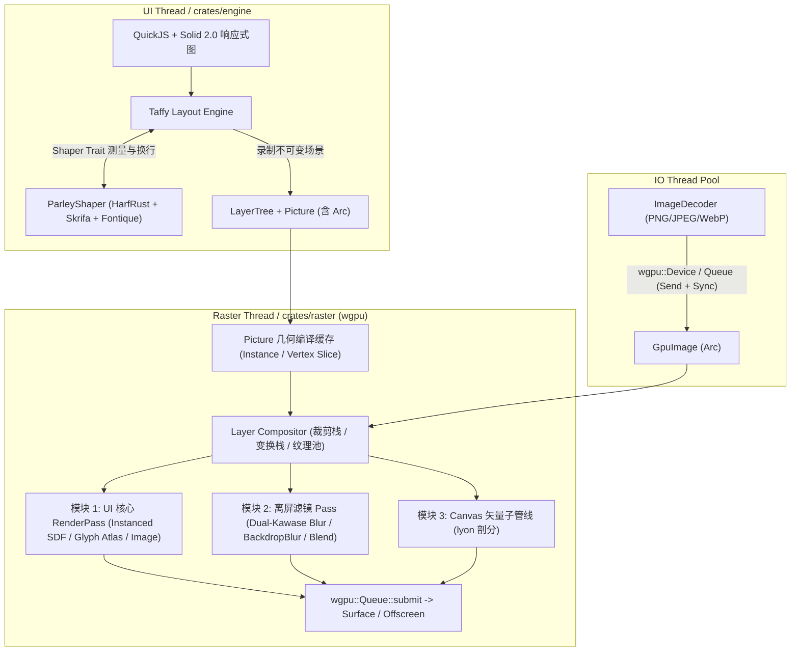

# Impasto `wgpu` 核心渲染与排版管线架构调研及方案设计

## 1. 适用范围与架构前提

本文档记录 Impasto 从 Flutter Impeller（Standalone C API）向 **Rust 原生 `wgpu` 渲染管线 + `parley` 字体排版管线**演进的技术调研、桌面端与移动端硬件架构对比，以及最终选定的**方案三（UI 专用 Instanced RenderPass + Glyph Atlas + 局部 Canvas 矢量加速）**的完整架构设计。

第 2 至 6 节记录迁移前的实现与选型。第 7 至 10 节给出接口设计和验收条件。

迁移后的 GPU 性能、画质及应用层 GPU 能力路线见 [wgpu 渲染管线演进设计](wgpu-rendering-evolution.md)。

### 1.1 运行与验证

| 范围 | 入口 |
|---|---|
| 离屏像素与排版 | `IMPASTO_TEST_GPU=1 cargo test -p raster`。macOS 使用 Metal，Linux CI 用 Mesa lavapipe 软件 Vulkan 逐个运行 Raster 用例 |
| macOS Gallery | `just host`。设置 `IMPASTO_DUMP=/tmp/impasto.png` 可导出首帧的 straight-alpha sRGB RGBA |
| iOS Gallery 和 UIKit 切片 | `just ios-sim-test --debug --udid <UDID>` 与 `just ios-composition-test <UDID>` |
| Android APK 与设备 | `just android-build-check` 与 `just android-device-test`。在 Vulkan 驱动不兼容的模拟器上设置 `IMPASTO_TEST_VULKAN=false` |
| 线程拓扑 | 在启动宿主前设置 `IMPASTO_THREAD_TOPOLOGY=shared`、`split` 或 `platform-ui` |

Android 的 `auto` 按 Vulkan、GLES 顺序选择。Android 模拟器上报告为 Goldfish GFXStream + SwiftShader 的 Vulkan 适配器在队列提交时发生原生崩溃，Raster 会拒绝该适配器，让 `auto` 落到 GLES。强制 Vulkan 在该驱动上返回设备不可用。真机 Vulkan 与 UIKit 事务仍需要独立的设备验收。

### 1.2 适用模块

本方案主要覆盖以下核心 crate 与平台宿主，并保持上游应用层与 JS 运行时契约不变：

- 场景与排版契约层：[`crates/engine`](../crates/engine/Cargo.toml)（Taffy 布局、`Shaper` Trait、不可变 `LayerTree` 与 `Picture`）
- 光栅与排版实现层：[`crates/raster`](../crates/raster/Cargo.toml)（替代对 [`crates/impeller-sys`](https://github.com/peterich-rs/Impasto/blob/492f186/crates/impeller-sys/README.md) 的依赖）
- 平台宿主层：[`crates/embedder/common`](../crates/embedder/common/src/lib.rs)、[`crates/embedder/macos`](../crates/embedder/macos/src/surface.rs)、[`crates/embedder/ios`](../crates/embedder/ios/src/compositor.rs)、[`crates/embedder/android`](../crates/embedder/android/src/surface.rs)

### 1.3 必须遵守的仓库硬性约束

根据 [`AGENTS.md`](../AGENTS.md) 与 [`tools/check-javascript-boundaries.py`](../tools/check-javascript-boundaries.py)，新管线必须严格守住以下边界：

1. **依赖隔离（`just boundaries`）**：
   - `crates/engine` 默认构建不得依赖 `raster`、`wgpu`、`rquickjs`、`quickjs-jit` 或任何平台原生图形库；`engine` 仅通过 [`engine::text::Shaper`](../crates/engine/src/text/shaper.rs#L194-L268) Trait 与 [`engine::scene::LayerTree`](../crates/engine/src/scene/layer.rs#L19-L24) 纯数据结构与光栅层解耦。
   - `crates/raster` 不得依赖 `rquickjs` / `quickjs-jit`。
   - `crates/javascript` 保持与 UI/图形 crate 完全隔离。
2. **安全编码规范**：
   - 遵循工作区 `unsafe_code = "deny"`、`unwrap_used = "deny"`、`expect_used = "deny"`（仅测试放行）。切换到纯 Rust 生态（`parley` + `wgpu`）后，原生表面句柄和 iOS Metal 互操作使用局部豁免，渲染器主体使用安全 Rust。
3. **线程拓扑与帧流水线**：
   - 必须完整支持 [`ThreadTopology`](../crates/embedder/common/src/lib.rs#L188-L199) 的三种模式：`Split`（默认，UI 与 Raster 分线程）、`SharedRender`（UI 与 Raster 同线程）、`PlatformUi`（UI 跑在平台主循环，Raster 独立线程），以及双帧流水线（[`FramePipeline::DEPTH = 2`](../crates/embedder/common/src/host.rs#L850)）。

---

## 2. 迁移前的 Impeller 管线

通过分析现有 [`crates/impeller-sys`](https://github.com/peterich-rs/Impasto/blob/492f186/crates/impeller-sys/README.md)、[`crates/raster`](../crates/raster/src/lib.rs) 与 [`crates/embedder/common`](../crates/embedder/common/src/host.rs)，迁移前的管线存在四个结构性痛点：

### 2.1 Standalone C API 处于上游“二等公民”位置，被迫维护私有补丁

Flutter 团队的重心在完整 Flutter Engine（Skia/Impeller + Dart Embedder），独立的 C Interop 接口（`impeller.h`）功能受限且上游响应慢，项目不得不自行维护源码补丁与私有导出符号：

- **平台构建补丁（[`crates/impeller-sys/patches/`](https://github.com/peterich-rs/Impasto/blob/492f186/crates/impeller-sys/patches/)）**：
  - `ios-interop.patch`：补齐禁用 GLES/Vulkan 时的条件编译，并额外扩展私有符号 [`ImpastoMetalTextureNew`](https://github.com/peterich-rs/Impasto/blob/492f186/crates/impeller-sys/src/lib.rs#L22)（零拷贝导入外部 `MTLTexture`）与 [`ImpastoMetalWaitUntilScheduled`](https://github.com/peterich-rs/Impasto/blob/492f186/crates/impeller-sys/src/lib.rs#L21)（UIKit 合成同步）。
  - `android-vulkan-shutdown.patch`：解决独立 Vulkan 上下文销毁时未调用 `ContextVK::Shutdown()` 导致的后台回收线程生命周期问题（还需在运行时通过 [`vulkan_has_safe_shutdown`](https://github.com/peterich-rs/Impasto/blob/492f186/crates/raster/src/vulkan.rs#L206-L216) 探测符号决定是否允许启用 Vulkan）。
  - `windows-modf.patch`：修复 Windows 平台下 `std::modf` 的编译问题。

### 2.2 Android Vulkan Swapchain 底层劫持脆弱

因为 Impeller Standalone SDK 内部创建 Vulkan Swapchain 时硬编码请求 `1×1` 的 `imageExtent` 且 Android 端未替换为窗口实际尺寸，[`crates/raster/src/vulkan.rs`](https://github.com/peterich-rs/Impasto/blob/492f186/crates/raster/src/vulkan.rs) 被迫通过 `dlopen("libvulkan.so")` 与 Thread-Local 状态（`CURRENT_PROCS`）拦截以下底层函数：

- `vkGetDeviceProcAddr`
- `vkCreateSwapchainKHR`（在函数调用栈上直接改写 C 结构体 `VkSwapchainCreateInfoKHR` 的 `extent_width` / `extent_height`）
- `vkAcquireNextImageKHR` 与 `vkQueuePresentKHR`（截获并缓存 `VkResult` 以识别 `VK_ERROR_DEVICE_LOST`、`VK_ERROR_SURFACE_LOST_KHR`、`VK_ERROR_OUT_OF_DATE_KHR`）

这种通过 ABI 结构体前缀偏移强行拦截 Vulkan loader 的做法对驱动与平台变体极为敏感。

### 2.3 构建工具链与产物分发极其沉重

- 源码构建需要拉取 Chromium `depot_tools`（`gclient`）与 Flutter `DEPS`，通过 GN + Ninja 编译多套 C++ 目标库。
- 仓库不得不在 [`crates/impeller-sys/prebuilt/flutter-77f043bc6319/`](https://github.com/peterich-rs/Impasto/blob/492f186/crates/impeller-sys/README.md#L16) 收录 11 个目标平台的预编译归档包。

### 2.4 分线程渲染（`ThreadTopology::Split`）下的排版断层与资源管理复杂度

这是当前制约多线程演进的最大架构瓶颈：

- **`!Send` 上下文导致的重复排版**：`ImpellerTypographyContext` 与 `ImpellerParagraph` 是非线程安全的 C++ 指针。在 [`crates/embedder/common/src/host.rs`](../crates/embedder/common/src/host.rs#L914-L980) 中，当启用 `Split` 拓扑时，宿主不得不在 UI 线程创建一套独立 `Typography::standalone()` 并注册字体，同时在 Raster 线程再创建另一套 `Typography` 并**注册第二遍字体**。UI 线程在 Taffy 布局阶段 shape 出的段落无法跨线程移交 Raster 线程，Raster 线程处理 [`Command::Text`](../crates/engine/src/scene/command.rs#L29-L42) 时必须重新执行一遍排版（shape）。
- **复杂的跨帧句柄保活**：由于 `ImpellerDisplayList` 内部持有弱引用或延迟释放资源，[`crates/raster/src/typography/paint_store.rs`](https://github.com/peterich-rs/Impasto/blob/492f186/crates/raster/src/typography/paint_store.rs) 与 [`HeldParagraph`](https://github.com/peterich-rs/Impasto/blob/492f186/crates/raster/src/player/mod.rs#L14-L18) 不得不维护复杂的槽位引用计数、滞后回收队列（`retired`）与显式失效标记，防止在 DisplayList 销毁前误释放段落。
- **异步纹理上传受限**：[`TextureFactory`](https://github.com/peterich-rs/Impasto/blob/492f186/crates/raster/src/player/upload.rs#L15-L23) 需要手动 `ImpellerContextRetain` 并标记 `unsafe impl Send`，且在 Android GLES 后端下被迫直接禁用（返回 `None`）。

---

## 3. 字体排版（Typography）生态选型与 Taffy 协同

[`crates/engine/src/text/shaper.rs`](../crates/engine/src/text/shaper.rs#L194-L268) 已经定义了极度清晰的排版抽象 `Shaper`，核心接口包括：

- 测量与布局：`metrics`、`intrinsic_width`、`min_content_metrics`、`measure_paint`、`metrics_paint`、`canvas_metrics`
- 编辑与命中测试：`caret_at_unit`、`caret_at_point`、`word_range`

### 3.1 候选方案对比

| 评估维度 | **Parley + Fontique + Skrifa + HarfRust**（Linebender 生态，**选定**） | **Cosmic-Text + Swash**（System76 生态） |
|---|---|---|
| **底层技术栈** | `harfrust`（HarfBuzz 的纯 Rust 移植）+ `skrifa`（Google 纯 Rust 字体解析，替代 FreeType）+ `fontique`（跨平台字体发现、注册与回退） | `harfrust` / `rustybuzz` + `swash` + `fontdb` |
| **与 Taffy / Engine 契合度** | **极高**。与 Impasto 已引入的 `taffy`、`kurbo` 同属 Linebender 生态；原生提供 `calculate_content_widths()`，直接对齐 Taffy `MinContent` / `MaxContent` 及 `Shaper::intrinsic_width` | 较高，但抽象偏重文本编辑器 Buffer 模型 |
| **富文本与 Span 能力** | 原生支持多级样式 Span 与自定义泛型 `Brush`（可携带 Impasto 的逻辑 Span 索引）、字重、斜体、下划线、删除线与 Inline Box | 支持 Span 属性，但对渐变前景等自定义 Brush 扩展不如 Parley 自然 |
| **CJK 与多语种 Fallback** | `fontique` + `parley` 原生基于脚本和字符覆盖自动触发字体回退，**可彻底移除** [`crates/raster/src/script.rs`](https://github.com/peterich-rs/Impasto/blob/492f186/crates/raster/src/script.rs) 的手工脚本切分逻辑 | 原生支持字体回退 |
| **光标与选区计算** | 内置 `Cursor::from_point` / `from_byte_index`、Upstream/Downstream Affinity 语义及单词边界识别，对齐 [`Caret`](../crates/engine/src/text/shaper.rs#L35-L43) | 内置完整编辑器光标操作 |
| **跨线程数据共享** | 将 `Layout<Brush>` 提取为标准库字形数据后跨线程共享 | `Buffer` 与 `LayoutRun` 可构建线程安全包装，但生态与 `kurbo` 联动较弱 |

### 3.2 选定方案：`ParleyShaper` 与 Taffy 协同设计

选择 **Parley + Fontique + Skrifa + HarfRust** 作为 Impasto 的统一排版核心：

1. **Taffy 双向约束测量**：
   - 在 `Taffy` 请求 `AvailableSpace::MinContent` / `MaxContent` 时，通过 `parley::Layout::calculate_content_widths()` 计算最小/最大内容宽度，混合方向文本按第 7.5 节处理。
   - 在已知可用宽度时调用 `break_all_lines(Some(max_width))` 完成折行与 `TextAlign` 对齐，由 `ParleyShaper` 处理 `TextOverflow::Ellipsis` 截断，并提取每行 `TextLine` 的 `baseline`、`ascent`、`descent`（同时满足 `Taffy` 的 `RowCrossAlign::Baseline` 和 `CanvasMetrics`）。
2. **UTF-8 与 UTF-16 偏移转换契约**：
   - `parley` 内部索引使用 UTF-8 字节偏移，而 Impasto 的编辑状态与 [`TextLine`](../crates/engine/src/text/shaper.rs#L51-L62)、[`Caret::unit`](../crates/engine/src/text/shaper.rs#L37) 使用 UTF-16 代码单元偏移。
   - `ParleyShaper` 在缓存已排版段落时附带一份紧凑的 UTF-8 ↔ UTF-16 索引映射（仅当文本包含非 ASCII 字符时构建，纯 ASCII 文本直接 $O(1)$ 零转换），保留 Impasto 的 UTF-16 光标与选区契约。
3. **一次排版，跨线程零拷贝复用**：
   - UI 线程完成排版后，将每行的字体引用、字形 ID、坐标、尺寸、装饰线和画刷索引冻结为不可变的 `Arc<ShapedParagraph>`（`Send + Sync`）。
   - `Arc<ShapedParagraph>` 可直接挂在 [`Command::Text`](../crates/engine/src/scene/command.rs#L29-L42)中随 `LayerTree` 发往 Raster 线程。**Raster 线程不再需要任何 `Typography` / HarfBuzz 排版上下文，也不再重复注册字体或二次 shape**。

---

## 4. `wgpu` 2D 渲染管线选型与桌面/移动端硬件架构对比

### 4.1 Impasto 场景负载画像

检查 [`crates/engine/src/scene/command.rs`](../crates/engine/src/scene/command.rs) 与 [`canvas.rs`](../crates/engine/src/scene/canvas.rs)，Impasto 的渲染指令天然分为两类负载：

1. **高频 UI 原语（占普通应用帧负载 ~95%）**：
   - `Command::Fill`、`Command::Rect`（含圆角、描边、线性/径向/扫描渐变、`Shadow` 与多层 `BoxShadow`）
   - `Command::Text`（纯色或 `SpanPaint::Gradient` 渐变文字、下划线/删除线）
   - `Command::Image`（`Fill` / `Fit` / `Crop` / `NineSlice`）
   - `PushClip`（矩形/圆角矩形裁剪）、`PushTransform`、`PushOpacity`、`PushBlur`、`PushBackdropBlur`、`PushBlend`（`Multiply` / `Screen`）
2. **通用 2D 矢量画布（占 ~5%）**：
   - `Command::Canvas` 内部的 `CanvasOp`：任意贝塞尔路径（`Move` / `Line` / `Quad` / `Cubic` / `Close`）、`NonZero` / `EvenOdd` 填充与裁剪、任意 2D 仿射矩阵 `ctm`、Porter-Duff 混合（`SourceOver` / `DestinationOver` / `DestinationOut` / `Multiply` / `Screen` / `Lighter` / `Xor`）及 `CanvasIsolation::Isolated` 离屏隔离。

### 4.2 三大 `wgpu` 候选方案对比

- **方案一：全量接入 `vello`（Compute Shader 管线）**
  - 使用 Vello Classic，将所有矩形、文字、阴影、画布全部转为矢量路径，每帧跑 8~10 个 Compute Shader 阶段在显存做 $16 \times 16$ 分块光栅化。
- **方案二：接入 `vello_gpu`（原 `vello_hybrid`，Sparse Strips 架构）**
  - CPU 使用 SIMD 生成稀疏条带（Sparse Strips），GPU 使用标准 RenderPass（Vertex + Fragment Shader）做光栅化与混合，规避重度 Compute Shader 兼容性问题。
- **方案三：UI 专用 Instanced RenderPass + 局部 Canvas 矢量加速（最终选定，类似 Zed GPUI / Flutter Impeller 核心思路）**
  - **UI 图元 Instancing（单 Pass 批处理）**：`Command::Rect`（含圆角、描边、渐变）、`BoxShadow`、`Command::Text`（Glyph Atlas 采样）、`Command::Image`（含 9-slice）以及圆角 `PushClip`，全部通过单个或少数几个 Instanced WGSL Shader 直接在 Fragment Shader 中用解析式 SDF（Signed Distance Field）完成；
    - 例如：Impeller 画一个带 `BoxShadow` 的圆角矩形需要创建高斯模糊 `ImageFilter` 并触发离屏模糊；而在 WGSL 中使用解析式圆角矩形高斯积分（Evan Wallace 算法），**只需画 1 个 Quad（零离屏纹理切换）**，在移动端 Tile-Based GPU（Apple GPU / Adreno / Mali）上 stays on-tile，带宽开销极低。
  - **Canvas 2D 矢量路径**：仅当遇到 `Command::Canvas` 中的任意贝塞尔路径时，才调用 `lyon`剖分并缓存该画布区域的几何。
  - **图层合成与毛玻璃（`Blur` / `BackdropBlur` / `Opacity` / `Blend`）**：由自研 `wgpu` Layer Compositor 显式管理离屏纹理池（Texture Pool），使用 **Dual-Kawase Blur**（降采样 + 升采样 2~4 Pass）实现 `PushBlur` 和 `PushBackdropBlur`，采样和 Pass 成本按设备实测。

### 4.3 深度辨析：为什么即使在桌面端，“全量 Vello Compute”也不是普通 UI 应用的最优解？

直觉上桌面端 GPU 算力充沛、驱动完善，似乎可以直接跑全量 Vello Compute 管线。但结合 Zed（GPUI）与 Flutter Impeller 的工程实践，全量 Compute 管线在非游戏类普通桌面 UI 应用中存在三个明显短板：

1. **固定流水线底座开销与笔记本功耗问题**：
   - Vello Classic 的设计靶心是包含数万条交叉曲线的复杂矢量图（SVG 地图、CAD 图形），通过海量并行分摊 8~10 阶段 Compute Pass 与多次 Pipeline Barrier 同步的固定开销。
   - 但在普通桌面应用中，绝大多数帧只是**光标闪烁、悬停高亮或列表轻微滚动**。全量 Compute 管线依然需要走完多阶段显存读写与同步屏障，显著拉高基础 GPU 占用与功耗，导致笔记本更易发热、续航缩短。
2. **小字号密集正文的锐利度劣势**：
   - 全量矢量引擎将文字当作纯几何轮廓做解析面积覆盖积分，在放大、旋转场景下表现优秀，但在桌面端显示 **12px~14px 的密集正文、行情数字或代码**时，由于缺乏字体 Hinting（像素网格对齐）与 Stem Darkening（笔画对比度补偿），渲染结果容易发虚或笔画偏细。
   - 采用 **Glyph Atlas（字形图集）** 时，单字光栅化阶段（`skrifa` + `swash`/`zeno`）可以完整保留 Hinting 与 Gamma 对比度补偿；绘制阶段只是对图集纹理的精准采样，清晰度接近原生操作系统控件，且每帧 GPU 成本极低。
3. **UI 特效（`BackdropBlur` 与 `BoxShadow`）合成本质不同**：
   - 在单一的 Compute 光栅 Pass 中途插入“读取当前背景像素 → 降采样模糊 → 叠加圆角毛玻璃前景”，必须打断 Compute 调度并落盘中间纹理；而 `BoxShadow` 若走多路径模糊更是开销成倍增加。
   - 在方案三的传统 RenderPass 架构中，`BoxShadow` 可在 Fragment Shader 内用解析式高斯积分**1 个 Quad 直接算完（0 次离屏 Pass）**；`BackdropBlur` 则天然适配多 Pass 纹理池调度。

### 4.4 桌面端 IMR vs 移动端 TBDR 硬件架构差异

虽然 `wgpu` 统一了图形 API（Metal / Vulkan / DX12 / GLES3），但桌面独显与移动端/Apple Silicon 芯片在微架构上截然不同：

| 对比维度 | **桌面端 GPU（Windows 独显 / 传统核显）** | **移动端 GPU（iOS Apple / Android Adreno & Mali）及 Apple Silicon** |
|---|---|---|
| **硬件架构** | **IMR（Immediate Mode Rendering）** | **TBDR（Tile-Based Deferred Rendering，分块延迟渲染）** |
| **硬件优势** | 显存带宽极大、Compute ALU 吞吐极高、RenderTarget 切换成本相对较低 | 片上集成超高速 **Tile Memory（On-Chip SRAM）**；同一个 RenderPass 内的像素混合、MSAA 解析、深度/模板裁剪**完全在片上完成，不消耗主存带宽** |
| **性能瓶颈** | 过量细碎的 CPU Draw Call 提交与状态切换 | **Compute Shader 绕过 Tile Memory 直接频繁读写系统主存**；以及频繁中途打断 RenderPass 导致 Tile 数据被迫 Flush（Load/Store 带宽爆炸、降频发热） |
| **方案三适配表现** | 通过 **Instancing 批处理**把成百上千个矩形/文字/图片合并为较少的提交，批次数受素材、裁剪及画序影响 | 完全运行在标准硬件 RenderPass 内，相邻绘制可复用 Tile Memory，离屏效果的带宽和功耗按设备实测 |

### 4.5 跨端架构统一性原则

**决策：桌面端与移动端统一采用方案三核心管线，绝不维护“桌面端 Vello + 移动端自研 RenderPass”两套异构渲染器。**

- 若双端采用两套管线，所有材质样式（如 [`SpanPaint::Gradient`](../crates/engine/src/scene/text.rs#L174-L177)、[`ContentMode::NineSlice`](../crates/engine/src/scene/image.rs#L19-L24)、`BoxShadow` 高斯衰减曲线、`Multiply`/`Screen` 混合）都需要写两遍且难以保证像素一致，桌面端 `IMPASTO_DUMP` 截图回归测试也将失去对移动端的指导意义。
- 方案三本身具备良好的模块化扩展性：主体管线 100% 跨端共享，仅针对不同 GPU 架构调整**策略参数**（如 Dual-Kawase 模糊下采样倍率、图集单页尺寸、是否开启片上 4x MSAA 等）。

---

## 5. 最终选定方案（方案三）完整架构设计

### 5.1 整体数据流与职责边界



### 5.2 模块 1：UI 核心图元管线（Instanced SDF & Texture RenderPass，跨端 100% 统一）

将占画面 ~95% 负载的 UI 图元（`Command::Rect`、`BoxShadow`、`Command::Text`、`Command::Image` 与圆角 `PushClip`）收敛到单个或少数几个 Instanced WGSL Shader 中批处理绘制，全部在标准硬件 RenderPass 的 Fragment Shader 中用解析式 SDF 与图集采样完成，完美适配移动端 TBDR 片上混合与桌面端 IMR 合批：

1. **SDF Uber-Shader（`Fill` / `Rect` / `BoxShadow` / `Shadow` / `PushClip`）**：
   - 每个图元只提交 1 个 Quad（4 顶点或 `vertex_index` 生成 6 顶点三角形），在 Fragment Shader 中基于解析式有向距离场（Signed Distance Field）计算抗锯齿边缘：
     - 支持矩形与任意平滑圆角（`corner_radius`）、独立描边（`stroke_width` / `stroke_color`）及内圆角过渡。
     - 支持纯色填充与 `Gradient::Linear` / `Radial` / `Sweep`。实例顶点携带共用 Uniform 渐变停靠点块内的偏移，颜色与渐变在同一批次绘制。
     - **解析式 `BoxShadow`**：Impeller 绘制带 `BoxShadow` 的圆角矩形时必须创建高斯模糊 `ImageFilter` 并触发离屏模糊 Pass；本方案在 WGSL 中直接采用解析式圆角矩形高斯积分（Evan Wallace 算法），**只需画 1 个 Quad（零离屏纹理切换）**，即可完成 `offset`、`blur_sigma`、`spread`、`color` 计算，在移动端 Tile-Based GPU（Apple GPU / Adreno / Mali）上 stays on-tile，带宽开销极低。
     - **圆角裁剪（`PushClip`）**：轴对齐裁剪收紧硬件 scissor。最多四层轴对齐、等比正缩放的圆角由着色器解析求交。其余圆角与路径生成紧边界覆盖率遮罩，同一帧内可复用。
2. **Text Atlas Pass（文字图集管线）**：
   - **双图集管理**：灰阶覆盖与彩色字形各使用一张按需扩层的二维数组纹理。常驻字形按实例选择图集和层，普通文字、彩色字形与装饰线可共用一批。图集按页回收，超限字形使用临时页。
   - **字形光栅化**。提交新 Picture 时，预先用 Swash 光栅化去重后的常用字形，回放时按需补齐。等比单位变换的字号以 1/8 px 分桶，其他变换以 1/4 px 分桶。按 DPR 使用 4、2 或 1 个水平亚像素桶。常驻灰阶和彩色页按 128×128 瓦片汇总脏矩形，上传覆盖字形之间的采样边距。
   - **前景与装饰**：支持单色前景、`SpanPaint::Gradient`（在 Shader 内按段落局部坐标采样渐变）以及下划线/删除线矩形实例合批。
3. **Image Pass（图像绘制管线）**：
   - 处理 `Command::Image`、`CanvasImageOp` 与异步上传的 `GpuImage`，直接在 Vertex/Fragment Shader 中映射 `ContentMode::Fill`、`Fit`、`Crop` 的 UV 采样框；对于 `NineSlice` 拆分为最多 9 个 Instanced Quad 在同一批次绘制。

### 5.3 模块 2：图层合成器（Layer Compositor）与 `Picture` 缓存

对齐 [`crates/engine/src/scene/layer.rs`](../crates/engine/src/scene/layer.rs) 的 `LayerTree` 与 `Picture`（`PictureId` + `generation`）机制：

1. **`Picture` 缓存为 GPU 数据切片，而非离屏纹理**：
   - 传统引擎若为每个 `Picture` 缓存一张离屏纹理，在长列表场景下会导致移动端显存瞬间爆满。
   - 本方案为未变更的 `Picture` 缓存**编译后的绘制命令与驻留 GPU 网格**。位移和动画可直接复用编译结果。Canvas 网格与路径裁剪的索引在上传前加上顶点基址，绘制时 `base_vertex` 为零。当前帧的实例与动态 Uniform 使用可复用的上传块。
2. **离屏纹理池（Texture Pool）与 Dual-Kawase Blur**：
   - 由我们自己的 `wgpu` Layer Compositor 显式管理按尺寸分桶的离屏纹理池（Texture Pool），仅当遇到以下需要中间合成目标的层节点时才租借离屏 `wgpu::Texture`：
     - `LayerKind::Opacity` / `Command::PushOpacity`（当内部含多个重叠子节点，无法通过简单的单图元乘 alpha 替代时；单子节点如 `single_picture_child` 继续走透传优化）。
     - `LayerKind::Blend` / `Command::PushBlend`（子层先合成至局部源纹理。Multiply 读取局部目标快照，Screen 使用固定管线混合回贴）。
     - `LayerKind::Blur` / `Command::PushBlur` 与 `LayerKind::BackdropBlur` / `Command::PushBackdropBlur`。
   - **Dual-Kawase Blur 管线**：用 5-tap 降采样与 8-tap 升采样过滤。前景模糊根据实际绘制范围外扩，背景模糊仅复制作用域与滤波边缘所需的像素。池使用 64 px 分桶，采样坐标钳位到有效像素中心。
   - **直绘**：输出支持 sRGB 且场景无需读取根目标时直接绘制表面；首个绘制 Pass 同时执行清屏。

### 5.4 模块 3：Canvas 2D 矢量路径子管线（`Command::Canvas`）

针对 [`Command::Canvas`](../crates/engine/src/scene/command.rs#L112-L118) 中约占 5% 负载的任意贝塞尔路径绘图：

1. **按需剖分与网格缓存**：
   - 仅当遇到 `Command::Canvas` 中的任意贝塞尔路径时，才调用 **`lyon`**（利用 `engine` 已有依赖 `kurbo` 配合 `lyon_tessellation`，对 `Move`/`Line`/`Quad`/`Cubic`/`Close` + `FillRule::NonZero`/`EvenOdd` 做三角剖分并缓存在 `Picture` 顶点缓冲中）。
   - **抗锯齿策略**：以目标格式和设备允许的样本数使用 MSAA，单采样目标使用覆盖率遮罩。
2. **隔离与 Porter-Duff 混合**：
   - `CanvasIsolation::Shared` 直接在当前 RenderPass 内携带内容框裁剪绘制；`CanvasIsolation::Isolated`（含 `clearRect` 或读取目标像素的 `DestinationOver`/`DestinationOut`/`Xor` 等）向纹理池申请临时透明画布执行。

---

## 6. 多线程渲染（Multithreaded Rendering）与平台宿主对接方案

### 6.1 多线程渲染在 `wgpu` 下的实现路径

Impasto 现有的 [`crates/embedder/common`](../crates/embedder/common/src/lib.rs#L188-L199) 已经实现了 `SharedRender`、`Split`（默认）、`PlatformUi` 三种线程拓扑和双帧流水线（[`FramePipeline::DEPTH = 2`](../crates/embedder/common/src/host.rs#L850)）。换用 `wgpu` + `parley` 后，多线程能力可以从以下三个层面彻底释放：

1. **UI 线程与 Raster 线程完全解耦且无重复工作**：
   - `FontLibrary` 在同一窗口的队列间共享不可变字体数据。Parley 上下文与缓存由 UI 持有。
   - UI 线程运行 QuickJS + Solid 响应式图 + Taffy 布局 + Parley 文本排版，录制产出纯不可变数据 `Arc<LayerTree>`（内含 `Arc<Picture>` 与 `Arc<ShapedParagraph>`）。
   - Raster 线程独占 `wgpu::Surface` 和帧合成器，消费 `LayerTree` 并提交 `wgpu::CommandBuffer`，**完全消除 `Split` / `PlatformUi` 模式下重复的 `Typography` 上下文与二次 shape 开销**。
2. **IO 线程异步纹理上传零 `unsafe` 化**：
   - 当前 [`crates/raster/src/player/upload.rs`](https://github.com/peterich-rs/Impasto/blob/492f186/crates/raster/src/player/upload.rs#L15-L23) 的 `TextureFactory` 为了在 `io` 线程上传图片纹理，需要手动 `ImpellerContextRetain` 并 `unsafe impl Send`，还在 Android GLES 下被迫禁用（[`if self.is_gles() { return None; }`](https://github.com/peterich-rs/Impasto/blob/492f186/crates/raster/src/player/upload.rs#L161-L164)）。
   - `wgpu::Device` 和 `wgpu::Queue` 原生就是 `Send + Sync`！`io` 线程解码出 RGBA 像素后，直接通过克隆的 `Arc<wgpu::Device>` 和 `Arc<wgpu::Queue>` 创建 `wgpu::Texture` 并写入数据，产出的 `GpuImage(Arc<wgpu::Texture>)` 天然可跨线程发送给 Raster 线程直接绑定采样。
3. **`Picture` 级 GPU 缓存与并行命令编码**：
   - Impasto 的 `LayerTree` 已经把不变的子树拆分成了带 `generation` 的 `Picture`。
   - 在 `wgpu` 中，未发生变更的 `Picture` 可以直接缓存其生成的 Instance Buffer 切片 / Vertex Slice 甚至预录制的 `wgpu::RenderBundle`；当帧只有滚动偏移（`LayerKind::Offset`）或动画变换（`LayerKind::Transform`）时，Raster 线程无需重新解析 `Command`，直接更新 Uniform 矩阵并重放缓存的 GPU 数据。
   - 此外，`wgpu::Device::create_command_encoder` 支持在多个线程上并行录制不同的 `wgpu::CommandEncoder`，最后在 Raster 线程统一 `queue.submit([...])`。

### 6.2 平台宿主对接与潜在注意点（macOS / iOS / Android）

在替换 `crates/raster` 时，现有宿主的几项特殊机制需要精确对齐：

1. **窗口表面（Surface）与生命周期**：
   - **macOS / iOS**：可直接由 `CAMetalLayer` 创建 `wgpu::Surface`（Metal 后端），通过 `get_current_texture()` 获取表面纹理，编码后调用 `Queue::present(texture)`。
   - **iOS PlatformView 交错合成（[`metal_compositor.rs`](https://github.com/peterich-rs/Impasto/blob/492f186/crates/raster/src/player/metal_compositor.rs#L29-L76)）**：目前 iOS 在存在原生 UIKit 视图穿插时，会将 `LayerTree` 切分为多个 Slice 分别渲染到多个 `CAMetalDrawable` 上，并调用 [`wait_for_metal_schedule`](https://github.com/peterich-rs/Impasto/blob/492f186/crates/raster/src/player/metal_compositor.rs#L166-L173)（对应 [`crates/embedder/ios/src/compositor.rs`](../crates/embedder/ios/src/compositor.rs)）。第 7.8 节以 HAL 包装 UIKit 所持的 drawable，并等候 Metal 调度后在同一 UIKit 事务中提交。
   - **Android**：由 `ANativeWindow` 创建 `wgpu::Surface`。Vulkan 与 GLES 共用 wgpu 表面接口。宿主按表面兼容性和设备能力选择后端，并处理 `Suboptimal`、`Outdated` 与 `Lost`。
2. **外部硬件纹理导入（External Texture）**：
   - 目前 iOS 有 [`import_metal_texture`](https://github.com/peterich-rs/Impasto/blob/492f186/crates/raster/src/player/upload.rs#L134-L155)（从原生 `MTLTexture` 零拷贝导入）。`wgpu` 支持通过 `wgpu::hal::api::Metal` 的 `Device::texture_from_raw` 将原生 `MTLTexture` 包装为 `wgpu::Texture`。Android 沿用已有 RGBA 发布链路。
   - 原生句柄和调度互操作集中在 surface 与纹理边界。
3. **首帧截图与自动化测试（`IMPASTO_DUMP`）**：
   - `wgpu` 原生支持将渲染目标拷贝到 `MAP_READ` 的 `wgpu::Buffer` 并回读 RGBA 字节，不仅能继续支持 `IMPASTO_DUMP=/tmp/frame.png`，甚至可以在 **CI 无窗口（Headless）环境下直接用离屏 `wgpu::Texture` 运行像素级渲染回归测试**。

| 平台 / 机制 | 原 Impeller 实现方式 | `wgpu` 架构对齐方式 |
|---|---|---|
| **macOS** | [`crates/embedder/macos/src/surface.rs`](../crates/embedder/macos/src/surface.rs) 将 `CAMetalLayer` 的 `nextDrawable()` 传给 `ImpellerSurfaceCreateWrappedMetalDrawableNew` | 由 `CAMetalLayer` 创建 `wgpu::Surface`（Metal 后端），每帧 `get_current_texture()`、编码提交、`Queue::present` |
| **iOS 单表面与 PlatformView 交错合成** | [`crates/raster/src/player/metal_compositor.rs`](https://github.com/peterich-rs/Impasto/blob/492f186/crates/raster/src/player/metal_compositor.rs) 与 [`crates/embedder/ios/src/compositor.rs`](../crates/embedder/ios/src/compositor.rs) 按 `LayerKind::PlatformView` 切分多层切片并调 `ImpastoMetalWaitUntilScheduled` | 单层使用 `wgpu::Surface`，事务合成使用 HAL 包装 drawable 并等候 Metal 调度 |
| **Android 表面与后端选择** | [`crates/embedder/android/src/surface.rs`](../crates/embedder/android/src/surface.rs) 维护 `VulkanProbe` 探测安全关闭、[`vulkan.rs`](https://github.com/peterich-rs/Impasto/blob/492f186/crates/raster/src/vulkan.rs) 劫持 600 行 Vulkan WSI、`gles.rs` 手写 EGL 绑定 | 由 `ANativeWindow` 直接创建 `wgpu::Surface`；候选适配器以窗口兼容性选择，按 acquire 结果调整表面 |
| **外部硬件纹理导入** | `ImpastoMetalTextureNew` 包装原生 `MTLTexture` | iOS 通过 Metal HAL 导入，Android 使用现有 RGBA 上传 |
| **首帧导出与 CI 像素回归 (`IMPASTO_DUMP`)** | macOS 回读 `CAMetalDrawable` 写 PNG | 通过 `wgpu::Texture` 拷贝至 `MAP_READ` Staging Buffer 回读 RGBA；**支持在无窗口（Headless）CI 环境下直接跑像素级渲染回归测试** |

---

## 7. 代码级重构方案

### 7.1 破坏性变更与迁移

1. 自定义 `Shaper` 继续向 `Tree` 提供测量和光标查询。需要绘制时，在最终约束下向 `ParagraphMetrics.shaped` 写入不可变排版结果。仅测量的实现可以返回 `None`。直接构造 `Command::Text` 的调用者改为提交 `ShapedParagraph` 与绘制颜色，直接构造 `CanvasTextOp` 的调用者改为提交预排版字形与 Canvas 画刷。
2. 删除 `ParagraphId`、`PaintStore`、`PaintSlot`、`HeldParagraph`、`RetainedPicture.held` 及 `release_paragraph`、`paragraph_live`、延迟回收队列。删除装载 Impeller 与空链接桩共用的 `raster::Surface` trait。平台生命周期使用 `embedder::Surface`。
3. 宿主改用 `Rasterizer::create`、`create_surface`、`submit_layers` 和 `present`，离屏调用者改用 `headless` 与 `render_rgba`。删除 `create_metal`、`create_vulkan`、`create_gles`、`draw_metal`、`draw_vulkan*`、`draw_gles`、`use_gles`、`create_swapchain`、`VulkanSwapchain`、`GlesWindow`、`VulkanPhase` 和 `Status::NotLinked`。iOS 事务合成使用 `encode_metal_slice` 和 `wait_for_metal_schedule`。
4. 删除 `FrameOutput.fonts`、`Session::take_fonts` 和 `FrameSubmission.fonts`。脚本注册队列在 UI 帧内消费。Rust 诊断与 DevTools 调用者将段落保活指标迁移到 UI 排版和 GPU 图集指标，版本显示改用实际锁定的 wgpu、Parley 版本。应用继续通过现有文字、Canvas、字体注册和平台视图 API 工作。
5. 删除 workspace 的 `impeller-sys` 成员、`impeller` feature、SDK 下载、构建、打包与分发步骤。消费 native host 的项目重新生成平台工程并从干净目录重建产物。Android 的 `auto`、`vulkan`、`gles` 宿主选择继续作为同一个 wgpu 渲染器的后端策略，供现有宿主和真机测试强制覆盖后端。

### 7.2 可行性与基线

采用正式版 **wgpu 30.0.2**、**Parley 0.13.0**、配套 Fontique 0.13、Swash 0.2、lyon 1、etagere 0.2、bytemuck 和 pollster 0.4。按目标打开 wgpu 的 Metal、Vulkan、GLES 或 DX12，加上 `std` 与 `wgsl`，通过 workspace 锁文件固定解析结果。Parley 通过 Fontique 选字，Swash 在线程本地按字形光栅化。Cargo 实施时核对 Swash 与排版栈使用的 Skrifa 版本以及当前 iOS 15、Android API 24 的目标构建。现有 `Shaper`、`LayerTree`、图像上传与帧队列已经提供切换点。macOS Metal 最小原型已验证 Parley 字形提取、原生 `MTLTexture` 导入、3×2 sRGB RGBA 回读和独立 HAL encoder 调度。iOS 真机事务合成与 Android Vulkan/GLES 表面生命周期按第 8 节验证。[wgpu 30.0.2 发布说明](https://github.com/gfx-rs/wgpu/releases/tag/v30.0.2) · [Parley 0.13.0](https://docs.rs/crate/parley/0.13.0) · [Swash 光栅接口](https://docs.rs/swash/0.2.10/swash/scale/)

### 7.3 现有调用面

| 文件与入口 | 当前职责 |
|---|---|
| [`scene/text.rs`](../crates/engine/src/scene/text.rs)、[`scene/mod.rs`](../crates/engine/src/scene/mod.rs)、[`scene/command.rs`](../crates/engine/src/scene/command.rs#L29-L42) | 声明、导出 `ParagraphId`，记录 Raster 重建段落所需输入 |
| [`text/shaper.rs`](../crates/engine/src/text/shaper.rs#L74-L268)、[`tree/node.rs`](../crates/engine/src/tree/node.rs#L287-L307) | 测量与绘制键、基线、编辑坐标、`TextPayload.metrics` |
| [`tree/layout.rs`](../crates/engine/src/tree/layout.rs#L1967-L2012)、[`tree/text.rs`](../crates/engine/src/tree/text.rs#L650-L705)、[`tree/record/pass.rs`](../crates/engine/src/tree/record/pass.rs#L78-L134) | Taffy 临时约束、最终测量同步、纯重绘改色与命令录制 |
| [`canvas/prepare.rs`](../crates/engine/src/canvas/prepare.rs#L344-L415)、[`scene/canvas.rs`](../crates/engine/src/scene/canvas.rs#L117-L145)、[`player/canvas.rs`](https://github.com/peterich-rs/Impasto/blob/492f186/crates/raster/src/player/canvas.rs#L139-L232) | UI 测 Canvas 文字，Raster 根据文字和样式重新排版 |
| [`js/player/bridge.rs`](../crates/engine/src/js/player/bridge.rs#L108-L166)、[`js/player/mod.rs`](../crates/engine/src/js/player/mod.rs#L865-L891)、[`session/mod.rs`](../crates/engine/src/session/mod.rs) | `FontBook` 注册上限、帧前注册、字体载荷交给宿主 |
| [`host.rs`](../crates/embedder/common/src/host.rs#L875-L985)、[`host/raster_host.rs`](../crates/embedder/common/src/host/raster_host.rs#L105-L215)、[`common/src/surface.rs`](../crates/embedder/common/src/surface.rs) | `Boot` 工厂、三拓扑组装、帧交接、表面恢复 |
| [`raster/src/player/mod.rs`](https://github.com/peterich-rs/Impasto/blob/492f186/crates/raster/src/player/mod.rs#L14-L51)、[`pictures.rs`](https://github.com/peterich-rs/Impasto/blob/492f186/crates/raster/src/pictures.rs)、[`player/upload.rs`](https://github.com/peterich-rs/Impasto/blob/492f186/crates/raster/src/player/upload.rs) | 原生段落句柄保活、Picture 缓存、上传工厂与 iOS 原生导入 |
| [`macos/src/surface.rs`](../crates/embedder/macos/src/surface.rs)、[`ios/src/surface.rs`](../crates/embedder/ios/src/surface.rs)、[`android/src/surface.rs`](../crates/embedder/android/src/surface.rs) | drawable 获取、iOS 送显事件、Android swapchain 和 EGL |
| [`ios/src/compositor.rs`](../crates/embedder/ios/src/compositor.rs)、[`ImpastoPlatformViews.swift`](../crates/embedder/ios/host/ImpastoPlatformViews.swift) | overlay 租约、序列确认与 UIKit 同一事务内呈现 |

### 7.4 Engine 场景与文字数据

`engine::scene::text` 新增以下标准库数据，通过 `engine::scene` 重导出。几何使用场景点，原点为段落左上，Y 向下。字形坐标包含 Parley 的视觉顺序、行对齐、基线和字形偏移。字形 ID 对应指定字体文件中的具体 face。

```rust
#[derive(Clone, Copy, Debug, PartialEq, Eq, Hash)]
pub struct FontFaceId(pub u64);

#[derive(Clone, Debug, PartialEq)]
pub struct ShapedParagraph {
    pub size: [f32; 2],
    pub runs: Box<[ShapedRun]>,
    pub decorations: Box<[DecorationLine]>,
}

#[derive(Clone, Debug, PartialEq)]
pub struct ShapedRun {
    pub face: Arc<FontFaceId>,
    pub font_size: f32,
    pub normalized_coords: Box<[i16]>,
    pub embolden: bool,
    pub skew_degrees: Option<f32>,
    pub span_index: Option<u32>,
    pub span_bounds: [f32; 4],
    pub glyphs: Box<[PositionedGlyph]>,
}

#[derive(Clone, Copy, Debug, PartialEq)]
pub struct PositionedGlyph {
    pub id: u16,
    pub x: f32,
    pub y: f32,
}

#[derive(Clone, Copy, Debug, PartialEq)]
pub struct DecorationLine {
    pub rect: [f32; 4],
    pub span_index: Option<u32>,
    pub span_bounds: [f32; 4],
}
```

`engine/src/text/shaper.rs` 的测量结果与 Canvas 结果：

```rust
#[derive(Clone, Debug, PartialEq)]
pub struct ParagraphMetrics {
    pub size: TextSize,
    pub lines: Arc<[TextLine]>,
    pub shaped: Option<Arc<ShapedParagraph>>,
    first_baseline: f32,
}

#[derive(Clone, Debug, PartialEq)]
pub struct CanvasTextLayout {
    pub metrics: CanvasMetrics,
    pub shaped: Option<Arc<ShapedParagraph>>,
}
```

- `span_index = None` 使用命令默认颜色。其余索引指向逻辑 Span 的画刷。合并同一可视行中该 Span 被回退字体拆开的连续片段，统一生成渐变坐标。装饰线携带同一画刷索引与坐标，按 run 的装饰度量计算线框。彩色字形保留字体自身颜色，应用绘制 alpha 与 clip。
- `ParagraphMetrics::with_baseline` 初始化 `shaped: None`。Parley 从最终对齐后的 Layout 提取 `size`、`lines`、`first_baseline` 和 `Some(Arc<ShapedParagraph>)`。保留 `dyn Shaper` 的对象安全性。将 `metrics_paint`、`measure_paint`、`touch` 和 `PaintKey` 收敛到 `MetricsKey` 与现有测量入口，`min_content_metrics` 改接收 `&MetricsKey`。节点的测量键只包含影响几何的字段。
- `sync_metrics_one` 使用最终测量宽度计算并提交 `TextPayload.metrics`。Taffy intrinsic 或 provisional 测量只允许复用尺寸和基线。最终字形须对应实际宽度，尤其是 RTL、居中、右对齐、截断及同宽下面的换行变更。纯改色、渐变及下游 layer 滚动维持现有 dirty 传播，更新命令画刷或层状态即可。
- Raster 对手写 `Command::Text { shaped: None, .. }` 跳过字形绘制。组件生产路径应在帧录制前填入几何，测试对非空文字断言 `Some`。空文字保留测量、IME 与编辑基线逻辑。

`engine/src/tree/record/pass.rs` 的文字直通录制，`Command::Text` 删除 `utf8`、`style`、`spans`、`max_width` 和 `font_size`：

```rust
commands.push(Command::Text {
    x: x + node.content_x,
    y: y + node.content_y,
    shaped: text.metrics.as_ref().and_then(|metrics| metrics.shaped.clone()),
    color: text.color,
    span_paints: text.spans.iter().map(TextSpan::paint).collect::<Vec<_>>().into(),
});
```

`engine/src/scene/canvas.rs` 给 `CanvasTextOp` 增加 `shaped: Option<Arc<ShapedParagraph>>`，删除专供重排的文字样式、字号和已由 `compress` 表达的 `max_width`。Canvas 录制保留测试与诊断读取的 `utf8`。新增对象安全的 `Shaper::shape_canvas(&mut self, text: &str, style: &TextStyle, size: f32) -> Option<CanvasTextLayout>`，默认从 `canvas_metrics` 生成仅测量结果。Parley 的 `canvas_metrics` 和 `shape_canvas` 复用同一无换行布局，处理空文本字体框与 CR/LF 归一化。`canvas/prepare.rs::text_of` 用同一次结果计算锚点、字体框与 `maxWidth` 压缩，合成顺序为 `ctm × T(anchor) × S(compress, 1) × T(-anchor) × T(x, y)`。`list_bytes` 在 Canvas 配额中计入活跃字形、run 和装饰线分配，同一列表内共享的段落只计一次。Canvas 渐变仍由 `CanvasPaint` 的坐标系决定。已提交的 `CanvasList` 是绘制快照，下次录制使用当时可用的字体。

### 7.5 字体注册与 ParleyShaper

- `raster/src/fonts.rs` 提供可克隆的 `FontLibrary`。每个 Boot 构造一个库并在该窗口的 UI、Raster 和恢复路径共享。字形引用与注册族名独立，窗口内同名字体替换分配新 face ID。新注册通过 Fontique `register_fonts` 的 `FontInfoOverride.family_name` 建立现有 `Sans`、`SansCJK` 和脚本别名。先验证新字体，再切换族名映射，保留按脚本的系统 fallback。覆盖 TTC、变量字体和依赖系统的 CJK/Emoji 回退。
- Parley 从实际命中的 Fontique `Blob` 与 face index 获得字体。`FontLibrary` 以该二元组驻留不可变 Blob，`ShapedRun.face` 持有纯数据 ID 的 `Arc`，库记录 `Weak<FontFaceId>`。Raster 在图集未命中时从共享库取 Blob 并释放锁后光栅化。活跃段落持有 ID 时，字体字节保持可读，旧 face 必须等场景、已编译 Picture 和待提交帧释放后才能清理。字体查询锁仅覆盖查表、注册提交或清扫，Parley 的 `LayoutContext`、本地 `FontContext` 和 Swash 的 `ScaleContext` 各由对应队列持有。
- `raster/src/shaper.rs` 实现 `ParleyShaper`。按 `(font_revision, text, style, span_geometry, font_size)` 缓存展开宽度前的 Layout，宽度变化复用 shaping，按最终宽度复用分行及冻结结果。用 `Option<u32>` 作为 Parley Brush，颜色变更复用原字形。通过 `RangedBuilder` 的字节区间应用样式，先 `set_base_direction`，再对 Layout 配置 `set_alignment` 并 `break_all_lines`。对齐选择 Impasto 的物理左、中、右，文字缩放应用在 UI 的字号，设备像素比例应用在 Raster 的光栅字号。
- 使用 `Layout::calculate_content_widths` 获取 intrinsic 宽度。Parley 对混合方向存在上游限制，混排用现有引擎验收样例覆盖，必要时以实际换行结果、不可再分的 cluster 和插入项确定窄宽限制。`max_lines`、自定义 ellipsis 与无 soft wrap 用 UI 侧截断实现，先为后缀预留宽度，沿视觉行 cluster 选择合法截断点，按保留文字与标记重新完成末行 shaping 和对齐。保存可见源位置映射，标记映射到截断边界。光标、选词和 IME 用同一可见 Layout 与 UTF-8/UTF-16 映射，测试 CRLF、代理对、组合符、emoji ZWJ、双向行尾及 affinity。[Parley Layout 源码](https://github.com/linebender/parley/blob/v0.13.0/parley/src/layout/layout.rs) · [Parley Cursor 源码](https://github.com/linebender/parley/blob/v0.13.0/parley/src/editing/cursor.rs)
- common `collect_fonts` 在 Boot 收集主字体和额外字体，主字体无效通过 `BootError` 返回，额外字体失败只记录族名和错误。运行时 `FontBook` 在 UI 的脚本任务完成后、Canvas 准备和 Taffy 布局前 drain 一次，保留现有注册上限与同族覆盖。接受新的字体映射后清理 shaper 缓存，并使 Tree 的文本测量缓存与 Taffy 文本节点失效。字体解析失败保留上一映射。为该帧内的 Canvas/布局回调注册明确顺序，下一次 UI 测量前消费新注册，同步已完成的 Canvas 快照按录制时间生效。

### 7.6 Raster 模块与 GPU 所有权

| 模块 | 主要类型、实现与资源所有权 |
|---|---|
| `lib.rs`、`status.rs` | `Rasterizer`、`RasterOptions`、`Status`、`SubmitInfo`。实例与 GPU 设备代次由 Raster 队列管理 |
| `fonts.rs`、`shaper.rs` | `FontLibrary`、`ParleyShaper`、`ShapeStats`。UI 独占排版上下文 |
| `atlas.rs` | Swash、etagere、灰阶和彩色二维数组纹理，Raster 管理页分配、上传与回收 |
| `pipelines/mod.rs`、`ui.wgsl` | 按目标格式、样本数、图元与混合键缓存流水线。实例顶点、渐变、解析裁剪、阴影与 lyon 网格 |
| `arena.rs` | 复用实例顶点、动态 Uniform 和渐变停靠点缓冲块。多切片共用同一帧生命周期，提交前统一上传 |
| `gpu.rs` | 探测设备限额与 Downlevel 能力。热路径检查异步设备错误，显式校验模式保留逐帧 Error Scope |
| `pipelines/text.wgsl`、`image.wgsl`、`blur.wgsl` | 字形与渐变、Image/Canvas 图像与九宫格、Dual-Kawase 与目标读取合成 |
| `compiler.rs` | `CompiledPicture` 与 Picture 缓存，Command、Canvas 的不可见判定、画刷和 lyon 路径剖分 |
| `compositor.rs` | 有序绘制批次、scope 栈、TexturePool、离屏效果、PlatformView 切片 |
| `textures.rs` | 图片缓存、`TextureFactory`、`GpuImage`、设备代次检查和 iOS 外部纹理导入 |
| `surface.rs` | `WgpuSurface`、配置、适配器选择与状态映射、回读；iOS 的 drawable 与调度边界 |

**编译与合成**

- `submit_layers` 验证有限正 scale、层索引/顺序、Picture 引用和 Push/Pop。新帧完整构建后原子替换当前帧，错误保留上一帧。缓存位于一个场景流，键为 `PictureId + generation`，加入会改变剖分容差的有效缩放档。重载或更换 scene stream 时清空。Picture 局部绘制和驻留网格可复用，图集 UV、外部纹理代次和离屏目标在编码时解析。编译时记录的绘制边界覆盖阴影、描边与溢出子层，必要时按实际合成变换重算边缘。提交与普通重绘只对相邻且绑定/裁剪/混合一致的绘制合批，保持透明绘制顺序。
- `compiler.rs` 对 `CanvasOp` 做穷尽匹配，映射 `Move/Line/Quad/Cubic/Close` 与 NonZero/EvenOdd，沿用 Canvas 传入的描边、路径裁剪和 CTM。曲线路径依有效像素误差剖分，AA 使用目标格式支持的 MSAA 或覆盖率遮罩。Save/Restore 与 Layer/Command 的作用域共享显式栈。Canvas 连续的 SourceOver 网格在同一个局部 MSAA Pass 按绘制顺序合成，再统一解析回贴。复杂裁剪通过紧边界覆盖率遮罩与父裁剪相交。
- 所有颜色在管线内使用线性预乘 RGBA，UI 颜色、图片、渐变和平台纹理在输入端按其声明的色域及 alpha 约定转换。普通透明按 SourceOver。组 opacity 在子树合并后应用一次。源内容模糊使用透明临时目标，BackdropBlur 读取当前位置之前的颜色快照，加入滤波边距再裁回效果边界。乘色、滤色和 Canvas 目标读取按 Porter–Duff 语义选择固定混合或独立快照，禁止同一附件同时作为采样输入。Canvas `clearRect` 只擦除隔离 Canvas，保留其后方 UI。
- 离屏目标按格式、样本数、尺寸分桶与用途租用，利用同一队列的提交顺序复用，帧内后续 pass 仍在读取的资源保持独占。常规 surface 只依赖可渲染附件能力，读取背景或截图走可采样可复制的中间目标。效果半径与设备上限校验后分配，以像素测试确认阴影、模糊范围与边缘裁剪。

**图集与图片**

- 图集键覆盖 face ID、glyph ID、有效物理字号档、X/Y 子像素档、Font Variation 坐标、合成粗体/斜角及会改变位图的光栅选项。位置分成整数基点和子像素偏移，偏移仅应用一次。轴对齐的文字可用像素网格提示，旋转和非均匀变换沿用局部坐标与覆盖率，并以有效倍率选位图。空白缓存为空项，超大字形按设备 limits 走临时贴图。页边保留采样边界，像素数据与着色器的 alpha 约定统一。
- 每次编码将用到的图集页先 pin 到帧，整帧准备后执行增量 `Queue::write_texture` 和提交。只回收已提交且不会被后续已编码批次引用的空间，队列内后续重写遵循提交顺序。跨帧缓存保存字形身份和几何。分别统计有效页字节数、hit/miss、上传与淘汰量。Picture 及图集按预算裁剪。
- 保留 `TextureFactory` 与 `GpuImage` 的跨线程所有权，生产工厂持有同一 `Device` 与 `Queue` 的 clone。上传结果携带设备代次和 source revision，拒收恢复前或已替换的结果。沿用 `LayerTree::image_requirements`、必需/可选图片和缺失图片唤醒行为。使用相同图片采样支持 Fill/Fit/Crop/NineSlice、Canvas src rect 和 smoothing。iOS 外部 `MTLTexture` 使用 HAL 导入，核对 device identity、format、extent、usage 与 producer 同步，保留 CoreVideo/Metal 所有权至采样结束。Android 已有的 RGBA 发布仍通过上传工厂，当前工程范围以现有输入契约为准。

### 7.7 统一 Rasterizer API 与表面状态

`raster/src/lib.rs` 与 `surface.rs` 的接口草案。常规渲染入口按窗口能力使用同一 GPU 管线，资源会话仍提供字体、上传工厂和缓存管理。

```rust
#[derive(Clone, Copy, Debug, PartialEq, Eq)]
pub enum RasterBackend {
    Metal,
    Vulkan,
    Gles,
    Dx12,
}

#[derive(Clone, Copy, Debug, Default, PartialEq, Eq)]
pub struct RasterOptions {
    pub backend: Option<RasterBackend>,
    pub force_fallback_adapter: bool,
}

#[derive(Clone, Copy, Debug)]
pub enum RawSurfaceHandle {
    #[cfg(target_vendor = "apple")]
    CoreAnimationLayer(NonNull<c_void>),
    Window {
        display: raw_window_handle::RawDisplayHandle,
        window: raw_window_handle::RawWindowHandle,
    },
}

#[derive(Clone, Debug)]
pub struct SubmitInfo {
    pub stats: SubmitStats,
    pub platform_views: Arc<[u64]>,
}

impl Rasterizer {
    pub fn create(options: RasterOptions, fonts: FontLibrary) -> Result<Self, Status>;
    pub fn headless(options: RasterOptions, fonts: FontLibrary) -> Result<Self, Status>;

    /// # Safety
    /// The host keeps the native target alive until the surface is dropped.
    pub unsafe fn create_surface(
        &mut self,
        target: RawSurfaceHandle,
        pixels: PixelSize,
    ) -> Result<WgpuSurface, Status>;

    pub fn submit_layers<'pixels>(
        &mut self,
        tree: &LayerTree,
        point_scale: f32,
        resolve: impl FnMut(&str) -> Option<ImagePixels<'pixels>>,
    ) -> Result<SubmitInfo, Status>;

    pub fn present(&mut self, surface: &mut WgpuSurface, pixels: PixelSize)
        -> Result<(), Status>;
    pub fn render_rgba(&mut self, pixels: PixelSize) -> Result<Vec<u8>, Status>;

    /// # Safety
    /// The host retains the drawable through submission and the UIKit transaction.
    #[cfg(target_os = "ios")]
    pub unsafe fn encode_metal_slice(
        &mut self,
        batch: &mut MetalSliceBatch,
        slice: Option<usize>,
        drawable: *mut c_void,
        pixels: PixelSize,
    ) -> Result<(), Status>;

    #[cfg(target_os = "ios")]
    pub fn wait_for_metal_schedule(&mut self, batch: MetalSliceBatch)
        -> Result<(), Status>;
}
```

- `RawSurfaceHandle` 用非空 `CoreAnimationLayer` 或 `RawWindowHandle` 与匹配的 display handle 表示。`WgpuSurface` 私有字段持有 wgpu 表面、配置和设备代次，宿主的原生租约由 attach/retire 管理。Android 可以直接持有 `NativeWindow` clone 直到 wgpu 表面销毁。iOS 使用 `LayerLease` 和 retire ack，macOS 在关闭窗口前等待 render 队列销毁表面。FFI 入口与 HAL 互操作使用最小 `#[expect(unsafe_code, reason = "...")]` 和逐块安全不变式。
- `create` 建立 Instance 与 options，首个 `create_surface` 先创建目标表面，再以 compatible surface 请求 adapter/device，成功后发布设备上传工厂。`headless` 直接建立离屏设备，无窗口测试可明确要求软件 adapter。`backend: None` 在 Android 按 Vulkan、GLES 候选顺序测试对指定窗口的适配器、格式和设备能力，初始化候选失败时尝试下一候选。强制后端只尝试对应候选。重试超时或重配尺寸都使用已选设备。
- 依据 surface capabilities 选择可用 sRGB 格式、`Fifo` 和合适的 alpha mode，并按格式支持情况选择 `SurfaceColorSpace::Srgb` 或默认 SDR `Auto`。按物理像素 resize。零尺寸、后台和过期 `SurfaceId` 跳过 acquire。wgpu 30.0.2 使用下表的 `CurrentSurfaceTexture` 和 `Queue::present(texture)`，GPU device loss 由独立回调标记。恢复时销毁旧表面、重新装载设备资源和图片工厂、重导入同设备的外部纹理、重提最后的 `LayerTree`。外部纹理仍属旧设备时由 producer 发布新帧。场景帧序号与设备代次共同筛除已过期的异步结果。[wgpu Surface 源码](https://github.com/gfx-rs/wgpu/blob/v30.0.2/wgpu/src/api/surface.rs) · [wgpu Queue 源码](https://github.com/gfx-rs/wgpu/blob/v30.0.2/wgpu/src/api/queue.rs)

| acquire 结果 | Raster / common host 行为 |
|---|---|
| `Success` / `Suboptimal` | 提交并 present。Suboptimal 在释放当前纹理后标记下次重配 |
| `Timeout` / `Occluded` | 分别进入现有重试节流或等待可见/resize 唤醒。保留最新帧 |
| `Outdated` / `Lost` | 先按最新像素尺寸重配或在同一设备重建 surface。仅设备丢失回调进入设备恢复 |
| `Validation` | 返回带操作上下文的失败并送诊断。设备内存不足使用现有资源压力路径回报 |

- `SubmitInfo` 含诊断和 `LayerKind::PlatformView` 的有序 node ID。`PresentCached` 重用该帧元数据。测试宿主通过现有开表面回调注入失败/录制，可用尚未初始化 GPU 的 Rasterizer 测调度；需要验证像素时使用真实 headless 设备。
- 普通窗口在获取 drawable 前准备 GPU View、帧数据和离屏命令。获取成功后绑定主目标、flush 上传并提交。涉及纹理池复用的主目标分段按原有顺序排在各自的离屏命令之后。`IMPASTO_LATE_ACQUIRE=0` 可用于同一二进制的 A/B 对照。
- 图片缓存为非当前场景的纹理保留最多 180 次成功场景提交，默认预算 48 MiB，可用 `IMPASTO_IMAGE_CACHE_MB` 配置。当前已安装场景持有其图片，宿主收到内存警告时立即清理闲置项。
- `render_rgba` 渲染至同一合成器的 RGBA8 sRGB 目标，使用拷贝到 `MAP_READ`、等待该次 submission 和 map callback。按 `COPY_BYTES_PER_ROW_ALIGNMENT` 分配行，回读后去 padding、在适用时将线性预乘恢复为 straight alpha，并生成从顶行起、紧密排列的 RGBA8。宽高和长度使用 checked 运算，GPU 错误沿 Result 返回。macOS `IMPASTO_DUMP` 复用此入口，首帧输出后沿现有停止路径退出。

常规宿主调用顺序为 `create(options, fonts) → create_surface(target, size) → submit_layers(tree, scale, resolve) → present(surface, size)`。离屏走 `headless(options, fonts) → submit_layers(...) → render_rgba(size)`。平台 host 统一按 `SurfaceId` 处理 resize、退役和恢复。

`just bench-wave` 运行异构卡片、模态叠层、缩放与混排文字、模糊与 mip 上传、混合 Canvas 五组合成负载。用 `tools/bench-compare.py --filter tests::p0::wave::bench_` 对照两个包含该基准的构建。可追加 `--limit-counter hetero_cards_50/counters.bind_groups_created=0` 以检查候选暖帧的计数。设备的获取等待和呈递间隔由宿主时序采样记录。

### 7.8 iOS UIKit 事务合成与可行性验证

1. **普通表面。** `ios/src/surface.rs` 单层走标准 `WgpuSurface`。wgpu 用传入的 `CAMetalLayer` 获取 drawable，公开 surface API 不暴露 drawable。把首帧可见回调装在宿主自己的 CAMetalLayer 子类的 `nextDrawable` 边界，复用现有 `SurfaceGate` 与每 surface 一次的 `addPresentedHandler` 语义。Rust 在普通 present 后报告 `FrameSubmitted`，仅 drawable 回调成功才发 `FramePresented`，保留模拟器无呈现回调时的现有降级行为。原生层和 producer 使用与 adapter 相同的 Metal 设备。iOS 事务路径与普通 wgpu surface 切换时确保旧模式没有未释放的 drawable。[wgpu Metal Surface 源码](https://github.com/gfx-rs/wgpu/blob/v30.0.2/wgpu-hal/src/metal/surface.rs)
2. **切片计划。** `compositor.rs` 保留画序中的 PlatformView 顺序与祖先 clip/transform 作用域，生成 root 加每个 overlay 的透明切片，过滤其他切片的绘制与原生视图实体。单切片内 backdrop 取同一切片已绘制内容。UIKit 原生内容留给系统合成。`SubmitInfo` 的顺序与 placement 一致才启用 interleave。保留 mismatch、overlay 上限及 reset 协议，终止旧事务后恢复普通 surface。
3. **同一批渲染。** acquire 并验证整组 drawable 的 layer、device、format、extent 与有效 surface，再逐个 `encode_metal_slice`。将 drawable 的纹理通过 Metal `texture_from_raw` 及 `Device::create_texture_from_hal` 包装为 render attachment，使用 `TextureUses::UNINITIALIZED` 配合开头清除，覆盖整个切片。`MetalSliceBatch` 记录该帧的设备代次、encoder 和对应资源。批次由 iOS 宿主局部持有，切片失败或 gate 失效时通过析构释放。Swift overlay 与根层从同一设备和配置取得像素格式及尺寸。[wgpu HAL 纹理导入源码](https://github.com/gfx-rs/wgpu/blob/v30.0.2/wgpu/src/api/device.rs)
4. **调度与提交。** 创建独立的尾部 encoder，仅在该 encoder 上调用 `as_hal_mut::<Metal, _, _>` 取得并 retain HAL `raw_command_buffer()`。wgpu 30.0.2 的一条 encoder 只能使用一种录制接口。将全部标准 wgpu 切片命令与这条 HAL 命令按顺序放入同一次 `Queue::submit`。在 Raster 队列等尾部 buffer 到达 `Scheduled` 或 `Completed`，且 gate 仍有效时将整组 drawable 交给 Swift。现有 `CATransaction` 原子更新 UIKit 视图和 overlay 并逐个 present。拒绝迟到的 surface/serial 或 resize 后的旧尺寸，任一失败释放该批租约并按现有协议确认。带 drawable 的帧以 Swift `finish` 确认为提交事件。[wgpu encoder 约束](https://github.com/gfx-rs/wgpu/blob/v30.0.2/wgpu-core/src/command/mod.rs) · [Metal raw command buffer](https://github.com/gfx-rs/wgpu/blob/v30.0.2/wgpu-hal/src/metal/command.rs) · [Metal 调度语义](https://developer.apple.com/documentation/metal/mtlcommandbuffer/waituntilscheduled%28%29)
5. **验证门槛。** 切换前用模拟器、真机跑普通首帧回调与多切片事务。验证尾部命令的调度涵盖整批切片、resize/detach 会取消迟到 drawable，以及等待时已经释放 wgpu/宿主锁。用该帧的 `SubmissionIndex` 完成等待作为原型对照。设备完成回调与 drawable 呈现事件分别记录。

## 8. 分阶段实施与验收

### 阶段一　验证依赖与平台接口

- **Cargo 与验证入口**。在独立原型中用锁定版本验证三端 surface 配置、离屏透明图像回读，以及 iOS 事务与外部纹理。用 Android Vulkan、GLES 强制模式各建立一次 `ANativeWindow` surface，核对 minimum limits、sRGB format、resize 与恢复。
- **文字基准**。用 Gallery 混排样本及固定字体验证 Fontique family override、TTC face index、变量坐标、空文字字体框和 Parley 的 RTL/caret。记录切换前的 Gallery、Canvas、窗口恢复、iOS PlatformView 用例与统计口径。可提交进主分支的切换以同一套 wgpu 路径完整运行作为边界。

### 阶段二　实现跨 crate 文字契约

- **`engine/src/scene/{text,command,canvas,mod}.rs`、`engine/src/text/shaper.rs`**。按 7.4 落地数据类型、Shaper 入口、`MonoShaper` 测量语义和编译期 Send/Sync 断言。
- **`engine/src/tree/{node,text,layout,record/mod,record/pass}.rs`、`canvas/prepare.rs`**。交付实际约束的冻结结果，转换文字重绘 dirty 路径，Canvas 共享测量和 shaping。更新 `engine/src/js/tests.rs` 等直接构造或匹配命令的测试。
- **`raster/src/{fonts,shaper}.rs`、`engine/src/{session/mod,js/player/{bridge,mod}}.rs`、`embedder/common/src/{lib,host,host/raster_host}.rs`**。建立一份 Boot 字体库，测试动态注册、保活与旧字体回收。删除 UI/Raster 复制、Script -> Host 字体 payload、`Typography` 入口和 Raster 重排。

### 阶段三　实现离屏及窗口管线

- **`raster/src/{lib,status,compiler,compositor,atlas,textures,surface}.rs` 与 `pipelines/`**。依次交付设备与离屏渲染、基础实例、图集/图片、Canvas 网格与裁剪、离屏效果、稳定的 Picture 缓存。将旧 `player/`、`typography/`、`pictures.rs`、`painter.rs` 的可观察行为转为像素/缓存/错误测试。
- **`embedder/common/src/{surface,host/surface_cmds,host/raster_host,host/cache_cmds}.rs`**。提交期间验证 GPU 代次，表面重配与设备恢复走各自路径。保留 `FramePipeline::DEPTH` 和现有 latest/revision 的背压策略。
- **`embedder/{macos,ios,android}/src/surface.rs`**。切换三端 surface opener。macOS 替换回读，iOS 保留 `SurfaceGate`、lease 和 UIKit 事务确认，Android 清理固定缓冲区格式、swapchain 回退代码并保持测试后端策略。后续所有上屏通过第 7.7 节的入口。

### 阶段四　交付单一后端与打包切换

- **自动化与分发**。清除 `crates/impeller-sys`、SDK 工作流、脚本、归档、Gradle copy 任务、app/XCFramework 中的 Impeller 库及许可条目。清理 SDK feature、链接参数、诊断引用、watch 监听和本地 README 说明。按仓库方式补齐新第三方依赖声明，保留字体 notice。构建目录复用时清理本次已不再产出的旧包内文件。
- **提交边界**。三端接线与历史实现清理在同一个切换提交完成。阶段性原型可在工作分支验证，每个发布构建只有 wgpu 后端。依赖门禁扩展至 wgpu 家族、Parley、Fontique、Swash 和 lyon，并检查 raster 仍隔离 JavaScript。

### 阶段五　验收

| 门禁 | 用例与通过条件 |
|---|---|
| 文本契约 | `just gallery-dist` 后跑 engine/raster 测试。覆盖 min/max-content、中心/右对齐改宽、颜色重绘零新增 shape、同名字体替换、新旧帧并存、CJK/Emoji/变量字体、RTL、IME 和 Canvas `fillText`。三种拓扑的同一最终布局仅 UI shape，滚动复用 Picture，Raster 在图集未命中时只光栅化已有 ID |
| Headless 像素 | 有 GPU 的 macOS 与已装软件 Vulkan ICD 的 Linux 验收目标实际执行。验证透明色、渐变及装饰、裁剪嵌套、九宫格、Canvas 路径/混合/清除、模糊半径、BGRA/RGBA 和奇数宽回读；覆盖图集回收与纹理/表面设备代次失效 |
| macOS | `cargo clippy -p embedder-macos --all-targets -- -D warnings`、`cargo test -p embedder-macos`、`just host` 与 `IMPASTO_DUMP=/tmp/frame.png just host`。检查 Gallery、滚动、DPI 与窗口重建 |
| iOS | `just ios-build-check`、`just ios-sim-test --debug --udid <UDID>`、`just ios-composition-test <UDID>`，真机复跑事务、透明 overlay、首帧事件、前后台、替换 surface 和 CoreVideo 纹理 |
| Android | `just android-build-check`、`just android-device-test` 及 APK/AAB 检查。Vulkan 与 GLES 分别跑 `SurfaceLifecycleTest`、`PlatformContentTest`、`HardwareTextTest`、`SharedWindowsTest`、`CanvasRenderingTest`，追加 auto 候选失败、旋转、retire ack、前后台、外部图像与设备恢复 |
| 仓库与分发 | `just check`、`cargo fmt --all -- --check`、`RUSTFLAGS="-D warnings"` 构建和 `cargo test -p cli`。从干净目录构建 macOS app、iOS XCFramework 和 Android 包，检查链接库、包内文件、依赖树与生产源码是否已移除 Impeller |

## 9. 架构约束

- 所有跨 UI/Raster 的帧数据由 `Arc` 共享或随命令转移所有权，`Shaper` 仍由 UI 队列独占。Windows 与 Linux 可用相同 headless 路径验证核心管线，平台程序入口以仓库现有宿主为准。
- Engine 新增的 scene/text 契约只使用现有场景类型与标准库。Raster 消费不可变图层树与字形，负责 GPU 资源和缓存。Parley、Fontique、wgpu 和 lyon 只进入 raster 及通过 raster 接入的宿主依赖树。
- 观测指标改为 UI shape/layout cache、Raster 绘制批次、图集和离屏资源，分别记录 CPU 与可用的 GPU 时间。性能与显存验收在固定设备、字体、规模、分辨率下比较冷/暖画面、滚动和模糊用例。

## 10. 文件变更摘要

| 文件 | 变更 |
|---|---|
| `Cargo.toml`、`Cargo.lock` | 新依赖、锁定版本、移除 workspace 成员 |
| `crates/cli/src/build.rs` | macOS app 构建与打包取消 SDK 准备、链接和 dylib 拷贝 |
| `crates/cli/src/ios.rs`、`ios_delivery.rs`、`ios_watch.rs` | iOS 模板生成、XCFramework、链接及监听去除 SDK |
| `crates/embedder/android/Cargo.toml`、`src/app.rs`、`src/surface.rs`、`src/decode.rs` | 统一开表面和后端策略，删 feature，使用新纹理语义与注释 |
| `crates/embedder/android/apk/app/build.gradle.kts` | Rust 构建与打包只包含新的原生库产物 |
| `crates/embedder/common/Cargo.toml`、`src/{lib,error,host,surface}.rs` | 启动字体库与惰性设备，统一初始化、恢复与错误映射 |
| `crates/embedder/common/src/host/{raster_host,surface_cmds,cache_cmds}.rs` | 删除帧字体载荷，发布新设备工厂和提交元数据 |
| `crates/embedder/common/src/{timing,diagnostics/{module,hub,inspect}}.rs` | 通用渲染统计、版本与声明来源 |
| `crates/embedder/ios/Cargo.toml`、`src/{bridge,surface,compositor}.rs` | Metal 互操作、标准 present、事务切片、恢复与外部纹理 |
| `crates/embedder/ios/host/{ImpastoViewController,ImpastoPlatformViews,ImpastoExternalTexture}.swift`、`crates/cli/templates/darwin/project.pbxproj` | 首帧观察、UIKit 交错、设备一致性与 bundle 链接清理 |
| `crates/embedder/macos/Cargo.toml`、`build.rs`、`src/{app,surface,pixels}.rs` | 新 surface opener、RGBA 截图、链接和启动调整 |
| `crates/engine/src/{scene/{text,mod,command,canvas},text/shaper,tree/{node,text,layout,style,record/mod,record/pass}}.rs` | 文字场景传输、约束同步、纯重绘、字形与画刷数据分离 |
| `crates/engine/src/{canvas/{prepare,text,tests},session/mod,js/{player/{bridge,mod,vm/canvas},tests}}.rs` | Canvas、字体 drain、会话契约与回归测试更新 |
| `crates/impeller-sys/` | 删除 crate、C 头文件与 bindings、补丁和 SDK 归档 |
| `crates/raster/Cargo.toml`、`src/{lib,status,fonts,shaper,atlas,compiler,compositor,textures,surface}.rs` | 统一设备、UI 排版、GPU 资源和窗口入口 |
| `crates/raster/src/pipelines/{mod.rs,ui.wgsl,text.wgsl,image.wgsl,blur.wgsl}` | UI、文字、图像、模糊与合成管线 |
| `crates/raster/src/{vulkan,gles,script,missing,pictures,painter}.rs`、`player/`、`typography/` | 删除平台专用实现、句柄播放器和旧排版 |
| `packages/devtools/src/{native.d.ts,native.stub.ts,pages/{info,performance}.tsx}` | 从 Module 元数据生成声明，迁移诊断展示 |
| `.github/workflows/{check,impeller-sdk}.yml`、`justfile`、`AGENTS.md`、`README.md`、`.gitignore` | 更新检查、工作区说明和产物配置，移除 SDK 作业 |
| `tools/{impeller_sdk,build_impeller,test_impeller_sdk}.py` | 删除 SDK 工具与专用测试 |
| `tools/{check-javascript-boundaries.py,check-android-package.py,android-frame-replay.sh}` | 依赖隔离、包体检查及录制元数据迁移 |

## 11. 帧级状态、合批和 Pass 调度

普通窗口先准备场景、录制离屏生产者和主目标绘制，再获取交换链纹理。获取失败可丢弃命令和待呈现结果。帧上传及缓存提交在成功获取后执行。UIKit 多切片沿用宿主的 drawable 事务，所有切片共用该帧的上传区。

支持顶点和片元 Storage Buffer 的设备把 32 B 仿射变换和可变长裁剪记录放在同一帧级页。矩形、图片及字形实例保留原有字节宽度，通过两个 16 位索引选择变换和裁剪。完全落在安全内区的实例使用空裁剪记录。空间批次只能越过无重叠的绘制，遇到独立的合成、原生着色器或常驻 Bundle 绘制时结束当前重排范围。高合批收益场景优先复用帧批次，几何密集 Picture 仍可晋升常驻 Bundle。下限设备沿用动态 uniform 和硬件 scissor。

RenderGraph 为渲染、Canvas resolve、Compute 模糊和纹理拷贝记录资源读写。它按依赖安排命令，并优先排入可以前置的离屏节点。物理附件在录制期间按规格租用，在最后一个消费者之后回池。同一物理纹理的新写入依赖此前的消费者。根目标无需快照且待采样附件低于内存水位时，独立离屏工作可共用一次根 Pass。读目标、跨切片和附件水位可能形成额外的 Pass 边界。

主目标 Early-Z 对可证明全不透明的核心从前往后写颜色和深度，再按画家顺序绘制透明区、抗锯齿边缘、Canvas 直绘和离屏回贴。默认仅在支持节省瞬态内存、覆盖面积充足且不透明核心明显重叠的设备和场景启用。需要自定义着色器或兼容旧 Bundle 的段使用有序绘制。

小字号静态正文使用 Swash 位图。大字号和动态变换的轮廓字形使用 48 px 基准的距离场，彩色字形和缺少有效轮廓的字体继续走原有路径。共享 Canvas 的凸形可在主目标使用像素宽度渐变网格。需要路径裁剪、特殊混合或保留细小结构时仍使用原有离屏覆盖。分离的复杂路径共用模板写入阶段和覆盖阶段。支持逐样本插值的非 GLES 后端可以使用二次贝塞尔片元测试，默认用于至少 2× 的编译比例。

| 开关 | 用途 |
| --- | --- |
| `IMPASTO_LATE_ACQUIRE=0` | 对照提前获取交换链纹理 |
| `IMPASTO_STATE_TABLE=0` | 使用动态 uniform |
| `IMPASTO_SPATIAL_BATCH=0` | 保持实例批次提交顺序 |
| `IMPASTO_RENDER_GRAPH=0` | 使用原有 Pass 顺序和附件预算 |
| `IMPASTO_EARLY_Z=0` 或 `1` | 关闭或强制尝试深度路径 |
| `IMPASTO_TEXT_MSDF=0` | 使用原有位图和轮廓文字 |
| `IMPASTO_CANVAS_DIRECT=0` | 使用原有 Canvas 覆盖路径 |
| `IMPASTO_CANVAS_CURVES=0` 或 `1` | 关闭或在受支持设备上强制解析曲线 |

正交基准运行于独立的 Headless 目标。以下命令使用同一二进制对照，跳过图片矩阵中四帧的冷上传，随后检查 buffer、BindGroup 和同步 PSO 计数。

```sh
python3 tools/bench-compare.py . . --backend metal \
  --filter tests::p0::wave::bench_ \
  --base-env IMPASTO_STATE_TABLE=0 --base-env IMPASTO_RENDER_GRAPH=0 \
  --base-env IMPASTO_TEXT_MSDF=0 --base-env IMPASTO_CANVAS_DIRECT=0 \
  --base-env IMPASTO_CANVAS_CURVES=0 --warmup-frames 4 --require-warm-resources \
  --limit-counter hetero_cards_50/counters.draws=8 \
  --limit-counter hetero_cards_50/counters.passes=1 \
  --limit-counter text_scale_and_cjk/counters.msdf_misses=0 \
  --limit-counter text_scale_and_cjk/counters.offscreen_passes=0 \
  --out .metrics/wave2-metal-ab.json
```

在 Android 真机上，可用 `tools/android-frame-trace.sh` 分别采集基线和候选的 300 秒 Trace。以 `base-scroll-1.perfetto-trace` 和 `head-scroll-1.perfetto-trace` 方式保存三组配对文件。只对已确认处于 120 Hz 的区间应用以下门禁，按需要指定区间的起点和长度。

```sh
python3 tools/compositor-trace-summary.py <trace-directory> --scene scroll \
  --skip-seconds <start> --duration-seconds <length> \
  --max-acquire-p95-ms 1.2 --max-cadence-p95-ms 8.8
```

### 11.1 Metal 合成基准

Apple M2 Max、Metal、Release、Headless。表内耗时变化取三轮配对百分比的中位数。结构计数取跳过四帧冷启动后的中位数。

| 场景 | 绘制与 Pass | 编码 p50 | GPU 帧跨度 p50 |
| --- | --- | ---: | ---: |
| 50 张异构卡片 | 250 → 5 次绘制，1 个 Pass | −6.3% | −22.9% |
| 不透明叠层 | 1,608 → 28 次绘制，1 个 Pass | −34.9% | −76.3% |
| 混排文字与缩放 | 17 → 1 个 Pass，暖帧 MSDF miss 为 0 | −55.4% | −91.5% |
| 模糊与 mip | 约 59 个 Pass | +0.5% | −0.1% |
| 混合 Canvas | 401 → 202 次绘制，2 个 Pass | +12.3% | +3.8% |

缩放文字的编码 p95 中位数由 314 µs 降至 144 µs。五组负载均通过暖帧 buffer、BindGroup 和同步 PSO 创建数为零的检查。单独切换不透明叠层的 Early-Z 时，主 Pass GPU p50 下降 45.1%，p95 下降 67.0%。异构卡片的 GPU p95 在三轮配对中的变化中位数为 +2.7%。混合 Canvas 与模糊矩阵的 GPU p95 分别增加约 12% 和 11%。样本记录在 `.metrics/wave2-metal-ab.json` 与 `.metrics/wave2-depth-ab.json`。

附件计划目前使用物理纹理租约和消费依赖。全图虚拟纹理区间预分配仍待实现。Canvas 资产图标沿用路径绘制，MSDF 图集当前覆盖轮廓字形。Compute 图片上传在支持 sRGB 视图的设备上使用每像素 4 字节的存储，保留 1×1 尾级 mip 供极小缩略图采样。字形准备在 Picture 生成后与损伤计算和图片提交并行。Pixel 9 与 iPhone 真机的高刷帧步调须单独采集。
